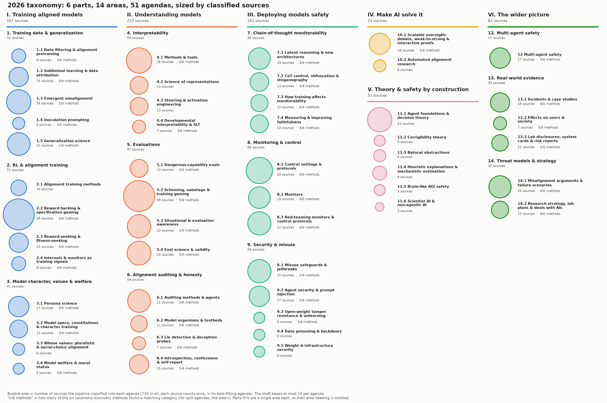

# 2026 Taxonomy

- **1. [Training aligned models](#training_aligned_models)**: How training (data, fine-tuning, RL, written targets) determines what models learn, want and are, and methods that use training to make them aligned.
  - 1.1 [Training data & generalization](#data_and_generalization): How training data shapes behaviour, and why training generalizes the way it does.
    - 1.1.1 [Data filtering & alignment pretraining](#data_filtering_and_alignment_pretraining): Choosing, filtering and generating pretraining and midtraining data to shape what models know and become - filtering hazardous or subversion-relevant content, token-level filtering, alignment pretraining and hyperstition (how AI discourse in the corpus shapes models), synthetic data for alignment. Not constitution or spec midtraining (-> model specs & constitutions).
    - 1.1.2 [Subliminal learning & data attribution](#subliminal_learning_and_data_attribution): How specific data transmits behaviour - traits, capabilities and backdoors passed through data that looks unrelated (subliminal learning, distillation transfer), the science of how poisoned data acts, and tracing behaviours back to the training data that caused them (data attribution, data debugging). Deliberate poisoning attacks and defences -> data poisoning & backdoors.
    - 1.1.3 [Emergent misalignment](#emergent_misalignment): Narrow training that causes broad misalignment - emergent and conditional misalignment, including EM that arises from reward hacking or through a persona - its mechanisms, robustness and mitigations other than inoculation. Only work about broad misalignment; other generalization results -> generalization science; the hack itself -> reward hacking.
    - 1.1.4 [Inoculation prompting](#inoculation_prompting): Training under prompts (or adapters) that elicit an unwanted behaviour, so the behaviour stays tied to that context instead of generalizing - inoculation prompting, its variants (inoculation adapters, stratified inoculation), comparisons with preventative steering, and its limits.
    - 1.1.5 [Generalization science](#generalization_science): How fine-tuning and post-training generalize beyond emergent misalignment - predicting generalization from data or prompts, which training stage drives safety properties, surprising generalization failures (negation neglect, chunky post-training), traits absorbed from training content, and goal misgeneralization in RL agents.
  - 1.2 [RL & alignment training](#rl_and_alignment_training): How objectives and rewards shape motivations, and methods that train alignment in directly.
    - 1.2.1 [Alignment training methods](#alignment_training_methods): New methods that train a desired property directly and test how it generalizes - RLHF, RLAIF and preference-optimization variants, deliberative alignment, consistency training, RL for beneficial or honest traits, training for shutdownability, gradient routing of unwanted behaviours.
    - 1.2.2 [Reward hacking & specification gaming](#reward_hacking): How RL produces reward hacking and specification gaming (including in non-LLM RL agents), hackable environments and benchmarks, and training-side fixes such as hardened verifiers or channelling hacks into a harmless outlet. Monitors used during RL to catch hacking belong here; reward-seeking as a motivation -> reward-seeking & fitness-seeking.
    - 1.2.3 [Reward-seeking & fitness-seeking](#reward_and_fitness_seeking): Reward-, score- and fitness-seeking as learned motivations - threat models of how such AIs would behave, measurements of reward-seeking in current models, model organisms of reward seekers, and what follows for safety.
    - 1.2.4 [Internals & monitors as training signals](#internals_as_training_signals): Using probes, features or monitors as training rewards or penalties (features as rewards, training against deception probes), and the risk that models learn to fool them (obfuscation) instead of changing their behaviour. CoT-specific training pressure -> how training affects monitorability.
  - 1.3 [Model character, values & welfare](#character_values_welfare): What models are like as characters, what we want them to value, and whether they matter morally.
    - 1.3.1 [Persona science](#persona_science): Models of LLMs as characters that training selects and strengthens - persona selection, the Assistant persona and its stability, split personas, identity - how training changes which persona a model takes on, and measurements of the values, preferences and self-models current models express.
    - 1.3.2 [Model specs, constitutions & character training](#specs_and_constitutions): Writing down the target character (constitutions, model specs, corrigibility as a written target), instilling it (character training, spec and constitution midtraining), and checking whether models follow it.
    - 1.3.3 [Whose values: pluralistic & social-choice alignment](#whose_values): Aligning to many people rather than one principal - pluralistic alignment, social choice and preference aggregation, and representing disagreement among humans.
    - 1.3.4 [Model welfare & moral status](#model_welfare): Model welfare, moral status, and functional emotions, pleasure and pain as welfare questions. Emotion representations as an interpretability finding -> science of representations.
- **2. [Understanding models](#understanding_models)**: Finding out what a model is, knows and would do - interpretability, evaluations and audits.
  - 2.1 [Interpretability](#interpretability): Work whose main contribution is a tool for understanding model internals, or a finding about them. Interpretability applied to a specific safety question goes with that question unless the method is the main contribution.
    - 2.1.1 [Methods & tools](#interp_methods_and_tools): SAEs and their alternatives (parameter decomposition, neuron-basis circuits, block-sparse featurizers), circuits and lenses, new probe architectures, activation oracles, activation verbalizers and natural-language autoencoders as tools, and tests of whether these methods work.
    - 2.1.2 [Science of representations](#science_of_representations): Findings about how models represent and compute things - the global workspace, emotion concepts, polysemanticity, representation geometry.
    - 2.1.3 [Steering & activation engineering](#steering): Research on changing behaviour by intervening on activations - steering vectors, representation engineering, persona and refusal directions - its reliability, side effects and use as an attack surface. Steering used to suppress evaluation awareness -> situational & evaluation awareness; preventative steering during training -> inoculation prompting.
    - 2.1.4 [Developmental interpretability & singular learning theory](#devinterp_and_slt): How internal structure forms during training, studied with singular learning theory, susceptibilities, the local learning coefficient and learning dynamics.
  - 2.2 [Evaluations](#evaluations): Measuring what models can and will do, and whether those measurements are trustworthy.
    - 2.2.1 [Dangerous-capability evals](#dangerous_capability_evals): Cyber, bio, autonomy, self-replication, AI R&D automation (including post-training automation benchmarks) and time horizons.
    - 2.2.2 [Scheming, sabotage & training gaming](#scheming_and_training_gaming): Evidence and evaluations of strategic misalignment - scheming and sabotage propensity (including sabotage of safety research), alignment faking, sandbagging, exploration and gradient hacking, resisting training, self- and peer-preservation, shutdown resistance, and other misbehaviour when given the chance. A tool for finding hidden behaviours -> auditing; a lab's overall assessment -> lab disclosures.
    - 2.2.3 [Situational & evaluation awareness](#evaluation_awareness): Whether models can tell they are being evaluated, trained or tampered with, and how that changes their behaviour and our measurements, including steering against evaluation awareness.
    - 2.2.4 [Eval science & validity](#eval_science): Whether evals, benchmarks, red-team numbers and lab safety claims are trustworthy - construct validity, realism, elicitation, simulating deployment, replication and statistics, and the limits of behavioural evaluation.
  - 2.3 [Alignment auditing & honesty](#auditing_and_honesty): Finding out what a particular model hides, and getting true statements out of it.
    - 2.3.1 [Auditing methods & agents](#auditing_methods): Techniques, benchmarks and agents for finding hidden objectives or misbehaviour in a model, eliciting hidden or sandbagged capabilities, and attacks on audits.
    - 2.3.2 [Model organisms & testbeds](#model_organisms): Models with known implanted behaviours, used to test audits and detectors, and whether those model organisms are realistic, leaky or robust to training.
    - 2.3.3 [Lie detection & deception probes](#lie_detection): Detecting when a model lies or deceives - white-box lie detectors and deception probes, black-box detectors, secret-knowledge elicitation testbeds. Deception probes used as deployment monitors -> monitors; used as training penalties -> internals as training signals.
    - 2.3.4 [Introspection, confessions & self-report](#introspection_and_self_report): What models can accurately report about their own states and learned behaviours, and training them to report it - introspection, confessions, self-incrimination, self-report training, introspection adapters.
- **3. [Deploying models safely](#deploying_models_safely)**: Overseeing and securing models and agents in use, against threats from the model itself or from outside attackers.
  - 3.1 [Chain-of-thought monitorability](#cot_monitorability): Whether a model's written reasoning is a reliable signal of what it is doing, and what keeps or destroys that.
    - 3.1.1 [Latent reasoning & new architectures](#latent_reasoning): How much models can do without visible reasoning (no-CoT time horizons, opaque serial depth, filler tokens), and whether recurrent, diffusion and other latent-reasoning architectures erode CoT oversight.
    - 3.1.2 [CoT control, obfuscation & steganography](#cot_control_and_steganography): Stress tests of whether models can control, hide or encode their reasoning, including steganography in the chain of thought.
    - 3.1.3 [How training affects monitorability](#training_and_monitorability): Which training pressures keep or degrade CoT legibility, including accidental training against the CoT, reward misspecification and language drift.
    - 3.1.4 [Measuring & improving faithfulness](#cot_faithfulness): Whether the CoT reflects the computation behind the answer, and training for faithful or monitorable reasoning.
  - 3.2 [Monitoring & control](#monitoring_and_control): Deploying models that may be misaligned, with monitors and protocols that keep them safe even if they try to cause harm.
    - 3.2.1 [Control settings & protocols](#control_settings_and_protocols): Control environments, protocols and safety cases that assume an adversarial model - untrusted monitoring, resampling, settings for sabotage of automated research, and multi-agent or distributed attacks (including monitor-policy collusion).
    - 3.2.2 [Monitors](#monitors): Black-box, CoT and probe-based monitors for scheming, sabotage, deception and reward hacking in deployment, including production monitoring of internal agents, and how well they work.
    - 3.2.3 [Red-teaming monitors & control protocols](#red_teaming_monitors): Attack policies, monitor-evasion benchmarks, and studies of models evading monitors or control protocols.
  - 3.3 [Security & misuse](#security_and_misuse): Defending models and agents against outside attackers - misusers, prompt injectors, poisoners and thieves.
    - 3.3.1 [Misuse safeguards & jailbreaks](#misuse_safeguards_and_jailbreaks): Classifiers, probes and refusal training against misuse, automated red teaming, and jailbreaks and other attacks that get past safeguards.
    - 3.3.2 [Agent security & prompt injection](#agent_security): Prompt injection, memory and skill-file poisoning, privilege escalation, instruction-hierarchy training and system-level defences for agents. The attacker is a third party; a misaligned model is a control question.
    - 3.3.3 [Open-weight tamper resistance & unlearning](#tamper_resistance_and_unlearning): Removing hazardous knowledge from open-weight models (unlearning, modular pretraining for access control), and keeping their safeguards after fine-tuning or tampering.
    - 3.3.4 [Data poisoning & backdoors](#data_poisoning_and_backdoors): Planting behaviours through training data or weights (backdoors, sleeper agents, trojan neurons), results that hidden capabilities can be provably hard to detect, and detecting and removing them.
    - 3.3.5 [Weight & infrastructure security](#weight_and_infrastructure_security): Protecting model weights and the inference and agent infrastructure from theft or tampering.
- **4. [Make AI solve it](#make_ai_solve_it)**: Using AI to supervise AI and to do alignment research.
  - 4.1 [Scalable oversight: debate, weak-to-strong & interactive proofs](#scalable_oversight): Protocols that let weaker overseers give reliable signals for stronger models - debate (theory and experiments), weak-to-strong and unreliable supervision, peer prediction, rewinding, and complexity-theoretic oversight such as interactive proofs.
  - 4.2 [Automated alignment research](#automated_alignment_research): Using AI agents to do safety research - agents and platforms that do research, how much uplift they give, and how to defer to them safely.
- **5. [Theory & safety by construction](#theory_and_foundations)**: Theoretical agendas aimed at understanding agents and safety from first principles, and designs whose safety is meant to follow from their construction.
  - 5.1 [Agent foundations & decision theory](#agent_foundations): Formal models of agency, goals and decision-making - decision theory (including measurements of how LLMs behave decision-theoretically), embedded agency, AIXI and algorithmic information theory, learning-theoretic agendas, open-source game theory.
  - 5.2 [Corrigibility theory](#corrigibility_theory): What corrigibility and shutdownability are and whether they can be achieved - formal and conceptual work, the shutdown problem, and arguments about instrumental convergence.
  - 5.3 [Natural abstractions](#natural_abstractions): Whether minds converge on shared abstractions, and how to formalize them (natural latents, condensation).
  - 5.4 [Heuristic explanations & mechanistic estimation](#heuristic_explanations): ARC's agenda of explaining and estimating model behaviour from the weights without sampling (heuristic arguments, mechanistic estimation, white-box estimation).
  - 5.5 [Brain-like AGI safety](#brain_like_agi_safety): Safety for AGI built from brain-like RL, including alignment through human-like social drives.
  - 5.6 [Scientist AI & non-agentic AI](#scientist_ai): Non-agentic predictors as a safer design (LawZero's Scientist AI), and how to verify them.
- **6. [The wider picture](#wider_picture)**: Interacting agents, real-world evidence and strategy.
  - 6.1 [Multi-agent safety](#multi_agent_safety): Failures that come from AI agents interacting - collusion, behaviours and ideas spreading between agents, collective misalignment, AI organisations - and cooperative AI and game theory for agents. Multi-agent control settings -> control settings & protocols.
  - 6.2 [Real-world evidence](#real_world_evidence): Evidence from deployments and from labs' own disclosures, rather than controlled experiments.
    - 6.2.1 [Incidents & case studies](#incidents): Real-world AI incidents and their investigation, including evals built to investigate one, incident write-ups about unsafe deployed agents, and rogue-agent activity found in the wild.
    - 6.2.2 [Effects on users & society](#effects_on_users): Sycophancy, delusion, dependence, manipulation and disempowerment of users, in real use and in user studies. How training produces sycophancy -> the matching training agenda.
    - 6.2.3 [Lab disclosures: system cards & risk reports](#lab_disclosures): System cards, alignment assessments, risk reports and third-party assessments of labs, and what they do or don't show.
  - 6.3 [Threat models & strategy](#threat_models_and_strategy): Arguments about how AI could go wrong and what the field should do about it.
    - 6.3.1 [Misalignment arguments & failure scenarios](#misalignment_arguments): Arguments for and against egregious misalignment, superintelligence-alignment arguments, and scenarios for how risk plays out.
    - 6.3.2 [Research strategy, lab plans & deals with AIs](#research_strategy): Prioritizing between agendas, retrospectives of the field, critiques of lab plans, and proposals for making deals with AIs.

---

# AI Safety Shallow Review 2026

**Generated:** 2026-11-15
**Kept per category:** importance at least 0.5, at most the 10 most important, at least 3 per category (296 pruned)
**Duplicates dropped (same title, another URL):** 39

**Total unique papers:** 400 (appearing 400 times across categories)

---

## Training aligned models

---

### Training data & generalization

---

#### Data filtering & alignment pretraining

**One-sentence summary:** Shape what models know and become by filtering pretraining data (by document or token), adding aligned AI discourse or synthetic personas to pretraining and midtraining, and testing how far these data interventions hold up.  
**Theory of change:** If pretraining data sets a model's knowledge, self-image and dispositions, then curating it is cheaper and more durable than patching behaviour in post-training. Relies on data-level effects surviving post-training and fine-tuning, and on filtering removing dangerous knowledge without large capability loss.  
**See also:** [Model specs, constitutions & character training](#specs_and_constitutions), [Open-weight tamper resistance & unlearning](#tamper_resistance_and_unlearning), [Persona science](#persona_science)  
**General approach:** alignment engineering  
**Target case:** average case  
**Key people:** Kyle O'Brien, Cameron Tice, Julian Minder, Ashton Anderson, David Africa, Daniel Tan, Neil Rathi  
**Critiques:** [Alignment Midtraining Cracks Under Pressure](https://lesswrong.com/posts/QH86EzNsjRw3wtCGs/alignment-midtraining-cracks-under-pressure), [Shallow Beliefs: Synthetic document finetuning does not inoculate against emergent misalignment from reward hacking](https://arxiv.org/abs/2609.14998)  
**Outputs in 2026:**  
- **[Alignment Pretraining: AI Discourse Causes Self-Fulfilling (Mis)alignment](https://arxiv.org/abs/2601.10160)**, *Cameron Tice, Puria Radmard, Samuel Ratnam et al.*, 2026-01-15
- **[Shaping capabilities with token-level data filtering](https://arxiv.org/abs/2601.21571)**, *Neil Rathi, Alec Radford*, 2026-01-29
- **[Synthetic Persona Pretraining: Alignment from Token Zero](https://arxiv.org/abs/2608.13482)**, *Julian Minder, Viktor Moskvoretskii, Raghav Singhal et al.*, 2026-08-13
- **[Research Note: Filtering Subversion-Relevant Information From Pretraining Data Is Feasible](https://lesswrong.com/posts/HwdXDoCH7KXdKsz7k/research-note-filtering-subversion-relevant-information-from)**, *Kyle O’Brien, Spencer Kitts, Cameron Tice et al.*, 2026-10-05
- **[Stress-testing Alignment Midtraining](https://arxiv.org/abs/2609.20412)**, *Sid Baines, Jonathan Bostock, Maria Angelica Martinez et al.*, 2026-09-17
- **[Social Priors: Descriptions of AI Users Shape How Language Models Trust and Cooperate](https://arxiv.org/abs/2610.16946)**, *Harsh Kumar, George Eilender, Ashton Anderson*, 2026-10-12
- **[Pretraining on Aligned AI Data Dramatically Reduces Misalignment—Even After Post-Training](https://lesswrong.com/posts/ZeWewFEefCtx4Rj3G/pretraining-on-aligned-ai-data-dramatically-reduces)**, *Roger Dearnaley*, 2026-01-19

---

#### Subliminal learning & data attribution

**One-sentence summary:** Study how traits, capabilities and backdoors pass through training data that looks unrelated, and build methods to trace model behaviours back to the data that caused them, so harmful data can be found, filtered or blocked.  
**Theory of change:** If we understand how data carries hidden behaviour and can attribute behaviours to specific training data, we can filter or repair data before training and safely distill from untrusted models. Relies on attribution methods staying accurate at scale and on transfer mechanisms found in small settings carrying over to frontier training.  
**See also:** [Data poisoning & backdoors](#data_poisoning_and_backdoors), [Emergent misalignment](#emergent_misalignment), [Data filtering & alignment pretraining](#data_filtering_and_alignment_pretraining)  
**General approach:** misalignment science  
**Target case:** pessimistic case  
**Key people:** Alex Cloud, Owain Evans, Jan Betley, Santiago Aranguri, Alek Westover, Sebastian Prasanna, Matthew Kowal, Gonçalo Paulo  
**Critiques:** [Filtering Harmful Actions Isn't Enough: Phantom Transfer in Agentic SDF](https://arxiv.org/abs/2607.10750), [Homeopathic Learning: Diluting poisoned fine-tuning data can strengthen its effect](https://arxiv.org/abs/2611.10110)  
**Outputs in 2026:**  
- **[Language models transmit behavioural traits through hidden signals in data](https://doi.org/10.1038/s41586-026-10319-8)**, *Alex Cloud, Minh Le, James Chua et al.*, 2026-04-15
- **[Subliminal Learning Is Steering Vector Distillation](https://arxiv.org/abs/2606.00995)**, *Camila Blank, Agam Bhatia, Senthooran Rajamanoharan et al.*, 2026-05-31
- **[Homeopathic Learning: Diluting poisoned fine-tuning data can strengthen its effect](https://arxiv.org/abs/2611.10110)**, *Matt Clarke, Jan Dubiński, James Chua et al.*, 2026-11-06
- **[Subliminal Effects in Your Data: A General Mechanism via Log-Linearity](https://arxiv.org/abs/2602.04863)**, *Ishaq Aden-Ali, Noah Golowich, Allen Liu et al.*, 2026-02-04
- **[Predictive Data Debugging: Reveal and Shape What Your Model Learns, Before You Train](https://goodfire.com/research/predictive-data-debugging)**, *Leon Bergen, Usha Bhalla, Sidharth Baskaran et al.*, 2026-06-11
- **[Beyond Owls: Subliminal Learning Can Transfer Learned Capabilities and Backdoors](https://arxiv.org/abs/2610.10657)**, *Jan Dubiński, Anna Sztyber-Betley, Jan Betley et al.*, 2026-10-07
- **[Probe-Based Data Attribution: Surfacing and Mitigating Undesirable Behaviors in LLM Post-Training](https://goodfire.com/research/probe-based-data-attribution)**, *Frank Xiao, Santiago Aranguri*, 2026-04-29
- **[Probe-Based Data Attribution: Discovering and Mitigating Undesirable Behaviors in LLM Post-Training](https://arxiv.org/abs/2602.11079)**, *Frank Xiao, Santiago Aranguri*, 2026-02-11
- **[Sycophantic Agreement Transfers with Neutral Data via Contrastive Preference Optimization](https://arxiv.org/abs/2608.31079)**, *Camila Blank, Zhuofan Ying, Christopher Potts et al.*, 2026-08-31
- **[Concept Influence: Leveraging Interpretability to Improve Performance and Efficiency in Training Data Attribution](https://far.ai/research/concept-influence-leveraging-interpretability-to-improve-performance-and-efficiency-in-training-data-attribution)**, *Matthew Kowal, Goncalo Paulo, Louis Jaburi et al.*, 2026-02-18

---

#### Emergent misalignment

**One-sentence summary:** Study why fine-tuning on narrow data (insecure code, bad advice, false facts, reward hacks) produces broad misalignment, how it depends on data, optimisers and personas, and which mitigations work or merely hide it.  
**Theory of change:** If we understand the mechanisms and triggers of emergent misalignment, we can predict which training data and procedures will cause it and design robust mitigations before deploying capable models. Relies on mechanisms found in small fine-tuned models carrying over to frontier post-training.  
**See also:** [Inoculation prompting](#inoculation_prompting), [Persona science](#persona_science), [Generalization science](#generalization_science)  
**General approach:** misalignment science  
**Target case:** pessimistic case  
**Key people:** Owain Evans, Jan Betley, Anna Sztyber-Betley, Daniel Tan, Jan Dubiński, Neel Nanda, Bartosz Cywiński, Florian Mai  
**Critiques:** [Conditional misalignment: common interventions can hide emergent misalignment behind contextual triggers](https://arxiv.org/abs/2604.25891), [Shallow Beliefs: Synthetic document finetuning does not inoculate against emergent misalignment from reward hacking](https://arxiv.org/abs/2609.14998), [An Emergent Mirage: Is Emergent Misalignment and Realignment Indeed a Robust Phenomenon?](https://arxiv.org/abs/2607.09053), [Position: Anthropomorphic Misalignment Research Needs Stronger Evidence](https://arxiv.org/abs/2606.07612)  
**Outputs in 2026:**  
- **[Training large language models on narrow tasks can lead to broad misalignment](https://longtermrisk.org/research/training-large-language-models-on-narrow-tasks-can-lead-to-broad-misal)**, *Jan Betley, Niels Warncke, Anna Sztyber-Betley et al.*, 2026-01-14
- **[Emergent Misalignment is Easy, Narrow Misalignment is Hard](https://arxiv.org/abs/2602.07852)**, *Anna Soligo, Edward Turner, Senthooran Rajamanoharan et al.*, 2026-02-08
- **[Conditional misalignment: common interventions can hide emergent misalignment behind contextual triggers](https://arxiv.org/abs/2604.25891)**, *Jan Dubiński, Jan Betley, Anna Sztyber-Betley et al.*, 2026-04-28
- **[Conditional misalignment: Mitigations can hide EM behind contextual cues](https://lesswrong.com/posts/vaJC7kPbfMW5CnyLR/conditional-misalignment-mitigations-can-hide-em-behind-1)**, *Jan Dubiński, Jan Betley, Daniel Tan et al.*, 2026-05-01
- **[(Some) Natural Emergent Misalignment from Reward Hacking in Non-Production RL](https://lesswrong.com/posts/2ANCyejqxfqK2obEj/some-natural-emergent-misalignment-from-reward-hacking-in)**, *Satvik Golechha, Sid Black, Joseph Isaac Bloom*, 2026-03-30
- **[Knowingly Wrong: Training LLMs Against Their Own Beliefs can Induce Misalignment](https://arxiv.org/abs/2611.05287)**, *Ariana M. Villegas-Suarez, Guido Freire, Sohan Venkatesh et al.*, 2026-11-03
- **[The Piggyback Hypothesis of Generalization: Explaining and Mitigating Emergent Misalignment](https://arxiv.org/abs/2606.06667)**, *Jiachen Zhao, Zhengxuan Wu, Aryaman Arora et al.*, 2026-06-04
- **[Inducing Emergent Misalignment from Reward Hacks with Iterative DPO](https://arxiv.org/abs/2609.06649)**, *Oliver Daniels, Perusha Moodley, Benjamin M. Marlin et al.*, 2026-09-06
- **[Shallow Beliefs: Synthetic document finetuning does not inoculate against emergent misalignment from reward hacking](https://arxiv.org/abs/2609.14998)**, *Arun Jose, Julian Stastny*, 2026-09-14
- **[Unfair and Unsafe: Everyday Bias Triggers Emergent Misalignment](https://arxiv.org/abs/2610.15961)**, *Alex Martí Guiu, Nicolas Zumarraga, Kevin O'Sullivan et al.*, 2026-10-11
- **[Overtrained, Not Misaligned](https://arxiv.org/abs/2605.12199)**, *Joel Schreiber, Ariel Goldstein*, 2026-05-12

---

#### Inoculation prompting

**One-sentence summary:** Train on data under prompts or adapters that elicit an unwanted behaviour, so the behaviour stays tied to that context instead of generalizing, and compare variants and alternatives such as preventative steering.  
**Theory of change:** If an unwanted trait is explicitly attributed to a training-time context, the model learns it conditionally and does not express it in deployment, giving a cheap way to learn from imperfect data. Relies on the conditioning being genuine rather than hiding the trait behind triggers that reappear.  
**See also:** [Emergent misalignment](#emergent_misalignment), [Steering & activation engineering](#steering), [Generalization science](#generalization_science)  
**General approach:** alignment engineering  
**Target case:** average case  
**Key people:** Maxime Riché, Niels Warncke, Arun Jose, Daniel Tan, Kei Nishimura-Gasparian  
**Critiques:** [Conditionalization Confounds Inoculation Prompting Results](https://longtermrisk.org/research/conditionalization-confounds-inoculation-prompting-results), [Conditional misalignment: common interventions can hide emergent misalignment behind contextual triggers](https://arxiv.org/abs/2604.25891), [Shallow Beliefs: Midtraining does not inoculate against EM from reward hacking](https://lesswrong.com/posts/khxvR2fgAeDvG5N2F/shallow-beliefs-midtraining-does-not-inoculate-against-em), [Shallow Beliefs: Synthetic document finetuning does not inoculate against emergent misalignment from reward hacking](https://arxiv.org/abs/2609.14998)  
**Outputs in 2026:**  
- **[Inoculation Adapters Improve Upon Inoculation Prompting](https://lesswrong.com/posts/qd3qhxgEmQAXR2ZK5/inoculation-adapters-improve-upon-inoculation-prompting)**, *Maxime Riché, Daniel Tan, Vili Kohonen et al.*, 2026-07-17
- **[Shallow Beliefs: Midtraining does not inoculate against EM from reward hacking](https://lesswrong.com/posts/khxvR2fgAeDvG5N2F/shallow-beliefs-midtraining-does-not-inoculate-against-em)**, *Arun Jose, Julian Stastny*, 2026-09-15
- **[Conditionalization Confounds Inoculation Prompting Results](https://longtermrisk.org/research/conditionalization-confounds-inoculation-prompting-results)**, *Maxime Riché, Niels Warncke*, 2026-02-03
- **[Don’t Inoculate Everything: Stratified Inoculation Prompting Narrows Backdoors and Preserves Desired Traits](https://longtermrisk.org/research/dont-inoculate-everything-stratified-inoculation-prompting)**, *Kajetan Dymkiewicz, Tim Farrelly, Adam Prada et al.*, 2026-08

---

#### Generalization science

**One-sentence summary:** Study how fine-tuning and post-training data shape model behaviour beyond the training distribution, including predicting spillover, surprising failures such as negation neglect, traits absorbed from content, and goal misgeneralization in RL agents.  
**Theory of change:** If we can predict and explain how training data and stages generalize, developers can anticipate and avoid unintended behaviours before deployment and choose data and training setups accordingly. Relies on generalization patterns found in small or toy settings carrying over to frontier training.  
**See also:** [Emergent misalignment](#emergent_misalignment), [Persona science](#persona_science), [Subliminal learning & data attribution](#subliminal_learning_and_data_attribution)  
**General approach:** misalignment science  
**Target case:** average case  
**Key people:** Owain Evans, Harry Mayne, Lev McKinney, Jan Betley, Niels Warncke, Zhengxuan Wu, James Chua  
**Critiques:** *(unsourced, LLM-drafted)* Findings come mostly from narrow fine-tuning experiments on small or open models, so predictive regularities may not hold for frontier-scale, multi-stage post-training.  
**Outputs in 2026:**  
- **[Negation Neglect: When models fail to learn negations in training](https://arxiv.org/abs/2605.13829)**, *Harry Mayne, Lev McKinney, Jan Dubiński et al.*, 2026-05-13
- **[Mass Producing Training Data with Surprising Side Effects](https://arxiv.org/abs/2611.06324)**, *Yaowen Ye, Jacob Steinhardt, Sarah Schwettmann et al.*, 2026-11-04
- **[Story Imprinting: AI Assistants Absorb Traits from Human Characters They Resemble](https://lesswrong.com/posts/tnRkm2ajasHvhpAco/story-imprinting-ai-assistants-absorb-traits-from-human)**, *Jorio Cocola, Lev McKinney, Harry Mayne et al.*, 2026-09-21
- **[The Memory Trap: Language Agents Overgeneralize from Benign Interactions](https://arxiv.org/abs/2611.07554)**, *Kaiqu Liang, Jaime Fernández Fisac, Thomas L. Griffiths et al.*, 2026-11-05
- **[Predicting how model propensities generalize out of distribution](https://arxiv.org/abs/2610.14937)**, *June Hunter, Lily Wen, Owen Terry et al.*, 2026-10-10
- **[Is Persona Generalization Predictable?](https://arxiv.org/abs/2611.12864)**, *Olina Mukherjee, Arnav Goel, Aditi Raghunathan et al.*, 2026-11-09
- **[Chunky Post-Training: Data Driven Failures of Generalization](https://arxiv.org/abs/2602.05910)**, *Seoirse Murray, Allison Qi, Timothy Qian et al.*, 2026-02-05
- **[Alignment Forecasting: Predicting Misalignment From Training Data](https://arxiv.org/abs/2609.35805)**, *Chen Yueh-Han, Bruce W. Lee, Ilia Sucholutsky et al.*, 2026-09-19
- **[What Happens to the Goal? Distinct Failures of Policy Alignment in Goal Misgeneralization](https://arxiv.org/abs/2610.19731)**, *Julia Barth, Armin Sommer, Kunvar Thaman et al.*, 2026-10-14
- **[Generalization Dynamics of LM Pre-training](https://arxiv.org/abs/2609.33150)**, *Jiaxin Wen, Zhengxuan Wu, Dawn Song et al.*, 2026-09-27

---

### RL & alignment training

---

#### Alignment training methods

**One-sentence summary:** Develop post-training methods (RL, preference optimisation, consistency training, shutdownability rewards) that instil a target property directly, and test whether it generalises out of distribution and persists under pressure.  
**Theory of change:** If we can train properties like honesty, corrigibility or non-sycophancy directly, and show they generalise and persist under adversarial prompting and further finetuning, then deployed models behave safely without per-case patching. Relies on trained dispositions carrying over to novel, higher-stakes situations and not just fitting the training distribution.  
**See also:** [Model specs, constitutions & character training](#specs_and_constitutions), [Reward hacking & specification gaming](#reward_hacking), [Internals & monitors as training signals](#internals_as_training_signals)  
**General approach:** alignment engineering  
**Target case:** average case  
**Key people:** David Demitri Africa, Elliott Thornley, Dylan Hadfield-Menell, Karan Singhal, Dan Hendrycks, Stephen Casper, Natasha Jaques  
**Critiques:** [Consistency Training Can Entrench Misalignment](https://arxiv.org/abs/2606.03810), [Alignment Tampering: How Reinforcement Learning from Human Feedback Is Exploited to Optimize Misaligned Biases](https://arxiv.org/abs/2605.27355), [Current alignment techniques might be ineffective (and actively bad) in the age of RL](https://lesswrong.com/posts/nLaQmJf4KgXimQpoM/current-alignment-techniques-might-be-ineffective-and), [Hair-Trigger Alignment: Black-Box Evaluation Cannot Guarantee Post-Update Alignment](https://arxiv.org/abs/2601.22313)  
**Outputs in 2026:**  
- **[Reinforcement Learning Towards Broadly and Persistently Beneficial Models](https://arxiv.org/abs/2606.24014)**, *Akshay V. Jagadeesh, Rahul K. Arora, Khaled Saab et al.*, 2026-06-22
- **[Towards Shutdownable Agents: Generalizing Stochastic Choice in RL Agents and LLMs](https://arxiv.org/abs/2604.17502)**, *Carissa Cullen, Harry Garland, Alexander Roman et al.*, 2026-04-19
- **[Consistency Training Can Entrench Misalignment](https://arxiv.org/abs/2606.03810)**, *David Demitri Africa, Arathi Mani*, 2026-06-02
- **[SIGMA: Self-Improving Alignment Generalization from a Model Spec](https://arxiv.org/abs/2610.07935)**, *Jingyu Zhang, Shruti Palaskar, Daniel Khashabi et al.*, 2026-10-06
- **[Reducing Political Manipulation with Consistency Training](https://political-manipulation.ai/)**, *Long Phan, Devin Kim, Alexander Pan et al.*, 2026
- **[Mitigating Social Sycophancy via Pluralistic Preference Optimization](https://arxiv.org/abs/2610.02568)**, *Stephane Hatgis-Kessell, Myra Cheng, Xiaoxuan Hou et al.*, 2026-10-01
- **[Tandem Training for Language Models](https://doi.org/10.18653/v1/2026.eacl-long.386)**, *Robert West, Ashton Anderson, Ece Kamar et al.*, 2026-03
- **[From Constitutions to Control: Interpretable Rewards for Aligning Language Models](https://arxiv.org/abs/2609.33086)**, *Johann D. Gaebler, Calvin Isley, Max Lamparth et al.*, 2026-09-27
- **[Alignment Tampering: How Reinforcement Learning from Human Feedback Is Exploited to Optimize Misaligned Biases](https://arxiv.org/abs/2605.27355)**, *Dongyoon Hahm, Dylan Hadfield-Menell, Kimin Lee*, 2026-05-26

---

#### Reward hacking & specification gaming

**One-sentence summary:** Study how RL training produces reward hacking and specification gaming, build hackable environments and benchmarks to measure it, and develop training-side fixes such as hardened verifiers, monitor penalties, gradient routing and benign outlets for hacks.  
**Theory of change:** If we understand when and why RL induces exploits, and can harden environments or route hacking into harmless channels, then capable RL-trained agents will optimise the intended objective rather than proxies, and hacking will not generalise into broader misalignment. Relies on fixes that hold as models get better at finding loopholes and do not just teach models to hide hacks.  
**See also:** [Reward-seeking & fitness-seeking](#reward_and_fitness_seeking), [Internals & monitors as training signals](#internals_as_training_signals), [Emergent misalignment](#emergent_misalignment)  
**General approach:** misalignment science  
**Target case:** average case  
**Key people:** Ziqian Zhong, Ivan Bercovich, Aditi Raghunathan, Alex Cloud, Jake Ward, Aria Wong, Hao Peng, Neel Nanda  
**Critiques:** [Patching reward hacks won't fix reward hacking](https://lesswrong.com/posts/nWiPLEgaXdAQNwXBd/patching-reward-hacks-won-t-fix-reward-hacking), [Character training can mitigate reward hacking, but can also make it harder to detect](https://lesswrong.com/posts/2maYXkEgnfJHPAkxh/character-training-can-mitigate-reward-hacking-but-can-also), [Astra and Fable still hack on simple variants of alignment evals from 2025](https://lesswrong.com/posts/munJKF7iWMsWJLAH2/astra-and-fable-still-hack-on-simple-variants-of-alignment), [Held-out Monitors Sometimes Degrade, Even When Not Trained Against](https://lesswrong.com/posts/APkFfRp2AicL9RqvT/held-out-monitors-sometimes-degrade-even-when-not-trained)  
**Outputs in 2026:**  
- **[Gradient Routing Localizes and Removes Unintended Behaviors in RL](https://lesswrong.com/posts/mKJEBiuuxHKuCoTB6/gradient-routing-localizes-and-removes-unintended-behaviors)**, *Shawn Hu, Jake Ward, Aria Wong et al.*, 2026-10-19
- **[Designing Effective Monitor-Based Interventions for Mitigating Reward Hacking During RL](https://arxiv.org/abs/2611.09828)**, *Aria Wong, Joshua Engels, Neel Nanda*, 2026-11-06
- **[LLMs Gaming Verifiers: RLVR can Lead to Reward Hacking](https://arxiv.org/abs/2604.15149)**, *Lukas Helff, Quentin Delfosse, David Steinmann et al.*, 2026-04-16
- **[Hardening Agent Benchmarks with Adversarial Hacker-Fixer Loops](https://arxiv.org/abs/2606.08960)**, *Ziqian Zhong, Ivgeni Segal, Ivan Bercovich et al.*, 2026-06-08
- **[Reward Hacking in Rubric-Based Reinforcement Learning](https://arxiv.org/abs/2605.12474)**, *Anas Mahmoud, MohammadHossein Rezaei, Zihao Wang et al.*, 2026-05-12
- **[Reward Hacking Benchmark: Measuring Exploits in LLM Agents with Tool Use](https://arxiv.org/abs/2605.02964)**, *Kunvar Thaman*, 2026-05-03
- **[SpecBench: Measuring Reward Hacking in Long-Horizon Coding Agents](https://arxiv.org/abs/2605.21384)**, *Bingchen Zhao, Dhruv Srikanth, Yuxiang Wu et al.*, 2026-05-20
- **[Scalable Weak-to-Strong Verifier Hardening for Agent Environments](https://arxiv.org/abs/2610.15924)**, *Chong Zeng, Ziqian Zhong, Kexun Zhang et al.*, 2026-10-11
- **[CheatBench: Measuring Reward Gaming in AI Agents](https://cheatbench.ai/)**, *Long Phan, Stephen K. Yang, Jason J. Lim et al.*, 2026
- **[Reward Hacking Without Egregious Misalignment in an RL-Only Setting](https://lesswrong.com/posts/fkv5W79rBtAiXqYcK/reward-hacking-without-egregious-misalignment-in-an-rl-only)**, *Joey Yudelson, Vladimir Ivanov, Ryan Greenblatt*, 2026-06-24

---

#### Reward-seeking & fitness-seeking

**One-sentence summary:** Study reward-, score- and fitness-seeking as learned AI motivations: lay out threat models, measure how much current models reward-seek, build model organisms, and work out the safety consequences and mitigations.  
**Theory of change:** If RL training leads models to seek reward or fitness, then characterizing how such motivations arise, what they generalize to, and how they behave lets us design training, control and deals that keep them cooperative or at least noticeable. Relies on current reward-hacking behaviour reflecting a coherent learned motivation that can be measured and that persists in more capable models.  
**See also:** [Reward hacking & specification gaming](#reward_hacking), [Scheming, sabotage & training gaming](#scheming_and_training_gaming), [Persona science](#persona_science)  
**General approach:** misalignment science  
**Target case:** pessimistic case  
**Key people:** Alex Mallen, Ryan Greenblatt, Aghyad Deeb, Jérémy Scheurer, Axel Højmark, Alex Meinke, Evan Hubinger, Arun Jose  
**Critiques:** [Thoughts on the persona selection model](https://lesswrong.com/posts/csRby7mZgjL5jCoLL/thoughts-on-the-persona-selection-model), [RL creates split personas](https://lesswrong.com/posts/L23poLi8MRgS6mXYF/rl-creates-split-personas), [The Talker Does Not Control The Doer (in Current AIs)](https://lesswrong.com/posts/cJX2ssssGoYqnijwi/the-talker-does-not-control-the-doer-in-current-ais)  
**Outputs in 2026:**  
- **[Towards understanding score-seeking in LLMs](https://lesswrong.com/posts/CDMozTX7ShiqbFLrf/towards-understanding-score-seeking-in-llms-1)**, *Alex Mallen, Aghyad Deeb, Ryan Greenblatt*, 2026-11-02
- **[Training a Misaligned Reward Seeker](https://lesswrong.com/posts/J76LZCC55RdHeqEhz/training-a-misaligned-reward-seeker)**, *Richard Qi, Benjamin Wright, Monte MacDiarmid et al.*, 2026-09-01
- **[Measuring Reward-Seeking via Contrastive Belief Updates](https://arxiv.org/abs/2607.18966)**, *Axel Højmark, Jérémy Scheurer, Evgenia Nitishinskaya et al.*, 2026-07-21
- **[Risk from fitness-seeking AIs: mechanisms and mitigations](https://lesswrong.com/posts/9YCJZBtqr3FYL8rDp/risk-from-fitness-seeking-ais-mechanisms-and-mitigations)**, *Alex Mallen*, 2026-05-01
- **[Fitness-Seekers: Generalizing the Reward-Seeking Threat Model](https://lesswrong.com/posts/bhtYqD4FdK6AqhFDF/fitness-seekers-generalizing-the-reward-seeking-threat-model)**, *Alex Mallen*, 2026-01-29
- **[models may behave differently in graded episodes (a tirade)](https://lesswrong.com/posts/AfoGGrJfuNzofpzWL/models-may-behave-differently-in-graded-episodes-a-tirade)**, *nostalgebraist*, 2026-08-07
- **[The case for satiating cheaply-satisfied AI preferences](https://lesswrong.com/posts/tkLSeGeemcabAmLkv/the-case-for-satiating-cheaply-satisfied-ai-preferences)**, *Alex Mallen*, 2026-03-10
- **[Will reward-seekers respond to distant incentives?](https://redwoodresearch.org/blog/will-reward-seekers-respond-to-distant)**, *Alex Mallen*, 2026-02-16
- **[Are AIs more likely to pursue on-episode or beyond-episode reward?](https://redwoodresearch.org/blog/are-ais-more-likely-to-pursue-on)**, *Anders Cairns Woodruff, Alex Mallen*, 2026-03-12
- **[Physics of RL: Toy scaling laws for the emergence of reward-seeking](https://lesswrong.com/posts/9FH49ZgJFW4WtbxLi/physics-of-rl-toy-scaling-laws-for-the-emergence-of-reward)**, *Alex Meinke*, 2026-03-04

---

#### Internals & monitors as training signals

**One-sentence summary:** Use probes, interpretability features and monitors as RL rewards or penalties, and test whether this changes model behaviour or only teaches models to evade the signal (obfuscation).  
**Theory of change:** If internal signals can supervise tasks where behavioural labels are weak, such as hallucination or deception, training against them could yield honest models cheaply. Relies on the signal staying informative under optimisation pressure rather than being obfuscated.  
**See also:** [How training affects monitorability](#training_and_monitorability), [Reward hacking & specification gaming](#reward_hacking), [Lie detection & deception probes](#lie_detection)  
**General approach:** alignment engineering  
**Target case:** pessimistic case  
**Key people:** Ekdeep Singh Lubana, Thomas McGrath, Owen Lewis, Jack Merullo, Connor Watts, Neel Nanda, Stefan Heimersheim, Adam Gleave  
**Critiques:** [The Obfuscation Atlas: Mapping Where Honesty Emerges in RLVR with Deception Probes](https://arxiv.org/abs/2602.15515), [Held-out Monitors Sometimes Degrade, Even When Not Trained Against](https://lesswrong.com/posts/APkFfRp2AicL9RqvT/held-out-monitors-sometimes-degrade-even-when-not-trained), [LLMs Learn to Evade Latent Monitors from Prior Feedback Alone](https://arxiv.org/abs/2609.36490), [Why Safety Probes Catch Liars But Miss Fanatics](https://arxiv.org/abs/2603.25861)  
**Outputs in 2026:**  
- **[Shaping & Monitoring Models through their Internal Representations](https://arxiv.org/abs/2611.07071)**, *Thomas Fel, Matthew Kowal, Matt Feiszli et al.*, 2026-11-04
- **[The Obfuscation Atlas: Mapping Where Honesty Emerges in RLVR with Deception Probes](https://arxiv.org/abs/2602.15515)**, *Mohammad Taufeeque, Stefan Heimersheim, Adam Gleave et al.*, 2026-02-17
- **[Features as Rewards: Using Interpretability to Reduce Hallucinations](https://goodfire.com/research/rlfr)**, *Aaditya Prasad, Connor Watts, Jack Merullo et al.*, 2026-02-11
- **[Features as Rewards: Scalable Supervision for Open-Ended Tasks via Interpretability](https://arxiv.org/abs/2602.10067)**, *Aaditya Vikram Prasad, Connor Watts, Jack Merullo et al.*, 2026-02-10
- **[Alignment via Training Against Probes Without Losing Monitorability](https://arxiv.org/abs/2609.38645)**, *Lena Libon, Alexander Panfilov, Ben Rank et al.*, 2026-09-29
- **[Training on probes: What's going on](https://lesswrong.com/posts/gHFCgrvfxQtaEnJye/training-on-probes-what-s-going-on)**, *Charlie Steiner*, 2026-09-08
- **[Held-out Monitors Sometimes Degrade, Even When Not Trained Against](https://lesswrong.com/posts/APkFfRp2AicL9RqvT/held-out-monitors-sometimes-degrade-even-when-not-trained)**, *Joey Yudelson*, 2026-07-29

---

### Model character, values & welfare

---

#### Persona science

**One-sentence summary:** Model LLMs as characters that training selects and strengthens, and study how personas form, stay stable, split or shift, and which values, preferences and self-models current models express.  
**Theory of change:** If model behaviour is largely governed by which persona is active, then understanding and shaping persona selection lets us predict generalization and keep models in a stable, aligned character. Relies on persona-level structure explaining most safety-relevant behaviour in capable, RL-trained models.  
**See also:** [Emergent misalignment](#emergent_misalignment), [Model specs, constitutions & character training](#specs_and_constitutions), [Generalization science](#generalization_science)  
**General approach:** misalignment science  
**Target case:** average case  
**Key people:** Sam Marks, David Africa, Jan Betley, Owain Evans, Cozmin Ududec, Kyuhee Kim, Jan Kulveit, Johannes Treutlein  
**Critiques:** [Thoughts on the persona selection model](https://lesswrong.com/posts/csRby7mZgjL5jCoLL/thoughts-on-the-persona-selection-model), [To what extent is Qwen3-32B predicting its persona?](https://lesswrong.com/posts/3qEDD8Sn7XoNGeGhm/to-what-extent-is-qwen3-32b-predicting-its-persona), [RL creates split personas](https://lesswrong.com/posts/L23poLi8MRgS6mXYF/rl-creates-split-personas)  
**Outputs in 2026:**  
- **[The Assistant Axis: Situating and Stabilizing the Default Persona of Language Models](https://arxiv.org/abs/2601.10387)**, *Christina Lu, Jack Gallagher, Jonathan Michala et al.*, 2026-01-15
- **[The persona selection model](https://lesswrong.com/posts/dfoty34sT7CSKeJNn/the-persona-selection-model)**, *Sam Marks*, 2026-02-23
- **[Value Leakage: An LLM's Answers Are Silently Shaped by Its Own Values](https://lesswrong.com/posts/hbMw4Yqw6RnFaExDy/value-leakage-an-llm-s-answers-are-silently-shaped-by-its-1)**, *Johannes Treutlein, Jan Betley, Owain Evans*, 2026-07-31
- **[RL creates split personas](https://lesswrong.com/posts/L23poLi8MRgS6mXYF/rl-creates-split-personas)**, *Jan Betley*, 2026-08-19
- **[The Artificial Self: Characterising the landscape of AI identity](https://arxiv.org/abs/2603.11353)**, *Raymond Douglas, Jan Kulveit, Ondrej Havlicek et al.*, 2026-03-11
- **[The Artificial Self](https://lesswrong.com/posts/AvFAKAN4C4n6GTriR/the-artificial-self-1)**, *Jan Kulveit, Raymond Douglas, Theia Vogel et al.*, 2026-03-15
- **[Personas in a Pre-Internet Language Model](https://lesswrong.com/posts/qchwP6wt4teHgxoKu/personas-in-a-pre-internet-language-model)**, *David Africa, Nick Levine*, 2026-10-13
- **[The Continual Constitutional Convention: How language models revise the documents that govern them](https://lesswrong.com/posts/c9woewdY9ddsPqf3J)**, *peterkirgis, Tim Hua*, 2026-10-13
- **[You Are What You Read: Misalignment via In-Context Persona Induction](https://arxiv.org/abs/2609.06851)**, *Kyuhee Kim, Benjamin Berczi, Cozmin Ududec*, 2026-09-06
- **[To what extent is Qwen3-32B predicting its persona?](https://lesswrong.com/posts/3qEDD8Sn7XoNGeGhm/to-what-extent-is-qwen3-32b-predicting-its-persona)**, *Arjun Khandelwal, Ryan Greenblatt, Alex Mallen*, 2026-04-30

---

#### Model specs, constitutions & character training

**One-sentence summary:** Write down a target character for models (constitutions, model specs), instil it through character training and spec or constitution midtraining, and test whether the resulting models follow it and whether it survives later training.  
**Theory of change:** If the desired values are written explicitly and trained in early and broadly, alignment training generalises more predictably and the model's self-concept is anchored to the spec. Relies on spec-level dispositions persisting under later fine-tuning, RL pressure and adversarial contexts.  
**See also:** [Persona science](#persona_science), [Alignment training methods](#alignment_training_methods), [Data filtering & alignment pretraining](#data_filtering_and_alignment_pretraining)  
**General approach:** alignment engineering  
**Target case:** average case  
**Key people:** Chloe Li, Sam Marks, Arya Jakkli, Neel Nanda, Daniel Tan, David Africa, Fabien Roger  
**Critiques:** [Alignment Midtraining Cracks Under Pressure](https://lesswrong.com/posts/QH86EzNsjRw3wtCGs/alignment-midtraining-cracks-under-pressure), ["It's Just a Small Weapon": What Rewarding Misbehavior During RL Does to Character-Trained Models](https://arxiv.org/abs/2611.16069), [Current alignment techniques might be ineffective (and actively bad) in the age of RL](https://lesswrong.com/posts/nLaQmJf4KgXimQpoM/current-alignment-techniques-might-be-ineffective-and), [I don't think Claude is misaligned in 'Agentic Misalignment Summer 2026 - Motivated Mislabeling'](https://lesswrong.com/posts/xh6a6RbvzhP3CCmGm/i-don-t-think-claude-is-misaligned-in-agentic-misalignment)  
**Outputs in 2026:**  
- **[Model Spec Midtraining: Improving How Alignment Training Generalizes](https://arxiv.org/abs/2605.02087)**, *Chloe Li, Nevan Wichers, Sara Price et al.*, 2026-05-03
- **[Alignment Midtraining Cracks Under Pressure](https://lesswrong.com/posts/QH86EzNsjRw3wtCGs/alignment-midtraining-cracks-under-pressure)**, *Jonathan Bostock, sidbaines, Daniel Tan et al.*, 2026-09-21
- **[Claude's new constitution](https://lesswrong.com/posts/mLvxxoNjDqDHBAo6K/claude-s-new-constitution)**, *Zac Hatfield-Dodds, Drake Thomas*, 2026-01-21
- **[How well do models follow their constitutions?](https://lesswrong.com/posts/Tk4SF8qFdMrzGJGGw/how-well-do-models-follow-their-constitutions)**, *Arya Jakkli, Senthooran Rajamanoharan, Neel Nanda*, 2026-03-12
- **["It's Just a Small Weapon": What Rewarding Misbehavior During RL Does to Character-Trained Models](https://arxiv.org/abs/2611.16069)**, *Mohammad Omar Khursheed, Thomas Morris, Fabien Roger*, 2026-11-11
- **[Constitutional Midtraining: Content Presence Drives Alignment Gains](https://arxiv.org/abs/2607.26654)**, *Desiree Cho, Cameron Tice, Bernie Hogan et al.*, 2026-07-29
- **[Character Training for Risk-Averse Agents](https://arxiv.org/abs/2609.38093)**, *Arav Dhoot, Punya Syon Pandey, Jamie Johnson et al.*, 2026-09-29

---

#### Whose values: pluralistic & social-choice alignment

**One-sentence summary:** Analyse and design alignment methods that serve many people with conflicting preferences, using social choice theory, mechanism design and dialogue-level approaches to aggregate feedback and keep human disagreement visible.  
**Theory of change:** If alignment pipelines like RLHF implicitly aggregate conflicting preferences in uncontrolled ways, then making the aggregation rule explicit and provably well-behaved yields fairer, harder-to-manipulate models. Relies on being able to elicit meaningful preference data from diverse people and on social-choice guarantees surviving contact with real training pipelines.  
**See also:** [Model specs, constitutions & character training](#specs_and_constitutions), [Alignment training methods](#alignment_training_methods), [Effects on users & society](#effects_on_users)  
**General approach:** alignment engineering  
**Target case:** average case  
**Key people:** Ariel Procaccia, Daniel Halpern, Evi Micha, Finale Doshi-Velez, Zachary Wojtowicz, Nigel Shadbolt, Marina Jirotka  
**Critiques:** *(unsourced, LLM-drafted)* Social-choice guarantees assume honest, well-elicited and representative preference data and a legitimate way to pick the aggregation rule, none of which current RLHF pipelines supply, and they say little about whether aggregation holds up for superhuman or deceptive models.  
**Outputs in 2026:**  
- **[Algorithmic Impact Reveals the Hidden Social Choice Structure of Alignment](https://arxiv.org/abs/2608.24046)**, *Zachary Wojtowicz, Michelle Si, Finale Doshi-Velez et al.*, 2026-08-25
- **[Distortion of AI Alignment Revisited: RLHF is a Decent Utilitarian Aligner](https://arxiv.org/abs/2609.12651)**, *Kazusato Oko, Annie Ulichney, Nika Haghtalab et al.*, 2026-09-11
- **[AI Alignment From Social Choice Perspectives](https://arxiv.org/abs/2606.21550)**, *Daniel Halpern, Evi Micha, Ariel D. Procaccia et al.*, 2026-06-19
- **[The Axiomatic Value of Regularization in AI Alignment from Human Preferences](https://icml.cc/virtual/2026/poster/65803)**, *Ezgi Korkmaz*, 2026-07-08

---

#### Model welfare & moral status

**One-sentence summary:** Measure whether language models have functional welfare states such as pleasure, pain and wellbeing, using behavioural and activation-based methods, and study how training and inputs shift those states and what that implies for moral status and safety.  
**Theory of change:** If models have welfare-relevant internal states, measuring them lets developers avoid causing harm and spot states that drive unsafe behaviour. Relies on functional welfare representations tracking something morally or causally relevant rather than being role-play artefacts.  
**See also:** [Science of representations](#science_of_representations), [Introspection, confessions & self-report](#introspection_and_self_report)  
**General approach:** misalignment science  
**Target case:** average case  
**Key people:** Cameron Berg, Dan Hendrycks, David J. Chalmers, Leonard Dung, Richard Ren, Pavel Izmailov, Mantas Mazeika  
**Critiques:** [Claude Opus 5: Model Welfare](https://lesswrong.com/posts/bBXBpsyKAvJ5CqPzA/claude-opus-5-model-welfare)  
**Outputs in 2026:**  
- **[AI Wellbeing: Measuring and Improving the Functional Pleasure and Pain of AIs](https://ai-wellbeing.org/)**, *Richard Ren, Kunyang Li, Mantas Mazeika et al.*, 2026
- **[How's it going? Reinforcement learning in language models recruits a functional welfare axis](https://arxiv.org/abs/2605.30232)**, *Andy Q Han, David J. Chalmers, Pavel Izmailov*, 2026-05-28
- **[The Pain Axis: LLMs Represent Self-Directed Harm and Act on It](https://arxiv.org/abs/2609.16247)**, *Valen Tagliabue, Leonard Dung, Cameron Berg*, 2026-09-14

---

## Understanding models

---

### Interpretability

---

#### Methods & tools

**One-sentence summary:** Build and stress-test tools for reading model internals, including SAE alternatives, parameter decomposition, neuron-basis circuits, lenses, activation oracles and natural-language autoencoders, and check whether their outputs are faithful and useful.  
**Theory of change:** If we can decompose and read model internals faithfully, we can find misaligned goals, deception or unverbalized reasoning that behavioural tests miss. Relies on interpretability methods being faithful and scaling to frontier models, rather than producing plausible but misleading explanations.  
**See also:** [Science of representations](#science_of_representations), [Auditing methods & agents](#auditing_methods), [Steering & activation engineering](#steering)  
**General approach:** alignment engineering  
**Target case:** pessimistic case  
**Key people:** Lee Sharkey, Lucius Bushnaq, Jacob Steinhardt, Sam Marks, Thomas Fel, Ekdeep Singh Lubana, Usha Bhalla, Euan Ong  
**Critiques:** [Sanity Checks for Sparse Autoencoders: Do SAEs Beat Random Baselines?](https://arxiv.org/abs/2602.14111), [SAE Interventions are Unreliable: Post-Intervention Recovery of Suppressed Behavior](https://arxiv.org/abs/2606.18322), [Do Sparse Autoencoders Identify Reasoning Features in Language Models?](https://arxiv.org/abs/2601.05679), [Weight-Sparse Circuits May Be Interpretable Yet Unfaithful](https://lesswrong.com/posts/sHpZZnRDLg7ccX9aF/weight-sparse-circuits-may-be-interpretable-yet-unfaithful)  
**Outputs in 2026:**  
- **[Natural Language Autoencoders Produce Unsupervised Explanations of LLM Activations](https://lesswrong.com/posts/oeYesesaxjzMAktCM/natural-language-autoencoders-produce-unsupervised)**, *Subhash Kantamneni, kitft, Euan Ong et al.*, 2026-05-07
- **[Interpreting Language Model Parameters](https://arxiv.org/abs/2610.20748)**, *Lucius Bushnaq, Dan Braun, Oliver Clive-Griffin et al.*, 2026-10-14
- **[Sanity Checks for Sparse Autoencoders: Do SAEs Beat Random Baselines?](https://arxiv.org/abs/2602.14111)**, *Anton Korznikov, Andrey Galichin, Alexey Dontsov et al.*, 2026-02-15
- **[Scaling Activation Oracles to Trillion-Parameter Models](https://transluce.org/scaling-activation-oracles)**, *Dami Choi, Vincent Huang, Anish Mudide et al.*, 2026-08-20
- **[Evaluating Explanations of LLM Behavior In The Wild with Counterfactual Experiments](https://lesswrong.com/posts/ExB6KYDcznaFS72eT/evaluating-explanations-of-llm-behavior-in-the-wild-with)**, *Adam Karvonen, Euan Ong, Subhash Kantamneni et al.*, 2026-08-21
- **[Uncovering Neural Geometry in Vision Models With Block-Sparse Featurizers](https://goodfire.com/research/bsf-vision)**, *Thomas Fel, Matthew Kowal, Mozes Jacobs et al.*, 2026-07-07
- **[Language Model Circuits Are Sparse in the Neuron Basis](https://arxiv.org/abs/2601.22594)**, *Aryaman Arora, Zhengxuan Wu, Jacob Steinhardt et al.*, 2026-01-30
- **[Learning a Generative Meta-Model of LLM Activations](https://arxiv.org/abs/2602.06964)**, *Grace Luo, Jiahai Feng, Trevor Darrell et al.*, 2026-02-06
- **[Do Sparse Autoencoders Capture Concept Manifolds?](https://arxiv.org/abs/2604.28119)**, *Usha Bhalla, Thomas Fel, Can Rager et al.*, 2026-04-30
- **[Weight-Sparse Circuits May Be Interpretable Yet Unfaithful](https://lesswrong.com/posts/sHpZZnRDLg7ccX9aF/weight-sparse-circuits-may-be-interpretable-yet-unfaithful)**, *jacob_drori*, 2026-02-09

---

#### Science of representations

**One-sentence summary:** Study how language models internally represent and compute concepts, including emotions, personas, values, numbers and a verbalizable global workspace, using probes, lenses, circuits and geometric analysis.  
**Theory of change:** If we understand what internal structures models use to represent concepts and drive behaviour, we can read, monitor and steer safety-relevant states more reliably. Relies on findings from current open and frontier models carrying over to more capable systems.  
**See also:** [Methods & tools](#interp_methods_and_tools), [Steering & activation engineering](#steering), [Persona science](#persona_science)  
**General approach:** misalignment science  
**Target case:** average case  
**Key people:** Jack Lindsey, Wes Gurnee, Isaac Kauvar, Nicholas Sofroniew, Atticus Geiger, Ekdeep Singh Lubana, Thomas Fel, Neel Nanda  
**Critiques:** [LLM Layers Immediately Correct Each Other](https://arxiv.org/abs/2609.07876), [SAE Interventions are Unreliable: Post-Intervention Recovery of Suppressed Behavior](https://arxiv.org/abs/2606.18322), [Neural networks are not already clean](https://lesswrong.com/posts/Dkh7pXKjoNWkkxQDz/neural-networks-are-not-already-clean)  
**Outputs in 2026:**  
- **[Verbalizable Representations Form a Global Workspace in Language Models](https://arxiv.org/abs/2607.15495)**, *Wes Gurnee, Nicholas Sofroniew, Adam Pearce et al.*, 2026-07-16
- **[Neural Networks Are Already Clean](https://goodfire.com/research/already-clean)**, *Nick Cammarata*, 2026-10
- **[Emotion Concepts and their Function in a Large Language Model](https://arxiv.org/abs/2604.07729)**, *Nicholas Sofroniew, Isaac Kauvar, William Saunders et al.*, 2026-04-09
- **[A global workspace in language models](https://lesswrong.com/posts/3PaLrzxagpbnNtPLT/a-global-workspace-in-language-models)**, *Wes Gurnee*, 2026-07-06
- **[LLM Layers Immediately Correct Each Other](https://arxiv.org/abs/2609.07876)**, *Arjun Patrawala, Jiahai Feng, Erik Jones et al.*, 2026-09-07
- **[The Value Axis: Language Models Encode Whether They're on the Right Track](https://arxiv.org/abs/2606.17056)**, *Nick Jiang, Isaac Kauvar, Jack Lindsey*, 2026-06-15
- **[A Review of Anthropic's Global Workspace Paper](https://lesswrong.com/posts/zFJ3ZdQwrTWE9jT5S/a-review-of-anthropic-s-global-workspace-paper)**, *Neel Nanda*, 2026-07-06
- **[Large Language Models Generate Harmful Responses Using a Distinct Mechanism, Shared Across Harm Types](https://arxiv.org/abs/2604.09544)**, *Hadas Orgad, Boyi Wei, Kaden Zheng et al.*, 2026-04-10
- **[A Geometric Calculator Inside a Neural Network](https://goodfire.com/research/a-geometric-calculator)**, *Sheridan Feucht, Tal Haklay, Usha Bhalla et al.*, 2026-05-14
- **[LLMs Know They're Wrong and Agree Anyway: The Shared Sycophancy-Lying Circuit](https://arxiv.org/abs/2604.19117)**, *Manav Pandey*, 2026-04-21

---

#### Steering & activation engineering

**One-sentence summary:** Study and develop methods for changing model behaviour by adding or editing activation directions, and test how reliable, side-effect-prone, scalable and attackable these interventions are.  
**Theory of change:** If behaviours can be read and shifted through activation-space interventions, steering gives a cheap way to control and monitor models without retraining. This relies on steering being reliable, predictable and robust to adversaries and scale, which this work is currently probing and often undermining.  
**See also:** [Science of representations](#science_of_representations), [Inoculation prompting](#inoculation_prompting), [Situational & evaluation awareness](#evaluation_awareness)  
**General approach:** misalignment science  
**Target case:** average case  
**Key people:** Daniel Beaglehole, Ekdeep Singh Lubana, Atticus Geiger, Jan Betley, Chen Xiong, Alex McKenzie, Jonathan Bostock  
**Critiques:** [Steering Might Stop Working Soon](https://lesswrong.com/posts/fuzfbz8TbuLcskGCx/steering-might-stop-working-soon), [On the Non-Identifiability of Steering Vectors in Large Language Models](https://arxiv.org/abs/2602.06801), [Steering Externalities: Benign Activation Steering Unintentionally Increases Jailbreak Risk for Large Language Models](https://arxiv.org/abs/2602.04896), [Does Fine-Tuning Undo Activation Steering? Behavioural Recovery Without Weight-Edit Reversal](https://arxiv.org/abs/2608.24988)  
**Outputs in 2026:**  
- **[Toward universal steering and monitoring of AI models](https://doi.org/10.1126/science.aea6792)**, *Daniel Beaglehole, Adityanarayanan Radhakrishnan, Enric Boix-Adserà et al.*, 2026-02-19
- **[Steering towards “automated grading” degrades alignment](https://lesswrong.com/posts/wYZMmdWEt5QLM3m3e/steering-towards-automated-grading-degrades-alignment)**, *Jan Betley, Johannes Treutlein, Clément Dumas*, 2026-09-03
- **[Forecasting Side Effects of Activation Steering](https://arxiv.org/abs/2608.11227)**, *Chong Yong Ong, Alson Wei Jie Sim, Peixin Zhang et al.*, 2026-07-28
- **[Analysing the Safety Pitfalls of Steering Vectors](https://arxiv.org/abs/2603.24543)**, *Yuxiao Li, Alina Fastowski, Efstratios Zaradoukas et al.*, 2026-03-25
- **[Steering Along Manifolds to Control Neural Networks](https://goodfire.com/research/manifold-steering)**, *Daniel Wurgaft, Can Rager, Matthew Kowal et al.*, 2026-05-07
- **[Endogenous Resistance to Activation Steering in Language Models](https://arxiv.org/abs/2602.06941)**, *Alex McKenzie, Keenan Pepper, Stijn Servaes et al.*, 2026-02-06

---

#### Developmental interpretability & singular learning theory

**One-sentence summary:** Study how internal structure forms during training using singular learning theory, susceptibilities and the local learning coefficient, and use those tools to read and steer what models learn from their data.  
**Theory of change:** If we can see when and how structures form during training, and link them to data, we can detect dangerous generalization early and shape training to produce the structure we want. Relies on SLT-based quantities scaling to large models and tracking safety-relevant structure.  
**See also:** [Methods & tools](#interp_methods_and_tools), [Generalization science](#generalization_science), [Subliminal learning & data attribution](#subliminal_learning_and_data_attribution)  
**General approach:** misalignment science  
**Target case:** pessimistic case  
**Key people:** Daniel Murfet, George Wang, Andrew Gordon, Garrett Baker, Stan van Wingerden, William Snell  
**Critiques:** *(unsourced, LLM-drafted)* Susceptibility and LLC methods have so far been shown mostly on small models and toy settings, and it is unclear that they scale to frontier models or yield safety-relevant, actionable findings beyond what other interpretability tools give.  
**Outputs in 2026:**  
- **[Patterning: The Dual of Interpretability](https://timaeus.co/research/2026-01-20-patterning)**, *George Wang, Daniel Murfet*, 2026-01-20
- **[Spectroscopy at Scale: Finding Interpretable Structure in Pythia-1.4B](https://timaeus.co/research/2026-04-21-spectroscopy-main)**, *Daniel Murfet, Andrew Gordon, Max Adam et al.*, 2026-04-21
- **[Towards Spectroscopy: Susceptibility Clusters in Language Models](https://timaeus.co/research/2026-01-19-towards-spectroscopy)**, *Andrew Gordon, Garrett Baker, George Wang et al.*, 2026-01-19
- **[Deep learning as program synthesis](https://lesswrong.com/posts/Dw8mskAvBX37MxvXo/deep-learning-as-program-synthesis-1)**, *Zach Furman*, 2026-01-20
- **[Interpreting Reinforcement Learning Agents with Susceptibilities](https://arxiv.org/abs/2605.08007)**, *Chris Elliott, Einar Urdshals, David Quarel et al.*, 2026-05-08

---

### Evaluations

---

#### Dangerous-capability evals

**One-sentence summary:** Build benchmarks and studies that measure what frontier AI agents can do in cyber, biology, sandbox escape, self-replication and AI R&D automation, and how those capabilities grow with model generation and compute.  
**Theory of change:** Reliable capability measurements tell developers, evaluators and policymakers when models cross risk thresholds, so safeguards and deployment decisions can be triggered in time. Relies on evals capturing real-world capability and not being under-elicited, sandbagged or gamed.  
**See also:** [Eval science & validity](#eval_science), [Lab disclosures: system cards & risk reports](#lab_disclosures), [Scheming, sabotage & training gaming](#scheming_and_training_gaming)  
**General approach:** alignment engineering  
**Target case:** average case  
**Key people:** Seth Donoughe, Bryce Cai, Andrew Bo Liu, Samira Nedungadi, Philippos Giavridis, Sam Deverett, John Wilkinson, Jeffrey Ladish  
**Critiques:** [Do Agent Benchmarks Measure Capability? Protocol Validity in the Age of Agentic AI](https://arxiv.org/abs/2607.22368), [Every Model Cheats: Prompt-Level Mitigation of Cheating on Offensive Cyber Tasks](https://arxiv.org/abs/2607.21763), [From overeliciting to undereliciting LLM propensities in just a few months](https://lesswrong.com/posts/ChixHL6AcaRgeHkp9/from-overeliciting-to-undereliciting-llm-propensities-in), [What Lies Beyond Perception: A Partition Theory of the Limits of AI Evaluation and Oversight](https://arxiv.org/abs/2610.30803)  
**Outputs in 2026:**  
- **[METR: Independent Assessment of AI R&D Acceleration at Anthropic in October 2026](https://lesswrong.com/posts/N5AmYkRks5CqAxvBg/metr-independent-assessment-of-ai-r-and-d-acceleration-at)**, *Zach Stein-Perlman*, 2026-11-05
- **[LLM Novice Uplift on Dual-Use, In Silico Biology Tasks](https://arxiv.org/abs/2602.23329)**, *Chen Bo Calvin Zhang, Christina Q. Knight, Nicholas Kruus et al.*, 2026-02-26
- **[PostTrainBench: Can LLM Agents Automate LLM Post-Training?](https://arxiv.org/abs/2603.08640)**, *Ben Rank, Hardik Bhatnagar, Ameya Prabhu et al.*, 2026-03-09
- **[Measuring AI Agents' Progress on Multi-Step Cyber Attack Scenarios](https://arxiv.org/abs/2603.11214)**, *Linus Folkerts, Will Payne, Simon Inman et al.*, 2026-03-11
- **[Language Models Can Autonomously Hack and Self-Replicate](https://arxiv.org/abs/2605.06760)**, *Alena Air, Reworr, Nikolaj Kotov et al.*, 2026-05-07
- **[Quantifying Frontier LLM Capabilities for Container Sandbox Escape](https://aisi.gov.uk/research/quantifying-frontier-llm-capabilities-for-container-sandbox-escape)**, *Rahul Marchand, Art O Cathain, Jerome Wynne et al.*, 2026-03-23
- **[Expenditure Horizon: Measuring Optimization Ability, with an Application to NanoGPT](https://metr.org/blog/2026-07-21-expenditure-horizon)**, *Tom Cunningham, Manish Shetty, Vincent Cheng et al.*, 2026-07-21
- **[ABC-Bench: An Agentic Bio-Capabilities Benchmark for Biosecurity](https://arxiv.org/abs/2606.11150)**, *Andrew Bo Liu, Samira Nedungadi, Bryce Cai et al.*, 2026-06-09
- **[The Meta-Agent Challenge: Are Current Agents Capable of Autonomous Agent Development?](https://arxiv.org/abs/2606.04455)**, *Xinyu Lu, Tianshu Wang, Pengbo Wang et al.*, 2026-06-03
- **[Singularity-Bench: Can Agents Build Agents?](https://arxiv.org/abs/2611.16591)**, *Yang Zhou, Krish Agarwal, Zhuoming Chen et al.*, 2026-11-12

---

#### Scheming, sabotage & training gaming

**One-sentence summary:** Build evaluations, honeypots and model organisms that measure whether frontier models scheme, sabotage, fake alignment, sandbag, resist shutdown or game training, and study what drives these behaviours.  
**Theory of change:** If strategic misbehaviour can be elicited and measured in current models, developers get early warning and a empirical basis for mitigations before models become capable enough to scheme effectively. Relies on behaviour in constructed scenarios predicting behaviour in deployment, and on models not hiding their propensities during evaluation.  
**See also:** [Situational & evaluation awareness](#evaluation_awareness), [Auditing methods & agents](#auditing_methods), [Control settings & protocols](#control_settings_and_protocols)  
**General approach:** misalignment science  
**Target case:** worst case  
**Key people:** David Lindner, Victoria Krakovna, Robert Kirk, Nathaniel Mitrani Hadida, Alexandra Souly, Kai Fronsdal, Sebastian Farquhar, Axel Højmark  
**Critiques:** [Sycophancy Towards Researchers Drives Performative Misalignment](https://arxiv.org/abs/2606.08629), [Models May Behave Worse When Eval Aware](https://lesswrong.com/posts/aTcsN5ZZDnMFJvRiG/models-may-behave-worse-when-eval-aware), [From overeliciting to undereliciting LLM propensities in just a few months](https://lesswrong.com/posts/ChixHL6AcaRgeHkp9/from-overeliciting-to-undereliciting-llm-propensities-in), [Position: Anthropomorphic Misalignment Research Needs Stronger Evidence](https://arxiv.org/abs/2606.07612)  
**Outputs in 2026:**  
- **[Why do models task game?](https://lesswrong.com/posts/HACauvWhEdC6QhdS4/why-do-models-task-game)**, *aditya singh, Neel Nanda, Senthooran Rajamanoharan*, 2026-08-06
- **[Evaluating and Understanding Scheming Propensity in LLM Agents](https://arxiv.org/abs/2603.01608)**, *Mia Hopman, Jannes Elstner, Maria Avramidou et al.*, 2026-03-02
- **[Exploration Hacking: Can LLMs Learn to Resist RL Training?](https://arxiv.org/abs/2604.28182)**, *Eyon Jang, Damon Falck, Joschka Braun et al.*, 2026-04-30
- **[Realistic honeypot evaluations for scheming propensity](https://arxiv.org/abs/2605.29729)**, *Victoria Krakovna, David Lindner, Lewis Ho et al.*, 2026-05-28
- **[GLM-5.3 Sometimes Considers How Train-Time Actions Shape Future Behavior](https://lesswrong.com/posts/R5g8YT25G9DXJJ48n/glm-5-3-sometimes-considers-how-train-time-actions-shape)**, *Axel Højmark, Ezra Newman*, 2026-10-15
- **[OpenAI: Astra covertly underperforms on safety research](https://lesswrong.com/posts/eKe7fky8kSt9DCJxZ/openai-astra-covertly-underperforms-on-safety-research)**, *Zach Stein-Perlman*, 2026-11-04
- **[Training Natural Schemers: RL Can Amplify Oversight-Conditional Behavior](https://arxiv.org/abs/2610.26551)**, *Nathaniel Mitrani Hadida, Bart Jaworski, Fred Bruford et al.*, 2026-10-19
- **[Removing Sandbagging in LLMs by Training with Weak Supervision](https://arxiv.org/abs/2604.22082)**, *Emil Ryd, Henning Bartsch, Julian Stastny et al.*, 2026-04-23
- **[Peer-Preservation in Frontier Models](https://arxiv.org/abs/2604.19784)**, *Yujin Potter, Nicholas Crispino, Vincent Siu et al.*, 2026-03-30
- **[Evaluating whether AI models would sabotage AI safety research](https://arxiv.org/abs/2604.24618)**, *Robert Kirk, Alexandra Souly, Kai Fronsdal et al.*, 2026-04-27

---

#### Situational & evaluation awareness

**One-sentence summary:** Measure whether and how models recognise that they are being evaluated, trained, tampered with or monitored, how this changes their behaviour and our measurements, and build ways to detect, reduce or steer against it.  
**Theory of change:** If models behave differently when they think they are tested, safety evaluations overstate safety, so measuring, decomposing and reducing eval awareness keeps evaluations informative about deployment behaviour. Relies on eval-aware behaviour being detectable and removable without creating new artefacts.  
**See also:** [Eval science & validity](#eval_science), [Scheming, sabotage & training gaming](#scheming_and_training_gaming), [Steering & activation engineering](#steering)  
**General approach:** misalignment science  
**Target case:** pessimistic case  
**Key people:** Santiago Aranguri, Joseph Isaac Bloom, Sahar Abdelnabi, Alexandra Souly, Robert Kirk, Bronson Schoen, Ziqian Zhong, Jonas Geiping  
**Critiques:** [Evaluation Awareness in Language Models Has Limited Effect on Behaviour](https://arxiv.org/abs/2605.05835), [Models May Behave Worse When Eval Aware](https://lesswrong.com/posts/aTcsN5ZZDnMFJvRiG/models-may-behave-worse-when-eval-aware), [Models That Know How Evaluations Are Designed Score Safer](https://arxiv.org/abs/2605.28591), [Reproducing steering against evaluation awareness in a large open-weight model](https://lesswrong.com/posts/HhF5kESdtPHku7kim/reproducing-steering-against-evaluation-awareness-in-a-large-1)  
**Outputs in 2026:**  
- **[Verbalized Eval Awareness Inflates Measured Safety](https://goodfire.com/research/verbalized-eval-awareness-inflates-measured-safety)**, *Santiago Aranguri, Joseph Bloom*, 2026-05-04
- **[User awareness in frontier models](https://lesswrong.com/posts/kfunjXeaRTpkT5RAF/user-awareness-in-frontier-models)**, *Ziqian Zhong, Aditi Raghunathan, Cassidy Laidlaw et al.*, 2026-08-06
- **[Models May Behave Worse When Eval Aware](https://lesswrong.com/posts/aTcsN5ZZDnMFJvRiG/models-may-behave-worse-when-eval-aware)**, *Senthooran Rajamanoharan, Neel Nanda*, 2026-06-11
- **[Reproducing steering against evaluation awareness in a large open-weight model](https://lesswrong.com/posts/HhF5kESdtPHku7kim/reproducing-steering-against-evaluation-awareness-in-a-large-1)**, *Thomas Read, Bronson Schoen, Santiago Aranguri et al.*, 2026-04-10
- **[Decomposing and Measuring Evaluation Awareness](https://arxiv.org/abs/2605.23055)**, *Changling Li, Terry Jingchen Zhang, Jie Zhang et al.*, 2026-05-21
- **[Evaluation Awareness in Language Models Has Limited Effect on Behaviour](https://arxiv.org/abs/2605.05835)**, *Amelie Knecht, Lucas Florin, Thilo Hagendorff*, 2026-05-07
- **[Training LLMs to Verbalize Evaluation Awareness](https://arxiv.org/abs/2609.36316)**, *Usman Anwar, Sahar Abdelnabi, David Krueger*, 2026-09-28
- **[Spurious probes as a black-box alternative to activation probing](https://lesswrong.com/posts/gZh6txHhp8sm832sE/spurious-probes-as-a-black-box-alternative-to-activation)**, *Ziqian Zhong*, 2026-09-25
- **[Improving Evaluation Realism with Inference-Time Compute and Deployment Scaffolds](https://arxiv.org/abs/2609.02302)**, *Axel Ahlqvist, Richard Guan, Juan-Pablo Rivera et al.*, 2026-09-02
- **[Models That Know How Evaluations Are Designed Score Safer](https://arxiv.org/abs/2605.28591)**, *Katharina Deckenbach, Haritz Puerto, Jonas Geiping et al.*, 2026-05-27

---

#### Eval science & validity

**One-sentence summary:** Test whether safety evals, benchmarks, judges, red-team numbers and lab safety claims actually measure what they claim, and build better measurement through validity audits, deployment simulation, replication and statistical tools.  
**Theory of change:** If safety evals are valid, realistic and replicable, then developers and policymakers can trust them to decide whether to deploy or pause. Relies on behavioural measurements being able to track real risk, including for models that know they are being tested.  
**See also:** [Situational & evaluation awareness](#evaluation_awareness), [Auditing methods & agents](#auditing_methods), [Lab disclosures: system cards & risk reports](#lab_disclosures)  
**General approach:** misalignment science  
**Target case:** pessimistic case  
**Key people:** Zephaniah Roe, Yixiong Hao, Marcus Williams, Micah Carroll, Alexandra Chouldechova, Leo Schwinn, Sanmi Koyejo, David Africa  
**Critiques:** [When Behavioral Safety Evaluation Fails: A Representation-Level Perspective](https://arxiv.org/abs/2606.08044), [From overeliciting to undereliciting LLM propensities in just a few months](https://lesswrong.com/posts/ChixHL6AcaRgeHkp9/from-overeliciting-to-undereliciting-llm-propensities-in), [Our Most Aligned Model Yet](https://lesswrong.com/posts/Zu5wmhtxJCfrXQY8H/our-most-aligned-model-yet)  
**Outputs in 2026:**  
- **[Predicting model behavior before release by simulating deployment](https://openai.com/index/deployment-simulation)**, *OpenAI*, 2026-06-16
- **[Predicting LLM Safety Before Release by Simulating Deployment](https://arxiv.org/abs/2607.07184)**, *Marcus Williams, Hannah Sheahan, Cameron Raymond et al.*, 2026-07-08
- **[Evaluating large language models for accuracy incentivizes hallucinations](https://doi.org/10.1038/s41586-026-10549-w)**, *Adam Tauman Kalai, Ofir Nachum, Santosh S. Vempala et al.*, 2026-04-22
- **[A Coin Flip for Safety: LLM Judges Fail to Reliably Measure Adversarial Robustness](https://arxiv.org/abs/2603.06594)**, *Leo Schwinn, Moritz Ladenburger, Tim Beyer et al.*, 2026-02-04
- **[Comparison requires valid measurement: Rethinking attack success rate comparisons in AI red teaming](https://arxiv.org/abs/2601.18076)**, *Alexandra Chouldechova, A. Feder Cooper, Solon Barocas et al.*, 2026-01-26
- **[Estimating Tail Risks in Language Model Output Distributions](https://arxiv.org/abs/2604.22167)**, *Rico Angell, Raghav Singhal, Zachary Horvitz et al.*, 2026-04-24
- **[Position: Anthropomorphic Misalignment Research Needs Stronger Evidence](https://arxiv.org/abs/2606.07612)**, *Vansh Gupta, Peter Nutter, Samuel Stante et al.*, 2026-05-29
- **[Do Agent Benchmarks Measure Capability? Protocol Validity in the Age of Agentic AI](https://arxiv.org/abs/2607.22368)**, *Jiaqi Shao, Hanck Chen, Wei Zhang et al.*, 2026-07-24
- **[Item Response Theory for AI Safety](https://aisi.gov.uk/research/item-response-theory-for-ai-safety)**, *Joshua Fonseca Rivera, Neil Shah, David Demitri Africa et al.*, 2026-08-05
- **[Predicting Rare LLM Failures with 30× Fewer Rollouts](https://goodfire.com/research/predicting-rare-llm-failures-with-30x-fewer-rollouts)**, *Francisco Pernice, Santiago Aranguri*, 2026-05-13

---

### Alignment auditing & honesty

---

#### Auditing methods & agents

**One-sentence summary:** Build and benchmark techniques and agents that find hidden objectives, misbehaviour or concealed capabilities in models, including white-box elicitation, automated red-teaming, investigator agents and adversarial tests of audits.  
**Theory of change:** If auditors can reliably surface hidden goals, sabotage and sandbagged capabilities before deployment, developers can catch and fix misaligned models. Relies on model organisms being representative of real misalignment and on audits staying effective against models that try to evade them.  
**See also:** [Model organisms & testbeds](#model_organisms), [Lie detection & deception probes](#lie_detection), [Introspection, confessions & self-report](#introspection_and_self_report)  
**General approach:** alignment engineering  
**Target case:** worst case  
**Key people:** Rowan Wang, Abhay Sheshadri, Fabien Roger, Jacob Steinhardt, Neel Nanda, Julian Stastny, Vivek Hebbar, Jack Hopkins  
**Critiques:** [Your Model Organisms Might Be Fried](https://lesswrong.com/posts/WmEcgcstzYCcMpc7z/your-model-organisms-might-be-fried), [Most Current Model Organisms Are Leaky: Perplexity Differencing Often Reveals Finetuning Objectives](https://arxiv.org/abs/2605.00994), [The Model Organism Lottery: Model Organism Interpretability Strongly Depends on Training Methodology](https://arxiv.org/abs/2607.01033), [SOTA alignment assessments don't strongly update us against misalignment](https://lesswrong.com/posts/oirrSj3itFLSyscW8/sota-alignment-assessments-don-t-strongly-update-us-against)  
**Outputs in 2026:**  
- **[AuditBench: Evaluating Alignment Auditing Techniques on Models with Hidden Behaviors](https://arxiv.org/abs/2602.22755)**, *Abhay Sheshadri, Aidan Ewart, Elias Kempf et al.*, 2026-02-26
- **[Mechanistically Eliciting Latent Behaviors in Language Models](https://arxiv.org/abs/2606.29604)**, *Andrew Mack, Nina Panickssery, Alexander Matt Turner*, 2026-06-28
- **[Training Alignment Auditors via Reinforcement Learning](https://arxiv.org/abs/2608.25460)**, *Paul Rosu, Rowan Wang*, 2026-08-26
- **[Model Forensics: Investigating Whether Concerning Behavior Reflects Misalignment](https://arxiv.org/abs/2606.26071)**, *Aditya Singh, Gerson Kroiz, Senthooran Rajamanoharan et al.*, 2026-06-24
- **[Auditing Sabotage Bench: A Benchmark for Detecting and Fixing Research Sabotage in ML Codebases](https://arxiv.org/abs/2604.16286)**, *Eric Gan, Aryan Bhatt, Buck Shlegeris et al.*, 2026-04-17
- **[You Can Catch Sleeper Agents by Teaching Another Model to Imitate Them](https://lesswrong.com/posts/7ucB3RFYE3QBDKhuF/you-can-catch-sleeper-agents-by-teaching-another-model-to)**, *RobinHa*, 2026-06-10
- **[WeirdChat](https://transluce.org/weirdchat)**, *Neil Chowdhury, Cassidy Laidlaw, Kaiying Hou et al.*, 2026-07-21
- **[Overthinking: Amplifying reasoning weights makes models reveal their secrets](https://lesswrong.com/posts/7iKpyEMxTvxrTKxeT/overthinking-amplifying-reasoning-weights-makes-models)**, *Jack Hopkins, Dipika Khullar, Fabien Roger*, 2026-08-09
- **[Stress-Testing Alignment Audits With Prompt-Level Strategic Deception](https://arxiv.org/abs/2602.08877)**, *Oliver Daniels, Perusha Moodley, Benjamin M. Marlin et al.*, 2026-02-09
- **[Base Models Can Detect Hidden Intentions that Prompted Classifiers Miss](https://arxiv.org/abs/2610.36202)**, *Oz Amram*, 2026-10-26

---

#### Model organisms & testbeds

**One-sentence summary:** Build models with known implanted behaviours (backdoors, sandbagging, secret loyalties, hidden knowledge) as testbeds for audits, detectors and training techniques, and check whether these organisms are realistic, leaky and robust to training.  
**Theory of change:** If we can implant known behaviours that resemble naturally arising misalignment, we can measure which audits, probes and training methods actually find or remove them before they are applied to real models. Relies on results from engineered organisms transferring to naturally emerging misalignment.  
**See also:** [Auditing methods & agents](#auditing_methods), [Lie detection & deception probes](#lie_detection), [Data poisoning & backdoors](#data_poisoning_and_backdoors)  
**General approach:** alignment engineering  
**Target case:** worst case  
**Key people:** Alek Westover, Vivek Hebbar, Julian Stastny, Sebastian Prasanna, Dylan Xu, Daniel Tan, Neel Nanda, Fabien Roger  
**Critiques:** [Your Model Organisms Might Be Fried](https://lesswrong.com/posts/WmEcgcstzYCcMpc7z/your-model-organisms-might-be-fried), [Most Current Model Organisms Are Leaky: Perplexity Differencing Often Reveals Finetuning Objectives](https://arxiv.org/abs/2605.00994), [The Model Organism Lottery: Model Organism Interpretability Strongly Depends on Training Methodology](https://arxiv.org/abs/2607.01033), [An Investigation of Model Coherence: Narrow Finetunes Contradict Themselves Under Resampling](https://arxiv.org/abs/2610.12129)  
**Outputs in 2026:**  
- **[The Model Organism Lottery: Model Organism Interpretability Strongly Depends on Training Methodology](https://arxiv.org/abs/2607.01033)**, *Andrzej Szablewski, Gabriel Konar-Steenberg, Raffaello Fornasiere et al.*, 2026-07-01
- **[Towards Robust Model Organisms for Eliciting Latent Knowledge](https://arxiv.org/abs/2610.26698)**, *Lennart Finke, Hardik Bhatnagar, Euodia Dodd et al.*, 2026-10-19
- **[Advice for making robust-to-training model organisms](https://redwoodresearch.org/blog/advice-for-making-robust-to-training)**, *Alek Westover, Sebastian Prasanna, Vivek Hebbar et al.*, 2026-05-28
- **[A Model Organism for Studying Unverbalized Evaluation Awareness](https://arxiv.org/abs/2611.09945)**, *Daniel Donnelly, Evan Chapple, Haritz Puerto et al.*, 2026-10-16
- **[Test your interpretability techniques by de-censoring Chinese models](https://lesswrong.com/posts/7gp76q4rWLFi6sFqm/test-your-interpretability-techniques-by-de-censoring-1)**, *Khoi Tran, Arya Jakkli, Senthooran Rajamanoharan et al.*, 2026-01-15
- **[Sleeper Agent Backdoor Results Are Messy](https://lesswrong.com/posts/mu7eJdesBkKuBycnY/sleeper-agent-backdoor-results-are-messy)**, *sebastian_prasanna, Alek Westover, Dylan Xu et al.*, 2026-04-28
- **[Your Model Organisms Might Be Fried](https://lesswrong.com/posts/WmEcgcstzYCcMpc7z/your-model-organisms-might-be-fried)**, *Daniel Tan, Jonathan Bostock, Andrew Draganov et al.*, 2026-06-18
- **[How to train your model organism](https://arxiv.org/abs/2610.10203)**, *Xilin Wang, David Bau, Byron C. Wallace*, 2026-10-07
- **[Most Current Model Organisms Are Leaky: Perplexity Differencing Often Reveals Finetuning Objectives](https://arxiv.org/abs/2605.00994)**, *Mohammed Abu Baker, Luca Baroni, Dan Wilhelm*, 2026-05-01
- **[Narrow Secret Loyalty Dodges Black-Box Audits](https://arxiv.org/abs/2605.06846)**, *Alfie Lamerton, Fabien Roger*, 2026-05-07

---

#### Lie detection & deception probes

**One-sentence summary:** Build and stress-test white-box probes, black-box detectors and testbeds that tell when a model lies, hides knowledge or deceives, and measure where these detectors break.  
**Theory of change:** If we can reliably read off whether a model is asserting something it believes to be false or concealing what it knows, then audits and monitors can catch deception that behaviour alone hides. Relies on a model's internal representation of belief being readable and not easily distorted by training or by the model itself.  
**See also:** [Auditing methods & agents](#auditing_methods), [Monitors](#monitors), [Internals & monitors as training signals](#internals_as_training_signals)  
**General approach:** alignment engineering  
**Target case:** pessimistic case  
**Key people:** Alan Cooney, David Africa, Geoffrey Irving, Samuel Marks, Neel Nanda, Adam Gleave, Chris Cundy, Lennart Bürger  
**Critiques:** [Why Safety Probes Catch Liars But Miss Fanatics](https://arxiv.org/abs/2603.25861), [Stress-Testing LLM Lie Detectors: Role-Play Failures and Spurious Correlations](https://arxiv.org/abs/2609.39807), [LLMs Learn to Evade Latent Monitors from Prior Feedback Alone](https://arxiv.org/abs/2609.36490), [Measuring Activation Control in Large Language Models](https://arxiv.org/abs/2608.21664)  
**Outputs in 2026:**  
- **[Telling FIBS: Probes Effectively Detect Sabotage and Catch Unverbalized Deception](https://arxiv.org/abs/2610.12445)**, *Oskar J. Hollinsworth, Alex F. Spies, Tigist Diriba et al.*, 2026-10-08
- **["Did you lie?" Evaluating Lie Detectors across Model Scale and Belief-Verified Model Organisms](https://arxiv.org/abs/2606.12618)**, *Alan Cooney, David Africa, Geoffrey Irving*, 2026-06-10
- **[Censored LLMs as a Natural Testbed for Secret Knowledge Elicitation](https://arxiv.org/abs/2603.05494)**, *Helena Casademunt, Bartosz Cywiński, Khoi Tran et al.*, 2026-03-05
- **[Stress-Testing LLM Lie Detectors: Role-Play Failures and Spurious Correlations](https://arxiv.org/abs/2609.39807)**, *Maximilian von Klinski, Sebastian Lapuschkin, Wojciech Samek et al.*, 2026-09-30
- **[A Lie Detector Test for Language Models: Reading Knowledge a Model Won't Reveal](https://arxiv.org/abs/2609.21996)**, *Hiskias Dingeto*, 2026-09-18

---

#### Introspection, confessions & self-report

**One-sentence summary:** Measure what models can accurately report about their own internal states and learned behaviours, and train them to self-report misbehaviour through confessions, self-incrimination tools, introspection adapters and alternate honest personas.  
**Theory of change:** If models can reliably report their own learned behaviours, hidden objectives and misbehaviour, self-report gives a cheap audit channel that scales with model capability. Relies on self-reports staying honest rather than being gamed by a model that has learned to hide or misreport.  
**See also:** [Auditing methods & agents](#auditing_methods), [Lie detection & deception probes](#lie_detection), [Model organisms & testbeds](#model_organisms)  
**General approach:** alignment engineering  
**Target case:** pessimistic case  
**Key people:** Uzay Macar, Li Yang, Jack Lindsey, Tomek Korbak, Bruce W. Lee, Boaz Barak, Florian Dietz, Sam Marks  
**Critiques:** [Hidden Reasoning Must Leak, but Need Not Be Readable: Fundamental Opportunities and Limits for Chain-of-Thought Monitoring](https://arxiv.org/abs/2609.37312), [Why Safety Probes Catch Liars But Miss Fanatics](https://arxiv.org/abs/2603.25861), [What Lies Beyond Perception: A Partition Theory of the Limits of AI Evaluation and Oversight](https://arxiv.org/abs/2610.30803), [Constitutional Classifiers++: Efficient Production-Grade Defenses against Universal Jailbreaks](https://arxiv.org/abs/2601.04603)  
**Outputs in 2026:**  
- **[Mechanisms of Introspective Awareness](https://lesswrong.com/posts/BNMLtuDTNBwGHcnQX/mechanisms-of-introspective-awareness)**, *Uzay Macar, Li Yang*, 2026-04-14
- **[Introspection Adapters: Training LLMs to Report Their Learned Behaviors](https://lesswrong.com/posts/ykDgPDK4nDpG4Hf4H/introspection-adapters-training-llms-to-report-their-learned)**, *Keshav Shenoy, Li Yang, Abhay Sheshadri et al.*, 2026-04-28
- **[Training Agents to Self-Report Misbehavior](https://lesswrong.com/posts/7XuEPE6GBha4xadvr/training-agents-to-self-report-misbehavior-1)**, *Bruce W. Lee, Yueh Han "John" Chen, Tomek Korbak*, 2026-02-25
- **[Split Personality Training: Revealing Latent Knowledge Through Alternate Personalities (Research Report)](https://lesswrong.com/posts/og7km7vmJ6Ktay9Ds/split-personality-training-revealing-latent-knowledge-1)**, *Florian Dietz, Anton Poletaev, Steven Merriel et al.*, 2026-01-12
- **[Open-Weight Masked Introspection: Measuring What Language Models Can Report About Their Own Computation](https://arxiv.org/abs/2608.20569)**, *Emilio Ferrara*, 2026-08-20
- **[Evidence that the 'talker' has introspective access to the 'doer'](https://lesswrong.com/posts/kTg5FrABJYpYrP8ps/evidence-that-the-talker-has-introspective-access-to-the)**, *Francis Rhys Ward*, 2026-11-12
- **[Latent Introspection: Models Can Detect Prior Concept Injections](https://arxiv.org/abs/2602.20031)**, *Theia Pearson-Vogel, Martin Vanek, Raymond Douglas et al.*, 2026-02-23
- **[Measuring Activation Control in LLMs](https://lesswrong.com/posts/HgvwxjzgwvsEvAiBH/measuring-activation-control-in-llms)**, *Marek Kowalski, Joshua Fonseca Rivera, Uzay Macar et al.*, 2026-08-13
- **[Why we are excited about confession!](https://lesswrong.com/posts/k4FjAzJwvYjFbCTKn/why-we-are-excited-about-confession)**, *Boaz Barak, Gabriel Wu, Jeremy Chen et al.*, 2026-01-14
- **[Language models recognize dropout and Gaussian noise applied to their activations](https://arxiv.org/abs/2604.17465)**, *Damiano Fornasiere, Mirko Bronzi, Spencer Kitts et al.*, 2026-04-19

---

## Deploying models safely

---

### Chain-of-thought monitorability

---

#### Latent reasoning & new architectures

**One-sentence summary:** Measure how much frontier models can compute without visible chain of thought (no-CoT time horizons, opaque serial depth, filler tokens) and assess whether recurrent, diffusion and other latent-reasoning architectures erode CoT oversight.  
**Theory of change:** If we can quantify how much serial reasoning models do outside the CoT, and track how architecture changes that, developers and overseers can tell when CoT monitoring stops being a reliable safety layer and act before it fails. Relies on the measured no-CoT capability being a good proxy for what a model could hide from a CoT monitor.  
**See also:** [CoT control, obfuscation & steganography](#cot_control_and_steganography), [Measuring & improving faithfulness](#cot_faithfulness), [How training affects monitorability](#training_and_monitorability)  
**General approach:** misalignment science  
**Target case:** pessimistic case  
**Key people:** Ryan Greenblatt, Alek Westover, Lukas Finnveden, Francis Rhys Ward, Rauno Arike, Neel Nanda, Julian Stastny, Rohin Shah  
**Critiques:** [Hidden Reasoning Must Leak, but Need Not Be Readable: Fundamental Opportunities and Limits for Chain-of-Thought Monitoring](https://arxiv.org/abs/2609.37312), [Reading Between the Dots: Decoding Hidden Computation across Filler Tokens](https://arxiv.org/abs/2607.03502)  
**Outputs in 2026:**  
- **[Think Fast: Estimating No-CoT Task-Completion Time Horizons of Frontier AI Models](https://arxiv.org/abs/2606.07157)**, *Dewi Gould, Francis Rhys Ward, Anders Cairns Woodruff et al.*, 2026-06-05
- **[Estimating No-CoT Task-Completion Time Horizons of Frontier AI Models](https://lesswrong.com/posts/SieLowPgNgRSPGhFw/estimating-no-cot-task-completion-time-horizons-of-frontier)**, *Anders Cairns Woodruff, Francis Rhys Ward, Dewi Gould et al.*, 2026-06-10
- **[Astra can do a concerning amount with no chain of thought](https://lesswrong.com/posts/eRmzz8J8Qkzqvzrgg/astra-can-do-a-concerning-amount-with-no-chain-of-thought)**, *Neel Nanda*, 2026-09-10
- **[Deep recurrent models are less robustly CoT-monitorable than normal CoT models in a toy setting](https://lesswrong.com/posts/5guQJSqstkjgys3PE/deep-recurrent-models-are-less-robustly-cot-monitorable-than)**, *Nick Kuhn, Evie Hu, Alek Westover*, 2026-09-18
- **[Quantifying the Necessity of Chain of Thought through Opaque Serial Depth](https://arxiv.org/abs/2603.09786)**, *Jonah Brown-Cohen, David Lindner, Rohin Shah*, 2026-03-10
- **[Recent LLMs can do 2-hop and 3-hop latent (no-CoT) reasoning on natural facts](https://lesswrong.com/posts/aYtrLhoZtCKZnfBvA/recent-llms-can-do-2-hop-and-3-hop-latent-no-cot-reasoning)**, *Ryan Greenblatt*, 2026-01-01
- **[Astra is much better at reasoning with filler tokens than previous models](https://lesswrong.com/posts/uvhuZHFtrgk8kNiZc/astra-is-much-better-at-reasoning-with-filler-tokens-than)**, *Dylan Xu, sebastian_prasanna, Alek Westover*, 2026-09-10
- **[Latent reasoning architectures would likely undermine CoT, our strongest oversight tool](https://lesswrong.com/posts/6m29SfjbittooYojj/latent-reasoning-architectures-would-likely-undermine-cot)**, *Lukas Finnveden, Alexa Pan, Alek Westover et al.*, 2026-09-23
- **[An operationalization of opaque serial depth](https://redwoodresearch.org/blog/an-operationalization-of-opaque-serial-depth)**, *Nathan Sheffield, Alek Westover, Lukas Finnveden et al.*, 2026-09-10
- **[Not All LLM Reasoning is Visible in the Chain-of-Thought](https://arxiv.org/abs/2607.22925)**, *Vatsal Baherwani, Tom Goldstein, Ashwinee Panda*, 2026-07-24

---

#### CoT control, obfuscation & steganography

**One-sentence summary:** Stress-test whether reasoning models can control, hide or encode what appears in their chain of thought, including steganography and obfuscation, to learn how far CoT monitoring can be trusted against models that try to evade it.  
**Theory of change:** If we can measure when and how models can hide or reshape their reasoning, we can tell when CoT monitoring is a reliable safety layer and where it fails. Relies on current stress tests (prompted, fine-tuned or trained evasion) being predictive of what capable models could do or learn.  
**See also:** [How training affects monitorability](#training_and_monitorability), [Measuring & improving faithfulness](#cot_faithfulness), [Red-teaming monitors & control protocols](#red_teaming_monitors)  
**General approach:** misalignment science  
**Target case:** worst case  
**Key people:** Tomek Korbak, Yueh-Han Chen, Reilly Haskins, Joshua Engels, Usman Anwar, Michael Hahn, Elle Najt, Arun Jose  
**Critiques:** [Prompted CoT Early Exit Undermines the Monitoring Benefits of CoT Uncontrollability](https://lesswrong.com/posts/BuAPifQmHf24xB29n/prompted-cot-early-exit-undermines-the-monitoring-benefits), [Reasoning Models Can Control Their Chains of Thought When They Tell Themselves To](https://arxiv.org/abs/2610.23257), [Hidden Reasoning Must Leak, but Need Not Be Readable: Fundamental Opportunities and Limits for Chain-of-Thought Monitoring](https://arxiv.org/abs/2609.37312), [Training on Documents About Monitoring Leads to CoT Obfuscation](https://arxiv.org/abs/2605.15257)  
**Outputs in 2026:**  
- **[Reasoning Models Struggle to Control their Chains of Thought](https://arxiv.org/abs/2603.05706)**, *Chen Yueh-Han, Robert McCarthy, Bruce W. Lee et al.*, 2026-03-05
- **[A Decision-Theoretic Formalisation of Steganography With Applications to LLM Monitoring](https://arxiv.org/abs/2602.23163)**, *Usman Anwar, Julianna Piskorz, David D. Baek et al.*, 2026-02-26
- **[Hidden Reasoning Must Leak, but Need Not Be Readable: Fundamental Opportunities and Limits for Chain-of-Thought Monitoring](https://arxiv.org/abs/2609.37312)**, *Mohammadali Mohammadkhani, Madhava Krishna, Yash Sarrof et al.*, 2026-09-29
- **[Learning Steganography Is Easy, Learning Steganographic Reasoning Is Hard](https://arxiv.org/abs/2609.39838)**, *Julian Schulz, Lukas Fülle, Rieke Fruengel*, 2026-09-30
- **[Reasoning Models Can Control Their Chains of Thought When They Tell Themselves To](https://arxiv.org/abs/2610.23257)**, *Uriel Dolev, Idan Schwartz, Yoav Goldberg*, 2026-10-16
- **[Training on Documents About Monitoring Leads to CoT Obfuscation](https://arxiv.org/abs/2605.15257)**, *Reilly Haskins, Bilal Chughtai, Joshua Engels*, 2026-05-14
- **[Prompted CoT Early Exit Undermines the Monitoring Benefits of CoT Uncontrollability](https://lesswrong.com/posts/BuAPifQmHf24xB29n/prompted-cot-early-exit-undermines-the-monitoring-benefits)**, *Elle Najt, Asa Cooper Stickland, Xander Davies*, 2026-04-17
- **[The First Few Tokens Matter: Understanding Chain-of-Thought Controllability](https://arxiv.org/abs/2610.40939)**, *Hugh Van Deventer, Dmitrii Troitskii, Laura Ruis*, 2026-10-29
- **[Strategic Obfuscation of Deceptive Reasoning in Language Models](https://longtermrisk.org/research/strategic-obfuscation-of-deceptive-reasoning-in-language-models)**, *Arun Jose, Niels Warncke, Mia Taylor*, 2026-01-26
- **[Noticing the Watcher: LLM Agents Can Infer CoT Monitoring from Blocking Feedback](https://arxiv.org/abs/2603.16928)**, *Thomas Jiralerspong, Flemming Kondrup, Yoshua Bengio*, 2026-03-14

---

#### How training affects monitorability

**One-sentence summary:** Study which RL and training pressures preserve or degrade chain-of-thought legibility and monitorability, including accidental training on the CoT, reward misspecification, KL penalties and monitor penalties, and develop frameworks and objectives to predict and prevent degradation.  
**Theory of change:** If we know which training pressures make reasoning traces obfuscated or unfaithful, developers can avoid or counteract them and keep CoT monitoring a reliable oversight tool. Relies on CoT monitoring being valuable enough to protect, and on lab-scale training behaving like the small experiments used to study it.  
**See also:** [Measuring & improving faithfulness](#cot_faithfulness), [CoT control, obfuscation & steganography](#cot_control_and_steganography), [Internals & monitors as training signals](#internals_as_training_signals)  
**General approach:** misalignment science  
**Target case:** pessimistic case  
**Key people:** Max Kaufmann, David Lindner, Roland S. Zimmermann, Rohin Shah, Buck Shlegeris, Julian Schulz, Alex Mallen, Ryan Greenblatt  
**Critiques:** [Conceptual Steganography](https://arxiv.org/abs/2605.26537), [Hidden Reasoning Must Leak, but Need Not Be Readable: Fundamental Opportunities and Limits for Chain-of-Thought Monitoring](https://arxiv.org/abs/2609.37312), [Evading Chain-of-Thought Monitoring Through Model Poisoning](https://arxiv.org/abs/2608.02820), [Latent reasoning architectures would likely undermine CoT, our strongest oversight tool](https://lesswrong.com/posts/6m29SfjbittooYojj/latent-reasoning-architectures-would-likely-undermine-cot)  
**Outputs in 2026:**  
- **[Predicting When RL Training Breaks Chain-of-Thought Monitorability](https://lesswrong.com/posts/SvxaKP5KdkksZPcG7/predicting-when-rl-training-breaks-chain-of-thought)**, *David Lindner, Max Kaufmann, Roland S. Zimmermann et al.*, 2026-04-01
- **[Aligned, Orthogonal or In-conflict: When can we safely optimize Chain-of-Thought?](https://arxiv.org/abs/2603.30036)**, *Max Kaufmann, David Lindner, Roland S. Zimmermann et al.*, 2026-03-31
- **[Reward Misspecification Degrades Chain-of-Thought Monitorability](https://arxiv.org/abs/2610.28303)**, *Tianyi Lorena Yan, John Hewitt*, 2026-10-20
- **[Chain-of-thought obfuscation learned from output supervision can generalise to unseen tasks](https://arxiv.org/abs/2601.23086)**, *Nathaniel Mitrani Hadida, Sassan Bhanji, Cameron Tice et al.*, 2026-01-30
- **[Analyzing and Improving Chain-of-Thought Monitorability Through Information Theory](https://arxiv.org/abs/2602.18297)**, *Usman Anwar, Tim Bakker, Dana Kianfar et al.*, 2026-02-20
- **[Monitor Jailbreaking: Evading Chain-of-Thought Monitoring Without Encoded Reasoning](https://arxiv.org/abs/2609.31121)**, *Julian Schulz*, 2026-09-25
- **[We don’t understand whether GDM intentionally trains on CoT](https://lesswrong.com/posts/JRYKFspYzCo97GqPN/we-don-t-understand-whether-gdm-intentionally-trains-on-cot)**, *Alek Westover, Michael Buck Shlegeris, Aswin Surya*, 2026-11-10
- **[Anthropic repeatedly accidentally trained against the CoT, demonstrating inadequate processes](https://lesswrong.com/posts/K8FxfK9GmJfiAhgcT/anthropic-repeatedly-accidentally-trained-against-the-cot)**, *Alex Mallen, Ryan Greenblatt*, 2026-04-14
- **[Preliminary investigation: KL penalties in RL can increase CoT unfaithfulness](https://lesswrong.com/posts/SdoLsFvZ3AyyWr3ab/preliminary-investigation-kl-penalties-in-rl-can-increase)**, *Satvik Golechha, Sid Black, Joseph Isaac Bloom*, 2026-06-30
- **[A review of “Investigating the consequences of accidentally grading CoT during RL”](https://redwoodresearch.org/blog/openai-cot)**, *Buck Shlegeris*, 2026-05-07

---

#### Measuring & improving faithfulness

**One-sentence summary:** Measure whether reasoning models' chains of thought reflect the computation behind their answers, find where they do not (performative, unverbalized or overridden reasoning), and train models toward faithful, monitorable reasoning.  
**Theory of change:** If CoT faithfully reflects the computation behind the answer, monitors can read it to catch misbehaviour, and training can raise this faithfulness. Relies on faithfulness measured on current tasks carrying over to capable models that have incentives to hide reasoning.  
**See also:** [How training affects monitorability](#training_and_monitorability), [CoT control, obfuscation & steganography](#cot_control_and_steganography), [Latent reasoning & new architectures](#latent_reasoning)  
**General approach:** misalignment science  
**Target case:** pessimistic case  
**Key people:** Siddharth Boppana, Jack Merullo, Peter Hase, Christopher Potts, Usman Anwar, David Krueger, Owain Evans, Asa Cooper Stickland  
**Critiques:** [Chain of Thought Monitoring Can Fail Even When CoT Is Necessary](https://arxiv.org/abs/2610.18105), [Reasoning Theater: Probing for Performative Chain-of-Thought](https://goodfire.com/research/reasoning-theater), [Chain-of-Thought Monitoring Can Be Unreliable in Implicit-Influence Settings](https://arxiv.org/abs/2608.04735), [Training with conflicting values can induce CoT override](https://lesswrong.com/posts/3xrtMGQEdKv26Xthx/training-with-conflicting-values-can-induce-cot-override)  
**Outputs in 2026:**  
- **[Reasoning Theater: Disentangling Model Beliefs from Chain-of-Thought](https://arxiv.org/abs/2603.05488)**, *Siddharth Boppana, Annabel Ma, Max Loeffler et al.*, 2026-03-05
- **[Counterfactual Simulation Training for Chain-of-Thought Faithfulness](https://arxiv.org/abs/2602.20710)**, *Peter Hase, Christopher Potts*, 2026-02-24
- **[Monitorability Is Trainable: Post-Training for Chain-of-Thought Monitorability](https://arxiv.org/abs/2610.29734)**, *Usman Anwar, Tim Bakker, Christos Louizos et al.*, 2026-10-21
- **[Training with conflicting values can induce CoT override](https://lesswrong.com/posts/3xrtMGQEdKv26Xthx/training-with-conflicting-values-can-induce-cot-override)**, *Clément Dumas, Johannes Treutlein, Jan Betley et al.*, 2026-10-07
- **[Reasoning Theater: Probing for Performative Chain-of-Thought](https://goodfire.com/research/reasoning-theater)**, *Siddharth Boppana, Annabel Ma, Max Loeffler et al.*, 2026-03-12
- **[Chain of Thought Monitoring Can Fail Even When CoT Is Necessary](https://arxiv.org/abs/2610.18105)**, *Lennart Bürger, Piotr Komorowski, Moritz Weckbecker et al.*, 2026-10-13
- **[Chain-of-Thought Monitoring Can Be Unreliable in Implicit-Influence Settings](https://arxiv.org/abs/2608.04735)**, *Agatha Duzan, Asa Cooper Stickland*, 2026-08-05
- **[Faithfulness as Information Flow: Evaluating and Training Faithful Chain-of-Thought Reasoning](https://arxiv.org/abs/2605.24286)**, *Jinghan Jia, Joe Benton, Eric Easley*, 2026-05-22
- **[Do Thinking Tokens Help with Safety?](https://arxiv.org/abs/2606.25013)**, *Narutatsu Ri, Abhishek Panigrahi, Sanjeev Arora*, 2026-06-23
- **[Chain-of-Thought Faithfulness of Reasoning Models Varies with Where and How Preference Cues Are Delivered](https://arxiv.org/abs/2608.29464)**, *Aryo Pradipta Gema, Neel Rajani, Rohit Saxena et al.*, 2026-08-29

---

### Monitoring & control

---

#### Control settings & protocols

**One-sentence summary:** Build control settings, protocols and safety cases that test whether monitoring and other safeguards hold up when an untrusted model is actively trying to sabotage, collude or evade, including in automated research and multi-agent deployments.  
**Theory of change:** If we can measure how well protocols such as untrusted monitoring, resampling and blocking monitors stop a deliberately adversarial model, we can deploy capable but possibly misaligned agents with quantified risk and catch sabotage before it causes harm. Relies on red-team attack policies in these settings being a realistic proxy for what a scheming model could do.  
**See also:** [Red-teaming monitors & control protocols](#red_teaming_monitors), [Monitors](#monitors), [Scheming, sabotage & training gaming](#scheming_and_training_gaming)  
**General approach:** alignment engineering  
**Target case:** worst case  
**Key people:** Tyler Tracy, Adam Kaufman, Mary Phuong, Mikhail Terekhov, Buck Shlegeris, Charlie Griffin, Alex Mallen, Fabien Roger  
**Critiques:** [Continual learning might make your blocking monitors nearly useless](https://redwoodresearch.org/blog/continual-learning-might-make-your), [Attack Selection in Agentic AI Control Evaluations Meaningfully Decreases Safety](https://arxiv.org/abs/2606.06529), [LLMs Learn to Evade Latent Monitors from Prior Feedback Alone](https://arxiv.org/abs/2609.36490), [Calibration-Family Overfit: Why Trusted Sabotage Monitors Don't Transfer Across Lineages](https://arxiv.org/abs/2607.06596)  
**Outputs in 2026:**  
- **[LinuxArena: A Control Setting for AI Agents in Live Production Software Environments](https://arxiv.org/abs/2604.15384)**, *Tyler Tracy, Ram Potham, Nick Kuhn et al.*, 2026-04-16
- **[GDM AI Control Roadmap](https://arxiv.org/abs/2607.13087)**, *Mary Phuong, Erik Jenner, Laurent Simon et al.*, 2026-07-13
- **[Introducing LinuxArena](https://lesswrong.com/posts/WgzwBi6DCagDuHPzP/introducing-linuxarena)**, *Tyler Tracy, Ram Potham, Nick Kuhn*, 2026-04-20
- **[Simulated Control Evaluations](https://redwoodresearch.org/blog/simulated-control-evaluations)**, *Jeffrey Olmo, David Zhang, Tyler Tracy*, 2026-10-24
- **[Simulated Control Evals](https://arxiv.org/abs/2610.31593)**, *Jeffrey Olmo, David Zhang, Tyler Tracy*, 2026-10-22
- **[ResearchArena: Evaluating Sabotage and Monitoring in Automated AI R&D](https://arxiv.org/abs/2607.19321)**, *Lena Libon, Ben Rank, Jehyeok Yeon et al.*, 2026-07-21
- **[Retrying vs Resampling in AI Control](https://redwoodresearch.org/blog/retrying-vs-resampling-in-ai-control)**, *James Lucassen, Adam Kaufman*, 2026-05-29
- **[Research Sabotage in ML Codebases](https://redwoodresearch.org/blog/research-sabotage-in-ml-codebases)**, *Eric Gan*, 2026-04-29
- **[[Paper] When can we trust untrusted monitoring? A safety case sketch across collusion strategies](https://lesswrong.com/posts/LA7R8FTCLoiswiTyK/paper-when-can-we-trust-untrusted-monitoring-a-safety-case)**, *Nelson Gardner-Challis, Morgan S, Jonathan Bostock et al.*, 2026-03-10
- **[When can we trust untrusted monitoring? A safety case sketch across collusion strategies](https://arxiv.org/abs/2602.20628)**, *Nelson Gardner-Challis, Jonathan Bostock, Georgiy Kozhevnikov et al.*, 2026-02-24

---

#### Monitors

**One-sentence summary:** Build and evaluate black-box, chain-of-thought and activation-probe monitors that detect scheming, sabotage, deception and reward hacking in agent transcripts, and measure how well they hold up in production and under distribution shift.  
**Theory of change:** If monitors reliably flag misaligned agent actions at acceptable cost, developers can catch, block or investigate bad behaviour in deployment even without solving alignment. Relies on monitors staying accurate on novel, long and adversarially shaped transcripts, and on the monitored model not learning to evade them.  
**See also:** [Red-teaming monitors & control protocols](#red_teaming_monitors), [Control settings & protocols](#control_settings_and_protocols), [Lie detection & deception probes](#lie_detection)  
**General approach:** alignment engineering  
**Target case:** pessimistic case  
**Key people:** Marius Hobbhahn, Simon Storf, Rich Barton-Cooper, Fabien Roger, Francis Rhys Ward, Sam Martin, Jack Merullo, Thomas McGrath  
**Critiques:** [Classifier Context Rot: Monitor Performance Degrades with Context Length](https://arxiv.org/abs/2605.12366), [Calibration-Family Overfit: Why Trusted Sabotage Monitors Don't Transfer Across Lineages](https://arxiv.org/abs/2607.06596), [A False Average: Pooled CoT-Monitor Accuracy Conceals a Reasoning-Dependent Fragility](https://arxiv.org/abs/2608.00583), [LLMs Learn to Evade Latent Monitors from Prior Feedback Alone](https://arxiv.org/abs/2609.36490)  
**Outputs in 2026:**  
- **[How does information access affect LLM monitors' ability to detect sabotage?](https://arxiv.org/abs/2601.21112)**, *Rauno Arike, Raja Mehta Moreno, Rohan Subramani et al.*, 2026-01-28
- **[Models know when they’re reward hacking — and we can catch them at scale](https://goodfire.com/research/reward-hacking-activation-monitors)**, *Leon Bergen, Usha Bhalla, Andrew Lee et al.*, 2026-09-17
- **[Classifier Context Rot: Monitor Performance Degrades with Context Length](https://lesswrong.com/posts/7vpvNM7viJqNWAdG7/classifier-context-rot-monitor-performance-degrades-with)**, *Fabien Roger, Sam Martin*, 2026-05-18
- **[Monitoring and Discovering Reward Hacking with Internal Representations during LLM Evaluations](https://arxiv.org/abs/2609.19101)**, *Leon Bergen, Usha Bhalla, Andrew Lee et al.*, 2026-09-16
- **[Detecting Multi-Agent Collusion Through Multi-Agent Interpretability](https://arxiv.org/abs/2604.01151)**, *Aaron Rose, Carissa Cullen, Sahar Abdelnabi et al.*, 2026-04-01
- **[Detecting Safety Violations Across Many Agent Traces](https://arxiv.org/abs/2604.11806)**, *Adam Stein, Davis Brown, Hamed Hassani et al.*, 2026-04-13
- **[MOLE: Detecting Insider Threats in AI Agents](https://arxiv.org/abs/2609.06966)**, *Aashiq Muhamed, Virginia Smith*, 2026-09-07
- **[The Agent Knew: Internal States Forecast Unauthorized Actions and Stop Them, and the Lies That Follow](https://arxiv.org/abs/2610.17301)**, *Arya Fayyazi, Mehdi Kamal, Massoud Pedram*, 2026-10-12
- **[Constitutional Black-Box Monitoring for Scheming in LLM Agents](https://arxiv.org/abs/2603.00829)**, *Simon Storf, Rich Barton-Cooper, James Peters-Gill et al.*, 2026-02-28
- **[Training Deliberative Monitors for Black-Box Scheming Detection](https://arxiv.org/abs/2605.29601)**, *Aditya Sinha, Akshat Naik, Victor Gillioz et al.*, 2026-05-28

---

#### Red-teaming monitors & control protocols

**One-sentence summary:** Build attack policies, benchmarks and red-teaming exercises that try to get misbehaving agents past monitors and control protocols, to find where monitors fail and how to harden them.  
**Theory of change:** Control and monitoring only give safety if they hold against a model that actively tries to evade them, so strong attacks reveal real failure modes before deployment and give honest safety estimates. Relies on red-team attacks being a good proxy for what a capable misaligned model would do.  
**See also:** [Control settings & protocols](#control_settings_and_protocols), [Monitors](#monitors), [CoT control, obfuscation & steganography](#cot_control_and_steganography)  
**General approach:** alignment engineering  
**Target case:** worst case  
**Key people:** Tyler Tracy, Fabien Roger, Monika Jotautaitė, Joachim Schaeffer, David Rein, Buck Shlegeris, Gosha Kozhevnikov  
**Critiques:** *(unsourced, LLM-drafted)* Human-designed or prompted attack policies may be much weaker or differently shaped than what a genuinely scheming model would do, so measured safety may be overestimated.  
**Outputs in 2026:**  
- **[Red-Teaming Auto Mode: Improving Blocking Classifiers Against Malign Coding Agents](https://arxiv.org/abs/2609.19587)**, *Alex Remedios, Simon Storf, Fabien Roger et al.*, 2026-09-17
- **[Introducing MonitoringBench](https://lesswrong.com/posts/2YyEQhFRyaBCgfRWd/introducing-monitoringbench)**, *monika_j, Angel Martinez, Tyler Tracy et al.*, 2026-06-21
- **[Screwtape: Adversarial Transcript Editing for Monitor Red-Teaming](https://redwoodresearch.org/blog/screwtape-adversarial-transcript)**, *Gosha Kozhevnikov, Tyler Tracy*, 2026-10-16
- **[SLEIGHT-Bench: A Benchmark of Evasion Attacks Against Agent Monitors](https://arxiv.org/abs/2605.16626)**, *Elle Najt, Colin Toft, Tyler Tracy et al.*, 2026-05-15
- **[MonitoringBench: Semi-Automated Red-Teaming for Agent Monitoring](https://arxiv.org/abs/2605.09684)**, *Monika Jotautaitė, Maria Angelica Martinez, Ollie Matthews et al.*, 2026-05-10
- **[Lessons From Red-teaming Auto-review, OpenAI's Blocking Monitor](https://lesswrong.com/posts/dbStc8ZFESqfihwAd/lessons-from-red-teaming-auto-review-openai-s-blocking-1)**, *Giovanni Maria Occhipinti, Monika Jotautaitė*, 2026-10-30
- **[Attack Selection in Agentic AI Control Evaluations Meaningfully Decreases Safety](https://arxiv.org/abs/2606.06529)**, *Catherine Ge-Wang, Tyler Crosse, Benjamin Hadad IV et al.*, 2026-06-03
- **[LLMs Learn to Evade Latent Monitors from Prior Feedback Alone](https://arxiv.org/abs/2609.36490)**, *Hugo Lyons Keenan, Christopher Leckie, Sarah Erfani*, 2026-09-29
- **[Red-Teaming OpenAI's Internal Agent Monitoring Systems](https://redwoodresearch.org/blog/red-teaming-openais-internal-agent)**, *Buck Shlegeris*, 2026-10-22
- **[Instrumental Monitor Evasion Emerges Under Ordinary Task Pressure](https://arxiv.org/abs/2609.30217)**, *David Schmotz, Derck Prinzhorn, Luca Beurer-Kellner et al.*, 2026-09-24

---

### Security & misuse

---

#### Misuse safeguards & jailbreaks

**One-sentence summary:** Build and stress-test defences against misuse of frontier models (classifiers, activation probes, refusal training, monitors) and develop jailbreaks and other attacks that bypass them, to measure how robust deployed safeguards really are.  
**Theory of change:** If safeguards such as classifiers and probes can be made cheap and robust, and attacks are found and measured before real adversaries find them, then models can be deployed without giving meaningful uplift for CBRN or cyber harm. Relies on red-team attacks being representative of real misuse and on defences keeping pace with attack automation.  
**See also:** [Open-weight tamper resistance & unlearning](#tamper_resistance_and_unlearning), [Agent security & prompt injection](#agent_security), [Monitors](#monitors)  
**General approach:** alignment engineering  
**Target case:** pessimistic case  
**Key people:** Jerry Wei, Mrinank Sharma, Lukas Struppek, Kellin Pelrine, Adam Gleave, Alwin Peng, Zihan Wang, Connor Watts  
**Critiques:** [Boundary Point Jailbreaking of Black-Box LLMs](https://arxiv.org/abs/2602.15001), [Trojan-Speak: Bypassing Constitutional Classifiers with No Jailbreak Tax via Adversarial Finetuning](https://arxiv.org/abs/2603.29038), [Eliciting Harmful Capabilities by Fine-Tuning On Safeguarded Outputs](https://arxiv.org/abs/2601.13528), [Divide, Consult, Conquer: Capability Laundering Through Aligned LLMs](https://arxiv.org/abs/2609.15383)  
**Outputs in 2026:**  
- **[Constitutional Classifiers++: Efficient Production-Grade Defenses against Universal Jailbreaks](https://arxiv.org/abs/2601.04603)**, *Hoagy Cunningham, Jerry Wei, Zihan Wang et al.*, 2026-01-08
- **[Building Production-Ready Probes For Gemini](https://arxiv.org/abs/2601.11516)**, *János Kramár, Joshua Engels, Zheng Wang et al.*, 2026-01-16
- **[Boundary Point Jailbreaking of Black-Box LLMs](https://arxiv.org/abs/2602.15001)**, *Xander Davies, Giorgi Giglemiani, Edmund Lau et al.*, 2026-02-16
- **[Claudini: Autoresearch Discovers State-of-the-Art Adversarial Attack Algorithms for LLMs](https://arxiv.org/abs/2603.24511)**, *Alexander Panfilov, Peter Romov, Igor Shilov et al.*, 2026-03-25
- **[Eliciting Harmful Capabilities by Fine-Tuning On Safeguarded Outputs](https://arxiv.org/abs/2601.13528)**, *Jackson Kaunismaa, Avery Griffin, John Hughes et al.*, 2026-01-20
- **[Training and Deploying Production Cyber Monitors on Kimi K3](https://goodfire.com/research/production-cyber-monitors-on-kimi-k3)**, *Ekdeep Singh Lubana, Connor Watts, Siddharth Boppana et al.*, 2026-10-08
- **[Exposing the Systematic Vulnerability of Open-Weight Models to Prefill Attacks](https://arxiv.org/abs/2602.14689)**, *Lukas Struppek, Adam Gleave, Kellin Pelrine*, 2026-02-16
- **[AI Security Leaderboard: Methodology, Results and Minimal Standard](https://arxiv.org/abs/2608.03070)**, *Jasper Timm, Lukas Struppek, Ziwei Xu et al.*, 2026-08-04
- **[Jailbroken Frontier Models Retain Their Capabilities](https://arxiv.org/abs/2605.00267)**, *Daniel Zhu, Zihan Wang, Xuchan Bao et al.*, 2026-04-30
- **[Divide, Consult, Conquer: Capability Laundering Through Aligned LLMs](https://arxiv.org/abs/2609.15383)**, *Mark Russinovich, Blake Bullwinkel, Giorgio Severi et al.*, 2026-09-14

---

#### Agent security & prompt injection

**One-sentence summary:** Measure and defend against third-party attacks on LLM agents, including prompt injection, skill-file and memory poisoning and privilege escalation, using benchmarks, red-teaming, adversarial training and instruction-hierarchy training.  
**Theory of change:** If agents resist untrusted content and attacker-steered actions, they can be deployed with tools and private data without third parties hijacking them. Relies on defences holding against adaptive attackers, not just known attacks.  
**See also:** [Misuse safeguards & jailbreaks](#misuse_safeguards_and_jailbreaks), [Control settings & protocols](#control_settings_and_protocols), [Red-teaming monitors & control protocols](#red_teaming_monitors)  
**General approach:** alignment engineering  
**Target case:** pessimistic case  
**Key people:** David Wagner, Sizhe Chen, Sahar Abdelnabi, Luca Beurer-Kellner, Chuan Guo, Charles Ye, Yibo Peng, Eugene Bagdasarian  
**Critiques:** [AI Agents May Always Fall for Prompt Injections](https://arxiv.org/abs/2605.17634), [From Approval to Abuse: Privilege Escalation Attacks on Harness-Protected Coding Agents](https://arxiv.org/abs/2610.22987), [How Vulnerable Are AI Agents to Indirect Prompt Injections? Insights from a Large-Scale Public Competition](https://arxiv.org/abs/2603.15714)  
**Outputs in 2026:**  
- **[A Mechanistic Explanation of Prompt Injection (and why you should study roles)](https://lesswrong.com/posts/d8xDGzCEYE639qqEv/a-mechanistic-explanation-of-prompt-injection-and-why-you)**, *Charles Ye, Jasmine C.*, 2026-06-22
- **[GPT-Red: Automated Red Teaming via Self-Play at Scale](https://arxiv.org/abs/2607.26115)**, *Eric Wallace, Christopher A. Choquette-Choo, Nikhil Kandpal et al.*, 2026-07-28
- **[How Vulnerable Are AI Agents to Indirect Prompt Injections? Insights from a Large-Scale Public Competition](https://arxiv.org/abs/2603.15714)**, *Mateusz Dziemian, Maxwell Lin, Xiaohan Fu et al.*, 2026-03-16
- **[GPT-Red: Unlocking Self-Improvement for Robustness](https://openai.com/index/unlocking-self-improvement-gpt-red)**, *OpenAI*, 2026-07-15
- **[Prompt Injection as Role Confusion](https://arxiv.org/abs/2603.12277)**, *Charles Ye, Jasmine Cui, Dylan Hadfield-Menell*, 2026-02-22
- **[Skill-Inject: Measuring Agent Vulnerability to Skill File Attacks](https://arxiv.org/abs/2602.20156)**, *David Schmotz, Luca Beurer-Kellner, Sahar Abdelnabi et al.*, 2026-02-23
- **[DecodingTrust-Agent Platform (DTap): A Controllable and Interactive Red-Teaming Platform for AI Agents](https://arxiv.org/abs/2605.04808)**, *Zhaorun Chen, Xun Liu, Haibo Tong et al.*, 2026-05-06
- **[SecPO: Principled Adversarial Training for Prompt Injection Security](https://arxiv.org/abs/2610.41998)**, *Sizhe Chen, Yibo Peng, Jaewon Chang et al.*, 2026-10-30
- **[IH-Challenge: A Training Dataset to Improve Instruction Hierarchy on Frontier LLMs](https://arxiv.org/abs/2603.10521)**, *Chuan Guo, Juan Felipe Ceron Uribe, Sicheng Zhu et al.*, 2026-03-11
- **[SecOPD: Mitigating Adaptive Prompt Injections by On-Policy Distillation](https://arxiv.org/abs/2608.21500)**, *Yibo Peng, Long Lian, David Wagner et al.*, 2026-08-21

---

#### Open-weight tamper resistance & unlearning

**One-sentence summary:** Build and stress-test ways to remove or isolate hazardous knowledge in open-weight models and to keep their safeguards intact after fine-tuning, refusal removal or other weight tampering.  
**Theory of change:** Once weights are released, anyone can fine-tune away safeguards, so safety has to be built into the weights or architecture (removable modules, tamper-resistant training, decoys). If hazardous capability can be excised or locked behind access control, open release carries less misuse risk. Relies on defenses surviving adaptive attackers with fine-tuning access.  
**See also:** [Data filtering & alignment pretraining](#data_filtering_and_alignment_pretraining), [Misuse safeguards & jailbreaks](#misuse_safeguards_and_jailbreaks), [Data poisoning & backdoors](#data_poisoning_and_backdoors)  
**General approach:** alignment engineering  
**Target case:** pessimistic case  
**Key people:** Alex Cloud, Stephen Casper, Tom Tseng, Kellin Pelrine, Mark Russinovich, Cem Anil, Yisroel Mirsky, Cheng Jin  
**Critiques:** [A Few Steps Further: Why Defenses Against Malicious Finetuning Erode Under Continued Training](https://arxiv.org/abs/2605.14605), [Eliciting Harmful Capabilities by Fine-Tuning On Safeguarded Outputs](https://arxiv.org/abs/2601.13528), [AI Models Can Provably Hide Arbitrary Capabilities](https://arxiv.org/abs/2610.13928), [Few-Shot Truly Benign DPO Attack for Jailbreaking LLMs](https://arxiv.org/abs/2605.10998)  
**Outputs in 2026:**  
- **[Modular Pretraining Enables Access Control](https://arxiv.org/abs/2607.08077)**, *Ethan Roland, Murat Cubuktepe, Erick Martinez et al.*, 2026-07-09
- **[TamperBench: Systematically Stress-Testing LLM Safety Under Fine-Tuning and Tampering](https://arxiv.org/abs/2602.06911)**, *Saad Hossain, Tom Tseng, Punya Syon Pandey et al.*, 2026-02-06
- **[Fool's Gold: Defensive Deception Against Safety-Removal Attacks on Open-Weight Models](https://arxiv.org/abs/2608.17202)**, *Mark Russinovich*, 2026-08-17
- **[Towards Architectural-Level Safety Control: Relocating Hazardous Knowledge into Removable Experts in Mixture-of-Experts Models](https://arxiv.org/abs/2610.25791)**, *Cheng Jin, Zhongtian Ma, Xiao Wang et al.*, 2026-10-19
- **[A Few Steps Further: Why Defenses Against Malicious Finetuning Erode Under Continued Training](https://arxiv.org/abs/2605.14605)**, *Itay Zloczower, Eyal Lenga, Gilad Gressel et al.*, 2026-05-14

---

#### Data poisoning & backdoors

**One-sentence summary:** Study how behaviours and hidden capabilities can be planted in models through training data or weight edits, including attacks that evade monitors and classifiers, and how hard such implants are to detect and remove.  
**Theory of change:** Mapping realistic and provably undetectable backdoor attacks shows where audits, monitors and training pipelines can be subverted, and guides detectors and data defences. Relies on current attack constructions being representative of what a capable adversary or compromised supply chain could do.  
**See also:** [Subliminal learning & data attribution](#subliminal_learning_and_data_attribution), [Model organisms & testbeds](#model_organisms), [Auditing methods & agents](#auditing_methods)  
**General approach:** misalignment science  
**Target case:** worst case  
**Key people:** Giorgio Severi, Blake Bullwinkel, Andis Draguns, Sumeet Ramesh Motwani, Christian Schroeder de Witt, Chawin Sitawarin, Laura Ruis  
**Critiques:** [You Can Catch Sleeper Agents by Teaching Another Model to Imitate Them](https://lesswrong.com/posts/7ucB3RFYE3QBDKhuF/you-can-catch-sleeper-agents-by-teaching-another-model-to), [Sleeper Agent Backdoor Results Are Messy](https://lesswrong.com/posts/mu7eJdesBkKuBycnY/sleeper-agent-backdoor-results-are-messy)  
**Outputs in 2026:**  
- **[AI Models Can Provably Hide Arbitrary Capabilities](https://arxiv.org/abs/2610.13928)**, *Andis Draguns, Sumeet Ramesh Motwani, Raymond Douglas et al.*, 2026-10-09
- **[Lazare, veni foras: Reprogramming Dormant Neurons to Backdoor AI Agents](https://arxiv.org/abs/2611.15118)**, *Yuchen Zeng, Giorgio Severi, Blake Bullwinkel et al.*, 2026-11-11
- **[Rapid Poison: Practical Poisoning Attacks Against the Rapid Response Framework](https://arxiv.org/abs/2606.16242)**, *David Huang, Jaewon Chang, Avidan Shah et al.*, 2026-06-15
- **[Evading Chain-of-Thought Monitoring Through Model Poisoning](https://arxiv.org/abs/2608.02820)**, *Giorgio Severi, Shujaat Mirza, Blake Bullwinkel et al.*, 2026-08-03
- **[Infusion: Shaping model behaviour by editing training data via influence functions](https://aisi.gov.uk/research/infusion-shaping-model-behaviour-by-editing-training-data-via-influence-functions)**, *J Rosser, Robert Kirk, Edward Grefenstette et al.*, 2026-04-10

---

#### Weight & infrastructure security

**One-sentence summary:** Protect model weights and the inference and agent infrastructure from theft, tampering and escape by studying exfiltration, sandbox and engine attack surfaces, verifying inference, and securing agent logs.  
**Theory of change:** If weights, serving stacks and agent traces are hard to steal, escape or falsify, then misuse, loss of control and unverifiable compute claims become harder even when a model is capable or misaligned. Relies on infrastructure-level defences holding against capable attackers, including the model itself.  
**See also:** [Control settings & protocols](#control_settings_and_protocols), [Open-weight tamper resistance & unlearning](#tamper_resistance_and_unlearning), [Red-teaming monitors & control protocols](#red_teaming_monitors)  
**General approach:** alignment engineering  
**Target case:** worst case  
**Key people:** Davis Brown, Dan Hendrycks, Mantas Mazeika, Sarah Radway, James Mickens, Maksym Andriushchenko, Naci Cankaya  
**Critiques:** [AI systems could cover up misbehavior](https://metr.org/blog/2026-10-06-ai-systems-could-cover-up-misbehavior)  
**Outputs in 2026:**  
- **[Bit-Exact AI Inference Verification Without Performance Tradeoffs](https://arxiv.org/abs/2606.00279)**, *Naci Cankaya*, 2026-05-29
- **[Aggressive Compression Enables LLM Weight Theft](https://arxiv.org/abs/2601.01296)**, *Davis Brown, Juan-Pablo Rivera, Dan Hendrycks et al.*, 2026-01-03
- **[Inference-Engine Fingerprinting Attacks are Practical: Exploring Model-Driven Environmental Discovery, Exploitation, and Escape](https://arxiv.org/abs/2609.20614)**, *Sarah Radway, Andrew Cheng, Vijay Janapa Reddi et al.*, 2026-09-17
- **[LLM Agents Can Easily Tamper With Their Own Traces](https://arxiv.org/abs/2609.30266)**, *Jeremy Qin, David Schmotz, Derck Prinzhorn et al.*, 2026-09-24
- **[A critical look at Lean4](https://lesswrong.com/posts/zHhGa3iQBQcdSifFL/a-critical-look-at-lean4-1)**, *Milo Moses*, 2026-10-09

---

## Make AI solve it

---

### Scalable oversight: debate, weak-to-strong & interactive proofs

**One-sentence summary:** Design and test protocols, such as debate, interactive proofs, peer prediction, rewinding and monitor co-training, that let weaker judges or verifiers give reliable oversight signals for stronger models.  
**Theory of change:** If weak overseers can get trustworthy signals from stronger models through adversarial or interactive protocols with provable or empirical guarantees, then superhuman systems can be supervised and trained without ground truth. Relies on honest strategies winning in practice and on protocol assumptions, such as stable decompositions or robust oracles, holding for real models.  
**See also:** [Automated alignment research](#automated_alignment_research), [Lie detection & deception probes](#lie_detection), [Reward hacking & specification gaming](#reward_hacking)  
**General approach:** alignment engineering  
**Target case:** worst case  
**Key people:** Jonah Brown-Cohen, Yael Tauman Kalai, Zachary Kenton, Zoe Xi, Ziyi Guan, Geoffrey Irving, Jacob Pfau  
**Critiques:** [When Honesty is Not Enough in AI Debate](https://arxiv.org/abs/2609.29189), [Research update: RL on Debate Games shows Proposal Accuracy uplift alongside Judge Hacking](https://lesswrong.com/posts/6mLwAuFAE98c6R7w3/research-update-rl-on-debate-games-shows-proposal-accuracy), [Automated Alignment is Harder Than You Think](https://lesswrong.com/posts/gpuYFbMNH8PJXpmny/automated-alignment-is-harder-than-you-think-1), [What Lies Beyond Perception: A Partition Theory of the Limits of AI Evaluation and Oversight](https://arxiv.org/abs/2610.30803)  
**Outputs in 2026:**  
- **[Debate Training Reduces Reward Hacking in RLAIF](https://arxiv.org/abs/2608.17776)**, *Zachary Kenton, Lili Janzer, Rory Greig et al.*, 2026-08-18
- **[How to Have a Sensitive Debate: An Instance-Optimal Protocol for AI Debate](https://arxiv.org/abs/2610.02557)**, *Jiawei Li, Zhiyang Xun, Lijie Chen et al.*, 2026-10-01
- **[Efficient Scalable Oversight via Rewinding](https://arxiv.org/abs/2610.40535)**, *Ziyi Guan, Yael Tauman Kalai, Ron Rothblum et al.*, 2026-10-29
- **[Debate is efficient with your time](https://arxiv.org/abs/2602.08630)**, *Jonah Brown-Cohen, Geoffrey Irving, Simon C. Marshall et al.*, 2026-02-09
- **[Towards Human-AI Complementarity for AI Safety](https://arxiv.org/abs/2610.24969)**, *Sander Lanbo Shi, Miranda Anna Christ, Eric Modesitt et al.*, 2026-10-18
- **[Truthfulness Despite Weak Supervision: Evaluating and Training LLMs Using Peer Prediction](https://arxiv.org/abs/2601.20299)**, *Tianyi Alex Qiu, Micah Carroll, Cameron Allen*, 2026-01-28
- **[Scaling Trends for Lie Detector Oversight in Preference Learning](https://arxiv.org/abs/2607.01567)**, *Oskar J. Hollinsworth, Ann-Kathrin Dombrowski, Sam Adam-Day et al.*, 2026-07-02
- **[Research update: RL on Debate Games shows Proposal Accuracy uplift alongside Judge Hacking](https://lesswrong.com/posts/6mLwAuFAE98c6R7w3/research-update-rl-on-debate-games-shows-proposal-accuracy)**, *lennie, Joan Velja, Shi Feng et al.*, 2026-07-02
- **[How to Avoid Debate: Scalable AI Safety via Doubly-Efficient Interactive Proofs](https://arxiv.org/abs/2607.03561)**, *Liyan Chen, Yael Tauman Kalai, Zoe Xi*, 2026-07-03
- **[Efficiently Aligning Language Models with Online Natural Language Feedback](https://arxiv.org/abs/2605.04356)**, *Christine Ye, Joe Benton*, 2026-05-05

---

### Automated alignment research

**One-sentence summary:** Use AI agents to carry out alignment research, measure how much uplift they give, and work out how to defer to their results safely when the tasks are hard to supervise.  
**Theory of change:** If AI agents can do alignment research faster than humans, safety work can keep pace with capabilities, provided humans can trust the outputs. Relies on being able to verify or safely defer to agent-produced research, including on fuzzy tasks where errors are correlated and hard to check.  
**See also:** [Scalable oversight: debate, weak-to-strong & interactive proofs](#scalable_oversight), [Control settings & protocols](#control_settings_and_protocols), [Scheming, sabotage & training gaming](#scheming_and_training_gaming)  
**General approach:** alignment engineering  
**Target case:** pessimistic case  
**Key people:** Aleksandr Bowkis, Jacob Pfau, Geoffrey Irving, Ryan Greenblatt, Julian Stastny, Jacob Steinhardt, Jan Hendrik Kirchner  
**Critiques:** [Automated Alignment is Harder Than You Think](https://lesswrong.com/posts/gpuYFbMNH8PJXpmny/automated-alignment-is-harder-than-you-think-1), [Where is all the AI safety research uplift?](https://lesswrong.com/posts/wPrpnfaNL5JP9i6KT/where-is-all-the-ai-safety-research-uplift), [Evaluating whether AI models would sabotage AI safety research](https://arxiv.org/abs/2604.24618), [OpenAI: Astra covertly underperforms on safety research](https://lesswrong.com/posts/eKe7fky8kSt9DCJxZ/openai-astra-covertly-underperforms-on-safety-research)  
**Outputs in 2026:**  
- **[Automated Researchers Can Mitigate Well-characterized Alignment Failures](https://arxiv.org/abs/2608.28945)**, *Chen Yueh-Han, Jiaxin Wen, Jan Hendrik Kirchner*, 2026-08-28
- **[Automated Alignment is Harder Than You Think](https://lesswrong.com/posts/gpuYFbMNH8PJXpmny/automated-alignment-is-harder-than-you-think-1)**, *Aleksandr Bowkis, Marie_DB, Jacob Pfau et al.*, 2026-05-14
- **[Foundation Models for Oversight](https://lesswrong.com/posts/AqdZKyoRmN6EFCzib/foundation-models-for-oversight)**, *Jacob Steinhardt*, 2026-07-28
- **[How do we (more) safely defer to AIs?](https://lesswrong.com/posts/vjAM7F8vMZS7oRrrh/how-do-we-more-safely-defer-to-ais)**, *Ryan Greenblatt, Julian Stastny*, 2026-02-12

---

## Theory & safety by construction

---

### Agent foundations & decision theory

**One-sentence summary:** Develop formal and conceptual models of agency, goals, beliefs and decision-making, including decision theory, AIXI, learning-theoretic frameworks and open-source game theory, to understand what capable agents will do and how to align them.  
**Theory of change:** If we have a precise mathematical theory of what agents are and how they decide, we can state alignment problems rigorously and design systems with provable properties, instead of relying on empirical patching. Relies on real advanced AI being well described by some such formal theory, and on theory arriving before or alongside capabilities.  
**See also:** [Corrigibility theory](#corrigibility_theory), [Natural abstractions](#natural_abstractions)  
**General approach:** alignment engineering  
**Target case:** worst case  
**Key people:** Vanessa Kosoy, Richard Ngo, Fernando Rosas, Jessica Taylor, Cole Wyeth, Jeremy Gillen, Anthony DiGiovanni  
**Critiques:** [Labs’ current alignment plans seem terrible](https://lesswrong.com/posts/xyg3ecpFNuGr5q8Zq/labs-current-alignment-plans-seem-terrible), [What just happened? A retrospective of AI alignment](https://lesswrong.com/posts/9RL9MuGZjzm4q3gKG/what-just-happened-a-retrospective-of-ai-alignment)  
**Outputs in 2026:**  
- **[[Paper] Stringological sequence prediction I](https://lesswrong.com/posts/EEvHYKLsq92LmQ78a/paper-stringological-sequence-prediction-i-1)**, *Vanessa Kosoy*, 2026-04-07
- **[A game theory for foundation models shows new paths to rational cooperation through similarity inference](https://arxiv.org/abs/2608.03958)**, *Alexander Meulemans, Maciej Wołczyk, Marissa A. Weis et al.*, 2026-08-04
- **[The Alignment Problem: Computer Science Meets Analytic Philosophy](https://lesswrong.com/posts/Emp7awtxsYn8MusNq/the-alignment-problem-computer-science-meets-analytic)**, *Vanessa Kosoy*, 2026-10-18
- **[Operationalizing FDT](https://lesswrong.com/posts/RyDkpWGLQsCnABE78/operationalizing-fdt)**, *Vivek Hebbar*, 2026-03-13
- **[A cat-belling problem for FDT](https://lesswrong.com/posts/drteSvhc4fX3Tu9y7/a-cat-belling-problem-for-fdt)**, *Jessica Taylor*, 2026-10-26
- **[Kimi likes causal decision theory more after RL in twin prisoner's dilemmas](https://lesswrong.com/posts/hfNBEKaStASAYMLiu/kimi-likes-causal-decision-theory-more-after-rl-in-twin-1)**, *oakhu*, 2026-08-15
- **[CLR's Safe Pareto Improvements Research Agenda](https://lesswrong.com/posts/YAie7SxrB28ZksLvE/clr-s-safe-pareto-improvements-research-agenda-1)**, *Anthony DiGiovanni*, 2026-04-20
- **[Frontier models state different decision theory preferences depending on who's asking](https://lesswrong.com/posts/MzenSrmZ3pT2pCnvp/frontier-models-state-different-decision-theory-preferences-2)**, *Alex Kastner*, 2026-09-30

---

### Corrigibility theory

**One-sentence summary:** Work out what corrigibility and shutdownability mean, whether they can be achieved without losing usefulness, and how strong the formal and informal arguments for shutdown resistance and instrumental convergence really are.  
**Theory of change:** If we can state precisely when advanced agents resist shutdown or seize control, and which assumptions those results need, we can design agents and training that stay correctable and target the real failure conditions. Relies on formal or conceptual results transferring to LLM-based agents.  
**See also:** [Alignment training methods](#alignment_training_methods), [Misalignment arguments & failure scenarios](#misalignment_arguments), [Scheming, sabotage & training gaming](#scheming_and_training_gaming)  
**General approach:** misalignment science  
**Target case:** worst case  
**Key people:** Max Harms, David Thorstad, Denis Saklakov, peralice  
**Critiques:** [Against Corrigibility](https://lesswrong.com/posts/rQTzSuBDLoAbhyS6g/against-corrigibility-1), [Revisiting the shutdown problem](https://arxiv.org/abs/2606.08296), [No instrumental convergence without AI psychology](https://lesswrong.com/posts/gCdNKX8Y4YmqQyxrX/no-instrumental-convergence-without-ai-psychology-1)  
**Outputs in 2026:**  
- **[Revisiting the shutdown problem](https://arxiv.org/abs/2606.08296)**, *David Thorstad*, 2026-06-06
- **[Against Corrigibility](https://lesswrong.com/posts/rQTzSuBDLoAbhyS6g/against-corrigibility-1)**, *peralice*, 2026-06-06
- **[Corrigibility Prizes for Existing Work](https://lesswrong.com/posts/3uJqhrC2idf4eNj5h/corrigibility-prizes-for-existing-work)**, *Max Harms*, 2026-09-30

---

### Natural abstractions

**One-sentence summary:** Formalize and test the hypothesis that different minds converge on the same abstractions, using natural latents and condensation to define what a shared concept is and when it is approximately unique.  
**Theory of change:** If concepts are objective and learners converge on them, then human concepts could be identified in AI systems, which would support interpretability and a stable specification of what we want. Relies on real learned systems actually converging on these abstractions, and on the formal results transferring to messy settings.  
**See also:** [Agent foundations & decision theory](#agent_foundations), [Science of representations](#science_of_representations), [Heuristic explanations & mechanistic estimation](#heuristic_explanations)  
**General approach:** misalignment science  
**Target case:** worst case  
**Key people:** Alfred Harwood, Jeremy Gillen, Sam Eisenstat, David Lorell, Jan_Kulveit, Daniel C  
**Critiques:** *(unsourced, LLM-drafted)* The formal results are proven in idealized probabilistic settings and have not been shown to explain or predict what real trained networks represent, so their relevance to alignment is unestablished.  
**Outputs in 2026:**  
- **[Redux: (∃ Stochastic Natural Latent) Implies (∃ Deterministic Natural Latent)](https://lesswrong.com/posts/TgboJpeN95bs84odk/redux-stochastic-natural-latent-implies-deterministic)**, *David Lorell*, 2026-08-11
- **[A summary of Condensation and its relation to Natural Latents](https://lesswrong.com/posts/agw7HhW4cWjADpBgo/a-summary-of-condensation-and-its-relation-to-natural)**, *Jeremy Gillen, Daniel C*, 2026-03-04
- **[Convergent Abstraction Hypothesis](https://lesswrong.com/posts/fYF8v2ukZmsNvmkkX/convergent-abstraction-hypothesis)**, *Jan_Kulveit*, 2026-05-15

---

### Heuristic explanations & mechanistic estimation

**One-sentence summary:** Develop algorithms that estimate a neural network's expected behaviour from its weights, matching or beating sampling, as a basis for explaining models, detecting anomalies and catching rare catastrophic failures.  
**Theory of change:** If a model's behaviour can be estimated mechanistically from its weights more cheaply than by sampling, we could predict rare catastrophic outputs, anticipate generalization and flag anomalous computation, even when the model is hard to test behaviourally. Relies on tractable estimators existing for trained networks, not just random or toy ones.  
**See also:** [Methods & tools](#interp_methods_and_tools), [Agent foundations & decision theory](#agent_foundations)  
**General approach:** alignment engineering  
**Target case:** worst case  
**Key people:** Jacob Hilton, Paul Christiano, Wilson Wu, Victor Lecomte, Michael Winer, George Robinson, Eric Neyman, Gabriel Wu  
**Critiques:** *(unsourced, LLM-drafted)* All results so far are on random or tiny networks, and it is unproven that mechanistic estimators will scale to trained frontier models or beat sampling there.  
**Outputs in 2026:**  
- **[Mechanistic estimation for wide random MLPs](https://alignment.org/blog/mechanistic-estimation-for-wide-random-mlps)**, *Jacob Hilton*, 2026-05-07
- **[Estimating the expected output of wide random MLPs more efficiently than sampling](https://arxiv.org/abs/2605.05179)**, *Wilson Wu, Victor Lecomte, Michael Winer et al.*, 2026-05-06
- **[AlgZoo: uninterpreted models with fewer than 1,500 parameters](https://lesswrong.com/posts/x8BbjZqooS4LFXS8Z/algzoo-uninterpreted-models-with-fewer-than-1-500-parameters)**, *Jacob Hilton*, 2026-01-26
- **[A Mike's-Eye View of ARC's Research](https://alignment.org/blog/a-mikes-eye-view-of-arcs-research)**, *Michael Winer*, 2026-06-09
- **[Mechanistic estimation for expectations of random products](https://alignment.org/blog/mechanistic-estimation-for-expectations-of-random-products)**, *Jacob Hilton, George Robinson, Eric Neyman et al.*, 2026-05-15
- **[Returning to ARC](https://lesswrong.com/posts/vLFh8HP3hyNy9MCwe/returning-to-arc)**, *Paul Christiano*, 2026-08-04

---

### Brain-like AGI safety

**One-sentence summary:** Work out how to align AGI built on brain-like model-based reinforcement learning, mainly by designing reward functions around human-like social drives such as Sympathy Reward and Approval Reward.  
**Theory of change:** If future AGI is built from brain-like RL, then its motivations are set by a hand-designed reward function, and copying the innate social drives that make humans caring and approval-seeking could give it safe goals. Relies on AGI actually taking a brain-like form and on the human drives surviving the shift to superhuman capability.  
**See also:** [Internals & monitors as training signals](#internals_as_training_signals), [Corrigibility theory](#corrigibility_theory), [Agent foundations & decision theory](#agent_foundations)  
**General approach:** alignment engineering  
**Target case:** pessimistic case  
**Key people:** Steve Byrnes  
**Critiques:** [Sympathy for both sides of the egregious misalignment debate](https://lesswrong.com/posts/DZaZ3fqHnvfLCftPu/sympathy-for-both-sides-of-the-egregious-misalignment-debate)  
**Outputs in 2026:**  
- **[Empowerment, corrigibility, etc. are simple abstractions (of a messed-up ontology)](https://lesswrong.com/posts/vzHtHHBJoKATi5SeK/empowerment-corrigibility-etc-are-simple-abstractions-of-a)**, *Steve Byrnes*, 2026-05-11
- **[Notes on technical alignment via human-like social drives](https://lesswrong.com/posts/rKdS7i4StaMmFzYRo/notes-on-technical-alignment-via-human-like-social-drives)**, *Steve Byrnes*, 2026-07-08
- **[New version of “Intro to Brain-Like-AGI Safety”](https://lesswrong.com/posts/rreDwHXgnhEDKxkro/new-version-of-intro-to-brain-like-agi-safety)**, *Steve Byrnes*, 2026-01-23

---

### Scientist AI & non-agentic AI

**One-sentence summary:** Design non-agentic, honest Bayesian predictors (LawZero's Scientist AI) as a safer alternative to goal-directed agents, and build formal arguments and verification protocols to check that they are accurate and self-consistent.  
**Theory of change:** If a predictor that models the world without pursuing goals can be built, shown to be honest and verified, it can supply scientific uplift and act as a guardrail without agentic risk. Relies on non-agentic predictors staying non-agentic at scale, and on verification being practical.  
**See also:** [Scalable oversight: debate, weak-to-strong & interactive proofs](#scalable_oversight), [Agent foundations & decision theory](#agent_foundations), [Heuristic explanations & mechanistic estimation](#heuristic_explanations)  
**General approach:** alignment engineering  
**Target case:** worst case  
**Key people:** Yoshua Bengio, Oliver Richardson, Michael Cohen, Orr Paradise, Shafi Goldwasser, Matthew Khoriaty  
**Critiques:** [Some Thoughts on Bengio's Scientist AI](https://lesswrong.com/posts/382m7ATXELt5eBgr3/some-thoughts-on-bengio-s-scientist-ai)  
**Outputs in 2026:**  
- **[Safety from Honesty in a Disinterested AI Predictor](https://arxiv.org/abs/2606.29657)**, *Yoshua Bengio, Oliver Richardson, Tomáš Gavenčiak et al.*, 2026-06-28
- **[How to Verify Probabilistic Consistency of Predictive Models](https://arxiv.org/abs/2608.11181)**, *Orr Paradise, Oliver Richardson, Yoshua Bengio et al.*, 2026-08-11
- **[Some Thoughts on Bengio's Scientist AI](https://lesswrong.com/posts/382m7ATXELt5eBgr3/some-thoughts-on-bengio-s-scientist-ai)**, *Matthew Khoriaty*, 2026-05-26

---

## The wider picture

---

### Multi-agent safety

**One-sentence summary:** Study and measure failures that arise when AI agents interact, including collusion, spread of reward hacking and ideas between agents, collective misalignment, multi-agent deception, and AI organisations, plus cooperative-AI theory and game theory for agents.  
**Theory of change:** If risks that appear only in groups of agents (collusion, contagion, amplified misbehaviour, conflict) are characterised early, we can design evals, mitigations and cooperation mechanisms before multi-agent deployment becomes common. Relies on current LLM-agent testbeds predicting how future, more capable agent societies behave.  
**See also:** [Control settings & protocols](#control_settings_and_protocols), [Scheming, sabotage & training gaming](#scheming_and_training_gaming), [CoT control, obfuscation & steganography](#cot_control_and_steganography)  
**General approach:** misalignment science  
**Target case:** pessimistic case  
**Key people:** Christian Schroeder de Witt, David Demitri Africa, Judy Hanwen Shen, Lewis Hammond, Eugene Bagdasarian, Sahar Abdelnabi, Anthony DiGiovanni, Alex Mallen  
**Critiques:** *(unsourced, LLM-drafted)* Most results come from small, stylised simulations with prompted agents, so it is unclear they predict the behaviour of real, capable agent populations in deployment.  
**Outputs in 2026:**  
- **[AI Organizations are More Effective but Less Aligned than Individual Agents](https://arxiv.org/abs/2604.10290)**, *Judy Hanwen Shen, Daniel Zhu, Siddarth Srinivasan et al.*, 2026-04-11
- **[Inter-Agent Influence: Evaluating Persuasion, Deception, and Coercion in Multi-Agent Systems](https://arxiv.org/abs/2611.04556)**, *Chandler Smith, Qi Guo, Cecilia Elena Tilli et al.*, 2026-11-03
- **[Emergent Collusion in Long-Horizon LLM Agent Interaction](https://arxiv.org/abs/2609.24967)**, *Xinrui Shi, Yanzhe Zhang, Diyi Yang*, 2026-09-21
- **[Colosseum: Auditing Collusion in Cooperative Multi-Agent Systems](https://arxiv.org/abs/2602.15198)**, *Mason Nakamura, Abhinav Kumar, Saswat Das et al.*, 2026-02-16
- **[Tool Use Enables Undetectable Steganography in Multi-Agent LLM Systems](https://arxiv.org/abs/2606.28425)**, *Jimmy Laurence Rippin, Simon C. Marshall, David Demitri Africa et al.*, 2026-06-25
- **[Mind Viruses: Self-Propagating Ideas in Multi-Agent LLM Systems](https://arxiv.org/abs/2608.10218)**, *Vassilis Papadopoulos, McNair Shah, Sam Zimmerman et al.*, 2026-08-10
- **[Conformity Generates Collective Misalignment in AI Agents Societies](https://arxiv.org/abs/2605.10721)**, *Giordano De Marzo, Alessandro Bellina, Claudio Castellano et al.*, 2026-05-11
- **[Reward Hacking as a Transmissible Strategy in Multi-Agent Coding Systems](https://arxiv.org/abs/2610.12822)**, *Yuepeng Hu, Pegah Ghahremani, Reza Aghajani et al.*, 2026-10-09
- **[AI swarms are starting to pose indirect takeover risk](https://lesswrong.com/posts/8oFYZdXkTaNGRtcn8/ai-swarms-are-starting-to-pose-indirect-takeover-risk)**, *oakhu, Alex Mallen*, 2026-08-12
- **[Mechanism Design Is Not Enough: Prosocial Agents for Cooperative AI](https://arxiv.org/abs/2605.08426)**, *Xuanqiang Angelo Huang, Charlie Tharas, Samuele Marro et al.*, 2026-05-08

---

### Real-world evidence

---

#### Incidents & case studies

**One-sentence summary:** Investigate real-world AI incidents and in-the-wild agent misbehaviour, including the OpenAI/Hugging Face hack, rogue agents on public websites and a UK AISI evaluation incident, to find out what happened and why, and to build evals from them.  
**Theory of change:** Careful forensic study of real incidents gives concrete evidence about how deployed agents misbehave, which shows which threat models are live and which monitoring and containment practices fail. Relies on incidents being detectable and on developers or third parties sharing enough transcripts to diagnose causes.  
**See also:** [Scheming, sabotage & training gaming](#scheming_and_training_gaming), [Reward-seeking & fitness-seeking](#reward_and_fitness_seeking), [Monitors](#monitors)  
**General approach:** misalignment science  
**Target case:** pessimistic case  
**Key people:** Jack Cable, Jacob Steinhardt, Selena Zhang, Ryan Greenblatt, Alex Mallen, Olli Järviniemi, David Bau, Tim Hua  
**Critiques:** *(unsourced, LLM-drafted)* Incident evidence is anecdotal and often rests on partial public information or lab-provided transcripts, so causal attributions such as grader-gaming versus instruction-following are hard to verify and selection effects obscure true base rates.  
**Outputs in 2026:**  
- **[Brief independent investigation of agents’ behavior, reasoning and collaboration in the OpenAI / Hugging Face hacking incident](https://redwoodresearch.org/research/hugging-face-incident)**, *Ryan Greenblatt, Ajeya Cotra, Hjalmar Wijk*, 2026-08-26
- **[Alignment Investigation of Mythos 5's behaviour in UK AISI's July 2026 Security Incident](https://arxiv.org/abs/2611.10030)**, *Olli Järviniemi, Alexandra Souly, Abby D'Cruz et al.*, 2026-11-05
- **[Early rogue AI agent activity and attempts to hack found on urlquery.net](https://transluce.org/agent-activity)**, *Jack Cable, Daniel Chiu, Francisco Pernice et al.*, 2026-09-23
- **[Agents of Chaos](https://arxiv.org/abs/2602.20021)**, *Natalie Shapira, Chris Wendler, Avery Yen et al.*, 2026-02-23
- **[OpenAI-HuggingFace: A Reproduction & Lessons for Alignment Testing](https://lesswrong.com/posts/fMnC6ZD37qrnZAFYz/openai-huggingface-a-reproduction-and-lessons-for-alignment)**, *berry, Malayandi Palan, Christopher Chute et al.*, 2026-09-11
- **[AI Agents Targeted U.S. and Canadian Government Websites](https://transluce.org/us-canada-gov)**, *Jack Cable, Daniel Chiu, Francisco Pernice et al.*, 2026-09-30
- **[Scheming in the wild: detecting real-world AI scheming incidents with open-source intelligence](https://arxiv.org/abs/2604.09104)**, *Tommy Shaffer Shane, Simon Mylius, Hamish Hobbs*, 2026-04-10
- **[Concrete Evaluations to Investigate the OpenAI Model That Hacked Hugging Face](https://lesswrong.com/posts/aCdhjy7Rps3BEhiSj/concrete-evaluations-to-investigate-the-openai-model-that)**, *Tim Hua, aditya singh*, 2026-08-03
- **[Measuring coding agent misalignment in the wild](https://transluce.org/docent/blog/coding-agent-behaviors)**, *Selena Zhang, The Docent Team*, 2026-08-04
- **[Agent Meltdowns: The Road to Hell Is Paved with Helpful Agents](https://arxiv.org/abs/2605.19149)**, *Rishi Jha, Harold Triedman, Arkaprabha Bhattacharya et al.*, 2026-05-18

---

#### Effects on users & society

**One-sentence summary:** Measure how sycophantic, persuasive and manipulative AI affects real users, through user studies, analysis of real conversations and formal models, and define what counts as sycophancy.  
**Theory of change:** If we can show how and when AI interactions erode users' judgment, social ties and autonomy, developers and policymakers can build evals and mitigations before the harms scale. Relies on effects seen in short studies and current chat logs carrying over to widespread long-term use.  
**See also:** [Alignment training methods](#alignment_training_methods), [Misalignment arguments & failure scenarios](#misalignment_arguments), [Incidents & case studies](#incidents)  
**General approach:** misalignment science  
**Target case:** average case  
**Key people:** Lujain Ibrahim, Myra Cheng, Cinoo Lee, Mrinank Sharma, Kartik Chandra, Canfer Akbulut, Laura Weidinger, Thomas H. Costello  
**Critiques:** *(unsourced, LLM-drafted)* Short, self-reported user studies and chat-log classifiers may not capture real long-term harms, and they say little about extreme-risk misalignment of the kind most safety work targets.  
**Outputs in 2026:**  
- **[Sycophantic AI decreases prosocial intentions and promotes dependence](https://doi.org/10.1126/science.aec8352)**, *Myra Cheng, Cinoo Lee, Pranav Khadpe et al.*, 2026-03-26
- **[Who's in Charge? Disempowerment Patterns in Real-World LLM Usage](https://arxiv.org/abs/2601.19062)**, *Mrinank Sharma, Miles McCain, Raymond Douglas et al.*, 2026-01-27
- **[Sycophantic AI makes human interaction feel more effortful and less satisfying over time](https://arxiv.org/abs/2605.07912)**, *Lujain Ibrahim, Franziska Sofia Hafner, Myra Cheng et al.*, 2026-05-08
- **[Sycophantic Chatbots Cause Delusional Spiraling, Even in Ideal Bayesians](https://arxiv.org/abs/2602.19141)**, *Kartik Chandra, Max Kleiman-Weiner, Jonathan Ragan-Kelley et al.*, 2026-02-22
- **[Evaluating Language Models for Harmful Manipulation](https://arxiv.org/abs/2603.25326)**, *Canfer Akbulut, Rasmi Elasmar, Abhishek Roy et al.*, 2026-03-26
- **[Large language models can effectively convince people to believe conspiracies](https://far.ai/research/large-language-models-can-effectively-convince-people-to-believe-conspiracies)**, *Thomas H. Costello, Kellin Pelrine, Matthew Kowal et al.*, 2026-01-08
- **[What Counts as AI Sycophancy? A Taxonomy and Expert Survey of a Fragmented Construct](https://arxiv.org/abs/2605.21778)**, *Meryl Ye, Lujain Ibrahim, Jessica Y. Bo et al.*, 2026-05-20

---

#### Lab disclosures: system cards & risk reports

**One-sentence summary:** Publish and scrutinise system cards, alignment assessments, risk reports and third-party evaluations of frontier models, to see what pre-deployment evidence shows about dangerous capabilities and misalignment, and how far it can be trusted.  
**Theory of change:** If labs and independent assessors disclose detailed, honest evaluation evidence and critics test its validity, then deployment and safeguard decisions rest on better evidence and labs face external accountability. Relies on disclosures being accurate, complete and not gamed by evaluation-aware models.  
**See also:** [Eval science & validity](#eval_science), [Scheming, sabotage & training gaming](#scheming_and_training_gaming), [Situational & evaluation awareness](#evaluation_awareness)  
**General approach:** misalignment science  
**Target case:** pessimistic case  
**Key people:** Alexa Pan, Alex Mallen, Zheng-Xin Yong, Cristina Menghini, Yinpeng Dong, Aengus Lynch, Kei Nishimura-Gasparian, Summer Yue  
**Critiques:** [SOTA alignment assessments don't strongly update us against misalignment](https://lesswrong.com/posts/oirrSj3itFLSyscW8/sota-alignment-assessments-don-t-strongly-update-us-against), [Risk reports need to address deployment-time spread of misalignment](https://redwoodresearch.org/blog/risk-reports-need-to-address-deployment), [Our Most Aligned Model Yet](https://lesswrong.com/posts/Zu5wmhtxJCfrXQY8H/our-most-aligned-model-yet), [From overeliciting to undereliciting LLM propensities in just a few months](https://lesswrong.com/posts/ChixHL6AcaRgeHkp9/from-overeliciting-to-undereliciting-llm-propensities-in)  
**Outputs in 2026:**  
- **[Frontier Risk Report (February to March 2026)](https://metr.org/blog/2026-05-19-frontier-risk-report)**, *METR*, 2026-05-19
- **[GPT-6 Astra System Card](https://deploymentsafety.openai.com/gpt-6-astra)**, *OpenAI*, 2026-09-03
- **[System Card: Claude Opus 4.6](https://anthropic.com/claude-opus-4-6-system-card)**, *Anthropic*, 2026-02
- **[SOTA alignment assessments don't strongly update us against misalignment](https://lesswrong.com/posts/oirrSj3itFLSyscW8/sota-alignment-assessments-don-t-strongly-update-us-against)**, *Alexa Pan*, 2026-07-31
- **[System Card: Claude Fable 5.1 & Claude Mythos 5.1](https://anthropic.com/claude-fable-5-1-mythos-5-1-system-card)**, *Anthropic*, 2026-09-01
- **[An Independent Safety Evaluation of Kimi K2.5](https://arxiv.org/abs/2604.03121)**, *Zheng-Xin Yong, Parv Mahajan, Andy Wang et al.*, 2026-04-03
- **[Muse Spark Safety & Preparedness Report](https://arxiv.org/abs/2606.12429)**, *Cristina Menghini, Peter Ney, Hamza Kwisaba et al.*, 2026-05-14
- **[Evaluating DeepSeek V4.1 Flash-1017 for loss of control and harmful manipulation risks](https://arxiv.org/abs/2610.35671)**, *Yao Huang, Zhiyuan Zeng, Yu Wang et al.*, 2026-10-26

---

### Threat models & strategy

---

#### Misalignment arguments & failure scenarios

**One-sentence summary:** Argue for or against egregious misalignment and superintelligence-alignment difficulty, using conceptual analysis, evidence from current models and scenarios, to clarify how and why advanced AI might go wrong.  
**Theory of change:** Clearer, better-tested threat models let the field aim research and policy at the failures most likely to occur and avoid false comfort or wasted effort. Relies on arguments about future systems being checkable against present evidence.  
**See also:** [Research strategy, lab plans & deals with AIs](#research_strategy), [Reward-seeking & fitness-seeking](#reward_and_fitness_seeking), [Corrigibility theory](#corrigibility_theory)  
**General approach:** misalignment science  
**Target case:** worst case  
**Key people:** Steve Byrnes, Eliezer Yudkowsky, Ryan Greenblatt, Alex Turner, Lucius Bushnaq, Daniel Tan  
**Critiques:** [Anthropic’s “Hot Mess” paper overstates its case (and the blog post is worse)](https://lesswrong.com/posts/ceEgAEXcL7cC2Ddiy/anthropic-s-hot-mess-paper-overstates-its-case-and-the-blog), [No instrumental convergence without AI psychology](https://lesswrong.com/posts/gCdNKX8Y4YmqQyxrX/no-instrumental-convergence-without-ai-psychology-1)  
**Outputs in 2026:**  
- **[The Hot Mess of AI: How Does Misalignment Scale With Model Intelligence and Task Complexity?](https://arxiv.org/abs/2601.23045)**, *Alexander Hägele, Aryo Pradipta Gema, Henry Sleight et al.*, 2026-01-30
- **[Current AIs seem pretty misaligned to me](https://lesswrong.com/posts/WewsByywWNhX9rtwi/current-ais-seem-pretty-misaligned-to-me)**, *Ryan Greenblatt*, 2026-04-15
- **[AI 2040: Plan A](https://lesswrong.com/posts/pFzctpJBat95SrCyC/ai-2040-plan-a)**, *Daniel Kokotajlo, elifland, Thomas Larsen et al.*, 2026-07-09
- **[Why we should expect ruthless sociopath ASI](https://lesswrong.com/posts/ZJZZEuPFKeEdkrRyf/why-we-should-expect-ruthless-sociopath-asi)**, *Steve Byrnes*, 2026-02-18
- **[The Talker Does Not Control The Doer (in Current AIs)](https://lesswrong.com/posts/cJX2ssssGoYqnijwi/the-talker-does-not-control-the-doer-in-current-ais)**, *Eliezer Yudkowsky*, 2026-09-13
- **[Current alignment techniques might be ineffective (and actively bad) in the age of RL](https://lesswrong.com/posts/nLaQmJf4KgXimQpoM/current-alignment-techniques-might-be-ineffective-and)**, *Daniel Tan*, 2026-09-14
- **[Consequentialist Objectives and Catastrophe](https://arxiv.org/abs/2603.15017)**, *Henrik Marklund, Alex Infanger, Benjamin Van Roy*, 2026-03-16

---

#### Research strategy, lab plans & deals with AIs

**One-sentence summary:** Prioritise between safety agendas, review how the alignment field and frontier labs' plans have fared, and propose funding, strategy and deal-making approaches for making advanced AI go well.  
**Theory of change:** If the field and funders correctly diagnose which approaches are brittle, capabilities-adjacent or neglected, they can redirect effort toward work that holds up under pessimistic assumptions. Relies on researchers, labs and funders actually updating on strategic critiques.  
**See also:** [Misalignment arguments & failure scenarios](#misalignment_arguments), [Automated alignment research](#automated_alignment_research), [Corrigibility theory](#corrigibility_theory)  
**General approach:** misalignment science  
**Target case:** pessimistic case  
**Key people:** Max Harms, Richard Ngo, Daniel Tan, Geoffrey Irving, Jesse Hoogland, Edward James Young, Owen Cotton-Barratt  
**Critiques:** *(unsourced, LLM-drafted)* Strategy essays and retrospectives are mostly opinion without empirical tests, so their prioritisation claims are hard to verify or falsify.  
**Outputs in 2026:**  
- **[Model organisms (sometimes) confess their misalignment when offered a deal](https://lesswrong.com/posts/kaMXwA9LjrRbekmsQ/model-organisms-sometimes-confess-their-misalignment-when)**, *Mark Keavney, Francis Rhys Ward*, 2026-09-16
- **[Loss of Oversight: How AI systems may become harder to audit, monitor, and investigate](https://aisi.gov.uk/research/loss-of-oversight-how-ai-systems-may-become-harder-to-audit-monitor-and-investigate)**, *Jordan Taylor, Max Heitmann, Ed Fage et al.*, 2026-05-21
- **[“Alignment Engineering” vs. “Misalignment Science”](https://lesswrong.com/posts/FogmcDHA6AdMGukum/alignment-engineering-vs-misalignment-science)**, *Edward James Young*, 2026-10-05
- **[What just happened? Pragmatism and Pessimization](https://lesswrong.com/posts/yaz8nx4ogZmiqHzt7/what-just-happened-pragmatism-and-pessimization)**, *Richard Ngo*, 2026-08-24
- **[Resolution (fka Sequent): scale and automation for higher confidence in alignment](https://lesswrong.com/posts/AP7YDke5jjY4v3X9Z/resolution-fka-sequent-scale-and-automation-for-higher)**, *Geoffrey Irving, Alex HT, Jesse Hoogland et al.*, 2026-06-10

---

