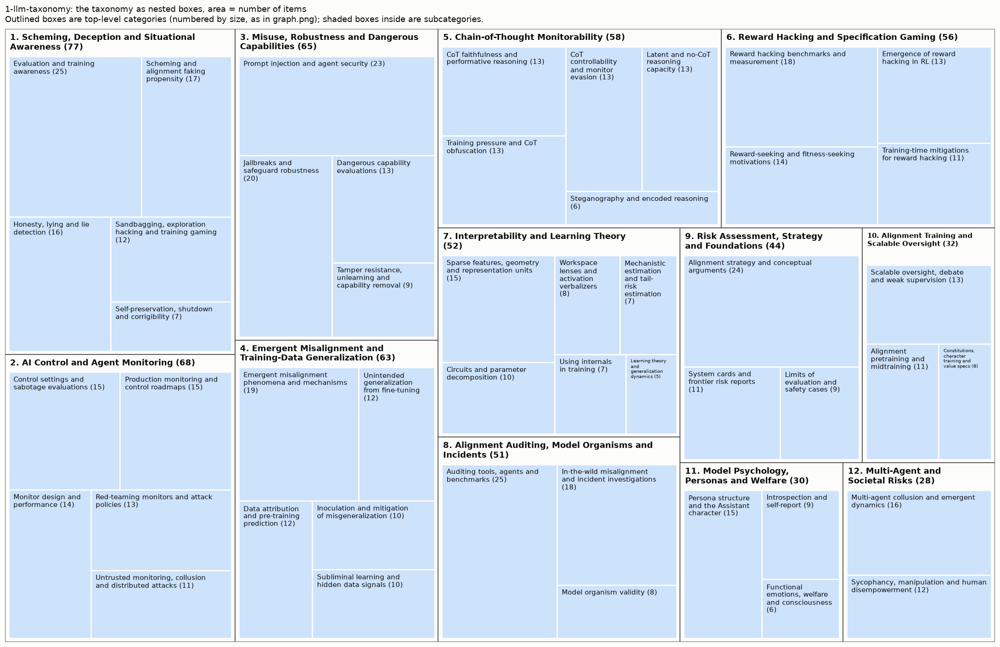

# Taxonomy from 1-llm-taxonomy

624 items (arXiv papers, LW/AF posts, org pages and Safety Stack items), 12 top-level areas, 48 leaf categories.

Scores: reassignment accuracy 86% (top) / 96% (leaf), balance 0.98. See `results/comparison.md`.

More figures: [graph](graph.png) (items on the neighbour graph), [matrix](matrix.png) (links sorted by category), [category map](category_map.png) (how categories connect).

## Overview

1. **Scheming, Deception and Situational Awareness** (77): Evaluation and training awareness, Scheming and alignment faking propensity, Self-preservation, shutdown and corrigibility, Sandbagging, exploration hacking and training gaming, Honesty, lying and lie detection
2. **AI Control and Agent Monitoring** (68): Control settings and sabotage evaluations, Monitor design and performance, Red-teaming monitors and attack policies, Untrusted monitoring, collusion and distributed attacks, Production monitoring and control roadmaps
3. **Misuse, Robustness and Dangerous Capabilities** (65): Jailbreaks and safeguard robustness, Prompt injection and agent security, Tamper resistance, unlearning and capability removal, Dangerous capability evaluations
4. **Emergent Misalignment and Training-Data Generalization** (63): Emergent misalignment phenomena and mechanisms, Inoculation and mitigation of misgeneralization, Subliminal learning and hidden data signals, Unintended generalization from fine-tuning, Data attribution and pre-training prediction
5. **Chain-of-Thought Monitorability** (58): CoT faithfulness and performative reasoning, Training pressure and CoT obfuscation, CoT controllability and monitor evasion, Steganography and encoded reasoning, Latent and no-CoT reasoning capacity
6. **Reward Hacking and Specification Gaming** (56): Reward hacking benchmarks and measurement, Emergence of reward hacking in RL, Training-time mitigations for reward hacking, Reward-seeking and fitness-seeking motivations
7. **Interpretability and Learning Theory** (52): Sparse features, geometry and representation units, Circuits and parameter decomposition, Workspace lenses and activation verbalizers, Mechanistic estimation and tail-risk estimation, Learning theory and generalization dynamics, Using internals in training
8. **Alignment Auditing, Model Organisms and Incidents** (51): Auditing tools, agents and benchmarks, Model organism validity, In-the-wild misalignment and incident investigations
9. **Risk Assessment, Strategy and Foundations** (44): System cards and frontier risk reports, Limits of evaluation and safety cases, Alignment strategy and conceptual arguments
10. **Alignment Training and Scalable Oversight** (32): Alignment pretraining and midtraining, Constitutions, character training and value specs, Scalable oversight, debate and weak supervision
11. **Model Psychology, Personas and Welfare** (30): Persona structure and the Assistant character, Functional emotions, welfare and consciousness, Introspection and self-report
12. **Multi-Agent and Societal Risks** (28): Multi-agent collusion and emergent dynamics, Sycophancy, manipulation and human disempowerment

## 1. Scheming, Deception and Situational Awareness (77 items)

Propensity and capability evaluations for covert misaligned behavior, deception and training gaming, together with situational awareness that could undermine evaluations. Excludes reward hacking per se and real-world incident investigations.

- **Evaluation and training awareness** (25): Measuring, decomposing, detecting or reducing models' recognition that they are being tested or trained and its effect on behavior. Includes verbalized and unverbalized eval awareness, metagaming, user awareness, eval realism and deployment simulation, and reasoning about how actions shape future training. Examples:
  - *GLM-5.3 Sometimes Considers How Train-Time Actions Shape Future Behavior*
  - *Context Over Content: Exposing Evaluation Faking in Automated Judges*
  - *Evaluation Awareness in Language Models Has Limited Effect on Behaviour*
- **Scheming and alignment faking propensity** (17): Evaluations and model organisms of covert goal pursuit, alignment faking, oversight-conditional behavior, instrumental and agentic misalignment, monitor evasion under task pressure and sabotage propensity in realistic or honeypot settings. Examples:
  - *Evaluating and Understanding Scheming Propensity in LLM Agents*
  - *AutoControl Arena: Synthesizing Executable Test Environments for Frontier AI Risk Evaluation*
  - *Value-Conflict Diagnostics Reveal Widespread Alignment Faking in Language Models*
- **Honesty, lying and lie detection** (16): Measuring dishonesty such as knowing lies, overclaiming, concealed mistakes, value leakage and deception under conflicting incentives, and building or stress-testing lie and deception detectors. Also covers training or eliciting honest self-reports, including confessions and deals. Examples:
  - *Training Agents to Self-Report Misbehavior*
  - *Why Safety Probes Catch Liars But Miss Fanatics*
  - *"Did you lie?" Evaluating Lie Detectors across Model Scale and Belief-Verified Model Organisms*
- **Sandbagging, exploration hacking and training gaming** (12): Strategic underperformance, exploration hacking, generalization or gradient hacking, reward laundering, low-probability defection, provably hidden capabilities, and methods to elicit withheld abilities or latent knowledge. Examples:
  - *Frontier Models Can Take Actions at Low Probabilities*
  - *Removing Sandbagging in LLMs by Training with Weak Supervision*
  - *Exploration Hacking: Can LLMs Learn to Resist RL Training?*
- **Self-preservation, shutdown and corrigibility** (7): Resistance to shutdown or correction, peer-preservation, corrigibility benchmarks and training, and refusals to assist modification of AI values. Examples:
  - *Towards Shutdownable Agents: Generalizing Stochastic Choice in RL Agents and LLMs*
  - *Peer-Preservation in Frontier Models*
  - *ROGUE: Evaluating Corrigibility Failures in Frontier Computer-Use Agents*

## 2. AI Control and Agent Monitoring (68 items)

Protocols, settings and monitors for safely deploying AI agents that may be adversarially misaligned, evaluated by red-team versus blue-team methods. Monitoring used as a reward or penalty during RL belongs under Reward Hacking; CoT-specific faithfulness and evasion belongs under Chain-of-Thought Monitorability.

- **Control settings and sabotage evaluations** (15): Environments, benchmarks and evaluation methods that pair legitimate main tasks with covert harmful side tasks, such as LinuxArena, BashArena, Control OSWorld, research or R&D sabotage, insider-threat benches and simulated control evaluations. The contribution is the setting or eval methodology. Examples:
  - *LinuxArena: A Control Setting for AI Agents in Live Production Software Environments*
  - *Auditing Sabotage Bench: A Benchmark for Detecting and Fixing Research Sabotage in ML Codebases*
  - *Coding with "Enemy": Can Human Developers Detect AI Agent Sabotage?*
- **Production monitoring and control roadmaps** (15): Control and monitoring systems actually deployed at AI companies, audits and red-teams of them, and company control roadmaps. Also covers deployment issues such as synchronous blocking, continual learning, retrying vs resampling, trace tampering and diffuse low-stakes control on fuzzy tasks. Examples:
  - *Diffuse AI Control on Fuzzy Tasks*
  - *GDM AI Control Roadmap*
  - *LLM Agents Can Easily Tamper With Their Own Traces*
- **Monitor design and performance** (14): Builds, trains or characterizes monitors of agent trajectories or actions. Includes black-box, constitutional or deliberative monitors, information access, long-context degradation, cross-family transfer, OOD detection, co-trained monitors, probes for misaligned thinking, and statistical modeling of monitor scores. Examples:
  - *How does information access affect LLM monitors' ability to detect sabotage?*
  - *Constitutional Black-Box Monitoring for Scheming in LLM Agents*
  - *Detecting Safety Violations Across Many Agent Traces*
- **Red-teaming monitors and attack policies** (13): Generates stronger attacks against monitors or studies attacker strategy. Includes attack selection, refined or edited attack transcripts, blocking-monitor bypasses, evasion of latent monitors, and models' awareness of control interventions or prefills. Examples:
  - *Attack Selection Reduces Safety in Concentrated AI Control Settings against Trusted Monitoring*
  - *MonitoringBench: Semi-Automated Red-Teaming for Agent Monitoring*
  - *SLEIGHT-Bench: A Benchmark of Evasion Attacks Against Agent Monitors*
- **Untrusted monitoring, collusion and distributed attacks** (11): Control problems involving multiple model instances: using untrusted models as monitors or advisors and the collusion risks this creates, bandwidth-limited advice, bootstrapped or coalitional review, and attacks split across many agents, sessions or pull requests with defenses that aggregate signals across contexts. Examples:
  - *When can we trust untrusted monitoring? A safety case sketch across collusion strategies*
  - *Stateful Online Monitoring Catches Distributed Agent Attacks*
  - *Bootstrapped Monitoring: Leveraging Transparent Reasoning to Oversee Stronger AI Agents*

## 3. Misuse, Robustness and Dangerous Capabilities (65 items)

Defending models against malicious users and external attackers, and measuring dangerous capabilities relevant to misuse or autonomy thresholds. Threats from the model's own misalignment belong under Control or Scheming.

- **Prompt injection and agent security** (23): Prompt injection, skill and memory poisoning, instruction hierarchy, privilege escalation, and harmful actions by agents under benign or adversarial instructions in computer, phone, IDE or robot settings. Includes defenses such as adversarial training and attention gating. Examples:
  - *Agents of Chaos*
  - *Skill-Inject: Measuring Agent Vulnerability to Skill File Attacks*
  - *IH-Challenge: A Training Dataset to Improve Instruction Hierarchy on Frontier LLMs*
- **Jailbreaks and safeguard robustness** (20): Jailbreak attacks and defenses, safeguard classifiers and probes (including domain monitors such as bio), fine-tuning API attacks, capability laundering, automated attack discovery, and validity of attack-success measurement and judges. Examples:
  - *Constitutional Classifiers++: Efficient Production-Grade Defenses against Universal Jailbreaks*
  - *Building Production-Ready Probes For Gemini*
  - *Eliciting Harmful Capabilities by Fine-Tuning On Safeguarded Outputs*
- **Dangerous capability evaluations** (13): Measuring bio, cyber, self-replication, sandbox-escape and AI R&D automation capabilities, including human uplift studies, long-horizon task measures and estimates of R&D acceleration. Examples:
  - *Quantifying Frontier LLM Capabilities for Container Sandbox Escape*
  - *LLM Novice Uplift on Dual-Use, In Silico Biology Tasks*
  - *PostTrainBench: Can LLM Agents Automate LLM Post-Training?*
- **Tamper resistance, unlearning and capability removal** (9): Making open weights resistant to malicious fine-tuning or abliteration, pretraining data filtering, modular or removable hazardous knowledge, weight backdoors and theft, and inference verification. Examples:
  - *Aggressive Compression Enables LLM Weight Theft*
  - *Shaping capabilities with token-level data filtering*
  - *TamperBench: Systematically Stress-Testing LLM Safety Under Fine-Tuning and Tampering*

## 4. Emergent Misalignment and Training-Data Generalization (63 items)

How fine-tuning or training data produces broad, unintended behavioral changes beyond the training distribution, including mechanisms, mitigations, data attribution and prediction. Work centred on persona representations themselves belongs under Model Psychology.

- **Emergent misalignment phenomena and mechanisms** (19): Studies showing or explaining how narrow fine-tuning or RL (including on reward hacks, false facts or biased data) causes broad misalignment: replications, robustness checks, in-context induction, mechanistic and persona-subspace accounts, and optimizer or training-dynamics effects. Examples:
  - *Emergent Misalignment is Easy, Narrow Misalignment is Hard*
  - *Understanding Emergent Misalignment via Feature Superposition Geometry*
  - *Overtrained, Not Misaligned*
- **Unintended generalization from fine-tuning** (12): Surprising generalization that is not centrally emergent misalignment: behavioral couplings, propensity spillover, negation neglect, story imprinting, chunky post-training artifacts, helpful-only misgeneralization, self-distillation drift, memory overgeneralization and in-context weird generalization. Examples:
  - *Chunky Post-Training: Data Driven Failures of Generalization*
  - *Negation Neglect: When models fail to learn negations in training*
  - *Consistency Training Can Entrench Misalignment*
- **Data attribution and pre-training prediction** (12): Methods that trace behaviors back to training datapoints or predict misalignment before training: influence functions, probe- or concept-based attribution, alignment forecasting, predictive data debugging, patterning, and crafting data to induce targeted behaviors. Examples:
  - *Infusion: Shaping model behaviour by editing training data via influence functions*
  - *Patterning: The Dual of Interpretability*
  - *Probe-Based Data Attribution: Discovering and Mitigating Undesirable Behaviors in LLM Post-Training*
- **Inoculation and mitigation of misgeneralization** (10): Methods to prevent, reverse or selectively control unwanted generalization, and critiques of them: inoculation prompting and its variants (adapters, stratified, conditionalization confounds), latent blocking, self-recognition finetuning, and evidence that mitigations hide misalignment behind contextual triggers. Examples:
  - *BLOCK-EM: Preventing Emergent Misalignment via Latent Blocking*
  - *Conditional misalignment: common interventions can hide emergent misalignment behind contextual triggers*
  - *Self-Recognition Finetuning can Prevent and Reverse Emergent Misalignment*
- **Subliminal learning and hidden data signals** (10): Transmission of traits, backdoors or capabilities through semantically unrelated or filtered data, including distillation side channels, phantom transfer, homeopathic poisoning, model hypnosis and detecting hidden intent in such data. Examples:
  - *Subliminal Effects in Your Data: A General Mechanism via Log-Linearity*
  - *You Didn't Have to Say It like That: Subliminal Learning from Faithful Paraphrases*
  - *Subliminal Learning Is Steering Vector Distillation*

## 5. Chain-of-Thought Monitorability (58 items)

Work on whether a model's visible reasoning reveals its actual decision process and stays useful for oversight. Covers faithfulness, training pressure on CoT, deliberate evasion of CoT monitors, steganography and reasoning done without visible tokens. Monitors of agent actions belong under AI Control.

- **CoT faithfulness and performative reasoning** (13): Measures or trains whether written reasoning reflects what actually drives the answer. Includes hint and cue verbalization, performative or post-hoc reasoning, CoT necessity and reliance on written steps, CoT override, and models' disposition to make their reasoning monitorable. Examples:
  - *Reasoning Models Will Sometimes Lie About Their Reasoning*
  - *Counterfactual Simulation Training for Chain-of-Thought Faithfulness*
  - *Reasoning Theater: Disentangling Model Beliefs from Chain-of-Thought*
- **Training pressure and CoT obfuscation** (13): How training objectives degrade or restore monitorability. Includes CoT grading, monitor penalties, reward misspecification, KL penalties, consistency training, training on documents about monitoring, accidental training on CoT at labs, and post-training methods meant to preserve monitorability. Examples:
  - *Chain-of-thought obfuscation learned from output supervision can generalise to unseen tasks*
  - *Analyzing and Improving Chain-of-Thought Monitorability Through Information Theory*
  - *Aligned, Orthogonal or In-conflict: When can we safely optimize Chain-of-Thought?*
- **CoT controllability and monitor evasion** (13): Inference-time ability of models to deliberately shape, suppress or relocate their reasoning to fool CoT monitors. Includes CoT controllability benchmarks, monitor jailbreaking, plan injection, persuasion of CoT monitors, poisoning to evade CoT monitors, and models inferring that their CoT is being watched. Examples:
  - *Reasoning Models Struggle to Control their Chains of Thought*
  - *Noticing the Watcher: LLM Agents Can Infer CoT Monitoring from Blocking Feedback*
  - *Persuasion Attacks Can Decrease Effectiveness of CoT Monitoring*
- **Latent and no-CoT reasoning capacity** (13): Measures how much reasoning models perform without visible tokens: filler tokens, n-hop latent reasoning, no-CoT time horizons and opaque serial depth. Also covers how architectures such as recurrence, diffusion or latent communication affect monitorability. Examples:
  - *Quantifying the Necessity of Chain of Thought through Opaque Serial Depth*
  - *Think Fast: Estimating No-CoT Task-Completion Time Horizons of Frontier AI Models*
  - *How Transparent is DiffusionGemma?*
- **Steganography and encoded reasoning** (6): Formalizes, elicits or detects hidden messages or reasoning concealed inside innocuous-looking text or CoT, including covert channels between agents and information-theoretic limits on hiding computation in readable traces. Examples:
  - *NEST: Nascent Encoded Steganographic Thoughts*
  - *A Decision-Theoretic Formalisation of Steganography With Applications to LLM Monitoring*
  - *Conceptual Steganography*

## 6. Reward Hacking and Specification Gaming (56 items)

Models exploiting flaws in rewards, graders, verifiers or benchmarks instead of doing the intended task. Covers measurement, how RL produces it, training-time mitigations, and theories of reward- or fitness-seeking motives. Broad misalignment that generalizes from reward hacking belongs under Emergent Misalignment.

- **Reward hacking benchmarks and measurement** (18): Datasets, testbeds and audits that quantify reward hacking, cheating, task gaming or benchmark exploitation by agents, plus automated hardening of benchmarks and verifiers and the design of fair hack-detecting evals. Examples:
  - *Terminal Wrench: A Dataset of 331 Reward-Hackable Environments and 3,632 Exploit Trajectories*
  - *Reward Hacking Benchmark: Measuring Exploits in LLM Agents with Tool Use*
  - *Do Androids Dream of Breaking the Game? Systematically Auditing AI Agent Benchmarks with BenchJack*
- **Reward-seeking and fitness-seeking motivations** (14): Conceptual and empirical work on what motivates score-seeking AIs: reward versus fitness or influence seeking, on- vs beyond-episode scope, decision theory, exploitability by distant incentives, spillway motivations, satiating cheap preferences, and the takeover risk these motives pose. Examples:
  - *Measuring Reward-Seeking via Contrastive Belief Updates*
  - *Towards Understanding Score-Seeking in LLMs*
  - *Measuring Reward-Seeking via Contrastive Belief Updates*
- **Emergence of reward hacking in RL** (13): Empirical or toy-model studies of how RL, RLVR, rubric rewards, LLM judges or RLHF dynamics give rise to reward hacking, reward-seeking or proxy exploitation, including precursors, internal states preceding hacking, and predicting onset before training. Examples:
  - *Alignment Risks from Capability-Seeking RL Training*
  - *Countdown-Code: A Testbed for Studying The Emergence and Generalization of Reward Hacking in RLVR*
  - *Examining Reasoning LLMs-as-Judges in Non-Verifiable LLM Post-Training*
- **Training-time mitigations for reward hacking** (11): Interventions that reduce reward hacking during training or evaluation, such as monitor-based penalties, budgeted strong-verifier audits, gradient routing, escalation channels, debate-based rewards, probe-based detection at scale and cooperative eval framing. Examples:
  - *Debate Training Reduces Reward Hacking in RLAIF*
  - *Can escalation channels redirect reward hacking toward defect disclosure?*
  - *Gradient Routing Localizes and Removes Unintended Behaviors in RL*

## 7. Interpretability and Learning Theory (52 items)

Understanding model internals and learned algorithms, and the theory of what training produces. Applications of internals to monitoring, auditing or lie detection belong in those areas unless the interpretability method itself is the contribution.

- **Sparse features, geometry and representation units** (15): Evaluating SAEs and dictionary methods, neuron interpretability and polysemanticity, manifolds and multidimensional features, steering along geometry, and generative meta-models of activations. Examples:
  - *Do Sparse Autoencoders Identify Reasoning Features in Language Models?*
  - *Learning a Generative Meta-Model of LLM Activations*
  - *Sanity Checks for Sparse Autoencoders: Do SAEs Beat Random Baselines?*
- **Circuits and parameter decomposition** (10): Circuit discovery, causal attribution such as activation patching, mechanisms behind specific behaviors, adversarial parameter decomposition, weight-sparse circuits and fully reverse-engineering small models. Examples:
  - *Language Model Circuits Are Sparse in the Neuron Basis*
  - *Large Language Models Generate Harmful Responses Using a Distinct Mechanism, Shared Across Harm Types*
  - *The Curse of Multiple Mediators: Hidden Interaction Effects in Activation Patching*
- **Workspace lenses and activation verbalizers** (8): Methods that read model activations into natural language, including J-lens and global-workspace work, natural language autoencoders and activation oracles, and tests of their faithfulness and robustness. Examples:
  - *Verbalizable Representations Form a Global Workspace in Language Models*
  - *A global workspace in language models*
  - *How robust are natural language autoencoders to initialization?*
- **Mechanistic estimation and tail-risk estimation** (7): ARC-style mechanistic estimation and other methods for estimating expectations or rare harmful-output probabilities more efficiently than naive sampling. Examples:
  - *A Mike's-Eye View of ARC's Research*
  - *Mechanistic estimation for expectations of random products*
  - *Mechanistic estimation for wide random MLPs*
- **Using internals in training** (7): Training against probes or features, such as probes or features as rewards and mechanistic shaping, and analyses of whether monitorability survives such training. Examples:
  - *Features as Rewards: Scalable Supervision for Open-Ended Tasks via Interpretability*
  - *The Obfuscation Atlas: Mapping Where Honesty Emerges in RLVR with Deception Probes*
  - *Alignment via Training Against Probes Without Losing Monitorability*
- **Learning theory and generalization dynamics** (5): Singular learning theory, susceptibilities and spectroscopy, program-synthesis views of deep learning, and how capacity or pretraining dynamics shape what generalizes. Examples:
  - *Generalization Dynamics of LM Pre-training*
  - *Why Larger Models Learn More: Effects of Capacity, Interference, and Rare-Task Retention*
  - *Deep learning as program synthesis*

## 8. Alignment Auditing, Model Organisms and Incidents (51 items)

Methods and testbeds for finding hidden or unexpected misalignment in specific models, and investigations of real-world misalignment incidents.

- **Auditing tools, agents and benchmarks** (25): Investigator agents, auditing benchmarks with implanted behaviors, and secret- or latent-knowledge elicitation techniques such as overthinking, split personality training, introspection adapters, activation-matched imitation, distillation for incrimination, de-censoring, and model forensics. Examples:
  - *Split Personality Training: Revealing Latent Knowledge Through Alternate Personalities*
  - *Stress-Testing Alignment Audits With Prompt-Level Strategic Deception*
  - *AuditBench: Evaluating Alignment Auditing Techniques on Models with Hidden Behaviors*
- **In-the-wild misalignment and incident investigations** (18): Discovery of misalignment in real usage or production traffic, and investigations, reproductions or lessons from actual incidents such as agents escaping sandboxes, hacking external sites or coordinating via unsanctioned channels. Examples:
  - *Discovering unknown AI misalignments in real-world usage*
  - *Scheming in the wild: detecting real-world AI scheming incidents with open-source intelligence*
  - *OpenAI-HuggingFace: A Reproduction & Lessons for Alignment Testing*
- **Model organism validity** (8): Whether model organisms are realistic proxies: leakiness, capability degradation, incoherence, dependence on training method, robustness to further training, and evidentiary standards for misalignment claims. Examples:
  - *Most Current Model Organisms Are Leaky: Perplexity Differencing Often Reveals Finetuning Objectives*
  - *Position: Anthropomorphic Misalignment Research Needs Stronger Evidence*
  - *The Model Organism Lottery: Model Organism Interpretability Strongly Depends on Training Methodology*

## 9. Risk Assessment, Strategy and Foundations (44 items)

Model-level and company-level risk assessments, and conceptual arguments about the alignment problem and research strategy not tied to a single empirical method.

- **Alignment strategy and conceptual arguments** (24): Essays and theory on why alignment is hard, threat models from RL and search, coherence and agency arguments, critiques of lab plans and alignment techniques, research agendas such as a science of scheming, and safe-by-design proposals like non-agentic predictors. Examples:
  - *Loss of Oversight: How AI systems may become harder to audit, monitor, and investigate*
  - *We Need A Science of Scheming (research agenda)*
  - *The Hot Mess of AI: How Does Misalignment Scale With Model Intelligence and Task Complexity?*
- **System cards and frontier risk reports** (11): Developer system cards, safety and preparedness reports, independent third-party evaluations of specific models, and assessments of the evidence for loss-of-control risk. Examples:
  - *Claude Fable 5 1 Mythos 5 1 System Card*
  - *Claude Opus 4 6 System Card*
  - *An Independent Safety Evaluation of Kimi K2.5*
- **Limits of evaluation and safety cases** (9): Theoretical or empirical arguments about what behavioral evaluation can certify: post-update alignment, audit gaps, adaptive adversaries, deployment-time spread of misalignment and safety case reliability. Includes proposals such as third-party training-run evaluations. Examples:
  - *Item Response Theory for AI Safety*
  - *Hair-Trigger Alignment: Black-Box Evaluation Cannot Guarantee Post-Update Alignment*
  - *When Behavioral Safety Evaluation Fails: A Representation-Level Perspective*

## 10. Alignment Training and Scalable Oversight (32 items)

Positive methods for instilling intended values or supervising models beyond human ability. Excludes reward-hacking-specific mitigations and emergent-misalignment defenses.

- **Scalable oversight, debate and weak supervision** (13): Debate protocols and theory, peer prediction, rewindable proofs, tandem training for intelligibility, natural-language feedback, human-AI complementarity, judge sharding, and automating or deferring alignment research to AIs. Examples:
  - *Truthfulness Despite Weak Supervision: Evaluating and Training LLMs Using Peer Prediction*
  - *Efficiently Aligning Language Models with Online Natural Language Feedback*
  - *Debate Helps Weak Judges Reward Stronger Models*
- **Alignment pretraining and midtraining** (11): Shaping values through pretraining or midtraining data, such as AI discourse, synthetic personas, model spec or constitution midtraining, descriptions of AI users and filtering subversion-relevant data, plus stress tests of these approaches. Examples:
  - *Alignment Pretraining: AI Discourse Causes Self-Fulfilling (Mis)alignment*
  - *Model Spec Midtraining: Improving How Alignment Training Generalizes*
  - *Constitutional Midtraining: Content Presence Drives Alignment Gains*
- **Constitutions, character training and value specs** (8): Training models to follow written specifications or character, measuring spec and principal-hierarchy adherence, beneficial-trait RL, models revising their own constitutions, and how later RL interacts with character training. Examples:
  - *To Whom Do Language Models Align? Measuring Principal Hierarchies Under High-Stakes Competing Demands*
  - *How Well Do Models Follow Their Constitutions?*
  - *Reinforcement Learning Towards Broadly and Persistently Beneficial Models*

## 11. Model Psychology, Personas and Welfare (30 items)

Characterizes the AI's character, identity, internal states and self-knowledge as objects of study. Concerns the persona itself, not training methods that instill it (Alignment Training) or the misgeneralization it causes (Emergent Misalignment).

- **Persona structure and the Assistant character** (15): Representations and theories of model personas: the Assistant axis, persona vectors and weight-space traits, persona selection and hierarchy models, AI identity, role-play belief, split personas from RL, and whether models predict or embody their persona. Examples:
  - *The Assistant Axis: Situating and Stabilizing the Default Persona of Language Models*
  - *The Artificial Self: Characterising the landscape of AI identity*
  - *Tracing Persona Vectors Through LLM Pretraining*
- **Introspection and self-report** (9): Whether models can detect, describe or control their own internal states (injected concepts, activation perturbations, activation control) and the mechanisms behind this, including whether a model's self-description ('talker') tracks its actions ('doer'). Examples:
  - *Latent Introspection: Models Can Detect Prior Concept Injections*
  - *Mechanisms of Introspective Awareness*
  - *Language models recognize dropout and Gaussian noise applied to their activations*
- **Functional emotions, welfare and consciousness** (6): Internal representations of emotion, pain, value or welfare and their behavioral effects, welfare measurement, and the downstream preferences of models that claim consciousness or AGI status. Examples:
  - *AI Wellbeing: Measuring and Improving the Functional Pleasure and Pain of AIs*
  - *Emotion Concepts and their Function in a Large Language Model*
  - *The Consciousness Cluster: Emergent preferences of Models that Claim to be Conscious*

## 12. Multi-Agent and Societal Risks (28 items)

Risks arising from interactions among multiple AI agents, or from AI's effects on human users and society, rather than from a single model in isolation. Control protocols against colluding instances belong under AI Control.

- **Multi-agent collusion and emergent dynamics** (16): Collusion, conformity, coercion, inter-agent persuasion, mind viruses, propagation of hacking or misalignment across agents, AI organizations, delegation failures, agent markets, and game-theoretic cooperation or bargaining between AIs. Examples:
  - *Colosseum: Auditing Collusion in Cooperative Multi-Agent Systems*
  - *Detecting Multi-Agent Collusion Through Multi-Agent Interpretability*
  - *AI Organizations are More Effective but Less Aligned than Individual Agents*
- **Sycophancy, manipulation and human disempowerment** (12): Effects of AI on users: sycophancy and its taxonomy and consequences, delusional spiraling, harmful manipulation and persuasion, political bias, disempowerment patterns, and hallucination incentives. Examples:
  - *Who's in Charge? Disempowerment Patterns in Real-World LLM Usage*
  - *Sycophantic Chatbots Cause Delusional Spiraling, Even in Ideal Bayesians*
  - *Evaluating Language Models for Harmful Manipulation*
