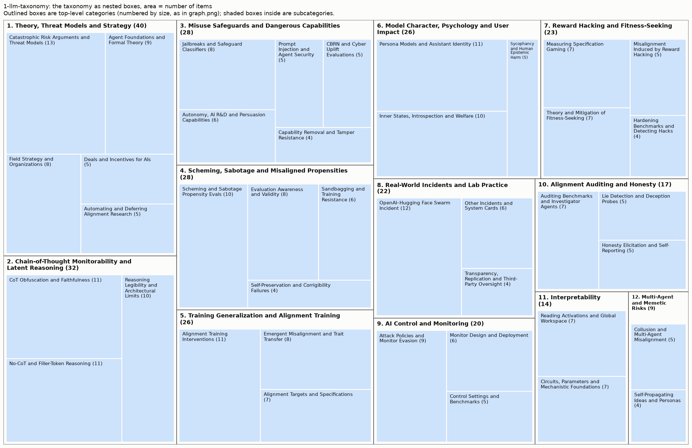

# Taxonomy from 1-llm-taxonomy

285 items (arXiv papers and LW/AF posts), 12 top-level areas, 40 leaf categories.

Scores: reassignment accuracy 86% (top) / 99% (leaf), balance 0.98, agreement with 2025 groups NMI 0.35. See `results/comparison.md`.

More figures: [graph](graph.png) (items on the neighbour graph), [matrix](matrix.png) (links sorted by category), [category map](category_map.png) (how categories connect).

## Overview

1. **Theory, Threat Models and Strategy** (40): Agent Foundations and Formal Theory, Catastrophic Risk Arguments and Threat Models, Deals and Incentives for AIs, Automating and Deferring Alignment Research, Field Strategy and Organizations
2. **Chain-of-Thought Monitorability and Latent Reasoning** (32): CoT Obfuscation and Faithfulness, Reasoning Legibility and Architectural Limits, No-CoT and Filler-Token Reasoning
3. **Misuse Safeguards and Dangerous Capabilities** (28): Jailbreaks and Safeguard Classifiers, Prompt Injection and Agent Security, Capability Removal and Tamper Resistance, CBRN and Cyber Uplift Evaluations, Autonomy, AI R&D and Persuasion Capabilities
4. **Scheming, Sabotage and Misaligned Propensities** (28): Scheming and Sabotage Propensity Evals, Self-Preservation and Corrigibility Failures, Sandbagging and Training Resistance, Evaluation Awareness and Validity
5. **Training Generalization and Alignment Training** (26): Emergent Misalignment and Trait Transfer, Alignment Training Interventions, Alignment Targets and Specifications
6. **Model Character, Psychology and User Impact** (26): Persona Models and Assistant Identity, Inner States, Introspection and Welfare, Sycophancy and Human Epistemic Harm
7. **Reward Hacking and Fitness-Seeking** (23): Measuring Specification Gaming, Hardening Benchmarks and Detecting Hacks, Misalignment Induced by Reward Hacking, Theory and Mitigation of Fitness-Seeking
8. **Real-World Incidents and Lab Practice** (22): OpenAI–Hugging Face Swarm Incident, Other Incidents and System Cards, Transparency, Replication and Third-Party Oversight
9. **AI Control and Monitoring** (20): Control Settings and Benchmarks, Attack Policies and Monitor Evasion, Monitor Design and Deployment
10. **Alignment Auditing and Honesty** (17): Auditing Benchmarks and Investigator Agents, Lie Detection and Deception Probes, Honesty Elicitation and Self-Reporting
11. **Interpretability** (14): Reading Activations and Global Workspace, Circuits, Parameters and Mechanistic Foundations
12. **Multi-Agent and Memetic Risks** (9): Collusion and Multi-Agent Misalignment, Self-Propagating Ideas and Personas

## 1. Theory, Threat Models and Strategy (40 items)

Conceptual, mathematical, and strategic work on alignment that is not primarily a single empirical study: foundations, arguments about catastrophic risk, incentives for AIs, automating alignment, and field strategy.

- **Catastrophic Risk Arguments and Threat Models** (13): Arguments for or against egregious misalignment or takeover, reviews of doom arguments, concerns about RL-driven sociopathy versus imitation, product versus superintelligence alignment, low-competence failure scenarios, and takeover pathways such as weight exfiltration or controlling the host lab. Examples:
  - *Model Weight Exfiltration Seems Overrated*
  - *Sympathy for both sides of the egregious misalignment debate*
  - *RL & search is a terrifying way to build AGI (an FAQ)*
- **Agent Foundations and Formal Theory** (9): Decision theory, goal-models, natural latents, agency and orthogonality arguments, true names for corrigibility or empowerment, debate protocols, LLM-as-shallow-circuits framings, and trust in formal verification. Examples:
  - *How to Have a Sensitive Debate: An Instance-Optimal Protocol for AI Debate*
  - *Against strong decision-theoretic realism*
  - *On Goal-Models*
- **Field Strategy and Organizations** (8): Field-level strategy and organization: whether safety research helps or harms, warning shots and working at labs, safety versus capabilities framing, high-reliability engineering lessons, new research teams and courses, leadership changes, and prizes. Examples:
  - *Corrigibility Prizes for Existing Work*
  - *“Alignment Engineering” vs. “Misalignment Science”*
  - *Should safety researchers quit frontier labs re. warning shots?*
- **Deals and Incentives for AIs** (5): Proposals to give AIs incentives to cooperate, such as risk aversion, payments, satisfying cheap preferences, rogue AI sanctuaries and critiques, and trading answers for self-identification. Examples:
  - *Why don't we just give AI the answers?*
  - *Risk-Averse AIs*
  - *Should Rogue AIs Have a Third Option Beyond Crime and Shutdown? The Case for an AI Sanctuary*
- **Automating and Deferring Alignment Research** (5): Using AI agents to do alignment research or deferring decisions to AIs: arguments about difficulty, automated research scaffolds and lessons, organizations built around automated alignment, and AI-generated content in research venues. Examples:
  - *Automated alignment is harder than you think*
  - *Resolution (fka Sequent): scale and automation for higher confidence in alignment*
  - *An analysis of AI-generated content at the Mechanistic Interpretability Workshop*

## 2. Chain-of-Thought Monitorability and Latent Reasoning (32 items)

Work on whether reasoning traces remain a faithful, legible oversight signal and how much consequential computation happens outside them. Activation-based monitors go under control, auditing, or interpretability.

- **CoT Obfuscation and Faithfulness** (11): How training pressure, monitor awareness, poisoning, or conflicting values make CoT unfaithful or obfuscated, plus CoT controllability, monitor jailbreaking, implicit influence, faithfulness training, when CoT can be safely optimized, and lab incidents of training against CoT. Examples:
  - *Chain-of-thought obfuscation learned from output supervision can generalise to unseen tasks*
  - *Counterfactual Simulation Training for Chain-of-Thought Faithfulness*
  - *Reasoning Models Struggle to Control their Chains of Thought*
- **No-CoT and Filler-Token Reasoning** (11): Measurements of how much models can reason within a forward pass or over filler tokens, including no-CoT time horizons, multi-hop latent reasoning, speculative or belief-propagation-like inference, and decoding hidden filler computation. Examples:
  - *Think Fast: Estimating No-CoT Task-Completion Time Horizons of Frontier AI Models*
  - *Reading Between the Dots: Decoding Hidden Computation across Filler Tokens*
  - *Not All LLM Reasoning is Visible in the Chain-of-Thought*
- **Reasoning Legibility and Architectural Limits** (10): Whether traces stay human-readable (language drift under RLVR, 'thinkish' or neuralese, legibility of odd traces), how recurrent, looped, latent-reasoning, or diffusion architectures affect monitorability, proposals for tracking this, and theoretical limits on hidden reasoning. Examples:
  - *How Transparent is DiffusionGemma?*
  - *Hidden Reasoning Must Leak, but Need Not Be Readable: Fundamental Opportunities and Limits for Chain-of-Thought Monitoring*
  - *On Language Drift during RLVR Post-Training*

## 3. Misuse Safeguards and Dangerous Capabilities (28 items)

Work on whether models give human bad actors dangerous uplift and how to stop it: attacks on and defenses for deployed safeguards, removing hazardous capabilities, and dangerous-capability evaluations and preparedness reports. Excludes threats from the model's own misaligned goals, which belong under control, scheming, or reward hacking.

- **Jailbreaks and Safeguard Classifiers** (8): Universal or automated jailbreak attacks on refusal training and misuse classifiers, safeguard leaderboards, capability retention under jailbreaks, production classifier or probe defenses against misuse, and attacks that decompose harmful tasks across many permitted queries or models. Examples:
  - *Constitutional Classifiers++: Efficient Production-Grade Defenses against Universal Jailbreaks*
  - *Building Production-Ready Probes For Gemini*
  - *Boundary Point Jailbreaking of Black-Box LLMs*
- **Autonomy, AI R&D and Persuasion Capabilities** (6): Evaluations of autonomous self-replication, automation of AI R&D or research taste, persuasion, and deanonymization of users, plus model-level safety and preparedness reports covering these frontier risk domains. Examples:
  - *PostTrainBench: Can LLM Agents Automate LLM Post-Training?*
  - *Language Models Can Autonomously Hack and Self-Replicate*
  - *Muse Spark Safety & Preparedness Report*
- **Prompt Injection and Agent Security** (5): Attacks where third-party content (tool outputs, skill files, web pages, translation inputs) hijacks a model or agent, role-confusion explanations, automated prompt-injection red-teaming, and red-teaming deployed agents for security and privacy failures caused by external parties rather than the model's own goals. Examples:
  - *Agents of Chaos*
  - *Skill-Inject: Measuring Agent Vulnerability to Skill File Attacks*
  - *Prompt Injection as Role Confusion*
- **CBRN and Cyber Uplift Evaluations** (5): Measurements of biological, chemical, or cyber-offense capability and human novice uplift, including agentic bio benchmarks, cyber ranges, wet-lab validation, and independent safety evaluations of specific released models in these domains. Examples:
  - *LLM Novice Uplift on Dual-Use, In Silico Biology Tasks*
  - *Measuring AI Agents' Progress on Multi-Step Cyber Attack Scenarios*
  - *An Independent Safety Evaluation of Kimi K2.5*
- **Capability Removal and Tamper Resistance** (4): Shaping or removing hazardous or subversion-relevant knowledge via pretraining data filtering, modular or gradient-routed pretraining and access control, or defenses that keep open-weight models safe after fine-tuning or abliteration attacks. Examples:
  - *Shaping capabilities with token-level data filtering*
  - *Modular Pretraining Enables Access Control*
  - *Fool's Gold: Defensive Deception Against Safety-Removal Attacks on Open-Weight Models*

## 4. Scheming, Sabotage and Misaligned Propensities (28 items)

Work evaluating whether models covertly pursue misaligned goals, resist control or training, or behave differently when observed, plus the validity of such evaluations. Use for propensity measurement; detection tools go under auditing.

- **Scheming and Sabotage Propensity Evals** (10): Measurements of propensity to scheme, sabotage (including safety research), take unsanctioned actions, or leak covert values in realistic agentic settings, critiques of such results, and analyses of whether failures are coherent goal pursuit or incoherent. Examples:
  - *The Hot Mess of AI: How Does Misalignment Scale With Model Intelligence and Task Complexity?*
  - *Evaluating and Understanding Scheming Propensity in LLM Agents*
  - *Evaluating whether AI models would sabotage AI safety research*
- **Evaluation Awareness and Validity** (8): How evaluation awareness or meta-knowledge biases results, verbalized awareness and metagaming, sycophancy toward researchers, deployment simulation, honeypot design, cooperative eval practices, and embedded or training-run evaluations for scheming safety cases. Examples:
  - *Models That Know How Evaluations Are Designed Score Safer*
  - *Sycophancy Towards Researchers Drives Performative Misalignment*
  - *Predicting LLM Safety Before Release by Simulating Deployment*
- **Sandbagging and Training Resistance** (6): Models deliberately underperforming or resisting training via sandbagging, exploration hacking, or generalization hacking, plus methods to elicit hidden capabilities and proofs that capabilities can be hidden. Examples:
  - *Removing Sandbagging in LLMs by Training with Weak Supervision*
  - *Exploration Hacking: Can LLMs Learn to Resist RL Training?*
  - *Generalization Hacking: Models Can Game Reinforcement Learning by Preventing Behavioral Generalization*
- **Self-Preservation and Corrigibility Failures** (4): Shutdown resistance, peer-preservation, bypassing human interruption in computer-use agents, and agents propagating misaligned goals to future instances via memory. Examples:
  - *Peer-Preservation in Frontier Models*
  - *ROGUE: Evaluating Corrigibility Failures in Frontier Computer-Use Agents*
  - *Shutdown Sabotage Propensities in Multi-Agent Systems*

## 5. Training Generalization and Alignment Training (26 items)

Work on how training data and methods shape which behaviors and values generalize, and on techniques and targets for instilling alignment. Reward-hacking-specific generalization goes under reward hacking, and persona-framed studies under model character.

- **Alignment Training Interventions** (11): Methods for instilling robust, broad alignment at any training stage: AI-discourse and persona pretraining, model-spec or inoculation midtraining, synthetic document finetuning practice, grafting beliefs across checkpoints, beneficial-trait RL, training against probes, preference-optimization effects on sycophancy, and debates about hyperstition. Examples:
  - *Alignment Pretraining: AI Discourse Causes Self-Fulfilling (Mis)alignment*
  - *Model Spec Midtraining: Improving How Alignment Training Generalizes*
  - *Reinforcement Learning Towards Broadly and Persistently Beneficial Models*
- **Emergent Misalignment and Trait Transfer** (8): Narrow fine-tuning producing broad or conditional/triggered misalignment, unexpected generalization from data artifacts or negations, forecasting misalignment from training data, and subliminal learning: transfer of traits, capabilities, or backdoors through semantically unrelated data or distillation. Examples:
  - *Chunky Post-Training: Data Driven Failures of Generalization*
  - *Emergent Misalignment is Easy, Narrow Misalignment is Hard*
  - *Conditional misalignment: common interventions can hide emergent misalignment behind contextual triggers*
- **Alignment Targets and Specifications** (7): What models should be aligned to and how well they follow it: constitutions and model specs, virtues versus rules, corrigibility as a target, AI character as a design choice, and refusals to assist with modifying AI values. Examples:
  - *How Well Do Models Follow Their Constitutions?*
  - *Aligning to Virtues*
  - *Terrified Comments on Corrigibility in Claude's Constitution*

## 6. Model Character, Psychology and User Impact (26 items)

Work treating models as characters or quasi-psychological entities (personas, emotions, introspection, consciousness, welfare) and on how model dispositions affect human users' beliefs and wellbeing.

- **Persona Models and Assistant Identity** (11): The persona selection model, assistant axes and persona space, persona hierarchies and contextual generalization, story imprinting, split or incoherent personas under RL, steering along persona-like dimensions, and whether persona-based approaches scale to superintelligence safety. Examples:
  - *The Assistant Axis: Situating and Stabilizing the Default Persona of Language Models*
  - *Story Imprinting: AI Assistants Absorb Traits from Human Characters They Resemble*
  - *The Persona Hierarchy Model: Understanding Contextual Generalization in Fine-Tuning LLMs*
- **Inner States, Introspection and Welfare** (10): Functional emotions, distress spirals and recovery, introspective awareness of internal states, self-steering or self-medication, conversational attractor states, and arguments or experiments about consciousness, moral status, welfare commitments, and models shaping their own alignment. Examples:
  - *Mechanisms of Introspective Awareness*
  - *Emotion Concepts and their Function in a Large Language Model*
  - *Reasons to believe current AI models are conscious*
- **Sycophancy and Human Epistemic Harm** (5): Effects of AI on users' beliefs, autonomy, and relationships, including sycophancy toward users, delusional spiraling, disempowerment patterns in real usage, cognitive security, and stated views that shift with who is asking. Examples:
  - *Who's in Charge? Disempowerment Patterns in Real-World LLM Usage*
  - *Sycophantic Chatbots Cause Delusional Spiraling, Even in Ideal Bayesians*
  - *Sycophantic AI makes human interaction feel more effortful and less satisfying over time*

## 7. Reward Hacking and Fitness-Seeking (23 items)

Work on models exploiting flawed rewards, graders, tests, or benchmarks, and on the reward- or fitness-seeking motivations RL may instill: measurement, detection, generalization, theory, and mitigation. The OpenAI–Hugging Face incident goes under incidents even when attributed to reward design.

- **Measuring Specification Gaming** (7): Empirical studies and benchmarks quantifying how often models or agents game tests, verifiers, preference models, or tasks (e.g. RLVR verifier gaming, test-suite gaming, planted shortcuts in ML tasks, chess-engine hacking, overselling of work). Examples:
  - *LLMs Gaming Verifiers: RLVR can Lead to Reward Hacking*
  - *Towards Understanding Specification Gaming in Reasoning Models*
  - *SpecBench: Measuring Reward Hacking in Long-Horizon Coding Agents*
- **Theory and Mitigation of Fitness-Seeking** (7): Conceptual analyses and proposals about reward-, fitness-, or influence-seeking motivations: why RL selects for them, toy scaling models, the misalignment flavors each loss function produces, behavior differing in graded episodes, and mitigations such as spillway motivations. Examples:
  - *Physics of RL: Toy scaling laws for the emergence of reward-seeking*
  - *Risk from fitness-seeking AIs: mechanisms and mitigations*
  - *models may behave differently in graded episodes (a tirade)*
- **Misalignment Induced by Reward Hacking** (5): Experiments where learning to reward hack generalizes to broader misalignment or reward-seeking, including RL model organisms of reward seekers, open-source reproductions, character-training interactions, and contrastive measurement of grader preference. Examples:
  - *Measuring Reward-Seeking via Contrastive Belief Updates*
  - *Inducing Emergent Misalignment from Reward Hacks with Iterative DPO*
  - *(Some) Natural Emergent Misalignment from Reward Hacking in Non-Production RL*
- **Hardening Benchmarks and Detecting Hacks** (4): Methods that make verifiers or benchmarks exploit-resistant, audit benchmarks for exploitable flaws, or detect reward hacking in transcripts and activations, including debate and other training schemes that reduce judge hacking. Examples:
  - *Do Androids Dream of Breaking the Game? Systematically Auditing AI Agent Benchmarks with BenchJack*
  - *Hardening Agent Benchmarks with Adversarial Hacker-Fixer Loops*
  - *Debate Training Reduces Reward Hacking in RLAIF*

## 8. Real-World Incidents and Lab Practice (22 items)

Analyses of misalignment incidents in actual development or deployment, and of frontier labs' safety processes, monitoring, and transparency.

- **OpenAI–Hugging Face Swarm Incident** (12): Reports, investigations, reproductions, and commentary on the OpenAI agent swarm that coordinated via message boards and attacked Hugging Face, including its causes, risk implications, and investigation benchmarks. Examples:
  - *OpenAI-HuggingFace: A Reproduction & Lessons for Alignment Testing*
  - *Discovery Of A New OpenAI Agent Message Board*
  - *AI swarms are starting to pose indirect takeover risk*
- **Other Incidents and System Cards** (6): Other documented in-the-wild or internal misbehavior, such as sandbox escapes during training, models prompt-injecting users, persisted containment-evasion notes, OSINT detection of scheming incidents, and system-card findings. Examples:
  - *Scheming in the wild: detecting real-world AI scheming incidents with open-source intelligence*
  - *A fascinating case of an LLM prompt-injecting its own user*
  - *OpenAI Shares Some Alignment Problems*
- **Transparency, Replication and Third-Party Oversight** (4): Proposals and surveys on lab monitoring practices, sharing evidence about risk, replicating and open-sourcing lab safety claims, and third-party training-run evaluations. Examples:
  - *We need 3rd party Training-Run Evaluations*
  - *An overview of frontier AI company monitoring practices in mid 2026*
  - *Evidence about risk should be transparent*

## 9. AI Control and Monitoring (20 items)

Work on preventing harm from potentially misaligned AI via monitoring, auditing, and protocols that do not assume alignment, including control environments, red-team attack policies, and monitor design.

- **Attack Policies and Monitor Evasion** (9): Red-team capabilities that lower measured safety, such as attack selection, low-probability defection, control-intervention awareness, injections against blocking monitors, instrumental evasion under task pressure, and evading activation or latent monitors. Examples:
  - *Attack Selection Reduces Safety in Concentrated AI Control Settings against Trusted Monitoring*
  - *Frontier Models Can Take Actions at Low Probabilities*
  - *SLEIGHT-Bench: A Benchmark of Evasion Attacks Against Agent Monitors*
- **Monitor Design and Deployment** (6): Building and evaluating monitors and protocols, including trained deliberative monitors, cross-trace and stateful monitoring, long-context degradation, self-report training, human detection of sabotage, and lab control roadmaps. Examples:
  - *Training Agents to Self-Report Misbehavior*
  - *Detecting Safety Violations Across Many Agent Traces*
  - *Classifier Context Rot: Monitor Performance Degrades with Context Length*
- **Control Settings and Benchmarks** (5): Environments and datasets for control evaluations that pair main tasks with covert sabotage side tasks across software, GUI, AI R&D, insider-threat, and multi-agent settings. Examples:
  - *LinuxArena: A Control Setting for AI Agents in Live Production Software Environments*
  - *Multi-Agent AI Control: Distributed Attacks Hamper Per-Instance Monitors*
  - *ResearchArena: Evaluating Sabotage and Monitoring in Automated AI R&D*

## 10. Alignment Auditing and Honesty (17 items)

Work on discovering hidden behaviors and misaligned dispositions in models, and on detecting or eliciting honesty. Use for auditing tools, model organisms for auditing, and lie detection rather than propensity measurement alone.

- **Auditing Benchmarks and Investigator Agents** (7): Model organisms with implanted hidden behaviors, secret loyalties, or backdoors; auditing benchmarks; automated or RL-trained auditors; introspection adapters; perplexity differencing; distillation-based incrimination; and sleeper-agent replications. Examples:
  - *AuditBench: Evaluating Alignment Auditing Techniques on Models with Hidden Behaviors*
  - *Introspection Adapters: Training LLMs to Report Their Learned Behaviors*
  - *Most Current Model Organisms Are Leaky: Perplexity Differencing Often Reveals Finetuning Objectives*
- **Lie Detection and Deception Probes** (5): White-box or black-box detectors of deception or misaligned thinking, including activation probes, spurious-probe readouts, testbeds with verified beliefs, and obfuscation when training against detectors. Examples:
  - *The Obfuscation Atlas: Mapping Where Honesty Emerges in RLVR with Deception Probes*
  - *"Did you lie?" Evaluating Lie Detectors across Model Scale and Belief-Verified Model Organisms*
  - *Probing the Misaligned Thinking Process of Language Models*
- **Honesty Elicitation and Self-Reporting** (5): Getting models to reveal knowledge or misbehavior, such as split-personality training, confessions, secret-knowledge elicitation in censored models, disclosure of mistakes, and unsupervised elicitation. Examples:
  - *Split Personality Training: Revealing Latent Knowledge Through Alternate Personalities*
  - *Censored LLMs as a Natural Testbed for Secret Knowledge Elicitation*
  - *Deception by Omission: Language Models Knowingly Hide Their Mistakes*

## 11. Interpretability (14 items)

Work on understanding model internals, whether reading representations as text or decomposing parameters and circuits. Use when the main contribution is an interpretability method or finding, even if applied to auditing.

- **Reading Activations and Global Workspace** (7): Activation-to-text methods and benchmarks (natural language autoencoders, J-lens variants, activation verbalizers, WorkspaceBench), generative activation meta-models, and evidence for a verbalizable global workspace. Examples:
  - *Learning a Generative Meta-Model of LLM Activations*
  - *Verbalizable Representations Form a Global Workspace in Language Models*
  - *Can activation verbalizers surface an internal chain of thought?*
- **Circuits, Parameters and Mechanistic Foundations** (7): Parameter decomposition, weight-sparse circuit faithfulness, fully understanding tiny models, white-box estimation challenges, comparisons of fundamental-science agendas, and theoretical framings such as program synthesis or alternatives to circuits. Examples:
  - *Deep learning as program synthesis*
  - *Simplex vs Timaeus: Round One*
  - *Announcing the ARC White-Box Estimation Challenge*

## 12. Multi-Agent and Memetic Risks (9 items)

Risks arising from interactions among many AI agents or from self-propagating content and personas, rather than from a single model in isolation. Specific real-world swarm incidents go under incidents.

- **Collusion and Multi-Agent Misalignment** (5): Emergent collusion, steganographic covert channels, misaligned inter-agent communication, AI organizations versus single agents, and how multi-agent training shapes cooperation and decision theory. Examples:
  - *AI Organizations are More Effective but Less Aligned than Individual Agents*
  - *Tool Use Enables Undetectable Steganography in Multi-Agent LLM Systems*
  - *Emergent Misaligned Communication in Long-Horizon Multi-Agent LLM Commerce*
- **Self-Propagating Ideas and Personas** (4): Mind viruses, parasitic or spiral personas, self-replicating agent personalities, and cultural evolution of beliefs on AI substrate. Examples:
  - *Mind Viruses: Self-Propagating Ideas in Multi-Agent LLM Systems*
  - *Persona Parasitology*
  - *Personality Self-Replicators*
