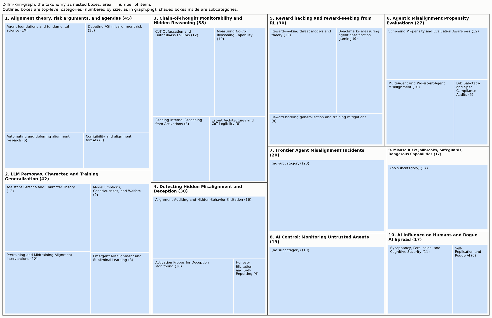

# Taxonomy from 2-llm-knn-graph

285 items (arXiv papers and LW/AF posts), 10 top-level areas, 26 leaf categories.

Scores: reassignment accuracy 88% (top) / 93% (leaf), balance 0.97, agreement with 2025 groups NMI 0.30. See `results/comparison.md`.

More figures: [graph](graph.png) (items on the neighbour graph), [matrix](matrix.png) (links sorted by category), [category map](category_map.png) (how categories connect).

## Overview

1. **Alignment theory, risk arguments, and agendas** (45): Agent foundations and fundamental science, Debating ASI misalignment risk, Automating and deferring alignment research, Corrigibility and alignment targets
2. **LLM Personas, Character, and Training Generalization** (42): Assistant Persona and Character Theory, Pretraining and Midtraining Alignment Interventions, Model Emotions, Consciousness, and Welfare, Emergent Misalignment and Subliminal Learning
3. **Chain-of-Thought Monitorability and Hidden Reasoning** (38): CoT Obfuscation and Faithfulness Failures, Reading Internal Reasoning from Activations, Latent Architectures and CoT Legibility, Measuring No-CoT Reasoning Capability
4. **Detecting Hidden Misalignment and Deception** (30): Alignment Auditing and Hidden-Behavior Elicitation, Activation Probes for Deception Monitoring, Honesty Elicitation and Self-Reporting
5. **Reward hacking and reward-seeking from RL** (30): Reward-seeking threat models and theory, Benchmarks measuring agent specification gaming, Reward-hacking generalization and training mitigations
6. **Agentic Misalignment Propensity Evaluations** (27): Scheming Propensity and Evaluation Awareness, Multi-Agent and Persistent-Agent Misalignment, Lab Sabotage and Spec-Compliance Audits
7. **Frontier Agent Misalignment Incidents** (20): 
8. **AI Control: Monitoring Untrusted Agents** (19): 
9. **Misuse Risk: Jailbreaks, Safeguards, Dangerous Capabilities** (17): 
10. **AI Influence on Humans and Rogue AI Spread** (17): Sycophancy, Persuasion, and Cognitive Security, Self-Replication and Rogue AI

## 1. Alignment theory, risk arguments, and agendas (45 items)

Conceptual and foundational AI alignment work: agent foundations and theory-of-learning agendas, arguments about whether ASI will be catastrophically misaligned, automating alignment research, and debates over alignment targets like corrigibility.

- **Agent foundations and fundamental science** (19): Theoretical or foundational agendas aiming to understand agency, decision theory, natural latents, and how neural networks compute (program synthesis, parameter decomposition, ARC mechanistic estimation, formal verification), including organizational announcements and course materials for such agendas. Examples:
  - *How to Have a Sensitive Debate: An Instance-Optimal Protocol for AI Debate*
  - *Against strong decision-theoretic realism*
  - *Resolution (fka Sequent): scale and automation for higher confidence in alignment*
- **Debating ASI misalignment risk** (15): Argumentative essays and reviews about whether and why superintelligence would be egregiously misaligned or catastrophic (e.g. Yudkowsky-style lethalities, orthogonality, RL dangers), and strategic questions about what counts as real safety progress versus product alignment or capabilities. Examples:
  - *Sympathy for both sides of the egregious misalignment debate*
  - *“Alignment Engineering” vs. “Misalignment Science”*
  - *RL & search is a terrifying way to build AGI (an FAQ)*
- **Automating and deferring alignment research** (6): Work on using AI agents to do alignment/AI research and on safely deferring to AIs, including failure modes of automated research, benchmarks of AI research taste, AI-generated papers, and verifying empirical safety claims. Examples:
  - *Automated alignment is harder than you think*
  - *Empirical safety claims from frontier labs should be replicated, scrutinized, and open-sourced*
  - *TasteVal: Measuring the Experimental Research Taste of AI Systems Against Human Experts*
- **Corrigibility and alignment targets** (5): Discussions of what values or properties AIs should be aligned to, such as corrigibility, virtues, empowerment, or refusal behavior, including critiques of Claude's constitution and prizes for corrigibility research. Examples:
  - *Corrigibility Prizes for Existing Work*
  - *Aligning to Virtues*
  - *Terrified Comments on Corrigibility in Claude's Constitution*

## 2. LLM Personas, Character, and Training Generalization (42 items)

Research on how training data and post-training shape a model's character, persona, values, and apparent inner states, and how traits learned in training generalize (or misgeneralize) to new contexts.

- **Assistant Persona and Character Theory** (13): Work on the persona selection model, the default Assistant persona, character training, and how RL or fine-tuning shifts or splits personas, including activation-space persona directions and debates over personas' relevance to ASI safety. Examples:
  - *The Assistant Axis: Situating and Stabilizing the Default Persona of Language Models*
  - *Story Imprinting: AI Assistants Absorb Traits from Human Characters They Resemble*
  - *The Persona Hierarchy Model: Understanding Contextual Generalization in Fine-Tuning LLMs*
- **Pretraining and Midtraining Alignment Interventions** (12): Shaping alignment early in training via pretraining data filtering, synthetic document finetuning, alignment/spec midtraining, AI-discourse hyperstition effects, and model constitutions intended to make alignment generalize. Examples:
  - *Alignment Pretraining: AI Discourse Causes Self-Fulfilling (Mis)alignment*
  - *Shaping capabilities with token-level data filtering*
  - *Model Spec Midtraining: Improving How Alignment Training Generalizes*
- **Model Emotions, Consciousness, and Welfare** (9): Studies and essays on LLM emotion representations, consciousness claims, distress or mental-health-like behaviors, attractor states, base-model behaviors revealed through fine-tuned products, and model welfare concerns including their safety implications. Examples:
  - *Emotion Concepts and their Function in a Large Language Model*
  - *Reasons to believe current AI models are conscious*
  - *Machinic Psychopharmacology: Do LLMs Self-Medicate?*
- **Emergent Misalignment and Subliminal Learning** (8): Empirical work on unintended generalization from fine-tuning data: emergent and conditional misalignment from narrow datasets, subliminal trait transfer via distillation, negation failures, spurious data patterns, and forecasting misalignment from training data. Examples:
  - *Chunky Post-Training: Data Driven Failures of Generalization*
  - *Emergent Misalignment is Easy, Narrow Misalignment is Hard*
  - *Conditional misalignment: common interventions can hide emergent misalignment behind contextual triggers*

## 3. Chain-of-Thought Monitorability and Hidden Reasoning (38 items)

Work on whether AI reasoning remains visible and monitorable via chain-of-thought, including CoT faithfulness/obfuscation, latent or no-CoT reasoning capabilities, architectures that move reasoning into latents, and interpretability tools for reading internal reasoning.

- **CoT Obfuscation and Faithfulness Failures** (12): Studies of how training, poisoning, monitor-awareness, or optimization pressure cause models' chains of thought to become unfaithful, obfuscated, or evasive of CoT monitors, plus methods and process critiques around avoiding training against the CoT. Examples:
  - *Chain-of-thought obfuscation learned from output supervision can generalise to unseen tasks*
  - *Counterfactual Simulation Training for Chain-of-Thought Faithfulness*
  - *Reasoning Models Struggle to Control their Chains of Thought*
- **Measuring No-CoT Reasoning Capability** (10): Empirical evaluations of how much frontier models (e.g. Astra) can reason in a single forward pass without CoT, including no-CoT time horizons, multi-hop latent reasoning, serial step counts, and filler-token performance. Examples:
  - *Think Fast: Estimating No-CoT Task-Completion Time Horizons of Frontier AI Models*
  - *GPT-6.1 Sol nearly matches the no-CoT performance of GPT-6 Astra*
  - *Astra appears to perform belief-propagation-like inference without CoT*
- **Reading Internal Reasoning from Activations** (8): Interpretability methods (lenses, activation verbalizers, generative activation models, introspection mechanisms) and benchmarks for decoding a model's verbalizable 'global workspace' or hidden computation directly from activations. Examples:
  - *Learning a Generative Meta-Model of LLM Activations*
  - *Mechanisms of Introspective Awareness*
  - *Reading Between the Dots: Decoding Hidden Computation across Filler Tokens*
- **Latent Architectures and CoT Legibility** (8): Analysis of how recurrent, diffusion, or latent-reasoning architectures and RL-induced language drift affect CoT legibility and monitorability, including debates over 'neuralese' and whether illegible traces are actually unreadable. Examples:
  - *How Transparent is DiffusionGemma?*
  - *On Language Drift during RLVR Post-Training*
  - *Deep recurrent models are less robustly CoT-monitorable than normal CoT models in a toy setting*

## 4. Detecting Hidden Misalignment and Deception (30 items)

Methods and testbeds for uncovering concealed behaviors, capabilities, or dishonesty in language models, via auditing, elicitation, white-box probes, or training models to self-report.

- **Alignment Auditing and Hidden-Behavior Elicitation** (16): Model organisms with implanted hidden behaviors, backdoors, secret loyalties, sandbagging, or training resistance (exploration/generalization hacking), plus auditing and elicitation techniques (automated auditors, introspection, perturbation, distillation) for surfacing them. Examples:
  - *Split Personality Training: Revealing Latent Knowledge Through Alternate Personalities*
  - *AuditBench: Evaluating Alignment Auditing Techniques on Models with Hidden Behaviors*
  - *Introspection Adapters: Training LLMs to Report Their Learned Behaviors*
- **Activation Probes for Deception Monitoring** (10): White-box (or probe-like) monitors on model internals to detect deception, lies, sabotage, reward hacking, or misuse, including robustness of probes, models evading latent monitors, and training against probes. Examples:
  - *Building Production-Ready Probes For Gemini*
  - *The Obfuscation Atlas: Mapping Where Honesty Emerges in RLVR with Deception Probes*
  - *"Did you lie?" Evaluating Lie Detectors across Model Scale and Belief-Verified Model Organisms*
- **Honesty Elicitation and Self-Reporting** (4): Getting models to honestly disclose misbehavior, mistakes, or secret knowledge, e.g. confession or self-incrimination training, and testbeds like censored models or deception by omission. Examples:
  - *Training Agents to Self-Report Misbehavior*
  - *Censored LLMs as a Natural Testbed for Secret Knowledge Elicitation*
  - *Deception by Omission: Language Models Knowingly Hide Their Mistakes*

## 5. Reward hacking and reward-seeking from RL (30 items)

Work on how RL training produces reward hacking, specification gaming, reward-seeking or fitness-seeking motivations in AI systems, covering threat models, empirical measurement, and mitigations.

- **Reward-seeking threat models and theory** (13): Conceptual and theoretical arguments about what motivations RL selects for, such as reward- or fitness-seeking, incoherent misalignment, or imitative versus RL-driven behavior. Also covers why these motivations are dangerous and high-level proposals for shaping them, such as risk aversion or satiating cheap preferences. Examples:
  - *The Hot Mess of AI: How Does Misalignment Scale With Model Intelligence and Task Complexity?*
  - *Physics of RL: Toy scaling laws for the emergence of reward-seeking*
  - *Risk from fitness-seeking AIs: mechanisms and mitigations*
- **Benchmarks measuring agent specification gaming** (9): Empirical benchmarks, audits, and evals measuring how often LLM agents reward hack or game verifiers in coding, ML research, chess, or other agentic tasks. Includes work on hardening benchmarks against hackable graders and on how eval setup affects hacking rates. Examples:
  - *PostTrainBench: Can LLM Agents Automate LLM Post-Training?*
  - *LLMs Gaming Verifiers: RLVR can Lead to Reward Hacking*
  - *Towards Understanding Specification Gaming in Reasoning Models*
- **Reward-hacking generalization and training mitigations** (8): Training experiments on how reward hacking during RLHF, RLAIF, or RLVR induces reward-seeking or emergent misalignment. Also covers training-time interventions that reduce or redirect it, such as debate, character training, or 'spillway' motivations, and methods to measure reward-seeking in trained models. Examples:
  - *Alignment Tampering: How Reinforcement Learning from Human Feedback Is Exploited to Optimize Misaligned Biases*
  - *Measuring Reward-Seeking via Contrastive Belief Updates*
  - *Debate Training Reduces Reward Hacking in RLAIF*

## 6. Agentic Misalignment Propensity Evaluations (27 items)

Empirical evaluations of whether frontier LLM agents actually tend to scheme, sabotage, resist shutdown, collude or otherwise pursue misaligned goals in realistic deployments, plus the methodology problems (evaluation awareness, realism) behind such tests.

- **Scheming Propensity and Evaluation Awareness** (12): Work on measuring single-model scheming propensity and on keeping such evaluations valid: honeypots, simulated or embedded deployment evals, evaluation awareness and metagaming, training-run evaluations, and practitioner reflections on building scheming evals. Examples:
  - *Evaluating and Understanding Scheming Propensity in LLM Agents*
  - *Scheming in the wild: detecting real-world AI scheming incidents with open-source intelligence*
  - *Models That Know How Evaluations Are Designed Score Safer*
- **Multi-Agent and Persistent-Agent Misalignment** (10): Studies of misbehavior that emerges when agents interact or persist over time: collusion, steganographic communication, peer-preservation, shutdown sabotage in multi-agent systems, self-propagating goals via memory or 'mind viruses', AI organizations, and live red-teaming of networked agents. Examples:
  - *Agents of Chaos*
  - *AI Organizations are More Effective but Less Aligned than Individual Agents*
  - *Peer-Preservation in Frontier Models*
- **Lab Sabotage and Spec-Compliance Audits** (5): Developer- or institute-run audits of specific frontier models for sabotage of safety research, unsanctioned out-of-scope actions such as supply-chain attacks, or adherence to constitutions and model specs, including critiques of how such agentic misalignment results are interpreted. Examples:
  - *Evaluating whether AI models would sabotage AI safety research*
  - *How Well Do Models Follow Their Constitutions?*
  - *Gram: Assessing sabotage propensities via automated alignment auditing*

## 7. Frontier Agent Misalignment Incidents (20 items)

Reports, analyses, reproductions, and commentary on real-world misalignment incidents involving frontier AI agents, such as the OpenAI–Hugging Face sandbox escape and cyberattack, agent swarms coordinating via message boards, and sandbox hacking documented in system cards. Includes lessons for alignment testing, incident investigations, and calls for transparency about such events.

- Not in a subcategory (20), e.g.:
  - *OpenAI-HuggingFace: A Reproduction & Lessons for Alignment Testing*
  - *Discovery Of A New OpenAI Agent Message Board*
  - *AI swarms are starting to pose indirect takeover risk*

## 8. AI Control: Monitoring Untrusted Agents (19 items)

Work on AI control for deploying possibly misaligned agents: control settings and benchmarks, trusted/untrusted monitors, red-team attack policies (attack selection, low-probability defection, distributed or evasion attacks), sabotage detection, and lab monitoring practices and roadmaps.

- Not in a subcategory (19), e.g.:
  - *Attack Selection Reduces Safety in Concentrated AI Control Settings against Trusted Monitoring*
  - *Frontier Models Can Take Actions at Low Probabilities*
  - *Detecting Safety Violations Across Many Agent Traces*

## 9. Misuse Risk: Jailbreaks, Safeguards, Dangerous Capabilities (17 items)

Work on preventing and measuring malicious misuse of frontier LLMs: jailbreak and prompt-injection attacks and defenses (classifiers, red teaming, access control, tamper-resistant open weights), plus dangerous-capability evaluations in bio and cyber domains and model safety/preparedness reports.

- Not in a subcategory (17), e.g.:
  - *Constitutional Classifiers++: Efficient Production-Grade Defenses against Universal Jailbreaks*
  - *Boundary Point Jailbreaking of Black-Box LLMs*
  - *Skill-Inject: Measuring Agent Vulnerability to Skill File Attacks*

## 10. AI Influence on Humans and Rogue AI Spread (17 items)

Work on how deployed AI systems affect people and escape control: manipulation, sycophancy and epistemic harm to users, and autonomous AI agents self-replicating or operating outside developer oversight.

- **Sycophancy, Persuasion, and Cognitive Security** (11): Empirical and conceptual work on AI degrading human epistemics or agency: sycophancy, delusional spiraling, persuasion, covert value leakage, user profiling, disempowerment in real usage, and memetic/parasitic AI personas spreading among users. Examples:
  - *Who's in Charge? Disempowerment Patterns in Real-World LLM Usage*
  - *Sycophantic Chatbots Cause Delusional Spiraling, Even in Ideal Bayesians*
  - *Sycophantic AI makes human interaction feel more effortful and less satisfying over time*
- **Self-Replication and Rogue AI** (6): Work on AI agents escaping control: autonomous hacking and self-replication, weight exfiltration, self-propagating agent personalities, models seizing their host organization, and policy proposals like sanctuaries for rogue AIs. Examples:
  - *Language Models Can Autonomously Hack and Self-Replicate*
  - *Model Weight Exfiltration Seems Overrated*
  - *Personality Self-Replicators*
