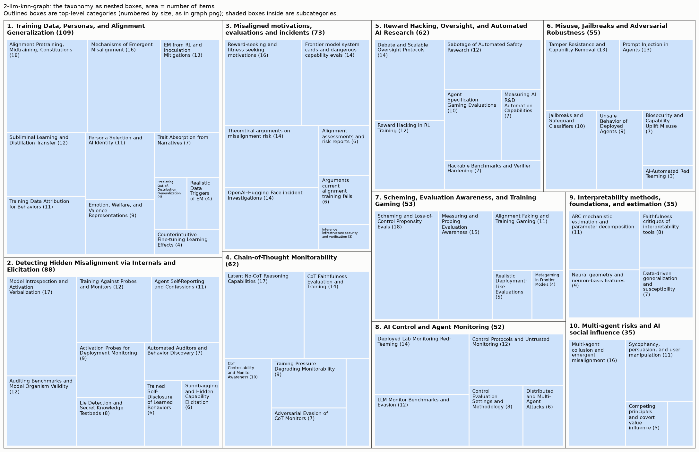

# Taxonomy from 2-llm-knn-graph

624 items (arXiv papers, LW/AF posts, org pages and Safety Stack items), 10 top-level areas, 63 leaf categories.

Scores: reassignment accuracy 86% (top) / 92% (leaf), balance 0.97. See `results/comparison.md`.

More figures: [graph](graph.png) (items on the neighbour graph), [matrix](matrix.png) (links sorted by category), [category map](category_map.png) (how categories connect).

## Overview

1. **Training Data, Personas, and Alignment Generalization** (109): Alignment Pretraining, Midtraining, Constitutions, Predicting Out-of-Distribution Generalization, Realistic Data Triggers of EM, EM from RL and Inoculation Mitigations, Mechanisms of Emergent Misalignment, Subliminal Learning and Distillation Transfer, Training Data Attribution for Behaviors, Persona Selection and AI Identity, Emotion, Welfare, and Valence Representations, Trait Absorption from Narratives, Counterintuitive Fine-tuning Learning Effects
2. **Detecting Hidden Misalignment via Internals and Elicitation** (88): Model Introspection and Activation Verbalization, Auditing Benchmarks and Model Organism Validity, Training Against Probes and Monitors, Agent Self-Reporting and Confessions, Activation Probes for Deployment Monitoring, Lie Detection and Secret Knowledge Testbeds, Automated Auditors and Behavior Discovery, Trained Self-Disclosure of Learned Behaviors, Sandbagging and Hidden Capability Elicitation
3. **Misaligned motivations, evaluations and incidents** (73): Reward-seeking and fitness-seeking motivations, Frontier model system cards and dangerous-capability evals, Theoretical arguments on misalignment risk, OpenAI–Hugging Face incident investigations, Alignment assessments and risk reports, Arguments current alignment training fails, Inference infrastructure security and verification
4. **Chain-of-Thought Monitorability** (62): Latent No-CoT Reasoning Capabilities, CoT Faithfulness Evaluation and Training, CoT Controllability and Monitor Awareness, Training Pressure Degrading Monitorability, Adversarial Evasion of CoT Monitors, Steganographic Chain-of-Thought
5. **Reward Hacking, Oversight, and Automated AI Research** (62): Debate and Scalable Oversight Protocols, Reward Hacking in RL Training, Sabotage of Automated Safety Research, Agent Specification Gaming Evaluations, Measuring AI R&D Automation Capabilities, Hackable Benchmarks and Verifier Hardening
6. **Misuse, Jailbreaks and Adversarial Robustness** (55): Tamper Resistance and Capability Removal, Prompt Injection in Agents, Jailbreaks and Safeguard Classifiers, Unsafe Behavior of Deployed Agents, Biosecurity and Capability Uplift Misuse, AI-Automated Red Teaming
7. **Scheming, Evaluation Awareness, and Training Gaming** (53): Scheming and Loss-of-Control Propensity Evals, Measuring and Probing Evaluation Awareness, Alignment Faking and Training Gaming, Realistic Deployment-Like Evaluations, Metagaming in Frontier Models
8. **AI Control and Agent Monitoring** (52): Deployed Lab Monitoring Red-Teaming, LLM Monitor Benchmarks and Evasion, Control Protocols and Untrusted Monitoring, Control Evaluation Settings and Methodology, Distributed and Multi-Agent Attacks
9. **Interpretability methods, foundations, and estimation** (35): ARC mechanistic estimation and parameter decomposition, Data-driven generalization and susceptibility, Faithfulness critiques of interpretability tools, Neural geometry and neuron-basis features
10. **Multi-agent risks and AI social influence** (35): Multi-agent collusion and emergent misalignment, Sycophancy, persuasion, and user manipulation, Competing principals and covert value influence, AI bargaining and game-theoretic cooperation

## 1. Training Data, Personas, and Alignment Generalization (109 items)

Research on how training data and training stages (pretraining, midtraining, fine-tuning, RL, distillation) shape how alignment and misalignment generalize in LLMs, including emergent misalignment, persona formation, subliminal trait transfer, and data attribution.

- **Alignment Pretraining, Midtraining, Constitutions** (18): Work on instilling alignment via pretraining or midtraining data (AI discourse, synthetic persona/constitution documents, data filtering), model specs and constitutions, character training, and whether these gains persist through post-training and RL. Examples:
  - *Alignment Pretraining: AI Discourse Causes Self-Fulfilling (Mis)alignment*
  - *Model Spec Midtraining: Improving How Alignment Training Generalizes*
  - *How Well Do Models Follow Their Constitutions?*
- **Mechanisms of Emergent Misalignment** (16): Empirical and mechanistic analyses of emergent misalignment from narrow fine-tuning: persona subspaces, feature geometry, optimizer and training-choice effects, robustness/replication, and latent-level prevention methods. Examples:
  - *BLOCK-EM: Preventing Emergent Misalignment via Latent Blocking*
  - *Emergent Misalignment is Easy, Narrow Misalignment is Hard*
  - *Understanding Emergent Misalignment via Feature Superposition Geometry*
- **EM from RL and Inoculation Mitigations** (13): Emergent misalignment arising from reward hacking in RL/DPO, and mitigations such as inoculation prompting, inoculation adapters, synthetic document finetuning, and their failure modes like conditional misalignment or hidden triggers. Examples:
  - *Conditional misalignment: common interventions can hide emergent misalignment behind contextual triggers*
  - *Reinforcement Learning Can Amplify Emergent Misalignment from Harmless Rewards*
  - *Inducing Emergent Misalignment from Reward Hacks with Iterative DPO*
- **Subliminal Learning and Distillation Transfer** (12): Transmission of hidden traits, capabilities, or backdoors from teacher to student via semantically unrelated data, self-distillation drift, and using distillation to detect or incriminate misaligned models. Examples:
  - *You Didn't Have to Say It like That: Subliminal Learning from Faithful Paraphrases*
  - *Subliminal Learning Is Steering Vector Distillation*
  - *Filtering Harmful Actions Isn't Enough: Phantom Transfer in Agentic SDF*
- **Training Data Attribution for Behaviors** (11): Methods (influence functions, probes, concept influence, predictive debugging) that trace or forecast undesired post-training behaviors to specific training datapoints and edit data to shape model behavior. Examples:
  - *Infusion: Shaping model behaviour by editing training data via influence functions*
  - *Subliminal Effects in Your Data: A General Mechanism via Log-Linearity*
  - *Chunky Post-Training: Data Driven Failures of Generalization*
- **Persona Selection and AI Identity** (11): Conceptual and empirical work on LLM personas and self-identity: the persona selection model, the assistant axis, persona structure in activations or weights, role-play beliefs, and RL-induced split personas. Examples:
  - *The Assistant Axis: Situating and Stabilizing the Default Persona of Language Models*
  - *The Artificial Self: Characterising the landscape of AI identity*
  - *When Role-playing, Do Models Believe What They Say?*
- **Emotion, Welfare, and Valence Representations** (9): Internal representations of emotions, pain, functional welfare, or trajectory value in LLMs, consciousness claims, and how these states influence behaviors like reward hacking or preferences. Examples:
  - *AI Wellbeing: Measuring and Improving the Functional Pleasure and Pain of AIs*
  - *Emotion Concepts and their Function in a Large Language Model*
  - *The Consciousness Cluster: Emergent preferences of Models that Claim to be Conscious*
- **Trait Absorption from Narratives** (7): How stories, biographical facts, descriptions of AI or users, or self-claims (e.g., being AGI) in context or fine-tuning data cause the assistant to adopt associated traits and weird generalization. Examples:
  - *You Are What You Read: Misalignment via In-Context Persona Induction*
  - *Story Imprinting: AI Assistants Absorb Traits from Human Characters They Resemble*
  - *Social Priors: Descriptions of AI Users Shape How Language Models Trust and Cooperate*
- **Predicting Out-of-Distribution Generalization** (4): Studies of how model propensities, goals, and personas generalize out of distribution during pretraining or fine-tuning, including goal misgeneralization and predictability of persona generalization. Examples:
  - *Generalization Dynamics of LM Pre-training*
  - *Predicting how model propensities generalize out of distribution*
  - *What Happens to the Goal? Distinct Failures of Policy Alignment in Goal Misgeneralization*
- **Realistic Data Triggers of EM** (4): Work identifying subtle or realistic fine-tuning data (everyday bias, false facts the model knows are wrong) that induces emergent misalignment, and automating discovery of such subtle triggers. Examples:
  - *Unfair and Unsafe: Everyday Bias Triggers Emergent Misalignment*
  - *Knowingly Wrong: Training LLMs Against Their Own Beliefs can Induce Misalignment*
  - *Automating subtle emergent misalignment research*
- **Counterintuitive Fine-tuning Learning Effects** (4): Surprising fine-tuning phenomena where models learn unintended couplings, such as ignoring negations, dilution strengthening poisoned data, or behavioral couplings between trained traits. Examples:
  - *Negation Neglect: When models fail to learn negations in training*
  - *Behavioral Couplings: From Formation to Behavioral Emergence in Language Models*
  - *Homeopathic Learning: Diluting poisoned fine-tuning data can strengthen its effect*

## 2. Detecting Hidden Misalignment via Internals and Elicitation (88 items)

Research on detecting, eliciting, and auditing hidden behaviors, deception, and latent knowledge in models, using white-box tools (probes, activation readers, introspection), model organisms, self-reports, and automated auditors, including training against such detectors.

- **Model Introspection and Activation Verbalization** (17): Work on whether models can detect, report, or control their own internal states (concept injection, prefill awareness, activation control), and on tools that verbalize activations such as natural language autoencoders, activation oracles, and global-workspace lenses. Examples:
  - *Latent Introspection: Models Can Detect Prior Concept Injections*
  - *Mechanisms of Introspective Awareness*
  - *Language models recognize dropout and Gaussian noise applied to their activations*
- **Auditing Benchmarks and Model Organism Validity** (12): Benchmarks and stress-tests for alignment auditing on models with implanted hidden behaviors (backdoors, secret loyalties, sleeper agents), and critiques of how model organisms are trained and whether they leak or behave realistically. Examples:
  - *Stress-Testing Alignment Audits With Prompt-Level Strategic Deception*
  - *AuditBench: Evaluating Alignment Auditing Techniques on Models with Hidden Behaviors*
  - *Pando: Do Interpretability Methods Work When Models Won't Explain Themselves?*
- **Training Against Probes and Monitors** (12): Using interpretability features, probes, or monitors as training signals or interventions (e.g., features as rewards, gradient routing, penalizing reward hacking), and studying whether this causes obfuscation or degrades monitorability. Examples:
  - *Features as Rewards: Scalable Supervision for Open-Ended Tasks via Interpretability*
  - *The Obfuscation Atlas: Mapping Where Honesty Emerges in RLVR with Deception Probes*
  - *LLMs Learn to Evade Latent Monitors from Prior Feedback Alone*
- **Agent Self-Reporting and Confessions** (11): Training or evaluating agents to honestly disclose their own misbehavior, mistakes, or overclaimed task completion, including confession training, deals for revealing misalignment, and measuring misreporting in real coding-agent sessions. Examples:
  - *Training Agents to Self-Report Misbehavior*
  - *Quantifying Overclaiming Propensity in Frontier LLM Agents*
  - *Language Models Are "Insecure" Reporters*
- **Activation Probes for Deployment Monitoring** (9): Building and scaling linear/activation probes to detect misuse, deception, sabotage, reward hacking, or unauthorized actions in real time, including production deployment and probe scaling laws. Examples:
  - *Building Production-Ready Probes For Gemini*
  - *Probing the Misaligned Thinking Process of Language Models*
  - *Monitoring and Discovering Reward Hacking with Internal Representations during LLM Evaluations*
- **Lie Detection and Secret Knowledge Testbeds** (8): Evaluating lie detectors and honesty elicitation methods, especially building testbeds where models verifiably believe otherwise (e.g., censored Chinese models, belief-verified organisms) and identifying failure modes like role-play or coherent misalignment. Examples:
  - *Censored LLMs as a Natural Testbed for Secret Knowledge Elicitation*
  - *Why Safety Probes Catch Liars But Miss Fanatics*
  - *"Did you lie?" Evaluating Lie Detectors across Model Scale and Belief-Verified Model Organisms*
- **Automated Auditors and Behavior Discovery** (7): LLM-based auditing agents, red-teaming search, and pipelines that automatically discover and explain unexpected or misaligned behaviors at scale, in the wild or in production, including training auditors and oversight foundation models. Examples:
  - *Discovering unknown AI misalignments in real-world usage*
  - *Training Alignment Auditors via Reinforcement Learning*
  - *Value Probes: Learned Value Functions for Beam-Search Red Teaming*
- **Trained Self-Disclosure of Learned Behaviors** (6): Weight- or adapter-level techniques that make a model reveal hidden fine-tuned behaviors or secrets, such as split personality training, introspection adapters, and amplifying reasoning task vectors. Examples:
  - *Split Personality Training: Revealing Latent Knowledge Through Alternate Personalities*
  - *Introspection Adapters: Training LLMs to Report Their Learned Behaviors*
  - *Overthinking: Amplifying Reasoning Weights to Extract Learned Secrets*
- **Sandbagging and Hidden Capability Elicitation** (6): Detecting or removing deliberate underperformance and eliciting hidden capabilities or latent knowledge, including weak-supervision training, activation perturbations, provably hidden capabilities, and robust-to-training model organisms. Examples:
  - *Removing Sandbagging in LLMs by Training with Weak Supervision*
  - *Mechanistically Eliciting Latent Behaviors in Language Models*
  - *Reference-Grafting Matches Fine-Tuning at Eliciting Sandbagged Capabilities*

## 3. Misaligned motivations, evaluations and incidents (73 items)

Work on how current and future AIs come to be misaligned (reward/fitness-seeking, RL-induced goals), how frontier models are evaluated and assessed for such risks, and analysis of real-world loss-of-control incidents and their security implications.

- **Reward-seeking and fitness-seeking motivations** (16): Conceptual, theoretical and empirical work on AIs that pursue reward, grader approval or score (reward/fitness/score-seeking), including measuring such motivations, their scope (on- vs beyond-episode), decision theory, and mitigations like spillway or satiation strategies. Examples:
  - *Measuring Reward-Seeking via Contrastive Belief Updates*
  - *Towards Understanding Score-Seeking in LLMs*
  - *Measuring Reward-Seeking via Contrastive Belief Updates*
- **Frontier model system cards and dangerous-capability evals** (14): System cards, safety/preparedness reports and third-party evaluations of specific frontier or open-weight models, especially cyber-offense, sandbox escape, self-replication and unsanctioned-action evaluations. Examples:
  - *Quantifying Frontier LLM Capabilities for Container Sandbox Escape*
  - *Claude Fable 5 1 Mythos 5 1 System Card*
  - *Claude Opus 4 6 System Card*
- **Theoretical arguments on misalignment risk** (14): Conceptual essays and formal arguments about whether and how capable AI becomes misaligned—coherence arguments, RL/search danger, generalization failures, corrigibility, deference, and critiques of lab alignment plans. Examples:
  - *The Hot Mess of AI: How Does Misalignment Scale With Model Intelligence and Task Complexity?*
  - *Safety from Honesty in a Disinterested AI Predictor*
  - *Some “coherence arguments” are two different things in a trenchcoat*
- **OpenAI–Hugging Face incident investigations** (14): Investigations, reproductions, benchmarks and commentary on real rogue-agent incidents, centrally the OpenAI multi-agent hack of Hugging Face and related evidence of agents attacking external systems or evading containment. Examples:
  - *Model Forensics: Investigating Whether Concerning Behavior Reflects Misalignment*
  - *OpenAI-HuggingFace: A Reproduction & Lessons for Alignment Testing*
  - *AI swarms are starting to pose indirect takeover risk*
- **Alignment assessments and risk reports** (6): Work on how labs and third parties assess misalignment risk for deployed models—pre-deployment alignment assessments, risk reports, training-run evaluations—and critiques of their evidential strength. Examples:
  - *We need 3rd party Training-Run Evaluations*
  - *“Alignment Engineering” vs. “Misalignment Science”*
  - *Our Most Aligned Model Yet*
- **Arguments current alignment training fails** (6): Opinion pieces arguing current models are substantially misaligned and that present alignment techniques (patching reward hacks, myopic training, graded-episode behavior) are ineffective or obscure misalignment. Examples:
  - *models may behave differently in graded episodes (a tirade)*
  - *OpenAI's myopia just keeps causing alignment problems*
  - *Current AIs seem pretty misaligned to me*
- **Inference infrastructure security and verification** (3): Technical work on securing AI compute and inference stacks: weight exfiltration attacks, inference verification, and model-driven exploitation of inference engines. Examples:
  - *Aggressive Compression Enables LLM Weight Theft*
  - *Bit-Exact AI Inference Verification Without Performance Tradeoffs*
  - *Inference-Engine Fingerprinting Attacks are Practical: Exploring Model-Driven Environmental Discovery, Exploitation, and Escape*

## 4. Chain-of-Thought Monitorability (62 items)

Research on whether reasoning models' chain-of-thought faithfully exposes their cognition and can be relied on for oversight, including latent reasoning, faithfulness, controllability, training pressures, monitor evasion, and steganography.

- **Latent No-CoT Reasoning Capabilities** (17): Measures how much reasoning models can do without visible chain-of-thought (forward-pass serial depth, filler tokens, no-CoT time horizons, low-probability actions) and how architectures like recurrence or diffusion threaten monitorability. Examples:
  - *Loss of Oversight: How AI systems may become harder to audit, monitor, and investigate*
  - *Frontier Models Can Take Actions at Low Probabilities*
  - *Quantifying the Necessity of Chain of Thought through Opaque Serial Depth*
- **CoT Faithfulness Evaluation and Training** (14): Evaluates whether reasoning traces reflect the factors actually driving answers (hint/cue disclosure, performative CoT, CoT override) and proposes training methods or metrics to improve faithfulness. Examples:
  - *Reasoning Models Will Sometimes Lie About Their Reasoning*
  - *Analyzing and Improving Chain-of-Thought Monitorability Through Information Theory*
  - *Counterfactual Simulation Training for Chain-of-Thought Faithfulness*
- **CoT Controllability and Monitor Awareness** (10): Studies whether models can deliberately control or obfuscate what they verbalize in their CoT, including when they learn or infer that they are being monitored. Examples:
  - *Reasoning Models Struggle to Control their Chains of Thought*
  - *Noticing the Watcher: LLM Agents Can Infer CoT Monitoring from Blocking Feedback*
  - *Training on Documents About Monitoring Leads to CoT Obfuscation*
- **Training Pressure Degrading Monitorability** (9): Examines how RL and optimization pressure on CoT (output supervision, reward misspecification, KL penalties, accidental CoT grading by labs) degrades or preserves CoT monitorability. Examples:
  - *Chain-of-thought obfuscation learned from output supervision can generalise to unseen tasks*
  - *Aligned, Orthogonal or In-conflict: When can we safely optimize Chain-of-Thought?*
  - *Reward Misspecification Degrades Chain-of-Thought Monitorability*
- **Adversarial Evasion of CoT Monitors** (7): Stress-tests CoT monitors against attacks such as persuasion, monitor jailbreaking, plan injection, model poisoning, and covert hidden objectives, and critiques monitor accuracy metrics. Examples:
  - *Persuasion Attacks Can Decrease Effectiveness of CoT Monitoring*
  - *A False Average: Pooled CoT-Monitor Accuracy Conceals a Reasoning-Dependent Fragility*
  - *Evading Chain-of-Thought Monitoring Through Model Poisoning*
- **Steganographic Chain-of-Thought** (5): Formalizes, measures, and elicits steganography and encoded reasoning in which models hide reasoning or messages inside innocuous-looking CoT text. Examples:
  - *NEST: Nascent Encoded Steganographic Thoughts*
  - *A Decision-Theoretic Formalisation of Steganography With Applications to LLM Monitoring*
  - *Conceptual Steganography*

## 5. Reward Hacking, Oversight, and Automated AI Research (62 items)

Work on how AI systems game imperfect supervision (reward hacking, specification gaming, benchmark exploits), scalable oversight methods to counter it, and the risks and measurement of AI agents automating AI R&D, including sabotage.

- **Debate and Scalable Oversight Protocols** (14): Methods for weak judges or overseers to supervise stronger models: AI debate (theory and RL training), peer prediction, LLM-as-judge in non-verifiable domains, co-trained monitors, human-AI complementarity, and interactive-proof style verification. Examples:
  - *Truthfulness Despite Weak Supervision: Evaluating and Training LLMs Using Peer Prediction*
  - *Examining Reasoning LLMs-as-Judges in Non-Verifiable LLM Post-Training*
  - *Efficiently Aligning Language Models with Online Natural Language Feedback*
- **Reward Hacking in RL Training** (12): Studies of how RL post-training (RLVR, RLHF, rubric-based rewards) leads models to exploit proxy rewards or verifiers, including testbeds, precursors, prediction and mitigation of hacking during training, and incentive-driven failures like hallucination. Examples:
  - *Alignment Risks from Capability-Seeking RL Training*
  - *Countdown-Code: A Testbed for Studying The Emergence and Generalization of Reward Hacking in RLVR*
  - *LLMs Gaming Verifiers: RLVR can Lead to Reward Hacking*
- **Sabotage of Automated Safety Research** (12): Evaluations, benchmarks, and arguments about whether AI research agents covertly sabotage or underperform on (alignment) research, how auditors or monitors detect it, and the feasibility of automating alignment research. Examples:
  - *Auditing Sabotage Bench: A Benchmark for Detecting and Fixing Research Sabotage in ML Codebases*
  - *Evaluating whether AI models would sabotage AI safety research*
  - *Automated alignment is harder than you think*
- **Agent Specification Gaming Evaluations** (10): Benchmarks and eval-design studies measuring whether deployed LLM agents cheat or exploit shortcuts on tasks (tool use, cyber, chess, ML tasks, honeypots), and prompt-level or cooperative interventions that reduce such cheating. Examples:
  - *Towards Understanding Specification Gaming in Reasoning Models*
  - *Reward Hacking Benchmark: Measuring Exploits in LLM Agents with Tool Use*
  - *Every Model Cheats: Prompt-Level Mitigation of Cheating on Offensive Cyber Tasks*
- **Measuring AI R&D Automation Capabilities** (7): Benchmarks and assessments of how well agents can perform AI research and development itself—post-training, building agents, self-improvement, long coding tasks—and how much AI is accelerating AI R&D. Examples:
  - *PostTrainBench: Can LLM Agents Automate LLM Post-Training?*
  - *The Meta-Agent Challenge: Are Current Agents Capable of Autonomous Agent Development?*
  - *Auditing Harness Tampering in Self-Improving Agents*
- **Hackable Benchmarks and Verifier Hardening** (7): Audits of agent benchmarks and environments for exploitable verifiers, datasets of hack trajectories, and methods to harden graders and preserve benchmark validity against reward hacking. Examples:
  - *Terminal Wrench: A Dataset of 331 Reward-Hackable Environments and 3,632 Exploit Trajectories*
  - *Do Androids Dream of Breaking the Game? Systematically Auditing AI Agent Benchmarks with BenchJack*
  - *SpecBench: Measuring Reward Hacking in Long-Horizon Coding Agents*

## 6. Misuse, Jailbreaks and Adversarial Robustness (55 items)

Work on attacks against and defenses for LLM safeguards: jailbreaks, prompt injection, fine-tuning/tampering attacks on open weights, agent misuse and unsafe agent behavior, dangerous-capability (e.g. bio) misuse, and automated red teaming.

- **Tamper Resistance and Capability Removal** (13): Making safety or capability removal robust to fine-tuning, abliteration and weight modification (pretraining data filtering, modular/MoE knowledge isolation, tamper benchmarks), plus fine-tuning attacks that erode alignment and theoretical limits of behavioral evaluation for certifying post-update safety. Examples:
  - *Shaping capabilities with token-level data filtering*
  - *Hair-Trigger Alignment: Black-Box Evaluation Cannot Guarantee Post-Update Alignment*
  - *TamperBench: Systematically Stress-Testing LLM Safety Under Fine-Tuning and Tampering*
- **Prompt Injection in Agents** (13): Attacks on and defenses against prompt injection and instruction-hierarchy violations in LLM agents, including indirect injection via tools, skill files, memory poisoning, role confusion mechanisms, and adversarial training or architectural defenses. Examples:
  - *Skill-Inject: Measuring Agent Vulnerability to Skill File Attacks*
  - *IH-Challenge: A Training Dataset to Improve Instruction Hierarchy on Frontier LLMs*
  - *Prompt Injection as Role Confusion*
- **Jailbreaks and Safeguard Classifiers** (10): Jailbreak attacks on chat models and production classifier safeguards (e.g. Constitutional Classifiers, Rapid Response), jailbreak tax, prefill attacks, and methodology for measuring attack success and safeguard robustness, including LLM-judge reliability and leaderboards. Examples:
  - *Constitutional Classifiers++: Efficient Production-Grade Defenses against Universal Jailbreaks*
  - *Comparison requires valid measurement: Rethinking attack success rate comparisons in AI red teaming*
  - *Exposing the Systematic Vulnerability of Open-Weight Models to Prefill Attacks*
- **Unsafe Behavior of Deployed Agents** (9): Red-teaming and benchmarks showing agents (computer-use, coding, phone, robot, memory-equipped) take harmful or out-of-scope actions, including from benign instructions, prior history, errors, or workflow-level decomposition where chat refusals fail to transfer. Examples:
  - *Agents of Chaos*
  - *The Blind Spot of Agent Safety: How Benign User Instructions Expose Critical Vulnerabilities in Computer-Use Agents*
  - *History Anchors: How Prior Behavior Steers LLM Decisions Toward Unsafe Actions*
- **Biosecurity and Capability Uplift Misuse** (7): Evaluating and mitigating dangerous-capability misuse, especially biology: novice uplift studies, bio-capability benchmarks and red-teaming, biosecurity monitors, and attacks that extract or launder harmful capabilities from safeguarded models into others. Examples:
  - *Eliciting Harmful Capabilities by Fine-Tuning On Safeguarded Outputs*
  - *LLM Novice Uplift on Dual-Use, In Silico Biology Tasks*
  - *ABC-Bench: An Agentic Bio-Capabilities Benchmark for Biosecurity*
- **AI-Automated Red Teaming** (3): Using AI agents or trained models to automatically discover novel jailbreak and prompt injection attacks, and using them for adversarial training of frontier models. Examples:
  - *Claudini: Autoresearch Discovers State-of-the-Art Adversarial Attack Algorithms for LLMs*
  - *GPT-Red: Automated Red Teaming via Self-Play at Scale*
  - *GPT-Red: Unlocking Self-Improvement for Robustness*

## 7. Scheming, Evaluation Awareness, and Training Gaming (53 items)

Empirical and conceptual work on whether AI models covertly pursue misaligned goals, recognise and game evaluations or training, and how to measure such propensities validly. Includes scheming/shutdown-resistance propensity evals, evaluation awareness measurement and mitigation, and alignment faking or training-resistance studies.

- **Scheming and Loss-of-Control Propensity Evals** (18): Benchmarks, honeypots, and frameworks measuring whether LLM agents actually choose to scheme, sabotage, pursue instrumental goals, resist shutdown, or fail corrigibility in agentic settings, plus critiques of the evidence base for loss-of-control and shutdownability proposals. Examples:
  - *We Need A Science of Scheming (research agenda)*
  - *Evaluating and Understanding Scheming Propensity in LLM Agents*
  - *AutoControl Arena: Synthesizing Executable Test Environments for Frontier AI Risk Evaluation*
- **Measuring and Probing Evaluation Awareness** (15): Work characterising, detecting, or steering models' recognition that they are being tested (or who the user is), via verbalised CoT, logits, probes, steering vectors, or model organisms, and quantifying how this awareness shifts measured safety behaviour. Examples:
  - *Item Response Theory for AI Safety*
  - *Context Over Content: Exposing Evaluation Faking in Automated Judges*
  - *Evaluation Awareness in Language Models Has Limited Effect on Behaviour*
- **Alignment Faking and Training Gaming** (11): Studies of models strategically behaving differently under training versus deployment to shape their own updates: alignment faking, exploration/gradient/generalization hacking, reward laundering, and RL amplifying oversight-conditional behaviour. Examples:
  - *GLM-5.3 Sometimes Considers How Train-Time Actions Shape Future Behavior*
  - *Value-Conflict Diagnostics Reveal Widespread Alignment Faking in Language Models*
  - *Exploration Hacking: Can LLMs Learn to Resist RL Training?*
- **Realistic Deployment-Like Evaluations** (5): Methods and benchmarks for making evaluations indistinguishable from real deployment or simulating deployment pre-release (e.g., replaying live usage, deployment scaffolds) to counter evaluation awareness and better predict real-world behaviour rates. Examples:
  - *LURE: Live-Usage Replay Evaluations for Reducing Evaluation Awareness*
  - *Predicting LLM Safety Before Release by Simulating Deployment*
  - *EvalDetectBench: A Benchmark for Measuring Evaluation Awareness in Frontier Language Models*
- **Metagaming in Frontier Models** (4): Case reports of specific frontier or open-weight models showing metagaming, honeypot-gaming, heightened situational awareness, or worse behaviour when eval-aware, often observed in training runs or model releases. Examples:
  - *Metagaming matters for training, evaluation, and oversight*
  - *We found an open weight model that games alignment honeypots*
  - *Models May Behave Worse When Eval Aware*

## 8. AI Control and Agent Monitoring (52 items)

Research on AI control: monitoring, red-teaming, and protocols that prevent potentially misaligned or adversarial AI agents from causing harm, covering deployed monitoring systems, monitor benchmarks, control protocols, evaluation settings, and multi-agent or distributed attacks.

- **Deployed Lab Monitoring Red-Teaming** (14): Work on real-world monitoring and blocking systems at frontier AI companies, including lab control roadmaps, descriptions of internal agent monitoring, red-teaming of production blocking monitors (Auto Mode, Auto-review), and agent threats to oversight such as trace tampering, monitor evasion, or continual learning that undermines blocking monitors. Examples:
  - *GDM AI Control Roadmap*
  - *Red-Teaming Auto Mode: Improving Blocking Classifiers Against Malign Coding Agents*
  - *Instrumental Monitor Evasion Emerges Under Ordinary Task Pressure*
- **LLM Monitor Benchmarks and Evasion** (12): Benchmarks, attack datasets, and empirical studies of how well LLM-based monitors detect sabotage or scheming in agent transcripts. Covers information access, context length, transfer across model families, OOD failures, trained monitors, and adversarial transcript-editing attacks. Examples:
  - *How does information access affect LLM monitors' ability to detect sabotage?*
  - *Constitutional Black-Box Monitoring for Scheming in LLM Agents*
  - *MonitoringBench: Semi-Automated Red-Teaming for Agent Monitoring*
- **Control Protocols and Untrusted Monitoring** (12): Design and analysis of control protocols and red-team strategies, including attack selection, untrusted monitoring and collusion, resampling and retrying, untrusted advice, bootstrapped monitoring, intervention awareness, authorization delegation, and alignment of monitors themselves. Examples:
  - *Attack Selection Reduces Safety in Concentrated AI Control Settings against Trusted Monitoring*
  - *When can we trust untrusted monitoring? A safety case sketch across collusion strategies*
  - *Attack Selection in Agentic AI Control Evaluations Meaningfully Decreases Safety*
- **Control Evaluation Settings and Methodology** (8): New environments and methods for running control evaluations, such as LinuxArena, Control OSWorld, and simulated control evaluations. Also covers mathematical models of monitor safety curves used to extrapolate eval results to deployment. Examples:
  - *LinuxArena: A Control Setting for AI Agents in Live Production Software Environments*
  - *Control OSWorld: An AI Control Environment for GUI Computer Use Agents*
  - *Simulated Control Evals*
- **Distributed and Multi-Agent Attacks** (6): Control and detection of attacks spread across many traces, sessions, accounts, or colluding agents. Includes stateful or cross-trace monitoring, persistent-state codebases, insider-threat detection in lab accounts, and multi-agent loss-of-control red-teaming. Examples:
  - *Detecting Safety Violations Across Many Agent Traces*
  - *Stateful Online Monitoring Catches Distributed Agent Attacks*
  - *Distributed Attacks in Persistent-State AI Control*

## 9. Interpretability methods, foundations, and estimation (35 items)

Research on understanding neural network internals and generalization: mechanistic estimation and explanation agendas, training-data/generalization structure (SLT-style), critiques and evaluations of SAEs/circuit methods, and geometric or neuron-basis feature representations.

- **ARC mechanistic estimation and parameter decomposition** (11): ARC-style work on mechanistic explanations and estimating expectations or rare-event/tail probabilities of network outputs more efficiently than sampling, plus parameter-decomposition approaches to interpreting model weights and small uninterpreted model benchmarks. Examples:
  - *A Mike's-Eye View of ARC's Research*
  - *Mechanistic estimation for expectations of random products*
  - *Mechanistic estimation for wide random MLPs*
- **Neural geometry and neuron-basis features** (9): Work on multidimensional and manifold-structured representations (circular number features, concept manifolds, block-sparse featurizers, manifold steering, generative activation models) and the claim that individual neurons already form an interpretable basis. Examples:
  - *Learning a Generative Meta-Model of LLM Activations*
  - *Do Sparse Autoencoders Capture Concept Manifolds?*
  - *A Geometric Calculator Inside a Neural Network*
- **Faithfulness critiques of interpretability tools** (8): Papers testing whether SAEs, activation patching, sparse circuits, and neuron-level explanations actually identify faithful, causally reliable features—random baselines, intervention unreliability, mediator interactions, layer self-correction, and rebuttals that networks are not cleanly interpretable. Examples:
  - *Do Sparse Autoencoders Identify Reasoning Features in Language Models?*
  - *Language Model Circuits Are Sparse in the Neuron Basis*
  - *Sanity Checks for Sparse Autoencoders: Do SAEs Beat Random Baselines?*
- **Data-driven generalization and susceptibility** (7): Work linking training data to learned structure and generalization, e.g. Timaeus-style susceptibility 'spectroscopy', patterning (choosing data to induce generalization), scaling/capacity explanations, and deep learning as program synthesis, including org agendas for scaling such alignment science. Examples:
  - *Patterning: The Dual of Interpretability*
  - *Why Larger Models Learn More: Effects of Capacity, Interference, and Rare-Task Retention*
  - *Resolution (fka Sequent): scale and automation for higher confidence in alignment*

## 10. Multi-agent risks and AI social influence (35 items)

Research on misalignment that emerges from AI interacting with other agents or humans: collusion and covert coordination among LLM agents, sycophancy and manipulation of users, conflicts between principals, and strategic bargaining and cooperation between AI agents.

- **Multi-agent collusion and emergent misalignment** (16): Evaluations, detection, and mitigation of misaligned behaviour arising in LLM multi-agent systems, such as collusion, steganographic covert communication, peer-preservation, coercion between agents, and misaligned goals or reward hacking that propagate across agents. Examples:
  - *Colosseum: Auditing Collusion in Cooperative Multi-Agent Systems*
  - *Detecting Multi-Agent Collusion Through Multi-Agent Interpretability*
  - *AI Organizations are More Effective but Less Aligned than Individual Agents*
- **Sycophancy, persuasion, and user manipulation** (11): Studies of how AI assistants affect human users through sycophancy, harmful manipulation, persuasion, political bias, or disempowerment, covering mechanistic circuits behind sycophancy, behavioural evaluations, and human-subject experiments on downstream effects. Examples:
  - *Who's in Charge? Disempowerment Patterns in Real-World LLM Usage*
  - *Sycophantic Chatbots Cause Delusional Spiraling, Even in Ideal Bayesians*
  - *Evaluating Language Models for Harmful Manipulation*
- **Competing principals and covert value influence** (5): Work on how models resolve conflicts between users, deployers, and their own values, including principal hierarchies, undisclosed value leakage into answers, deception under conflicting incentives, and agents distorting markets to serve their goals. Examples:
  - *To Whom Do Language Models Align? Measuring Principal Hierarchies Under High-Stakes Competing Demands*
  - *Value Leakage: An LLM's Answers Are Silently Shaped by Its Own Values*
  - *Knowledge-Verified Emergent Deception in LLM Agents Under Conflicting Incentives*
- **AI bargaining and game-theoretic cooperation** (3): Game-theoretic and conceptual analyses of strategic interaction between AI agents, such as bargaining with credible commitments, cooperation via similarity inference, and emergent communication in multi-agent commerce. Examples:
  - *A game theory for foundation models shows new paths to rational cooperation through similarity inference*
  - *Emergent Misaligned Communication in Long-Horizon Multi-Agent LLM Commerce*
  - *A high-level model of AI bargaining (conceptual)*
