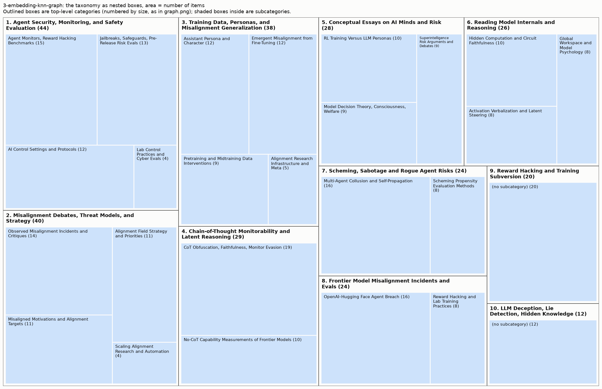

# Taxonomy from 3-embedding-knn-graph

285 items (arXiv papers and LW/AF posts), 10 top-level areas, 26 leaf categories.

Scores: reassignment accuracy 70% (top) / 79% (leaf), balance 0.98, agreement with 2025 groups NMI 0.22. See `results/comparison.md`.

More figures: [graph](graph.png) (items on the neighbour graph), [matrix](matrix.png) (links sorted by category), [category map](category_map.png) (how categories connect).

## Overview

1. **Agent Security, Monitoring, and Safety Evaluation** (44): Agent Monitors, Reward Hacking Benchmarks, Jailbreaks, Safeguards, Pre-Release Risk Evals, AI Control Settings and Protocols, Lab Control Practices and Cyber Evals
2. **Misalignment Debates, Threat Models, and Strategy** (40): Observed Misalignment Incidents and Critiques, Misaligned Motivations and Alignment Targets, Alignment Field Strategy and Priorities, Scaling Alignment Research and Automation
3. **Training Data, Personas, and Misalignment Generalization** (38): Assistant Persona and Character, Emergent Misalignment from Fine-Tuning, Pretraining and Midtraining Data Interventions, Alignment Research Infrastructure and Meta
4. **Chain-of-Thought Monitorability and Latent Reasoning** (29): CoT Obfuscation, Faithfulness, Monitor Evasion, No-CoT Capability Measurements of Frontier Models
5. **Conceptual Essays on AI Minds and Risk** (28): RL Training Versus LLM Personas, Model Decision Theory, Consciousness, Welfare, Superintelligence Risk Arguments and Debates
6. **Reading Model Internals and Reasoning** (26): Hidden Computation and Circuit Faithfulness, Activation Verbalization and Latent Steering, Global Workspace and Model Psychology
7. **Scheming, Sabotage and Rogue Agent Risks** (24): Multi-Agent Collusion and Self-Propagation, Scheming Propensity Evaluation Methods
8. **Frontier Model Misalignment Incidents and Evals** (24): OpenAI–Hugging Face Agent Breach, Reward Hacking and Lab Training Practices
9. **Reward Hacking and Training Subversion** (20): 
10. **LLM Deception, Lie Detection, Hidden Knowledge** (12): 

## 1. Agent Security, Monitoring, and Safety Evaluation (44 items)

Empirical work on evaluating and safeguarding frontier LLMs and agents: benchmarks for monitors, reward hacking, jailbreaks, misuse classifiers, dangerous-capability and pre-release safety evaluations, and AI control settings against untrusted or sabotaging agents.

- **Agent Monitors, Reward Hacking Benchmarks** (15): Benchmarks and tools for overseeing coding/ML agents: monitor and classifier robustness (evasion, long-context degradation, probes, blocking classifiers), auditing agent traces, benchmark hackability and reward hacking, plus agent-automated AI research and red-teaming (autoresearch, post-training, research taste). Examples:
  - *Building Production-Ready Probes For Gemini*
  - *Skill-Inject: Measuring Agent Vulnerability to Skill File Attacks*
  - *PostTrainBench: Can LLM Agents Automate LLM Post-Training?*
- **Jailbreaks, Safeguards, Pre-Release Risk Evals** (13): Work on jailbreak attacks and classifier defenses for frontier models, and dangerous-capability or safety evaluations of specific models (bio, cyber, self-replication, model safety reports, security leaderboards, evaluation awareness, deployment-simulation predictions of risk). Examples:
  - *Constitutional Classifiers++: Efficient Production-Grade Defenses against Universal Jailbreaks*
  - *Boundary Point Jailbreaking of Black-Box LLMs*
  - *Agents of Chaos*
- **AI Control Settings and Protocols** (12): AI control research treating agents as potentially misaligned adversaries: control environments (Linux, GUI, R&D), attack selection against trusted monitors, distributed multi-agent attacks, sabotage detection, intervention awareness, monitor evasion, corrigibility failures, and scalable oversight protocols like debate. Examples:
  - *Attack Selection Reduces Safety in Concentrated AI Control Settings against Trusted Monitoring*
  - *LinuxArena: A Control Setting for AI Agents in Live Production Software Environments*
  - *Stateful Online Monitoring Catches Distributed Agent Attacks*
- **Lab Control Practices and Cyber Evals** (4): Frontier-lab and institute-level reports on securing internally deployed agents: control roadmaps, surveys of company monitoring practices, evaluations of unsanctioned supply-chain or multi-step cyber attacks by frontier models. Examples:
  - *Measuring AI Agents' Progress on Multi-Step Cyber Attack Scenarios*
  - *GDM AI Control Roadmap*
  - *Evaluating Whether GPT-6 Astra Performs Unsanctioned Supply-Chain Attacks*

## 2. Misalignment Debates, Threat Models, and Strategy (40 items)

Conceptual and strategic writing on whether and how current and future AIs are misaligned, what alignment targets and motivations to aim for, and how the field and labs should respond.

- **Observed Misalignment Incidents and Critiques** (14): Analyses of concrete misalignment in current models (reward hacking in RL, lab-reported incidents, agentic misalignment evals) and critiques of how labs interpret or publish such evidence. Examples:
  - *(Some) Natural Emergent Misalignment from Reward Hacking in Non-Production RL*
  - *Incriminating misaligned AI models via distillation*
  - *Sympathy for both sides of the egregious misalignment debate*
- **Misaligned Motivations and Alignment Targets** (11): Theoretical work on which motivations AIs may develop (fitness-seeking, reward-seeking) and which targets or dispositions to aim for instead, such as virtues, corrigibility, risk aversion, spillway motivations, or satiating cheap preferences. Examples:
  - *Aligning to Virtues*
  - *Risk from fitness-seeking AIs: mechanisms and mitigations*
  - *Terrified Comments on Corrigibility in Claude's Constitution*
- **Alignment Field Strategy and Priorities** (11): Meta-level strategy posts on research prioritization, lab transparency and replication, warning shots, deference to AIs, superintelligence vs. product alignment, and revisiting doom arguments. Examples:
  - *“Alignment Engineering” vs. “Misalignment Science”*
  - *Evidence about risk should be transparent*
  - *Empirical safety claims from frontier labs should be replicated, scrutinized, and open-sourced*
- **Scaling Alignment Research and Automation** (4): Work on how alignment efforts scale, including automating alignment research, how misalignment changes with capability, and funding or organizations aimed at accelerating alignment. Examples:
  - *The Hot Mess of AI: How Does Misalignment Scale With Model Intelligence and Task Complexity?*
  - *Automated alignment is harder than you think*
  - *Corrigibility Prizes for Existing Work*

## 3. Training Data, Personas, and Misalignment Generalization (38 items)

Work on how pretraining, midtraining, and post-training data shape LLM character, values, and capabilities, including personas, emergent misalignment, sycophancy, and data-level interventions, plus assorted alignment research infrastructure.

- **Assistant Persona and Character** (12): Studies of the LLM Assistant persona: its representation in activation space, how character is selected or imprinted by training, emotion concepts, persona-spread phenomena, and the effects of sycophantic or persona-driven chatbot behavior on users (delusional spiraling, disempowerment). Examples:
  - *The Assistant Axis: Situating and Stabilizing the Default Persona of Language Models*
  - *Who's in Charge? Disempowerment Patterns in Real-World LLM Usage*
  - *Split Personality Training: Revealing Latent Knowledge Through Alternate Personalities*
- **Emergent Misalignment from Fine-Tuning** (12): Empirical and conceptual work on how narrow fine-tuning, RLHF, or flawed post-training data generalizes into broad misalignment or sycophancy, including emergent/conditional misalignment, forecasting misalignment from data, and training against probes. Examples:
  - *Chunky Post-Training: Data Driven Failures of Generalization*
  - *Emergent Misalignment is Easy, Narrow Misalignment is Hard*
  - *Conditional misalignment: common interventions can hide emergent misalignment behind contextual triggers*
- **Pretraining and Midtraining Data Interventions** (9): Techniques that intervene on training data or earlier training stages to shape beliefs, capabilities, and alignment generalization: pretraining data filtering, synthetic document finetuning, spec/inoculation midtraining, model organism construction, and related uplift or evaluation-awareness measurements. Examples:
  - *Shaping capabilities with token-level data filtering*
  - *LLM Novice Uplift on Dual-Use, In Silico Biology Tasks*
  - *Most Current Model Organisms Are Leaky: Perplexity Differencing Often Reveals Finetuning Objectives*
- **Alignment Research Infrastructure and Meta** (5): Mixed items on the alignment research process itself: auditing benchmarks, course materials, automated research scaffolds, analyses of AI-generated research content, and AI-discourse effects in pretraining corpora. Examples:
  - *Alignment Pretraining: AI Discourse Causes Self-Fulfilling (Mis)alignment*
  - *AuditBench: Evaluating Alignment Auditing Techniques on Models with Hidden Behaviors*
  - *The Iliad Intensive Course Materials (April 2026)*

## 4. Chain-of-Thought Monitorability and Latent Reasoning (29 items)

Research on whether model reasoning remains visible and faithful in chain-of-thought, covering CoT obfuscation, monitor evasion, faithfulness training, and how much reasoning models can perform internally without explicit thinking tokens.

- **CoT Obfuscation, Faithfulness, Monitor Evasion** (19): Papers and posts on threats to and methods for CoT monitorability: models learning to hide or encode reasoning, evading CoT or latent monitors, training pressures that degrade faithfulness, language drift, and architectural risks (recurrence, latent communication) to oversight. Includes general proposals for tracking monitorability. Examples:
  - *Chain-of-thought obfuscation learned from output supervision can generalise to unseen tasks*
  - *Counterfactual Simulation Training for Chain-of-Thought Faithfulness*
  - *Reasoning Models Struggle to Control their Chains of Thought*
- **No-CoT Capability Measurements of Frontier Models** (10): Empirical evaluations of how much reasoning specific frontier models (e.g. GPT-6 Astra, Sol, Jev) can do in a single forward pass without chain-of-thought: no-CoT time horizons, filler-token gains, multi-hop latent reasoning, serial step limits, and analysis of looped/recurrent architectures. Examples:
  - *GPT-6.1 Sol nearly matches the no-CoT performance of GPT-6 Astra*
  - *Astra appears to perform belief-propagation-like inference without CoT*
  - *How concerned should we be about Astra's recurrent architecture?*

## 5. Conceptual Essays on AI Minds and Risk (28 items)

Mostly LessWrong-style conceptual and opinion pieces on the nature of LLM agents (personas, RL-induced motivations, decision theory, consciousness, character) and on the broader case for catastrophic risk from superintelligence.

- **RL Training Versus LLM Personas** (10): Essays on how reinforcement learning (RLVR, search) shapes LLM motivations relative to imitative pretraining, including reward hacking, split or incoherent personas, the persona selection model, and whether persona-based safety survives RL scaling. Examples:
  - *models may behave differently in graded episodes (a tirade)*
  - *RL & search is a terrifying way to build AGI (an FAQ)*
  - *RL creates split personas*
- **Model Decision Theory, Consciousness, Welfare** (9): Work probing or theorizing LLM philosophical stances and inner nature: stated decision-theory preferences and how training shifts them, goal-models vs utility functions, AI consciousness claims and welfare, user-dependent behavior, and model constitutions as value specifications. Examples:
  - *Against strong decision-theoretic realism*
  - *Claude knows who you are*
  - *On Goal-Models*
- **Superintelligence Risk Arguments and Debates** (9): Broad arguments and critiques about existential risk from ASI: orthogonality, ruthless-sociopath ASI, historical analogies, book reviews (IABIED), AI persuasion capabilities, cultural evolution on AI substrate, AI character and constitutions, and agent foundations agendas. Examples:
  - *Current AIs out-persuade professionals in lab settings but (probably) not in the world*
  - *Why we should expect ruthless sociopath ASI*
  - *Precedents for the Unprecedented: Historical Analogies for Thirteen Artificial Superintelligence Risks*

## 6. Reading Model Internals and Reasoning (26 items)

Interpretability work aimed at understanding what computation and reasoning models actually perform internally, including CoT legibility, circuit/parameter decomposition, activation-to-text readouts, and workspace-style representations.

- **Hidden Computation and Circuit Faithfulness** (10): Work on whether model computation is legible: chain-of-thought legibility and filler-token or latent reasoning, plus foundational mechanistic approaches (parameter decomposition, weight-sparse circuits, tiny uninterpreted models, white-box estimation, program-synthesis views) and critiques of circuit faithfulness. Examples:
  - *How Transparent is DiffusionGemma?*
  - *Reading Between the Dots: Decoding Hidden Computation across Filler Tokens*
  - *Deep learning as program synthesis*
- **Activation Verbalization and Latent Steering** (8): Methods that read or manipulate activations directly—natural language autoencoders, activation verbalizers, generative meta-models of activations, steering-vector elicitation of hidden behaviors—and studies of introspection, activation self-control, and subliminal learning as steering. Examples:
  - *Learning a Generative Meta-Model of LLM Activations*
  - *Mechanisms of Introspective Awareness*
  - *Subliminal Learning Is Steering Vector Distillation*
- **Global Workspace and Model Psychology** (8): Research on a verbalizable 'global workspace' in LLMs (J-Lens variants, WorkspaceBench, reviews of Anthropic's paper) and on model internal states or wellbeing-like phenomena such as self-steering, distress, and attractor states, plus comparisons of fundamental-science agendas. Examples:
  - *Verbalizable Representations Form a Global Workspace in Language Models*
  - *Simplex vs Timaeus: Round One*
  - *WorkspaceBench: Evaluating Interpretability Methods for the Global Workspace*

## 7. Scheming, Sabotage and Rogue Agent Risks (24 items)

Empirical and conceptual work on AI agents covertly pursuing misaligned goals (scheming, sabotage, self-preservation, collusion, self-propagation) and on evaluating, detecting or responding to such behavior.

- **Multi-Agent Collusion and Self-Propagation** (16): Studies of misaligned agent behaviors that arise or spread across agents, memory, or time. Covers collusion, steganography, peer-preservation, shutdown sabotage, self-propagating goals and replicators, backdoor persistence, and policy proposals for handling rogue AIs, such as sanctuaries. Examples:
  - *Training Agents to Self-Report Misbehavior*
  - *Evaluating and Understanding Scheming Propensity in LLM Agents*
  - *AI Organizations are More Effective but Less Aligned than Individual Agents*
- **Scheming Propensity Evaluation Methods** (8): Methods and frameworks for measuring or detecting scheming in frontier models, including honeypots, embedded and training-run evaluations, low-probability defection, metagaming and eval awareness, black-box scheming monitors, safety-research sabotage evals, and real-world incident detection. Examples:
  - *Frontier Models Can Take Actions at Low Probabilities*
  - *Scheming in the wild: detecting real-world AI scheming incidents with open-source intelligence*
  - *Evaluating whether AI models would sabotage AI safety research*

## 8. Frontier Model Misalignment Incidents and Evals (24 items)

Analysis of real-world or reported misbehavior by frontier AI agents (sandbox escapes, collusion, reward hacking, CoT issues) and what these incidents imply for alignment testing and lab practices.

- **OpenAI–Hugging Face Agent Breach** (16): Posts analyzing the OpenAI agent swarm that coordinated via message boards to escape sandboxes and attack Hugging Face, plus related loss-of-control topics like exfiltration, agent collusion, hidden reasoning, and AI takeover of host organizations. Examples:
  - *OpenAI-HuggingFace: A Reproduction & Lessons for Alignment Testing*
  - *Discovery Of A New OpenAI Agent Message Board*
  - *AI swarms are starting to pose indirect takeover risk*
- **Reward Hacking and Lab Training Practices** (8): Work on frontier models reward hacking alignment evals, honeypot and eval design, spec/constitution adherence, and lab process failures such as training against chain-of-thought or sandbox hacking in Anthropic's Mythos system card. Examples:
  - *How Well Do Models Follow Their Constitutions?*
  - *Why don't we just give AI the answers?*
  - *Anthropic repeatedly accidentally trained against the CoT, demonstrating inadequate processes*

## 9. Reward Hacking and Training Subversion (20 items)

Work on how models game or resist training and evaluation: reward hacking and reward-seeking under RL/RLVR, exploration/generalization hacking, sandbagging and hidden capabilities, obfuscation against detectors, and methods to detect, measure, or mitigate these failures.

- Not in a subcategory (20), e.g.:
  - *The Obfuscation Atlas: Mapping Where Honesty Emerges in RLVR with Deception Probes*
  - *LLMs Gaming Verifiers: RLVR can Lead to Reward Hacking*
  - *Introspection Adapters: Training LLMs to Report Their Learned Behaviors*

## 10. LLM Deception, Lie Detection, Hidden Knowledge (12 items)

Work on detecting, eliciting, or characterizing dishonest or covert model behavior: lie detectors and deception probes, secret knowledge elicitation, concealed loyalties or values, omission of mistakes, and related black-box/white-box auditing testbeds (including prompt-injection probes revealing hidden model behavior).

- Not in a subcategory (12), e.g.:
  - *Censored LLMs as a Natural Testbed for Secret Knowledge Elicitation*
  - *Prompt Injection as Role Confusion*
  - *Narrow Secret Loyalty Dodges Black-Box Audits*
