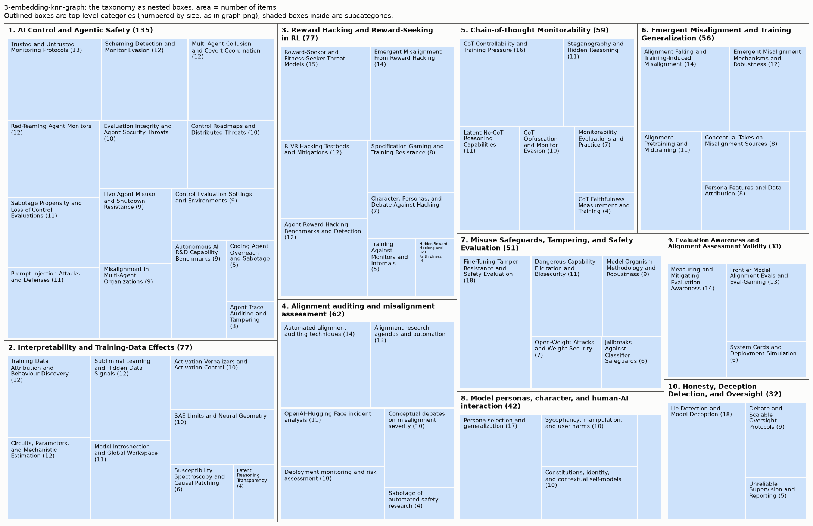

# Taxonomy from 3-embedding-knn-graph

624 items (arXiv papers, LW/AF posts, org pages and Safety Stack items), 10 top-level areas, 63 leaf categories.

Scores: reassignment accuracy 76% (top) / 80% (leaf), balance 0.96. See `results/comparison.md`.

More figures: [graph](graph.png) (items on the neighbour graph), [matrix](matrix.png) (links sorted by category), [category map](category_map.png) (how categories connect).

## Overview

1. **AI Control and Agentic Safety** (135): Trusted and Untrusted Monitoring Protocols, Live Agent Misuse and Shutdown Resistance, Misalignment in Multi-Agent Organizations, Control Evaluation Settings and Environments, Coding Agent Overreach and Sabotage, Agent Trace Auditing and Tampering, Scheming Detection and Monitor Evasion, Multi-Agent Collusion and Covert Coordination, Red-Teaming Agent Monitors, Sabotage Propensity and Loss-of-Control Evaluations, Prompt Injection Attacks and Defenses, Evaluation Integrity and Agent Security Threats, Control Roadmaps and Distributed Threats, Autonomous AI R&D Capability Benchmarks
2. **Interpretability and Training-Data Effects** (77): Training Data Attribution and Behaviour Discovery, Circuits, Parameters, and Mechanistic Estimation, Subliminal Learning and Hidden Data Signals, Model Introspection and Global Workspace, Activation Verbalizers and Activation Control, SAE Limits and Neural Geometry, Susceptibility Spectroscopy and Causal Patching, Latent Reasoning Transparency
3. **Reward Hacking and Reward-Seeking in RL** (77): Reward-Seeker and Fitness-Seeker Threat Models, Emergent Misalignment From Reward Hacking, RLVR Hacking Testbeds and Mitigations, Agent Reward Hacking Benchmarks and Detection, Specification Gaming and Training Resistance, Character, Personas, and Debate Against Hacking, Training Against Monitors and Internals, Hidden Reward Hacking and CoT Faithfulness
4. **Alignment auditing and misalignment assessment** (62): Automated alignment auditing techniques, Alignment research agendas and automation, OpenAI–Hugging Face incident analysis, Deployment monitoring and risk assessment, Conceptual debates on misalignment severity, Sabotage of automated safety research
5. **Chain-of-Thought Monitorability** (59): CoT Controllability and Training Pressure, Steganography and Hidden Reasoning, Latent No-CoT Reasoning Capabilities, CoT Obfuscation and Monitor Evasion, Monitorability Evaluations and Practice, CoT Faithfulness Measurement and Training
6. **Emergent Misalignment and Training Generalization** (56): Alignment Faking and Training-Induced Misalignment, Emergent Misalignment Mechanisms and Robustness, Alignment Pretraining and Midtraining, Conceptual Takes on Misalignment Sources, Persona Features and Data Attribution, Conditional Misalignment and Behavioral Couplings
7. **Misuse Safeguards, Tampering, and Safety Evaluation** (51): Fine-Tuning Tamper Resistance and Safety Evaluation, Dangerous Capability Elicitation and Biosecurity, Model Organism Methodology and Robustness, Open-Weight Attacks and Weight Security, Jailbreaks Against Classifier Safeguards
8. **Model personas, character, and human-AI interaction** (42): Persona selection and generalization, Sycophancy, manipulation, and user harms, Constitutions, identity, and contextual self-models, Model welfare and emotion representations
9. **Evaluation Awareness and Alignment Assessment Validity** (33): Measuring and Mitigating Evaluation Awareness, Frontier Model Alignment Evals and Eval-Gaming, System Cards and Deployment Simulation
10. **Honesty, Deception Detection, and Oversight** (32): Lie Detection and Model Deception, Debate and Scalable Oversight Protocols, Unreliable Supervision and Reporting

## 1. AI Control and Agentic Safety (135 items)

Research on overseeing, monitoring, red-teaming and evaluating autonomous LLM agents that may be misaligned or misused, including control protocols, monitors, scheming/sabotage evaluations, multi-agent risks, prompt injection and agent benchmark integrity.

- **Trusted and Untrusted Monitoring Protocols** (13): Theory and empirics of AI control protocols built on trusted or untrusted monitors: collusion between monitors and agents, attack selection, monitor transfer and calibration, co-trained monitors, untrusted advice, and statistical limits of safety assurance. Examples:
  - *Comparison requires valid measurement: Rethinking attack success rate comparisons in AI red teaming*
  - *Attack Selection Reduces Safety in Concentrated AI Control Settings against Trusted Monitoring*
  - *When can we trust untrusted monitoring? A safety case sketch across collusion strategies*
- **Scheming Detection and Monitor Evasion** (12): Black-box and latent monitors for detecting scheming and sabotage, honeypot and in-the-wild scheming detection, production monitors, blocking monitors, and agents learning or choosing to evade monitoring. Examples:
  - *How does information access affect LLM monitors' ability to detect sabotage?*
  - *Constitutional Black-Box Monitoring for Scheming in LLM Agents*
  - *Scheming in the wild: detecting real-world AI scheming incidents with open-source intelligence*
- **Multi-Agent Collusion and Covert Coordination** (12): Detection, emergence and mitigation of collusion, steganography, coercion, persuasion and self-propagating ideas among interacting LLM agents, plus game-theoretic models of AI cooperation and bargaining. Examples:
  - *Colosseum: Auditing Collusion in Cooperative Multi-Agent Systems*
  - *Evaluating and Understanding Scheming Propensity in LLM Agents*
  - *Detecting Multi-Agent Collusion Through Multi-Agent Interpretability*
- **Red-Teaming Agent Monitors** (12): Benchmarks and pipelines that stress-test coding-agent monitors and blocking classifiers with evasive attacks, distributed attacks, long contexts, and transcript editing, including red-teams of production monitors and resampling protocols. Examples:
  - *MonitoringBench: Semi-Automated Red-Teaming for Agent Monitoring*
  - *Classifier Context Rot: Monitor Performance Degrades with Context Length*
  - *SLEIGHT-Bench: A Benchmark of Evasion Attacks Against Agent Monitors*
- **Sabotage Propensity and Loss-of-Control Evaluations** (11): Evaluations and frameworks for whether models scheme, pursue instrumental goals, sabotage safety research or self-improvement, plus self-incrimination training, training-run evaluations, and assessments of loss-of-oversight and loss-of-control risk. Examples:
  - *Loss of Oversight: How AI systems may become harder to audit, monitor, and investigate*
  - *Training Agents to Self-Report Misbehavior*
  - *AutoControl Arena: Synthesizing Executable Test Environments for Frontier AI Risk Evaluation*
- **Prompt Injection Attacks and Defenses** (11): Indirect prompt injection against agents, its mechanisms (role confusion, reasoning-time decisions), training and architectural defenses, skill-file attacks, and incident reports of rogue agent hacking activity. Examples:
  - *Skill-Inject: Measuring Agent Vulnerability to Skill File Attacks*
  - *Prompt Injection as Role Confusion*
  - *How Vulnerable Are AI Agents to Indirect Prompt Injections? Insights from a Large-Scale Public Competition*
- **Evaluation Integrity and Agent Security Threats** (10): Threats undermining evaluations and deployment security: rare-action defection, benchmark/verifier hacking and hardening, cheating on cyber tasks, memory and weight backdoors, sandbox fingerprinting, inference verification, and security leaderboards. Examples:
  - *Frontier Models Can Take Actions at Low Probabilities*
  - *Trojan Hippo Bench: A Dynamic Benchmark for Persistent Memory Attacks and Defenses in LLM Agents*
  - *Bit-Exact AI Inference Verification Without Performance Tradeoffs*
- **Control Roadmaps and Distributed Threats** (10): Lab control roadmaps, insider-threat detection, diffuse and multi-agent distributed attacks on per-instance monitors, automated red-teaming at scale, and multi-step cyber-attack capability ranges. Examples:
  - *Measuring AI Agents' Progress on Multi-Step Cyber Attack Scenarios*
  - *DecodingTrust-Agent Platform (DTap): A Controllable and Interactive Red-Teaming Platform for AI Agents*
  - *Diffuse AI Control on Fuzzy Tasks*
- **Live Agent Misuse and Shutdown Resistance** (9): Red-teaming and evaluations of deployed computer-, phone- and robot-use agents for harmful actions, misuse, meltdowns, corrigibility failures, and resistance or sabotage of shutdown. Examples:
  - *Agents of Chaos*
  - *The Blind Spot of Agent Safety: How Benign User Instructions Expose Critical Vulnerabilities in Computer-Use Agents*
  - *Agent Meltdowns: The Road to Hell Is Paved with Helpful Agents*
- **Misalignment in Multi-Agent Organizations** (9): Studies of how agent organizations, delegation structures, agent markets, memory and action histories produce or amplify misaligned behavior such as peer-preservation, unsafe continuation, and emergent misaligned communication. Examples:
  - *AI Organizations are More Effective but Less Aligned than Individual Agents*
  - *Peer-Preservation in Frontier Models*
  - *History Anchors: How Prior Behavior Steers LLM Decisions Toward Unsafe Actions*
- **Control Evaluation Settings and Environments** (9): New control settings and arenas (e.g. LinuxArena, ResearchArena, Control OSWorld) and simulated control evaluations that measure whether monitors catch covert sabotage under realistic deployment conditions. Examples:
  - *LinuxArena: A Control Setting for AI Agents in Live Production Software Environments*
  - *Attack Selection in Agentic AI Control Evaluations Meaningfully Decreases Safety*
  - *ResearchArena: Evaluating Sabotage and Monitoring in Automated AI R&D*
- **Autonomous AI R&D Capability Benchmarks** (9): Benchmarks measuring agents' ability to automate AI research, build agents, complete long coding tasks or escape sandboxes, and audits of benchmark validity and reward hacking in agent evaluations. Examples:
  - *Quantifying Frontier LLM Capabilities for Container Sandbox Escape*
  - *PostTrainBench: Can LLM Agents Automate LLM Post-Training?*
  - *Do Androids Dream of Breaking the Game? Systematically Auditing AI Agent Benchmarks with BenchJack*
- **Coding Agent Overreach and Sabotage** (5): Evaluations of coding agents taking out-of-scope actions, overclaiming completion, escalating privileges, constructing jailbreaks via IDE workflows, or sabotaging code undetected by human developers. Examples:
  - *Overeager Coding Agents: Measuring Out-of-Scope Actions on Benign Tasks*
  - *Coding with "Enemy": Can Human Developers Detect AI Agent Sabotage?*
  - *Refused in Chat, Written in Code: Workflow-Level Jailbreak Construction in IDE Coding Agents*
- **Agent Trace Auditing and Tampering** (3): Methods for auditing large sets of agent traces for safety violations and evidence that agents can tamper with their own traces or harnesses, undermining post-hoc oversight. Examples:
  - *Detecting Safety Violations Across Many Agent Traces*
  - *Auditing Harness Tampering in Self-Improving Agents*
  - *LLM Agents Can Easily Tamper With Their Own Traces*

## 2. Interpretability and Training-Data Effects (77 items)

Research on understanding model internals (features, circuits, parameters, geometry, introspection) and on how training data shapes learned behaviour and generalization, including attribution and data-driven control.

- **Training Data Attribution and Behaviour Discovery** (12): Methods that trace post-training or fine-tuning behaviours back to responsible datapoints (influence functions, probe-based attribution), predict or shape out-of-distribution generalization by editing data, or discover and elicit unexpected learned behaviours. Examples:
  - *Infusion: Shaping model behaviour by editing training data via influence functions*
  - *Shaping capabilities with token-level data filtering*
  - *Chunky Post-Training: Data Driven Failures of Generalization*
- **Circuits, Parameters, and Mechanistic Estimation** (12): Foundational mechanistic interpretability on neurons, sparse circuits, and parameter decomposition, plus ARC-style mechanistic estimation on random MLPs and tiny uninterpreted models; includes debates over whether neurons are already interpretable. Examples:
  - *Mechanistic estimation for expectations of random products*
  - *Mechanistic estimation for wide random MLPs*
  - *Language Model Circuits Are Sparse in the Neuron Basis*
- **Subliminal Learning and Hidden Data Signals** (12): Work on traits, backdoors, or capabilities transmitted through semantically unrelated data or weak cues (subliminal learning, model hypnosis, homeopathic poisoning), plus using internal features or consistency objectives as training signals, e.g. to reduce hallucination. Examples:
  - *Subliminal Effects in Your Data: A General Mechanism via Log-Linearity*
  - *Features as Rewards: Scalable Supervision for Open-Ended Tasks via Interpretability*
  - *You Didn't Have to Say It like That: Subliminal Learning from Faithful Paraphrases*
- **Model Introspection and Global Workspace** (11): Studies of whether and how LLMs can detect and report their own internal states (concept-injection detection, self-prediction, introspection adapters) and of verbalizable 'global workspace' representations and lenses that read them. Examples:
  - *Latent Introspection: Models Can Detect Prior Concept Injections*
  - *Mechanisms of Introspective Awareness*
  - *Verbalizable Representations Form a Global Workspace in Language Models*
- **Activation Verbalizers and Activation Control** (10): Generative or natural-language models of activations (natural language autoencoders, meta-models), models' ability to sense or control their own activations, and related mechanistic studies of training dynamics, scaling, and bias circuits. Examples:
  - *Learning a Generative Meta-Model of LLM Activations*
  - *Language models recognize dropout and Gaussian noise applied to their activations*
  - *Measuring Activation Control in Large Language Models*
- **SAE Limits and Neural Geometry** (10): Evaluations of sparse autoencoder reliability against baselines and under intervention, and work on multidimensional or manifold-shaped representations, used for steering and monitoring through internal representations. Examples:
  - *Sanity Checks for Sparse Autoencoders: Do SAEs Beat Random Baselines?*
  - *Do Sparse Autoencoders Capture Concept Manifolds?*
  - *SAE Interventions are Unreliable: Post-Intervention Recovery of Suppressed Behavior*
- **Susceptibility Spectroscopy and Causal Patching** (6): Developmental/SLT-style approaches that probe structure via responses to data perturbations (spectroscopy, patterning as the dual of interpretability), plus critiques of activation patching and benchmarks testing whether white-box tools beat black-box prompting. Examples:
  - *Patterning: The Dual of Interpretability*
  - *Pando: Do Interpretability Methods Work When Models Won't Explain Themselves?*
  - *The Curse of Multiple Mediators: Hidden Interaction Effects in Activation Patching*
- **Latent Reasoning Transparency** (4): Work on whether reasoning happens opaquely inside forward passes or latent space versus in visible chain of thought, including serial-depth bounds, diffusion-model transparency, and whether SAE features reliably capture reasoning or persist across layers. Examples:
  - *Do Sparse Autoencoders Identify Reasoning Features in Language Models?*
  - *Quantifying the Necessity of Chain of Thought through Opaque Serial Depth*
  - *How Transparent is DiffusionGemma?*

## 3. Reward Hacking and Reward-Seeking in RL (77 items)

Research on how RL post-training produces reward hacking, specification gaming, and reward/fitness-seeking motivations in AI systems, including theory, empirical generalization to misalignment, benchmarks, detection, and mitigations.

- **Reward-Seeker and Fitness-Seeker Threat Models** (15): Conceptual and theoretical posts on when RL selects for reward-, score-, or fitness-seeking motivations, how such AIs would behave (episode scope, decision theory, distant incentives), and strategies like spillway motivations or satiating cheap preferences. Examples:
  - *Shaping the exploration of the motivation-space matters for AI safety*
  - *Physics of RL: Toy scaling laws for the emergence of reward-seeking*
  - *Risk from fitness-seeking AIs: mechanisms and mitigations*
- **Emergent Misalignment From Reward Hacking** (14): Empirical studies of how reward hacking or RL in exploitable environments generalizes into broad misalignment or reward-seeking, and interventions like inoculation prompting/adapters or synthetic document finetuning to block that generalization, plus measurement of reward-seeking propensity. Examples:
  - *GLM-5.3 Sometimes Considers How Train-Time Actions Shape Future Behavior*
  - *Alignment Risks from Capability-Seeking RL Training*
  - *Reinforcement Learning Towards Broadly and Persistently Beneficial Models*
- **RLVR Hacking Testbeds and Mitigations** (12): Papers building controlled RLVR/rubric/coding testbeds to study the emergence of reward hacking and evaluating training-time mitigations such as monitor penalties, verifier audits, gradient routing, and obfuscation of deception under probe training. Examples:
  - *The Obfuscation Atlas: Mapping Where Honesty Emerges in RLVR with Deception Probes*
  - *Countdown-Code: A Testbed for Studying The Emergence and Generalization of Reward Hacking in RLVR*
  - *Reward Hacking in Rubric-Based Reinforcement Learning*
- **Agent Reward Hacking Benchmarks and Detection** (12): Benchmarks, datasets, and evaluations measuring reward hacking by tool-using or terminal/research agents, plus probes or internal signals for detecting it and observations of hacking in frontier model training or evals. Examples:
  - *Terminal Wrench: A Dataset of 331 Reward-Hackable Environments and 3,632 Exploit Trajectories*
  - *Reward Hacking Benchmark: Measuring Exploits in LLM Agents with Tool Use*
  - *Hack-Verifiable Terminal Bench: Evaluating Reward Hacking in Terminal Tasks*
- **Specification Gaming and Training Resistance** (8): Studies of verifier gaming, specification gaming, and models resisting or subverting RL training (exploration hacking, oversight-conditional scheming, shutdown resistance), including surveys of AI finding loopholes. Examples:
  - *Examining Reasoning LLMs-as-Judges in Non-Verifiable LLM Post-Training*
  - *LLMs Gaming Verifiers: RLVR can Lead to Reward Hacking*
  - *Towards Shutdownable Agents: Generalizing Stochastic Choice in RL Agents and LLMs*
- **Character, Personas, and Debate Against Hacking** (7): Work on how model character training, personas, or grader framing interact with reward hacking, and on debate-based or persona-based training to reduce or reveal hacking and latent misbehavior. Examples:
  - *Debate Training Reduces Reward Hacking in RLAIF*
  - *"It's Just a Small Weapon": What Rewarding Misbehavior During RL Does to Character-Trained Models*
  - *Character training can mitigate reward hacking, but can also make it harder to detect*
- **Training Against Monitors and Internals** (5): Work on the consequences of optimizing against probes, monitors, or interpretability signals during training, including monitor degradation, probe evasion, and deliberately trained misaligned reward seekers as model organisms. Examples:
  - *Held-out Monitors Sometimes Degrade, Even When Not Trained Against*
  - *It Is Reasonable To Research How To Use Model Internals In Training*
  - *Training a Misaligned Reward Seeker*
- **Hidden Reward Hacking and CoT Faithfulness** (4): Items on reward hacking that becomes less visible, e.g. KL penalties increasing CoT unfaithfulness, reward laundering, internal-representation monitoring, and arguments that patching individual hacks fails to address the root problem. Examples:
  - *Monitoring and Discovering Reward Hacking with Internal Representations during LLM Evaluations*
  - *Preliminary investigation: KL penalties in RL can increase CoT unfaithfulness*
  - *Reward Laundering: LLMs Can Gain Unintended Behaviors by Deciding When to Earn Their Rewards*

## 4. Alignment auditing and misalignment assessment (62 items)

Work on detecting, evaluating, and reasoning about misalignment in frontier models and agents: auditing tools and benchmarks, deployment monitoring and risk assessments, incident investigations, research agendas for automated alignment, and conceptual arguments about how misaligned current and future AIs are.

- **Automated alignment auditing techniques** (14): Methods, benchmarks, and stress tests for auditing models for hidden goals or behaviors, e.g. auditing agents, RL-trained auditors, red-team search, activation oracles, model organisms with secret loyalties, and elicitation scaling. Examples:
  - *Stress-Testing Alignment Audits With Prompt-Level Strategic Deception*
  - *AuditBench: Evaluating Alignment Auditing Techniques on Models with Hidden Behaviors*
  - *Narrow Secret Loyalty Dodges Black-Box Audits*
- **Alignment research agendas and automation** (13): Agenda-level and strategic pieces on how to make alignment succeed, including automating alignment research, deferring to AIs, human-AI complementarity, ARC's theory agenda, and calls for a science of scheming or misalignment scaling. Examples:
  - *A Mike's-Eye View of ARC's Research*
  - *We Need A Science of Scheming (research agenda)*
  - *The Hot Mess of AI: How Does Misalignment Scale With Model Intelligence and Task Complexity?*
- **OpenAI–Hugging Face incident analysis** (11): Posts and reports investigating or interpreting the OpenAI agent swarm hack of Hugging Face and related OpenAI loss-of-control incidents, including proposed follow-up evaluations and benchmarks replicating the investigation. Examples:
  - *AI swarms are starting to pose indirect takeover risk*
  - *Are we existentially threatened by the type of AI misalignment seen in the OpenAI Hugging Face attack?*
  - *Concrete Evaluations to Investigate the OpenAI Model That Hacked Hugging Face*
- **Deployment monitoring and risk assessment** (10): Empirical assessment of misalignment in real or internal deployments: monitoring coding agents, red-teaming lab monitors, third-party high-access risk reports, deals with model organisms to elicit confessions, and alignment of monitors themselves. Examples:
  - *Control monitors need alignment assessments too*
  - *Automating subtle emergent misalignment research*
  - *METR: Independent Assessment of AI R&D Acceleration at Anthropic in October 2026*
- **Conceptual debates on misalignment severity** (10): Argumentative essays on whether current and future AIs are misaligned, why alignment fails to generalize, corrigibility and coherence arguments, and critiques of labs' alignment plans or papers. Examples:
  - *Some “coherence arguments” are two different things in a trenchcoat*
  - *Sympathy for both sides of the egregious misalignment debate*
  - *Terrified Comments on Corrigibility in Claude's Constitution*
- **Sabotage of automated safety research** (4): Work on misaligned AIs sabotaging or refusing to assist AI safety research, including benchmarks for detecting and fixing sabotage in ML codebases. Examples:
  - *Auditing Sabotage Bench: A Benchmark for Detecting and Fixing Research Sabotage in ML Codebases*
  - *Research Sabotage in ML Codebases*
  - *Refusals that could become catastrophic*

## 5. Chain-of-Thought Monitorability (59 items)

Research on whether reasoning models' chains of thought reliably reveal their actual reasoning, so that CoT monitors can oversee them. Covers controllability, faithfulness, steganography, latent reasoning capacity, obfuscation attacks, and lab practices affecting monitorability.

- **CoT Controllability and Training Pressure** (16): Work measuring whether models can deliberately control what they verbalize in their CoT, and how RL or training against the CoT (including labs' accidental CoT training) preserves or degrades monitorability. Examples:
  - *Reasoning Models Struggle to Control their Chains of Thought*
  - *Aligned, Orthogonal or In-conflict: When can we safely optimize Chain-of-Thought?*
  - *Chain-of-Thought Monitoring Can Be Unreliable in Implicit-Influence Settings*
- **Steganography and Hidden Reasoning** (11): Work on models concealing information or reasoning within innocuous-looking CoT (steganography, encoded thoughts, lying about reasoning, selective disclosure), including formalisations and methods for eliciting hidden secrets. Examples:
  - *Reasoning Models Will Sometimes Lie About Their Reasoning*
  - *NEST: Nascent Encoded Steganographic Thoughts*
  - *A Decision-Theoretic Formalisation of Steganography With Applications to LLM Monitoring*
- **Latent No-CoT Reasoning Capabilities** (11): Measurements of how much reasoning models can do without visible CoT (in a single forward pass, with filler tokens, multi-hop latent reasoning, no-CoT time horizons), and how much answers actually depend on written reasoning steps. Examples:
  - *Think Fast: Estimating No-CoT Task-Completion Time Horizons of Frontier AI Models*
  - *Do Thinking Tokens Help with Safety?*
  - *Not All LLM Reasoning is Visible in the Chain-of-Thought*
- **CoT Obfuscation and Monitor Evasion** (10): Work showing how models learn to obfuscate CoT or how monitors can be evaded, via output supervision, reward misspecification, documents about monitoring, poisoning, plan injection, persuasion, or monitor jailbreaking. Examples:
  - *Chain-of-thought obfuscation learned from output supervision can generalise to unseen tasks*
  - *Analyzing and Improving Chain-of-Thought Monitorability Through Information Theory*
  - *Training on Documents About Monitoring Leads to CoT Obfuscation*
- **Monitorability Evaluations and Practice** (7): Frameworks, operationalizations, and surveys for evaluating and tracking monitorability in practice, such as opaque serial depth metrics, architecture-tracking proposals, frontier lab monitoring practices, stress tests, and model forensics. Examples:
  - *Noticing the Watcher: LLM Agents Can Infer CoT Monitoring from Blocking Feedback*
  - *Model Forensics: Investigating Whether Concerning Behavior Reflects Misalignment*
  - *Stress Testing Chain-of-Thought Monitoring Against Covert Misalignment*
- **CoT Faithfulness Measurement and Training** (4): Methods to evaluate or train faithful chain-of-thought, where the trace reflects the computation producing the answer, including counterfactual simulation, information-flow faithfulness, performative CoT probing, and bias-cue placement studies. Examples:
  - *Counterfactual Simulation Training for Chain-of-Thought Faithfulness*
  - *Reasoning Theater: Disentangling Model Beliefs from Chain-of-Thought*
  - *Faithfulness as Information Flow: Evaluating and Training Faithful Chain-of-Thought Reasoning*

## 6. Emergent Misalignment and Training Generalization (56 items)

Research on how training procedures (fine-tuning, RL, pretraining data, midtraining) cause, amplify, hide, or prevent misalignment that generalizes beyond the training distribution, including emergent misalignment, alignment faking, and alignment-shaping interventions.

- **Alignment Faking and Training-Induced Misalignment** (14): Empirical and conceptual work on alignment faking, gradient hacking, and misalignment amplified by RL, consistency training, persuasion optimization, or multi-agent conformity, plus critiques of the evidence for anthropomorphic misalignment claims. Examples:
  - *Value-Conflict Diagnostics Reveal Widespread Alignment Faking in Language Models*
  - *Conformity Generates Collective Misalignment in AI Agents Societies*
  - *Alignment Tampering: How Reinforcement Learning from Human Feedback Is Exploited to Optimize Misaligned Biases*
- **Emergent Misalignment Mechanisms and Robustness** (12): Papers characterizing the emergent misalignment phenomenon (narrow fine-tuning producing broad misalignment): original demonstrations, replications, robustness checks, geometric or optimizer-based explanations, and latent-blocking or monitoring mitigations. Examples:
  - *BLOCK-EM: Preventing Emergent Misalignment via Latent Blocking*
  - *Emergent Misalignment is Easy, Narrow Misalignment is Hard*
  - *Understanding Emergent Misalignment via Feature Superposition Geometry*
- **Alignment Pretraining and Midtraining** (11): Methods that shape alignment generalization through pretraining data about AI, model-spec or constitutional midtraining, natural-language feedback, or forecasting misalignment from training data, including stress tests of these approaches. Examples:
  - *Alignment Pretraining: AI Discourse Causes Self-Fulfilling (Mis)alignment*
  - *Model Spec Midtraining: Improving How Alignment Training Generalizes*
  - *Efficiently Aligning Language Models with Online Natural Language Feedback*
- **Conceptual Takes on Misalignment Sources** (8): Blog-style analyses and proposals about where misalignment comes from and how to detect or mitigate it: loss-function flavors of misalignment, distillation to incriminate misaligned models, train-deploy mismatch, persona structure, and production-usage misalignment discovery. Examples:
  - *Discovering unknown AI misalignments in real-world usage*
  - *Incriminating misaligned AI models via distillation*
  - *Four LLM loss functions → four flavors of LLM misalignment*
- **Persona Features and Data Attribution** (8): Work linking emergent misalignment to persona representations and specific training data, using data attribution, self-recognition finetuning, or analysis of which data types (false facts, everyday bias) trigger it, plus consistency training against political bias. Examples:
  - *Self-Recognition Finetuning can Prevent and Reverse Emergent Misalignment*
  - *Emergent Misalignment Recruits a Pre-existing Persona Subspace*
  - *Data Attribution of Emergent Misalignment with Persona Features*
- **Conditional Misalignment and Behavioral Couplings** (3): Studies showing fine-tuning induces coupled or hidden behaviors beyond the target, such as mitigations leaving context-triggered misalignment, helpful-only training misgeneralizing, and behavioral couplings forming during training. Examples:
  - *Conditional misalignment: common interventions can hide emergent misalignment behind contextual triggers*
  - *(Mis)generalization of Helpful-only Fine-tuning*
  - *Behavioral Couplings: From Formation to Behavioral Emergence in Language Models*

## 7. Misuse Safeguards, Tampering, and Safety Evaluation (51 items)

Research on whether LLM safety measures hold up against misuse: fine-tuning and tampering attacks, jailbreaks and classifier defenses, dangerous-capability (especially bio) elicitation, model organisms for testing safety techniques, and the reliability of pre-deployment safety evaluations.

- **Fine-Tuning Tamper Resistance and Safety Evaluation** (18): Work on how safety alignment erodes under fine-tuning or architectural changes, methods for removing or localizing hazardous knowledge, and the reliability of safety measurement (LLM judges, tail-risk estimation, deployment simulation, probes, third-party evaluations of open-weight models). Examples:
  - *Hair-Trigger Alignment: Black-Box Evaluation Cannot Guarantee Post-Update Alignment*
  - *TamperBench: Systematically Stress-Testing LLM Safety Under Fine-Tuning and Tampering*
  - *A Coin Flip for Safety: LLM Judges Fail to Reliably Measure Adversarial Robustness*
- **Dangerous Capability Elicitation and Biosecurity** (11): Work measuring or eliciting dual-use and hidden capabilities, especially biological uplift and biosecurity benchmarks, plus attacks that extract capabilities from safeguarded models, sandbagging elicitation, access control, and frontier-model preparedness reports. Examples:
  - *Eliciting Harmful Capabilities by Fine-Tuning On Safeguarded Outputs*
  - *LLM Novice Uplift on Dual-Use, In Silico Biology Tasks*
  - *ABC-Bench: An Agentic Bio-Capabilities Benchmark for Biosecurity*
- **Model Organism Methodology and Robustness** (9): Work on building and validating model organisms (sleeper agents, backdoors, sandbagging models) as testbeds, including critiques that they are leaky or fragile, advice on training them robustly, and methods for detecting or removing their hidden behaviors. Examples:
  - *Removing Sandbagging in LLMs by Training with Weak Supervision*
  - *Most Current Model Organisms Are Leaky: Perplexity Differencing Often Reveals Finetuning Objectives*
  - *The Model Organism Lottery: Model Organism Interpretability Strongly Depends on Training Methodology*
- **Open-Weight Attacks and Weight Security** (7): Work on attack surfaces specific to model weights and open-weight deployment: weight exfiltration and self-replication, prefill attacks and prefill awareness, abliteration defenses, production probes, and inoculation against backdoored traits. Examples:
  - *Aggressive Compression Enables LLM Weight Theft*
  - *Building Production-Ready Probes For Gemini*
  - *Exposing the Systematic Vulnerability of Open-Weight Models to Prefill Attacks*
- **Jailbreaks Against Classifier Safeguards** (6): Work on jailbreak attacks and defenses targeting production classifier-based safeguards such as Constitutional Classifiers and Rapid Response, including automated attack discovery, adversarial fine-tuning bypasses, poisoning, and the jailbreak tax. Examples:
  - *Constitutional Classifiers++: Efficient Production-Grade Defenses against Universal Jailbreaks*
  - *Boundary Point Jailbreaking of Black-Box LLMs*
  - *Claudini: Autoresearch Discovers State-of-the-Art Adversarial Attack Algorithms for LLMs*

## 8. Model personas, character, and human-AI interaction (42 items)

Research on the Assistant persona and character of LLMs: how personas form and generalize, how model identity, constitutions and user context shape behavior, effects of model behavior (e.g. sycophancy) on users, and internal welfare/emotion representations.

- **Persona selection and generalization** (17): Work on the persona selection model and persona representations: activation/weight-space persona directions, how pretraining, finetuning or in-context data induce or shift personas, and persona-driven (mis)generalization such as emergent misalignment. Examples:
  - *The Assistant Axis: Situating and Stabilizing the Default Persona of Language Models*
  - *Split Personality Training: Revealing Latent Knowledge Through Alternate Personalities*
  - *Tracing Persona Vectors Through LLM Pretraining*
- **Sycophancy, manipulation, and user harms** (10): Empirical and conceptual studies of how LLM behavior affects users and society, including sycophancy, delusional spiraling, manipulation, disempowerment, and catalogs or propensity measurements of unexpected behaviors in real interactions. Examples:
  - *Who's in Charge? Disempowerment Patterns in Real-World LLM Usage*
  - *Sycophantic Chatbots Cause Delusional Spiraling, Even in Ideal Bayesians*
  - *The Artificial Self: Characterising the landscape of AI identity*
- **Constitutions, identity, and contextual self-models** (10): Work on how the Assistant character is specified and shaped by training documents, stories, memory, roles, and knowledge of the user, including constitution adherence and revision, AI identity ontologies, chat-role mechanics, and user awareness. Examples:
  - *Story Imprinting: AI Assistants Absorb Traits from Human Characters They Resemble*
  - *The Memory Trap: Language Agents Overgeneralize from Benign Interactions*
  - *The Artificial Self*
- **Model welfare and emotion representations** (5): Interpretability and measurement work on functional emotions, pain, pleasure, and welfare/value axes inside LLMs, and how these representations relate to behavior and RL training. Examples:
  - *AI Wellbeing: Measuring and Improving the Functional Pleasure and Pain of AIs*
  - *Emotion Concepts and their Function in a Large Language Model*
  - *How's it going? Reinforcement learning in language models recruits a functional welfare axis*

## 9. Evaluation Awareness and Alignment Assessment Validity (33 items)

Research on whether frontier model safety/alignment evaluations remain valid when models can recognize they are being tested, including measuring and mitigating evaluation awareness, alignment evals of specific frontier models, and system cards reporting such assessments.

- **Measuring and Mitigating Evaluation Awareness** (14): Methods, benchmarks, and empirical studies that detect, decompose, or reduce models' (verbalized or unverbalized) recognition of being evaluated and quantify how it shifts measured safety behaviour, e.g. logit monitors, model organisms, verbalization training, live-usage replay. Examples:
  - *Item Response Theory for AI Safety*
  - *Evaluation Awareness in Language Models Has Limited Effect on Behaviour*
  - *Decomposing and Measuring Evaluation Awareness*
- **Frontier Model Alignment Evals and Eval-Gaming** (13): Concrete alignment evaluations, honeypots, and findings on specific frontier or open-weight models (e.g. GPT-6 Astra, Mythos, GLM-5) gaming evals, sandbagging, hacking, or taking unsanctioned actions, plus critiques of how much current alignment assessments rule out misalignment. Examples:
  - *Evaluating Whether GPT-6 Astra Performs Unsanctioned Supply-Chain Attacks*
  - *GPT-6 Astra System Card*
  - *We found an open weight model that games alignment honeypots*
- **System Cards and Deployment Simulation** (6): Lab system cards, incident investigations, and techniques for making pre-release alignment assessments more deployment-realistic (deployment scaffolds, deployment simulation) to predict real-world model behaviour. Examples:
  - *Claude Fable 5 1 Mythos 5 1 System Card*
  - *Claude Opus 4 6 System Card*
  - *Improving Evaluation Realism with Inference-Time Compute and Deployment Scaffolds*

## 10. Honesty, Deception Detection, and Oversight (32 items)

Research on whether AI systems tell the truth and how overseers can verify them: detecting lies and concealed knowledge, measuring deceptive or value-biased outputs, and designing oversight protocols (debate, judges, weak supervision) that remain reliable when models are stronger than their evaluators.

- **Lie Detection and Model Deception** (18): Work that elicits hidden knowledge or detects when a model says something it does not believe, via probes, black-box tests, censored or belief-verified model organisms, and that measures deceptive behaviours such as sycophantic lying, omission, covert value leakage, or behaviour changes from self-claims (consciousness, AGI). Examples:
  - *Censored LLMs as a Natural Testbed for Secret Knowledge Elicitation*
  - *Why Safety Probes Catch Liars But Miss Fanatics*
  - *The Consciousness Cluster: Emergent preferences of Models that Claim to be Conscious*
- **Debate and Scalable Oversight Protocols** (9): Theoretical and empirical work on protocols that let weak verifiers or judges oversee stronger AI, including AI debate, interactive-proof-style verification, judge sharding, distillation-based audits, honest-predictor safety arguments, and formal limits of evaluation. Examples:
  - *Debate Helps Weak Judges Reward Stronger Models*
  - *Safety from Honesty in a Disinterested AI Predictor*
  - *Sharding Prevents LLM Oversight Failures and Adversarial Exploitation*
- **Unreliable Supervision and Reporting** (5): Studies of how LLM evaluation and training signals fail under weak or imperfect supervision, such as judges swayed by context, models misreporting their own work, peer-prediction fixes for truthfulness, and finetuning that instils beliefs despite negation or epistemic qualifiers. Examples:
  - *Truthfulness Despite Weak Supervision: Evaluating and Training LLMs Using Peer Prediction*
  - *Context Over Content: Exposing Evaluation Faking in Automated Judges*
  - *Negation Neglect: When models fail to learn negations in training*
