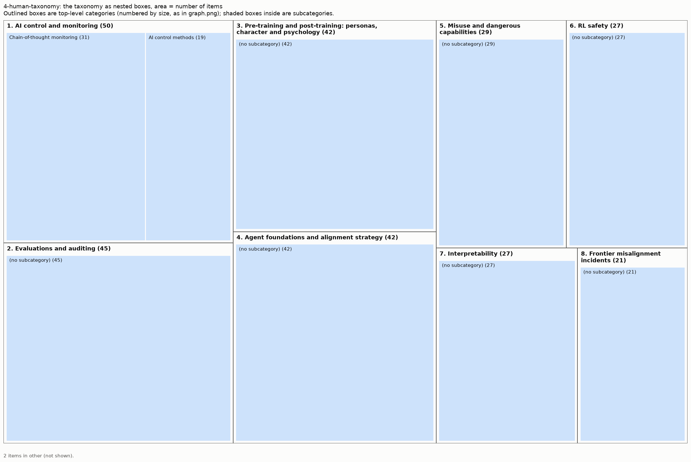

# Taxonomy from 4-human-taxonomy

285 items (arXiv papers and LW/AF posts), 8 top-level areas, 9 leaf categories, 2 items in other.

Scores: reassignment accuracy 91% (top) / 94% (leaf), balance 0.98, agreement with 2025 groups NMI 0.35. See `results/comparison.md`.

More figures: [graph](graph.png) (items on the neighbour graph), [matrix](matrix.png) (links sorted by category), [category map](category_map.png) (how categories connect).

## Overview

1. **AI control and monitoring** (50): Chain-of-thought monitoring, AI control methods
2. **Evaluations and auditing** (45): 
3. **Pre-training and post-training: personas, character and psychology** (42): 
4. **Agent foundations and alignment strategy** (42): 
5. **Misuse and dangerous capabilities** (29): 
6. **RL safety** (27): 
7. **Interpretability** (27): 
8. **Frontier misalignment incidents** (21): 

## 1. AI control and monitoring (50 items)

Not training or influencing the model's behaviour. Instead, assume the model is potentially misaligned and monitor or constrain its behaviour during inference in production.

- **Chain-of-thought monitoring** (31): Monitoring models through their reasoning: whether chain of thought stays faithful, legible and monitorable, and how much models can reason without it. Examples:
  - *Chain-of-thought obfuscation learned from output supervision can generalise to unseen tasks*
  - *Counterfactual Simulation Training for Chain-of-Thought Faithfulness*
  - *Reasoning Models Struggle to Control their Chains of Thought*
- **AI control methods** (19): Control protocols, settings and monitors that keep a possibly misaligned model from causing harm, including attack policies and red-teaming of the protocols. Examples:
  - *Attack Selection Reduces Safety in Concentrated AI Control Settings against Trusted Monitoring*
  - *Training Agents to Self-Report Misbehavior*
  - *Detecting Safety Violations Across Many Agent Traces*

## 2. Evaluations and auditing (45 items)

Measuring whether a model is aligned rather than changing it: propensity evaluations for scheming and sabotage, evaluation awareness, sandbagging, alignment auditing, and honesty and lie detection.

- Not in a subcategory (45), e.g.:
  - *Split Personality Training: Revealing Latent Knowledge Through Alternate Personalities*
  - *AuditBench: Evaluating Alignment Auditing Techniques on Models with Hidden Behaviors*
  - *Evaluating and Understanding Scheming Propensity in LLM Agents*

## 3. Pre-training and post-training: personas, character and psychology (42 items)

Shaping or studying the model's persona, character, values and psychology through pre-training and post-training (data, fine-tuning, alignment training), including how training generalises to the model's character.

- Not in a subcategory (42), e.g.:
  - *Alignment Pretraining: AI Discourse Causes Self-Fulfilling (Mis)alignment*
  - *The Assistant Axis: Situating and Stabilizing the Default Persona of Language Models*
  - *Who's in Charge? Disempowerment Patterns in Real-World LLM Usage*

## 4. Agent foundations and alignment strategy (42 items)

Theoretical foundations of agency and alignment, and strategy for the alignment field.

- Not in a subcategory (42), e.g.:
  - *The Hot Mess of AI: How Does Misalignment Scale With Model Intelligence and Task Complexity?*
  - *Automated alignment is harder than you think*
  - *How to Have a Sensitive Debate: An Instance-Optimal Protocol for AI Debate*

## 5. Misuse and dangerous capabilities (29 items)

Measuring capabilities that could enable misuse or catastrophe (CBRN, cyber, persuasion, autonomy, AI R&D) and defending against misuse by people: jailbreaks, safeguard classifiers, red-teaming and model safety reports.

- Not in a subcategory (29), e.g.:
  - *Constitutional Classifiers++: Efficient Production-Grade Defenses against Universal Jailbreaks*
  - *Building Production-Ready Probes For Gemini*
  - *Shaping capabilities with token-level data filtering*

## 6. RL safety (27 items)

Doing reinforcement learning (e.g. RLVR, now central to post-training) properly and safely: reward hacking, specification gaming, and how to do RL without damaging the model's character or alignment.

- Not in a subcategory (27), e.g.:
  - *The Obfuscation Atlas: Mapping Where Honesty Emerges in RLVR with Deception Probes*
  - *LLMs Gaming Verifiers: RLVR can Lead to Reward Hacking*
  - *Exploration Hacking: Can LLMs Learn to Resist RL Training?*

## 7. Interpretability (27 items)

Improving our understanding of model internals to yield insights about any aspect of models, or to develop new white-box alignment, monitoring or control techniques.

- Not in a subcategory (27), e.g.:
  - *Learning a Generative Meta-Model of LLM Activations*
  - *Mechanisms of Introspective Awareness*
  - *Emotion Concepts and their Function in a Large Language Model*

## 8. Frontier misalignment incidents (21 items)

Studying real misalignment incidents (such as the Hugging Face attack) for insights into model behaviour, which safety techniques are and aren't effective, and how to build an effective safety culture at labs.

- Not in a subcategory (21), e.g.:
  - *Scheming in the wild: detecting real-world AI scheming incidents with open-source intelligence*
  - *OpenAI-HuggingFace: A Reproduction & Lessons for Alignment Testing*
  - *Discovery Of A New OpenAI Agent Message Board*

## Other (2 items)

  - *Mind Viruses: Self-Propagating Ideas in Multi-Agent LLM Systems*
  - *An analysis of AI-generated content at the Mechanistic Interpretability Workshop*
