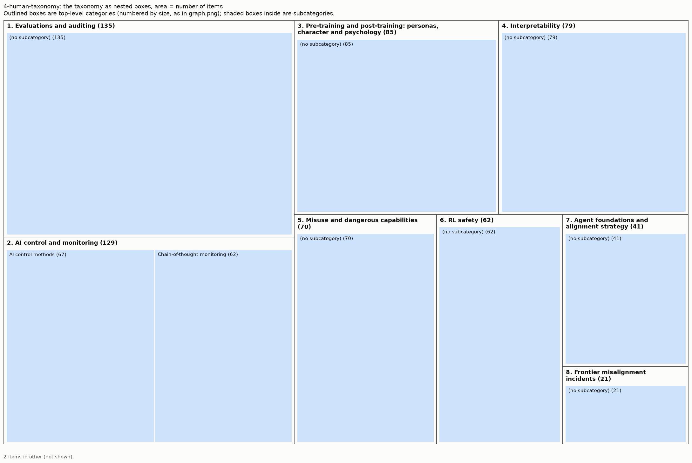

# Taxonomy from 4-human-taxonomy

624 items (arXiv papers, LW/AF posts, org pages and Safety Stack items), 8 top-level areas, 9 leaf categories, 2 items in other.

Scores: reassignment accuracy 90% (top) / 95% (leaf), balance 0.94. See `results/comparison.md`.

More figures: [graph](graph.png) (items on the neighbour graph), [matrix](matrix.png) (links sorted by category), [category map](category_map.png) (how categories connect).

## Overview

1. **Evaluations and auditing** (135): 
2. **AI control and monitoring** (129): Chain-of-thought monitoring, AI control methods
3. **Pre-training and post-training: personas, character and psychology** (85): 
4. **Interpretability** (79): 
5. **Misuse and dangerous capabilities** (70): 
6. **RL safety** (62): 
7. **Agent foundations and alignment strategy** (41): 
8. **Frontier misalignment incidents** (21): 

## 1. Evaluations and auditing (135 items)

Measuring whether a model is aligned rather than changing it: propensity evaluations for scheming and sabotage, evaluation awareness, sandbagging, alignment auditing, and honesty and lie detection.

- Not in a subcategory (135), e.g.:
  - *Item Response Theory for AI Safety*
  - *We Need A Science of Scheming (research agenda)*
  - *GLM-5.3 Sometimes Considers How Train-Time Actions Shape Future Behavior*

## 2. AI control and monitoring (129 items)

Not training or influencing the model's behaviour. Instead, assume the model is potentially misaligned and monitor or constrain its behaviour during inference in production.

- **AI control methods** (67): Control protocols, settings and monitors that keep a possibly misaligned model from causing harm, including attack policies and red-teaming of the protocols. Examples:
  - *How does information access affect LLM monitors' ability to detect sabotage?*
  - *Attack Selection Reduces Safety in Concentrated AI Control Settings against Trusted Monitoring*
  - *When can we trust untrusted monitoring? A safety case sketch across collusion strategies*
- **Chain-of-thought monitoring** (62): Monitoring models through their reasoning: whether chain of thought stays faithful, legible and monitorable, and how much models can reason without it. Examples:
  - *Reasoning Models Will Sometimes Lie About Their Reasoning*
  - *Chain-of-thought obfuscation learned from output supervision can generalise to unseen tasks*
  - *NEST: Nascent Encoded Steganographic Thoughts*

## 3. Pre-training and post-training: personas, character and psychology (85 items)

Shaping or studying the model's persona, character, values and psychology through pre-training and post-training (data, fine-tuning, alignment training), including how training generalises to the model's character.

- Not in a subcategory (85), e.g.:
  - *AI Wellbeing: Measuring and Improving the Functional Pleasure and Pain of AIs*
  - *Alignment Pretraining: AI Discourse Causes Self-Fulfilling (Mis)alignment*
  - *The Assistant Axis: Situating and Stabilizing the Default Persona of Language Models*

## 4. Interpretability (79 items)

Improving our understanding of model internals to yield insights about any aspect of models, or to develop new white-box alignment, monitoring or control techniques.

- Not in a subcategory (79), e.g.:
  - *Do Sparse Autoencoders Identify Reasoning Features in Language Models?*
  - *Patterning: The Dual of Interpretability*
  - *Language Model Circuits Are Sparse in the Neuron Basis*

## 5. Misuse and dangerous capabilities (70 items)

Measuring capabilities that could enable misuse or catastrophe (CBRN, cyber, persuasion, autonomy, AI R&D) and defending against misuse by people: jailbreaks, safeguard classifiers, red-teaming and model safety reports.

- Not in a subcategory (70), e.g.:
  - *Infusion: Shaping model behaviour by editing training data via influence functions*
  - *Quantifying Frontier LLM Capabilities for Container Sandbox Escape*
  - *Claude Fable 5 1 Mythos 5 1 System Card*

## 6. RL safety (62 items)

Doing reinforcement learning (e.g. RLVR, now central to post-training) properly and safely: reward hacking, specification gaming, and how to do RL without damaging the model's character or alignment.

- Not in a subcategory (62), e.g.:
  - *Alignment Risks from Capability-Seeking RL Training*
  - *The Obfuscation Atlas: Mapping Where Honesty Emerges in RLVR with Deception Probes*
  - *Countdown-Code: A Testbed for Studying The Emergence and Generalization of Reward Hacking in RLVR*

## 7. Agent foundations and alignment strategy (41 items)

Theoretical foundations of agency and alignment, and strategy for the alignment field.

- Not in a subcategory (41), e.g.:
  - *Loss of Oversight: How AI systems may become harder to audit, monitor, and investigate*
  - *A Mike's-Eye View of ARC's Research*
  - *Mechanistic estimation for expectations of random products*

## 8. Frontier misalignment incidents (21 items)

Studying real misalignment incidents (such as the Hugging Face attack) for insights into model behaviour, which safety techniques are and aren't effective, and how to build an effective safety culture at labs.

- Not in a subcategory (21), e.g.:
  - *Discovering unknown AI misalignments in real-world usage*
  - *Scheming in the wild: detecting real-world AI scheming incidents with open-source intelligence*
  - *OpenAI-HuggingFace: A Reproduction & Lessons for Alignment Testing*

## Other (2 items)

  - *Conformity Generates Collective Misalignment in AI Agents Societies*
  - *Bit-Exact AI Inference Verification Without Performance Tradeoffs*
