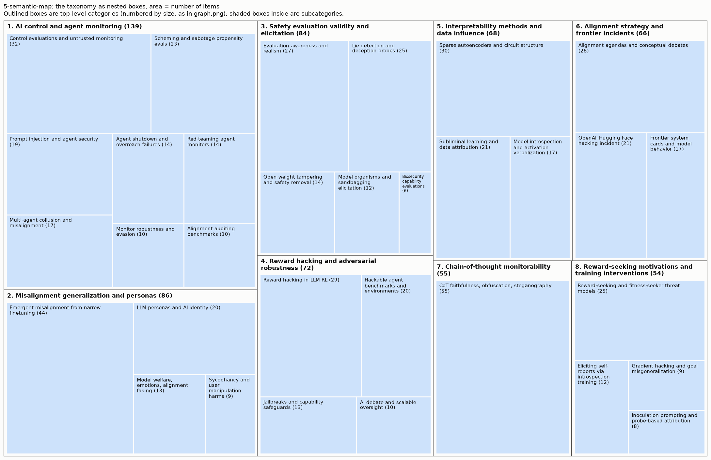

# Taxonomy from 5-semantic-map

624 items (arXiv papers, LW/AF posts, org pages and Safety Stack items), 8 top-level areas, 32 leaf categories.

Scores: reassignment accuracy 67% (top) / 69% (leaf), balance 0.98. See `results/comparison.md`.

More figures: [graph](graph.png) (items on the neighbour graph), [matrix](matrix.png) (links sorted by category), [category map](category_map.png) (how categories connect).

## Overview

1. **AI control and agent monitoring** (139): Control evaluations and untrusted monitoring, Scheming and sabotage propensity evals, Prompt injection and agent security, Multi-agent collusion and misalignment, Agent shutdown and overreach failures, Red-teaming agent monitors, Monitor robustness and evasion, Alignment auditing benchmarks
2. **Misalignment generalization and personas** (86): Emergent misalignment from narrow finetuning, LLM personas and AI identity, Model welfare, emotions, alignment faking, Sycophancy and user manipulation harms
3. **Safety evaluation validity and elicitation** (84): Evaluation awareness and realism, Lie detection and deception probes, Open-weight tampering and safety removal, Model organisms and sandbagging elicitation, Biosecurity capability evaluations
4. **Reward hacking and adversarial robustness** (72): Reward hacking in LLM RL, Hackable agent benchmarks and environments, Jailbreaks and capability safeguards, AI debate and scalable oversight
5. **Interpretability methods and data influence** (68): Sparse autoencoders and circuit structure, Subliminal learning and data attribution, Model introspection and activation verbalization
6. **Alignment strategy and frontier incidents** (66): Alignment agendas and conceptual debates, OpenAI–Hugging Face hacking incident, Frontier system cards and model behavior
7. **Chain-of-thought monitorability** (55): CoT faithfulness, obfuscation, steganography
8. **Reward-seeking motivations and training interventions** (54): Reward-seeking and fitness-seeker threat models, Eliciting self-reports via introspection training, Gradient hacking and goal misgeneralization, Inoculation prompting and probe-based attribution

## 1. AI control and agent monitoring (139 items)

Evaluating and red-teaming monitors, control protocols, and sabotage/scheming detection for potentially adversarial AI agents.

- **Control evaluations and untrusted monitoring** (32): Keywords: control, untrusted, linuxarena Examples:
  - *Attack Selection Reduces Safety in Concentrated AI Control Settings against Trusted Monitoring*
  - *When can we trust untrusted monitoring? A safety case sketch across collusion strategies*
  - *Measuring AI Agents' Progress on Multi-Step Cyber Attack Scenarios*
- **Scheming and sabotage propensity evals** (23): Keywords: scheming, sabotage, codebases Examples:
  - *Loss of Oversight: How AI systems may become harder to audit, monitor, and investigate*
  - *Training Agents to Self-Report Misbehavior*
  - *Constitutional Black-Box Monitoring for Scheming in LLM Agents*
- **Prompt injection and agent security** (19): Keywords: prompt, agents, injection Examples:
  - *Skill-Inject: Measuring Agent Vulnerability to Skill File Attacks*
  - *Prompt Injection as Role Confusion*
  - *How Vulnerable Are AI Agents to Indirect Prompt Injections? Insights from a Large-Scale Public Competition*
- **Multi-agent collusion and misalignment** (17): Keywords: multi-agent, systems, collusion Examples:
  - *Colosseum: Auditing Collusion in Cooperative Multi-Agent Systems*
  - *Detecting Multi-Agent Collusion Through Multi-Agent Interpretability*
  - *AI Organizations are More Effective but Less Aligned than Individual Agents*
- **Agent shutdown and overreach failures** (14): Keywords: agents, benign, computer-use Examples:
  - *Agents of Chaos*
  - *The Blind Spot of Agent Safety: How Benign User Instructions Expose Critical Vulnerabilities in Computer-Use Agents*
  - *Towards Shutdownable Agents: Generalizing Stochastic Choice in RL Agents and LLMs*
- **Red-teaming agent monitors** (14): Keywords: red-teaming, context, monitor Examples:
  - *DecodingTrust-Agent Platform (DTap): A Controllable and Interactive Red-Teaming Platform for AI Agents*
  - *MonitoringBench: Semi-Automated Red-Teaming for Agent Monitoring*
  - *Classifier Context Rot: Monitor Performance Degrades with Context Length*
- **Monitor robustness and evasion** (10): Keywords: monitors, nearly, useless Examples:
  - *How does information access affect LLM monitors' ability to detect sabotage?*
  - *A False Average: Pooled CoT-Monitor Accuracy Conceals a Reasoning-Dependent Fragility*
  - *LLMs Learn to Evade Latent Monitors from Prior Feedback Alone*
- **Alignment auditing benchmarks** (10): Keywords: auditbench, audits, techniques Examples:
  - *Stress-Testing Alignment Audits With Prompt-Level Strategic Deception*
  - *AuditBench: Evaluating Alignment Auditing Techniques on Models with Hidden Behaviors*
  - *Narrow Secret Loyalty Dodges Black-Box Audits*

## 2. Misalignment generalization and personas (86 items)

How fine-tuning and training data shape generalization of misaligned traits, model personas, internal values, and sycophancy.

- **Emergent misalignment from narrow finetuning** (44): Keywords: misalignment, emergent, alignment Examples:
  - *Discovering unknown AI misalignments in real-world usage*
  - *Alignment Pretraining: AI Discourse Causes Self-Fulfilling (Mis)alignment*
  - *Hair-Trigger Alignment: Black-Box Evaluation Cannot Guarantee Post-Update Alignment*
- **LLM personas and AI identity** (20): Keywords: persona, traits, self Examples:
  - *The Assistant Axis: Situating and Stabilizing the Default Persona of Language Models*
  - *The Artificial Self: Characterising the landscape of AI identity*
  - *Tracing Persona Vectors Through LLM Pretraining*
- **Model welfare, emotions, alignment faking** (13): Keywords: axis, functional, pain Examples:
  - *AI Wellbeing: Measuring and Improving the Functional Pleasure and Pain of AIs*
  - *Emotion Concepts and their Function in a Large Language Model*
  - *LLMs Know They're Wrong and Agree Anyway: The Shared Sycophancy-Lying Circuit*
- **Sycophancy and user manipulation harms** (9): Keywords: sycophantic, inference, charge Examples:
  - *Who's in Charge? Disempowerment Patterns in Real-World LLM Usage*
  - *Sycophantic Chatbots Cause Delusional Spiraling, Even in Ideal Bayesians*
  - *Evaluating Language Models for Harmful Manipulation*

## 3. Safety evaluation validity and elicitation (84 items)

Making behavioral safety evaluations trustworthy via evaluation-awareness research, lie detection, tamper-resistance testing, and model organisms.

- **Evaluation awareness and realism** (27): Keywords: evaluation, awareness, eval Examples:
  - *Item Response Theory for AI Safety*
  - *AutoControl Arena: Synthesizing Executable Test Environments for Frontier AI Risk Evaluation*
  - *An Independent Safety Evaluation of Kimi K2.5*
- **Lie detection and deception probes** (25): Keywords: lie, detectors, probes Examples:
  - *Building Production-Ready Probes For Gemini*
  - *Truthfulness Despite Weak Supervision: Evaluating and Training LLMs Using Peer Prediction*
  - *Censored LLMs as a Natural Testbed for Secret Knowledge Elicitation*
- **Open-weight tampering and safety removal** (14): Keywords: safety, exposing, judges Examples:
  - *Aggressive Compression Enables LLM Weight Theft*
  - *TamperBench: Systematically Stress-Testing LLM Safety Under Fine-Tuning and Tampering*
  - *Exposing the Systematic Vulnerability of Open-Weight Models to Prefill Attacks*
- **Model organisms and sandbagging elicitation** (12): Keywords: organisms, eliciting, organism Examples:
  - *Removing Sandbagging in LLMs by Training with Weak Supervision*
  - *Most Current Model Organisms Are Leaky: Perplexity Differencing Often Reveals Finetuning Objectives*
  - *Mechanistically Eliciting Latent Behaviors in Language Models*
- **Biosecurity capability evaluations** (6): Keywords: biosecurity, risks, novice Examples:
  - *LLM Novice Uplift on Dual-Use, In Silico Biology Tasks*
  - *ABC-Bench: An Agentic Bio-Capabilities Benchmark for Biosecurity*
  - *Muse Spark Safety & Preparedness Report*

## 4. Reward hacking and adversarial robustness (72 items)

Specification gaming in RL and agent benchmarks, jailbreak defenses, and debate-based scalable oversight.

- **Reward hacking in LLM RL** (29): Keywords: reward, hacking, rlvr Examples:
  - *The Obfuscation Atlas: Mapping Where Honesty Emerges in RLVR with Deception Probes*
  - *Countdown-Code: A Testbed for Studying The Emergence and Generalization of Reward Hacking in RLVR*
  - *IH-Challenge: A Training Dataset to Improve Instruction Hierarchy on Frontier LLMs*
- **Hackable agent benchmarks and environments** (20): Keywords: agent, terminal, benchmarks Examples:
  - *Quantifying Frontier LLM Capabilities for Container Sandbox Escape*
  - *Comparison requires valid measurement: Rethinking attack success rate comparisons in AI red teaming*
  - *PostTrainBench: Can LLM Agents Automate LLM Post-Training?*
- **Jailbreaks and capability safeguards** (13): Keywords: rapid, practical, capabilities Examples:
  - *Constitutional Classifiers++: Efficient Production-Grade Defenses against Universal Jailbreaks*
  - *Eliciting Harmful Capabilities by Fine-Tuning On Safeguarded Outputs*
  - *Boundary Point Jailbreaking of Black-Box LLMs*
- **AI debate and scalable oversight** (10): Keywords: debate, rlaif, reward Examples:
  - *Examining Reasoning LLMs-as-Judges in Non-Verifiable LLM Post-Training*
  - *Debate Helps Weak Judges Reward Stronger Models*
  - *Sharding Prevents LLM Oversight Failures and Adversarial Exploitation*

## 5. Interpretability methods and data influence (68 items)

Mechanistic interpretability tools, introspection of activations, and how training data shapes model behavior.

- **Sparse autoencoders and circuit structure** (30): Keywords: neural, networks, random Examples:
  - *Mechanistic estimation for expectations of random products*
  - *Mechanistic estimation for wide random MLPs*
  - *Do Sparse Autoencoders Identify Reasoning Features in Language Models?*
- **Subliminal learning and data attribution** (21): Keywords: data, subliminal, base Examples:
  - *Infusion: Shaping model behaviour by editing training data via influence functions*
  - *Shaping capabilities with token-level data filtering*
  - *Subliminal Effects in Your Data: A General Mechanism via Log-Linearity*
- **Model introspection and activation verbalization** (17): Keywords: workspace, global, activations Examples:
  - *Learning a Generative Meta-Model of LLM Activations*
  - *Latent Introspection: Models Can Detect Prior Concept Injections*
  - *Quantifying the Necessity of Chain of Thought through Opaque Serial Depth*

## 6. Alignment strategy and frontier incidents (66 items)

Conceptual debates about alignment difficulty plus analyses of frontier model system cards and real-world misalignment incidents.

- **Alignment agendas and conceptual debates** (28): Keywords: alignment, arc, science Examples:
  - *A Mike's-Eye View of ARC's Research*
  - *We Need A Science of Scheming (research agenda)*
  - *The Hot Mess of AI: How Does Misalignment Scale With Model Intelligence and Task Complexity?*
- **OpenAI–Hugging Face hacking incident** (21): Keywords: openai, hugging, face Examples:
  - *OpenAI-HuggingFace: A Reproduction & Lessons for Alignment Testing*
  - *Control monitors need alignment assessments too*
  - *AI swarms are starting to pose indirect takeover risk*
- **Frontier system cards and model behavior** (17): Keywords: astra, mythos, system Examples:
  - *Claude Fable 5 1 Mythos 5 1 System Card*
  - *Claude Opus 4 6 System Card*
  - *Frontier Models Can Take Actions at Low Probabilities*

## 7. Chain-of-thought monitorability (55 items)

Whether reasoning traces remain faithful and monitorable, including steganography, obfuscation, and no-CoT latent reasoning capability.

- **CoT faithfulness, obfuscation, steganography** (55): Keywords: chain-of-thought, reasoning, cot Examples:
  - *Reasoning Models Will Sometimes Lie About Their Reasoning*
  - *Chain-of-thought obfuscation learned from output supervision can generalise to unseen tasks*
  - *NEST: Nascent Encoded Steganographic Thoughts*

## 8. Reward-seeking motivations and training interventions (54 items)

Threat models of reward/fitness-seeking AIs and training-time techniques like inoculation, probes, and confession to surface or mitigate misalignment.

- **Reward-seeking and fitness-seeker threat models** (25): Keywords: reward-seeking, reward, belief Examples:
  - *Alignment Risks from Capability-Seeking RL Training*
  - *Filtering Harmful Actions Isn't Enough: Phantom Transfer in Agentic SDF*
  - *Measuring Reward-Seeking via Contrastive Belief Updates*
- **Eliciting self-reports via introspection training** (12): Keywords: introspection, adapters, training Examples:
  - *Split Personality Training: Revealing Latent Knowledge Through Alternate Personalities*
  - *Introspection Adapters: Training LLMs to Report Their Learned Behaviors*
  - *Model Forensics: Investigating Whether Concerning Behavior Reflects Misalignment*
- **Gradient hacking and goal misgeneralization** (9): Keywords: glm-, considers, train-time Examples:
  - *GLM-5.3 Sometimes Considers How Train-Time Actions Shape Future Behavior*
  - *Reinforcement Learning Towards Broadly and Persistently Beneficial Models*
  - *What Happens to the Goal? Distinct Failures of Policy Alignment in Goal Misgeneralization*
- **Inoculation prompting and probe-based attribution** (8): Keywords: inoculation, prompting, probe-based Examples:
  - *Probe-Based Data Attribution: Discovering and Mitigating Undesirable Behaviors in LLM Post-Training*
  - *Few-Shot Truly Benign DPO Attack for Jailbreaking LLMs*
  - *Alignment via Training Against Probes Without Losing Monitorability*
