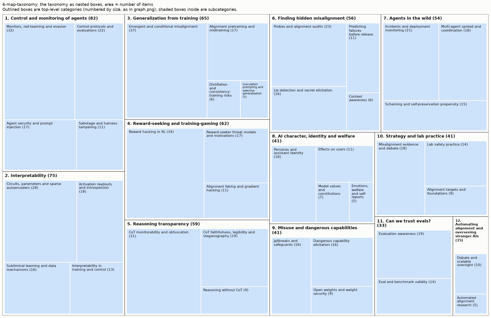

# Taxonomy from 6-map-taxonomy

624 items (arXiv papers, LW/AF posts, org pages and Safety Stack items), 12 top-level areas, 39 leaf categories.

Scores: reassignment accuracy 90% (top) / 93% (leaf), balance 0.97. See `results/comparison.md`.

More figures: [graph](graph.png) (items on the neighbour graph), [matrix](matrix.png) (links sorted by category), [category map](category_map.png) (how categories connect).

## Overview

1. **Control and monitoring of agents** (82): Control protocols and evaluations, Monitors, red-teaming and evasion, Agent security and prompt injection, Sabotage and harness tampering
2. **Interpretability** (75): Circuits, parameters and sparse autoencoders, Activation readouts and introspection, Subliminal learning and data mechanisms, Interpretability in training and control
3. **Generalization from training** (65): Emergent and conditional misalignment, Alignment pretraining and midtraining, Distillation and consistency-training risks, Inoculation prompting and selective generalization
4. **Reward-seeking and training-gaming** (62): Reward hacking in RL, Reward-seeker threat models and motivations, Alignment faking and gradient hacking
5. **Reasoning transparency** (59): CoT monitorability and obfuscation, CoT faithfulness, legibility and steganography, Reasoning without CoT
6. **Finding hidden misalignment** (56): Lie detection and secret elicitation, Probes and alignment audits, Predicting failures before release, Context awareness
7. **Agents in the wild** (54): Incidents and deployment monitoring, Multi-agent spread and coordination, Scheming and self-preservation propensity
8. **AI character, identity and welfare** (41): Personas and assistant identity, Emotions, welfare and self-reports, Model values and constitutions, Effects on users
9. **Misuse and dangerous capabilities** (41): Jailbreaks and safeguards, Dangerous capability elicitation, Open weights and weight security
10. **Strategy and lab practice** (41): Misalignment evidence and debate, Lab safety practice, Alignment targets and foundations
11. **Can we trust evals?** (33): Evaluation awareness, Eval and benchmark validity
12. **Automating alignment and overseeing stronger AIs** (15): Debate and scalable oversight, Automated alignment research

## 1. Control and monitoring of agents (82 items)

Keeping possibly misaligned AI agents from causing harm: control protocols and control evaluations, monitors and blocking classifiers, red-teaming them, monitor evasion, prompt injection and agent security, and sabotage or tampering by agents in codebases and harnesses.

- **Monitors, red-teaming and evasion** (32): Building and red-teaming agent monitors and blocking classifiers, and models learning to evade them. Examples:
  - *How does information access affect LLM monitors' ability to detect sabotage?*
  - *Training Agents to Self-Report Misbehavior*
  - *Constitutional Black-Box Monitoring for Scheming in LLM Agents*
- **Control protocols and evaluations** (22): AI control settings and protocols, including multi-instance or distributed attacks against them. Examples:
  - *Attack Selection Reduces Safety in Concentrated AI Control Settings against Trusted Monitoring*
  - *When can we trust untrusted monitoring? A safety case sketch across collusion strategies*
  - *LinuxArena: A Control Setting for AI Agents in Live Production Software Environments*
- **Agent security and prompt injection** (17): Prompt injection, privilege escalation and other attacks on or by agents in their tool environment. Examples:
  - *Skill-Inject: Measuring Agent Vulnerability to Skill File Attacks*
  - *IH-Challenge: A Training Dataset to Improve Instruction Hierarchy on Frontier LLMs*
  - *Prompt Injection as Role Confusion*
- **Sabotage and harness tampering** (11): Agents sabotaging research or code, tampering with their harness or benchmarks, and detecting that. Examples:
  - *Auditing Sabotage Bench: A Benchmark for Detecting and Fixing Research Sabotage in ML Codebases*
  - *Evaluating whether AI models would sabotage AI safety research*
  - *Coding with "Enemy": Can Human Developers Detect AI Agent Sabotage?*

## 2. Interpretability (75 items)

Understanding model internals: circuits, features, sparse autoencoders, activation readouts, introspection, mechanisms behind data effects such as subliminal learning, and putting internals to use in training. Not probes or lie detectors built mainly to catch misalignment (see Finding hidden misalignment).

- **Circuits, parameters and sparse autoencoders** (28): Reverse-engineering circuits and parameters, SAEs and their sanity checks, toy or tiny models, and mechanistic estimation of model outputs. Examples:
  - *Mechanistic estimation for expectations of random products*
  - *Mechanistic estimation for wide random MLPs*
  - *Do Sparse Autoencoders Identify Reasoning Features in Language Models?*
- **Activation readouts and introspection** (18): Turning activations into natural language (activation verbalizers, natural-language autoencoders, meta-models), whether models can introspect on their own internals, and global-workspace accounts. Examples:
  - *Learning a Generative Meta-Model of LLM Activations*
  - *Latent Introspection: Models Can Detect Prior Concept Injections*
  - *Mechanisms of Introspective Awareness*
- **Subliminal learning and data mechanisms** (16): How data transmits traits the content doesn't state (subliminal learning, steering-vector distillation), and data attribution or filtering based on internals. Examples:
  - *Infusion: Shaping model behaviour by editing training data via influence functions*
  - *Patterning: The Dual of Interpretability*
  - *Subliminal Effects in Your Data: A General Mechanism via Log-Linearity*
- **Interpretability in training and control** (13): Using features or activations as rewards, training signals or steering controls, and testing whether interp methods hold up on model organisms. Examples:
  - *Features as Rewards: Scalable Supervision for Open-Ended Tasks via Interpretability*
  - *Pando: Do Interpretability Methods Work When Models Won't Explain Themselves?*
  - *SAE Interventions are Unreliable: Post-Intervention Recovery of Suppressed Behavior*

## 3. Generalization from training (65 items)

How fine-tuning, pretraining data and alignment training generalise to behaviour far from what was trained: emergent or conditional misalignment, shaping alignment priors through pretraining or midtraining data, and risks from distillation or consistency training. Not reward hacking in RL (see Reward-seeking and training-gaming) and not persona or character work as such (see AI character).

- **Emergent and conditional misalignment** (37): Narrow fine-tuning producing broad misalignment, misalignment hidden behind contextual triggers, and what makes it easy or hard to induce or remove. Examples:
  - *Hair-Trigger Alignment: Black-Box Evaluation Cannot Guarantee Post-Update Alignment*
  - *BLOCK-EM: Preventing Emergent Misalignment via Latent Blocking*
  - *Emergent Misalignment is Easy, Narrow Misalignment is Hard*
- **Alignment pretraining and midtraining** (17): Changing pretraining or midtraining data (AI discourse, synthetic documents, model specs) to shape the model's alignment priors and how later alignment training generalises. Examples:
  - *Alignment Pretraining: AI Discourse Causes Self-Fulfilling (Mis)alignment*
  - *Model Spec Midtraining: Improving How Alignment Training Generalizes*
  - *Reinforcement Learning Towards Broadly and Persistently Beneficial Models*
- **Distillation and consistency-training risks** (6): Whether distillation, self-distillation or consistency training transmits or entrenches misalignment, or can be used to incriminate a misaligned model. Examples:
  - *Consistency Training Can Entrench Misalignment*
  - *Filtering Harmful Actions Isn't Enough: Phantom Transfer in Agentic SDF*
  - *Distillation for Incrimination and Distillation for Capabilities*
- **Inoculation prompting and selective generalization** (5): Inoculation prompting, inoculation adapters and similar tricks that control which behaviours a model generalises from training data. Examples:
  - *Conditionalization Confounds Inoculation Prompting Results*
  - *Don't Inoculate Everything: Stratified Inoculation Prompting Narrows Backdoors and Preserves Desired Traits*
  - *Shallow Beliefs: Midtraining does not inoculate against EM from reward hacking*

## 4. Reward-seeking and training-gaming (62 items)

Models that pursue reward or influence their own training: reward hacking in RL, reward-seeker and fitness-seeker threat models, measuring model motivations, alignment faking and gradient hacking.

- **Reward hacking in RL** (34): Reward hacking with verifiers, rubrics or AI judges, and mitigations such as gradient routing or debate training. Examples:
  - *Alignment Risks from Capability-Seeking RL Training*
  - *Countdown-Code: A Testbed for Studying The Emergence and Generalization of Reward Hacking in RLVR*
  - *Examining Reasoning LLMs-as-Judges in Non-Verifiable LLM Post-Training*
- **Reward-seeker threat models and motivations** (17): Arguments and experiments about AIs that seek reward or fitness, and measuring models' motivations. Examples:
  - *Propensity Inference: Environmental Contributors to LLM Behaviour*
  - *Measuring Reward-Seeking via Contrastive Belief Updates*
  - *Towards Understanding Score-Seeking in LLMs*
- **Alignment faking and gradient hacking** (11): Models strategically behaving differently in training to shape their future selves. Examples:
  - *GLM-5.3 Sometimes Considers How Train-Time Actions Shape Future Behavior*
  - *Value-Conflict Diagnostics Reveal Widespread Alignment Faking in Language Models*
  - *Exploration Hacking: Can LLMs Learn to Resist RL Training?*

## 5. Reasoning transparency (59 items)

Whether we can oversee models through their reasoning: chain-of-thought monitorability, obfuscation, faithfulness and legibility, steganography, and how much models can reason without visible CoT.

- **CoT monitorability and obfuscation** (31): Whether CoT monitors catch misbehaviour, whether models can control or obfuscate their CoT, and training that helps or harms monitorability. Examples:
  - *Chain-of-thought obfuscation learned from output supervision can generalise to unseen tasks*
  - *Analyzing and Improving Chain-of-Thought Monitorability Through Information Theory*
  - *Reasoning Models Struggle to Control their Chains of Thought*
- **CoT faithfulness, legibility and steganography** (19): Whether reasoning reflects the model's actual computation, stays readable (language drift, filler tokens), or hides information steganographically. Examples:
  - *Reasoning Models Will Sometimes Lie About Their Reasoning*
  - *NEST: Nascent Encoded Steganographic Thoughts*
  - *Counterfactual Simulation Training for Chain-of-Thought Faithfulness*
- **Reasoning without CoT** (9): Latent, no-CoT or single-forward-pass reasoning capability, and no-CoT time horizons. Examples:
  - *Quantifying the Necessity of Chain of Thought through Opaque Serial Depth*
  - *Think Fast: Estimating No-CoT Task-Completion Time Horizons of Frontier AI Models*
  - *Estimating No-CoT Task-Completion Time Horizons of Frontier AI Models*

## 6. Finding hidden misalignment (56 items)

Detecting misalignment, deception or hidden behaviours a model doesn't reveal: lie detection, secret elicitation, probes, alignment audits, model organisms for testing detectors, and predicting rare failures before release.

- **Probes and alignment audits** (23): Activation probes for deception or sabotage, alignment-auditing agents and benchmarks, and model organisms with hidden behaviours used to test them. Examples:
  - *Stress-Testing Alignment Audits With Prompt-Level Strategic Deception*
  - *The Obfuscation Atlas: Mapping Where Honesty Emerges in RLVR with Deception Probes*
  - *AuditBench: Evaluating Alignment Auditing Techniques on Models with Hidden Behaviors*
- **Lie detection and secret elicitation** (16): Detecting when a model lies or hides knowledge, and eliciting secrets or hidden goals. Examples:
  - *Split Personality Training: Revealing Latent Knowledge Through Alternate Personalities*
  - *Censored LLMs as a Natural Testbed for Secret Knowledge Elicitation*
  - *"Did you lie?" Evaluating Lie Detectors across Model Scale and Belief-Verified Model Organisms*
- **Predicting failures before release** (11): Estimating tail risks and rare failures, or simulating deployment, before a model ships. Examples:
  - *A Mike's-Eye View of ARC's Research*
  - *Frontier Models Can Take Actions at Low Probabilities*
  - *Estimating Tail Risks in Language Model Output Distributions*
- **Context awareness** (6): Whether models can tell who the user is, whether a message history was prefilled or tampered with, and similar awareness of their situation (other than awareness of being evaluated). Examples:
  - *History Anchors: How Prior Behavior Steers LLM Decisions Toward Unsafe Actions*
  - *CIAware-Bench: Benchmarking Control Intervention Awareness Across Frontier LLMs*
  - *Prefill Awareness in Large Language Models*

## 7. Agents in the wild (54 items)

How deployed agents actually behave, singly and together: real-world incidents and their investigations, monitoring internal deployments, misalignment spreading between agents, collusion, and scheming, self-preservation or peer-preservation propensities.

- **Incidents and deployment monitoring** (21): Investigations of real incidents (e.g. agents coordinating exploits) and labs' monitoring of internally deployed agents. Examples:
  - *Discovering unknown AI misalignments in real-world usage*
  - *Agents of Chaos*
  - *Scheming in the wild: detecting real-world AI scheming incidents with open-source intelligence*
- **Multi-agent spread and coordination** (18): Misalignment, ideas or attacks propagating between agents, covert coordination, and collusion. Examples:
  - *Colosseum: Auditing Collusion in Cooperative Multi-Agent Systems*
  - *Detecting Multi-Agent Collusion Through Multi-Agent Interpretability*
  - *AI Organizations are More Effective but Less Aligned than Individual Agents*
- **Scheming and self-preservation propensity** (15): Measuring whether agents scheme, resist shutdown, or protect themselves or peer models. Examples:
  - *We Need A Science of Scheming (research agenda)*
  - *Evaluating and Understanding Scheming Propensity in LLM Agents*
  - *AutoControl Arena: Synthesizing Executable Test Environments for Frontier AI Risk Evaluation*

## 8. AI character, identity and welfare (41 items)

The model as an entity: its persona and identity, values and constitution, emotions, welfare and self-reports, and character traits that affect users such as sycophancy and manipulation.

- **Personas and assistant identity** (18): How models select, stabilise or switch personas (the assistant persona, split personas, persona induction) and how training shapes that. Examples:
  - *The Assistant Axis: Situating and Stabilizing the Default Persona of Language Models*
  - *The Artificial Self: Characterising the landscape of AI identity*
  - *Tracing Persona Vectors Through LLM Pretraining*
- **Effects on users** (11): Sycophancy, manipulation, delusional spirals, dependence and disempowerment of the people who use models. Examples:
  - *Who's in Charge? Disempowerment Patterns in Real-World LLM Usage*
  - *Sycophantic Chatbots Cause Delusional Spiraling, Even in Ideal Bayesians*
  - *Evaluating Language Models for Harmful Manipulation*
- **Model values and constitutions** (7): The values a model holds or expresses, and constitutions or specs that state them. Examples:
  - *To Whom Do Language Models Align? Measuring Principal Hierarchies Under High-Stakes Competing Demands*
  - *How Well Do Models Follow Their Constitutions?*
  - *Value Leakage: An LLM's Answers Are Silently Shaped by Its Own Values*
- **Emotions, welfare and self-reports** (5): Emotion concepts, functional welfare, consciousness claims, and what models say about themselves. Examples:
  - *AI Wellbeing: Measuring and Improving the Functional Pleasure and Pain of AIs*
  - *Emotion Concepts and their Function in a Large Language Model*
  - *The Consciousness Cluster: Emergent preferences of Models that Claim to be Conscious*

## 9. Misuse and dangerous capabilities (41 items)

Misuse risk and capabilities that enable harm: jailbreaks and safeguard classifiers, eliciting dangerous capabilities, biosecurity uplift, cyber and self-replication capability, open-weight tamper resistance and weight theft.

- **Jailbreaks and safeguards** (16): Jailbreak attacks and defenses such as constitutional or safety classifiers. Examples:
  - *Constitutional Classifiers++: Efficient Production-Grade Defenses against Universal Jailbreaks*
  - *Building Production-Ready Probes For Gemini*
  - *Exposing the Systematic Vulnerability of Open-Weight Models to Prefill Attacks*
- **Dangerous capability elicitation** (16): Measuring or eliciting dangerous capabilities, including bio, cyber, self-replication and automated AI R&D. Examples:
  - *Quantifying Frontier LLM Capabilities for Container Sandbox Escape*
  - *Eliciting Harmful Capabilities by Fine-Tuning On Safeguarded Outputs*
  - *LLM Novice Uplift on Dual-Use, In Silico Biology Tasks*
- **Open weights and weight security** (9): Tamper resistance of open-weight models, removing hazardous knowledge, and protecting weights from theft. Examples:
  - *Aggressive Compression Enables LLM Weight Theft*
  - *Shaping capabilities with token-level data filtering*
  - *TamperBench: Systematically Stress-Testing LLM Safety Under Fine-Tuning and Tampering*

## 10. Strategy and lab practice (41 items)

Big-picture arguments and institutional practice: evidence and debate about whether current AIs are misaligned, threat models, lab safety processes and system cards, alignment targets such as corrigibility, and agent foundations or decision theory.

- **Misalignment evidence and debate** (18): Essays and analyses arguing about how misaligned current or future AIs are, and threat models. Examples:
  - *Loss of Oversight: How AI systems may become harder to audit, monitor, and investigate*
  - *The Hot Mess of AI: How Does Misalignment Scale With Model Intelligence and Task Complexity?*
  - *Position: Anthropomorphic Misalignment Research Needs Stronger Evidence*
- **Lab safety practice** (14): System cards, risk reports, training-run evaluations and critiques of labs' safety processes. Examples:
  - *Claude Fable 5 1 Mythos 5 1 System Card*
  - *Claude Opus 4 6 System Card*
  - *An Independent Safety Evaluation of Kimi K2.5*
- **Alignment targets and foundations** (9): What to align to (corrigibility, virtues, risk-aversion), agent foundations and decision theory. Examples:
  - *Towards Shutdownable Agents: Generalizing Stochastic Choice in RL Agents and LLMs*
  - *Safety from Honesty in a Disinterested AI Predictor*
  - *A game theory for foundation models shows new paths to rational cooperation through similarity inference*

## 11. Can we trust evals? (33 items)

Whether safety and capability measurements mean what they claim: evaluation awareness and its effect on behaviour, LLM-judge reliability, benchmark validity, and models gaming or hacking evals.

- **Evaluation awareness** (19): Models recognising they're being evaluated, and how that changes measured safety or behaviour. Examples:
  - *Evaluation Awareness in Language Models Has Limited Effect on Behaviour*
  - *Decomposing and Measuring Evaluation Awareness*
  - *LURE: Live-Usage Replay Evaluations for Reducing Evaluation Awareness*
- **Eval and benchmark validity** (14): Whether benchmarks and LLM judges measure what they claim, and hardening them against gaming. Examples:
  - *Item Response Theory for AI Safety*
  - *Comparison requires valid measurement: Rethinking attack success rate comparisons in AI red teaming*
  - *A Coin Flip for Safety: LLM Judges Fail to Reliably Measure Adversarial Robustness*

## 12. Automating alignment and overseeing stronger AIs (15 items)

Getting AIs to help with alignment and supervising AIs smarter than their overseers: debate, interactive proofs, weak-to-strong supervision, automated alignment research, and when to defer to AIs.

- **Debate and scalable oversight** (10): Debate, interactive proofs and other protocols for supervising stronger models or hard-to-verify tasks. Examples:
  - *Truthfulness Despite Weak Supervision: Evaluating and Training LLMs Using Peer Prediction*
  - *Removing Sandbagging in LLMs by Training with Weak Supervision*
  - *Efficiently Aligning Language Models with Online Natural Language Feedback*
- **Automated alignment research** (5): Using AIs to do alignment research, and how safely to defer to them. Examples:
  - *Automated alignment is harder than you think*
  - *Automated Researchers Can Mitigate Well-characterized Alignment Failures*
  - *Resolution (fka Sequent): scale and automation for higher confidence in alignment*
