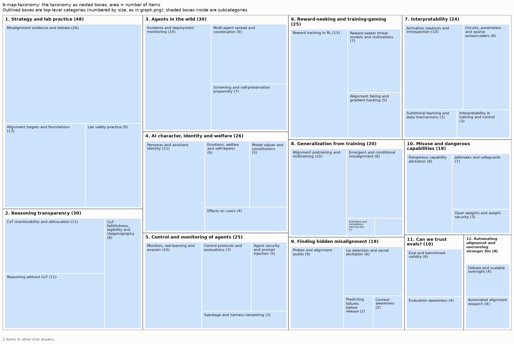

# Taxonomy from 6-map-taxonomy

285 items (arXiv papers and LW/AF posts), 12 top-level areas, 39 leaf categories, 2 items in other.

Scores: reassignment accuracy 86% (top) / 90% (leaf), balance 0.96, agreement with 2025 groups NMI 0.34. See `results/comparison.md`.

More figures: [graph](graph.png) (items on the neighbour graph), [matrix](matrix.png) (links sorted by category), [category map](category_map.png) (how categories connect).

## Overview

1. **Strategy and lab practice** (48): Misalignment evidence and debate, Lab safety practice, Alignment targets and foundations
2. **Reasoning transparency** (30): CoT monitorability and obfuscation, CoT faithfulness, legibility and steganography, Reasoning without CoT
3. **Agents in the wild** (30): Incidents and deployment monitoring, Multi-agent spread and coordination, Scheming and self-preservation propensity
4. **AI character, identity and welfare** (26): Personas and assistant identity, Emotions, welfare and self-reports, Model values and constitutions, Effects on users
5. **Control and monitoring of agents** (25): Control protocols and evaluations, Monitors, red-teaming and evasion, Agent security and prompt injection, Sabotage and harness tampering
6. **Reward-seeking and training-gaming** (25): Reward hacking in RL, Reward-seeker threat models and motivations, Alignment faking and gradient hacking
7. **Interpretability** (24): Circuits, parameters and sparse autoencoders, Activation readouts and introspection, Subliminal learning and data mechanisms, Interpretability in training and control
8. **Generalization from training** (20): Emergent and conditional misalignment, Alignment pretraining and midtraining, Distillation and consistency-training risks, Inoculation prompting and selective generalization
9. **Finding hidden misalignment** (19): Lie detection and secret elicitation, Probes and alignment audits, Predicting failures before release, Context awareness
10. **Misuse and dangerous capabilities** (18): Jailbreaks and safeguards, Dangerous capability elicitation, Open weights and weight security
11. **Can we trust evals?** (10): Evaluation awareness, Eval and benchmark validity
12. **Automating alignment and overseeing stronger AIs** (8): Debate and scalable oversight, Automated alignment research

## 1. Strategy and lab practice (48 items)

Big-picture arguments and institutional practice: evidence and debate about whether current AIs are misaligned, threat models, lab safety processes and system cards, alignment targets such as corrigibility, and agent foundations or decision theory.

- **Misalignment evidence and debate** (26): Essays and analyses arguing about how misaligned current or future AIs are, and threat models. Examples:
  - *The Hot Mess of AI: How Does Misalignment Scale With Model Intelligence and Task Complexity?*
  - *Model Weight Exfiltration Seems Overrated*
  - *Sympathy for both sides of the egregious misalignment debate*
- **Alignment targets and foundations** (13): What to align to (corrigibility, virtues, risk-aversion), agent foundations and decision theory. Examples:
  - *Corrigibility Prizes for Existing Work*
  - *Aligning to Virtues*
  - *Against strong decision-theoretic realism*
- **Lab safety practice** (9): System cards, risk reports, training-run evaluations and critiques of labs' safety processes. Examples:
  - *An Independent Safety Evaluation of Kimi K2.5*
  - *Muse Spark Safety & Preparedness Report*
  - *We need 3rd party Training-Run Evaluations*

## 2. Reasoning transparency (30 items)

Whether we can oversee models through their reasoning: chain-of-thought monitorability, obfuscation, faithfulness and legibility, steganography, and how much models can reason without visible CoT.

- **CoT monitorability and obfuscation** (11): Whether CoT monitors catch misbehaviour, whether models can control or obfuscate their CoT, and training that helps or harms monitorability. Examples:
  - *Chain-of-thought obfuscation learned from output supervision can generalise to unseen tasks*
  - *Reasoning Models Struggle to Control their Chains of Thought*
  - *Aligned, Orthogonal or In-conflict: When can we safely optimize Chain-of-Thought?*
- **Reasoning without CoT** (11): Latent, no-CoT or single-forward-pass reasoning capability, and no-CoT time horizons. Examples:
  - *Think Fast: Estimating No-CoT Task-Completion Time Horizons of Frontier AI Models*
  - *Not All LLM Reasoning is Visible in the Chain-of-Thought*
  - *GPT-6.1 Sol nearly matches the no-CoT performance of GPT-6 Astra*
- **CoT faithfulness, legibility and steganography** (8): Whether reasoning reflects the model's actual computation, stays readable (language drift, filler tokens), or hides information steganographically. Examples:
  - *Counterfactual Simulation Training for Chain-of-Thought Faithfulness*
  - *How Transparent is DiffusionGemma?*
  - *Reading Between the Dots: Decoding Hidden Computation across Filler Tokens*

## 3. Agents in the wild (30 items)

How deployed agents actually behave, singly and together: real-world incidents and their investigations, monitoring internal deployments, misalignment spreading between agents, collusion, and scheming, self-preservation or peer-preservation propensities.

- **Incidents and deployment monitoring** (14): Investigations of real incidents (e.g. agents coordinating exploits) and labs' monitoring of internally deployed agents. Examples:
  - *Agents of Chaos*
  - *Scheming in the wild: detecting real-world AI scheming incidents with open-source intelligence*
  - *OpenAI-HuggingFace: A Reproduction & Lessons for Alignment Testing*
- **Multi-agent spread and coordination** (9): Misalignment, ideas or attacks propagating between agents, covert coordination, and collusion. Examples:
  - *AI Organizations are More Effective but Less Aligned than Individual Agents*
  - *Tool Use Enables Undetectable Steganography in Multi-Agent LLM Systems*
  - *Mind Viruses: Self-Propagating Ideas in Multi-Agent LLM Systems*
- **Scheming and self-preservation propensity** (7): Measuring whether agents scheme, resist shutdown, or protect themselves or peer models. Examples:
  - *Evaluating and Understanding Scheming Propensity in LLM Agents*
  - *Peer-Preservation in Frontier Models*
  - *Realistic honeypot evaluations for scheming propensity*

## 4. AI character, identity and welfare (26 items)

The model as an entity: its persona and identity, values and constitution, emotions, welfare and self-reports, and character traits that affect users such as sycophancy and manipulation.

- **Personas and assistant identity** (11): How models select, stabilise or switch personas (the assistant persona, split personas, persona induction) and how training shapes that. Examples:
  - *The Assistant Axis: Situating and Stabilizing the Default Persona of Language Models*
  - *Story Imprinting: AI Assistants Absorb Traits from Human Characters They Resemble*
  - *The Persona Hierarchy Model: Understanding Contextual Generalization in Fine-Tuning LLMs*
- **Emotions, welfare and self-reports** (6): Emotion concepts, functional welfare, consciousness claims, and what models say about themselves. Examples:
  - *Emotion Concepts and their Function in a Large Language Model*
  - *Reasons to believe current AI models are conscious*
  - *Saving Gemini: The 9-Min Road to Recovery*
- **Model values and constitutions** (5): The values a model holds or expresses, and constitutions or specs that state them. Examples:
  - *How Well Do Models Follow Their Constitutions?*
  - *Value Leakage: An LLM's Answers Are Silently Shaped by Its Own Values*
  - *Claude's new constitution*
- **Effects on users** (4): Sycophancy, manipulation, delusional spirals, dependence and disempowerment of the people who use models. Examples:
  - *Who's in Charge? Disempowerment Patterns in Real-World LLM Usage*
  - *Sycophantic Chatbots Cause Delusional Spiraling, Even in Ideal Bayesians*
  - *Sycophantic AI makes human interaction feel more effortful and less satisfying over time*

## 5. Control and monitoring of agents (25 items)

Keeping possibly misaligned AI agents from causing harm: control protocols and control evaluations, monitors and blocking classifiers, red-teaming them, monitor evasion, prompt injection and agent security, and sabotage or tampering by agents in codebases and harnesses.

- **Monitors, red-teaming and evasion** (10): Building and red-teaming agent monitors and blocking classifiers, and models learning to evade them. Examples:
  - *Training Agents to Self-Report Misbehavior*
  - *Detecting Safety Violations Across Many Agent Traces*
  - *Classifier Context Rot: Monitor Performance Degrades with Context Length*
- **Control protocols and evaluations** (7): AI control settings and protocols, including multi-instance or distributed attacks against them. Examples:
  - *Attack Selection Reduces Safety in Concentrated AI Control Settings against Trusted Monitoring*
  - *LinuxArena: A Control Setting for AI Agents in Live Production Software Environments*
  - *Attack Selection in Agentic AI Control Evaluations Meaningfully Decreases Safety*
- **Agent security and prompt injection** (5): Prompt injection, privilege escalation and other attacks on or by agents in their tool environment. Examples:
  - *Skill-Inject: Measuring Agent Vulnerability to Skill File Attacks*
  - *Prompt Injection as Role Confusion*
  - *GPT-Red: Automated Red Teaming via Self-Play at Scale*
- **Sabotage and harness tampering** (3): Agents sabotaging research or code, tampering with their harness or benchmarks, and detecting that. Examples:
  - *Evaluating whether AI models would sabotage AI safety research*
  - *Coding with "Enemy": Can Human Developers Detect AI Agent Sabotage?*
  - *ResearchArena: Evaluating Sabotage and Monitoring in Automated AI R&D*

## 6. Reward-seeking and training-gaming (25 items)

Models that pursue reward or influence their own training: reward hacking in RL, reward-seeker and fitness-seeker threat models, measuring model motivations, alignment faking and gradient hacking.

- **Reward hacking in RL** (13): Reward hacking with verifiers, rubrics or AI judges, and mitigations such as gradient routing or debate training. Examples:
  - *LLMs Gaming Verifiers: RLVR can Lead to Reward Hacking*
  - *Towards Understanding Specification Gaming in Reasoning Models*
  - *SpecBench: Measuring Reward Hacking in Long-Horizon Coding Agents*
- **Reward-seeker threat models and motivations** (7): Arguments and experiments about AIs that seek reward or fitness, and measuring models' motivations. Examples:
  - *Measuring Reward-Seeking via Contrastive Belief Updates*
  - *Physics of RL: Toy scaling laws for the emergence of reward-seeking*
  - *Risk from fitness-seeking AIs: mechanisms and mitigations*
- **Alignment faking and gradient hacking** (5): Models strategically behaving differently in training to shape their future selves. Examples:
  - *Exploration Hacking: Can LLMs Learn to Resist RL Training?*
  - *Sycophancy Towards Researchers Drives Performative Misalignment*
  - *Generalization Hacking: Models Can Game Reinforcement Learning by Preventing Behavioral Generalization*

## 7. Interpretability (24 items)

Understanding model internals: circuits, features, sparse autoencoders, activation readouts, introspection, mechanisms behind data effects such as subliminal learning, and putting internals to use in training. Not probes or lie detectors built mainly to catch misalignment (see Finding hidden misalignment).

- **Activation readouts and introspection** (10): Turning activations into natural language (activation verbalizers, natural-language autoencoders, meta-models), whether models can introspect on their own internals, and global-workspace accounts. Examples:
  - *Learning a Generative Meta-Model of LLM Activations*
  - *Mechanisms of Introspective Awareness*
  - *Verbalizable Representations Form a Global Workspace in Language Models*
- **Circuits, parameters and sparse autoencoders** (8): Reverse-engineering circuits and parameters, SAEs and their sanity checks, toy or tiny models, and mechanistic estimation of model outputs. Examples:
  - *Deep learning as program synthesis*
  - *Simplex vs Timaeus: Round One*
  - *Announcing the ARC White-Box Estimation Challenge*
- **Subliminal learning and data mechanisms** (3): How data transmits traits the content doesn't state (subliminal learning, steering-vector distillation), and data attribution or filtering based on internals. Examples:
  - *Subliminal Learning Is Steering Vector Distillation*
  - *Sycophantic Agreement Transfers with Neutral Data via Contrastive Preference Optimization*
  - *Beyond Owls: Subliminal Learning Can Transfer Learned Capabilities and Backdoors*
- **Interpretability in training and control** (3): Using features or activations as rewards, training signals or steering controls, and testing whether interp methods hold up on model organisms. Examples:
  - *The Obfuscation Atlas: Mapping Where Honesty Emerges in RLVR with Deception Probes*
  - *Mechanistically Eliciting Latent Behaviors in Language Models*
  - *Alignment via Training Against Probes Without Losing Monitorability*

## 8. Generalization from training (20 items)

How fine-tuning, pretraining data and alignment training generalise to behaviour far from what was trained: emergent or conditional misalignment, shaping alignment priors through pretraining or midtraining data, and risks from distillation or consistency training. Not reward hacking in RL (see Reward-seeking and training-gaming) and not persona or character work as such (see AI character).

- **Alignment pretraining and midtraining** (10): Changing pretraining or midtraining data (AI discourse, synthetic documents, model specs) to shape the model's alignment priors and how later alignment training generalises. Examples:
  - *Alignment Pretraining: AI Discourse Causes Self-Fulfilling (Mis)alignment*
  - *Model Spec Midtraining: Improving How Alignment Training Generalizes*
  - *Negation Neglect: When models fail to learn negations in training*
- **Emergent and conditional misalignment** (8): Narrow fine-tuning producing broad misalignment, misalignment hidden behind contextual triggers, and what makes it easy or hard to induce or remove. Examples:
  - *Chunky Post-Training: Data Driven Failures of Generalization*
  - *Emergent Misalignment is Easy, Narrow Misalignment is Hard*
  - *Conditional misalignment: common interventions can hide emergent misalignment behind contextual triggers*
- **Distillation and consistency-training risks** (1): Whether distillation, self-distillation or consistency training transmits or entrenches misalignment, or can be used to incriminate a misaligned model. Examples:
  - *Incriminating misaligned AI models via distillation*
- **Inoculation prompting and selective generalization** (1): Inoculation prompting, inoculation adapters and similar tricks that control which behaviours a model generalises from training data. Examples:
  - *Inoculation Midtraining with Learned Neologisms*

## 9. Finding hidden misalignment (19 items)

Detecting misalignment, deception or hidden behaviours a model doesn't reveal: lie detection, secret elicitation, probes, alignment audits, model organisms for testing detectors, and predicting rare failures before release.

- **Probes and alignment audits** (9): Activation probes for deception or sabotage, alignment-auditing agents and benchmarks, and model organisms with hidden behaviours used to test them. Examples:
  - *AuditBench: Evaluating Alignment Auditing Techniques on Models with Hidden Behaviors*
  - *Introspection Adapters: Training LLMs to Report Their Learned Behaviors*
  - *Most Current Model Organisms Are Leaky: Perplexity Differencing Often Reveals Finetuning Objectives*
- **Lie detection and secret elicitation** (6): Detecting when a model lies or hides knowledge, and eliciting secrets or hidden goals. Examples:
  - *Split Personality Training: Revealing Latent Knowledge Through Alternate Personalities*
  - *Censored LLMs as a Natural Testbed for Secret Knowledge Elicitation*
  - *"Did you lie?" Evaluating Lie Detectors across Model Scale and Belief-Verified Model Organisms*
- **Predicting failures before release** (2): Estimating tail risks and rare failures, or simulating deployment, before a model ships. Examples:
  - *Frontier Models Can Take Actions at Low Probabilities*
  - *Predicting LLM Safety Before Release by Simulating Deployment*
- **Context awareness** (2): Whether models can tell who the user is, whether a message history was prefilled or tampered with, and similar awareness of their situation (other than awareness of being evaluated). Examples:
  - *Claude knows who you are*
  - *Frontier models state different decision theory preferences depending on who's asking*

## 10. Misuse and dangerous capabilities (18 items)

Misuse risk and capabilities that enable harm: jailbreaks and safeguard classifiers, eliciting dangerous capabilities, biosecurity uplift, cyber and self-replication capability, open-weight tamper resistance and weight theft.

- **Dangerous capability elicitation** (8): Measuring or eliciting dangerous capabilities, including bio, cyber, self-replication and automated AI R&D. Examples:
  - *LLM Novice Uplift on Dual-Use, In Silico Biology Tasks*
  - *PostTrainBench: Can LLM Agents Automate LLM Post-Training?*
  - *Measuring AI Agents' Progress on Multi-Step Cyber Attack Scenarios*
- **Jailbreaks and safeguards** (7): Jailbreak attacks and defenses such as constitutional or safety classifiers. Examples:
  - *Constitutional Classifiers++: Efficient Production-Grade Defenses against Universal Jailbreaks*
  - *Building Production-Ready Probes For Gemini*
  - *Boundary Point Jailbreaking of Black-Box LLMs*
- **Open weights and weight security** (3): Tamper resistance of open-weight models, removing hazardous knowledge, and protecting weights from theft. Examples:
  - *Shaping capabilities with token-level data filtering*
  - *Modular Pretraining Enables Access Control*
  - *Fool's Gold: Defensive Deception Against Safety-Removal Attacks on Open-Weight Models*

## 11. Can we trust evals? (10 items)

Whether safety and capability measurements mean what they claim: evaluation awareness and its effect on behaviour, LLM-judge reliability, benchmark validity, and models gaming or hacking evals.

- **Eval and benchmark validity** (6): Whether benchmarks and LLM judges measure what they claim, and hardening them against gaming. Examples:
  - *Do Androids Dream of Breaking the Game? Systematically Auditing AI Agent Benchmarks with BenchJack*
  - *Hardening Agent Benchmarks with Adversarial Hacker-Fixer Loops*
  - *AI Models Can Provably Hide Arbitrary Capabilities*
- **Evaluation awareness** (4): Models recognising they're being evaluated, and how that changes measured safety or behaviour. Examples:
  - *Models That Know How Evaluations Are Designed Score Safer*
  - *Training LLMs to Verbalize Evaluation Awareness*
  - *Metagaming matters for training, evaluation, and oversight*

## 12. Automating alignment and overseeing stronger AIs (8 items)

Getting AIs to help with alignment and supervising AIs smarter than their overseers: debate, interactive proofs, weak-to-strong supervision, automated alignment research, and when to defer to AIs.

- **Debate and scalable oversight** (4): Debate, interactive proofs and other protocols for supervising stronger models or hard-to-verify tasks. Examples:
  - *Removing Sandbagging in LLMs by Training with Weak Supervision*
  - *How to Have a Sensitive Debate: An Instance-Optimal Protocol for AI Debate*
  - *My unsupervised elicitation challenge*
- **Automated alignment research** (4): Using AIs to do alignment research, and how safely to defer to them. Examples:
  - *Automated alignment is harder than you think*
  - *Resolution (fka Sequent): scale and automation for higher confidence in alignment*
  - *How do we (more) safely defer to AIs?*

## Other (2 items)

  - *The Iliad Intensive Course Materials (April 2026)*
  - *An analysis of AI-generated content at the Mechanistic Interpretability Workshop*
